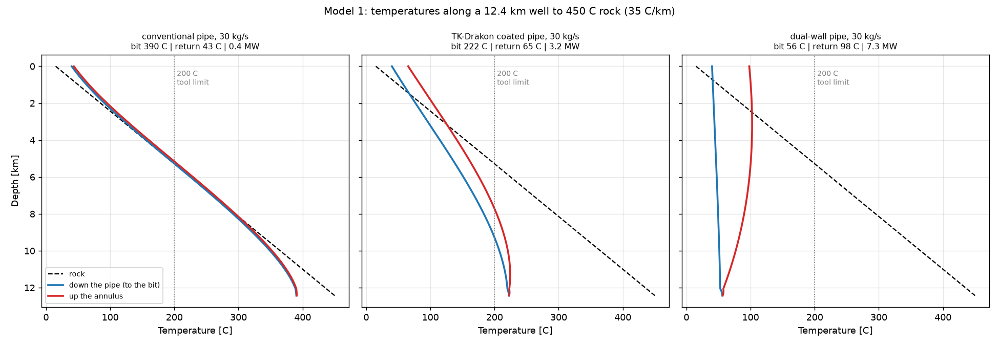

# BoreTHM documentation

BoreTHM is an open-source Python model for assessing drilling programmes in superhot geothermal rock. It couples circulating-fluid and downhole-tool temperatures with thermal stress at the borehole wall to calculate the mud-weight window: the range of fluid densities that meets the pressure constraints through drilling, connections and trips.



*[Illustrative year-long circulation case](science/models.md#circulation-and-heat-transfer), separate from the drilling programmes: temperature of the downgoing fluid, returning fluid and rock along a 12.4 km well reaching 450 °C rock, at 30 kg/s.*

Install BoreTHM with Python 3.11 or later:

```bash
python -m pip install borethm
```

Installation and the first command are in the [project README](../README.md#get-started).

Choose a path based on what you want to do.

<div class="paths" markdown="1">
<div class="path" markdown="1">

## Use the model

- [Evaluate a new site](guides/new-site.md): create, check and evaluate a TOML site file from the installed package.
- [Interpret an assessment](guides/interpreting-results.md): status, density bounds and schedule identity.
- [Python interface](api.md): public functions and classes, with units and the interface stability policy.
- [Read the study summary](guides/summary.md): findings and questions for specialist discussion, also available as a [two-page PDF](../output/pdf/summary.pdf).

</div>
<div class="path" markdown="1">

## Understand the science

- [Physical models](science/models.md): component calculations, programme evaluation and equations.
- [Model development](science/model-development.md): declared changes, development-data gaps and candidate outcomes.
- [Validation and calibration](science/validation.md): what the observations and analytic checks establish.
- [Limitations and open questions](science/limitations.md): input uncertainties, approximations and the deferred work.
- [Sources and related work](science/sources.md): bibliography and links to data provenance.

</div>
<div class="path" markdown="1">

## Examine the studies

- [Approximation comparisons](science/approximation-comparisons.md): the individual physical and numerical sensitivity checks.
- [Design comparisons](science/design-comparisons.md): the evaluated interventions, remaining failures and qualification evidence.
- [Breakout timing](science/breakout-timing.md): assumed formation delays and the drilling-window opening brackets.
- [Benchmark dataset](../benchmarks/README.md): reference inputs and outputs for checking another model, with tolerances and source records.

</div>
<div class="path" markdown="1">

## Maintain the project

- [Maintenance notes](maintenance/README.md): implementation priorities and triggers.
- [Contributing](../CONTRIBUTING.md) and [support](../SUPPORT.md): changes, problem reports and questions.

</div>
</div>

Field-data descriptions and input sources stay beside their files under [src/borethm/data/](../src/borethm/data/). They are linked from the scientific pages where needed.

[Documentation website](https://ldocallaghan.github.io/BoreTHM/)
