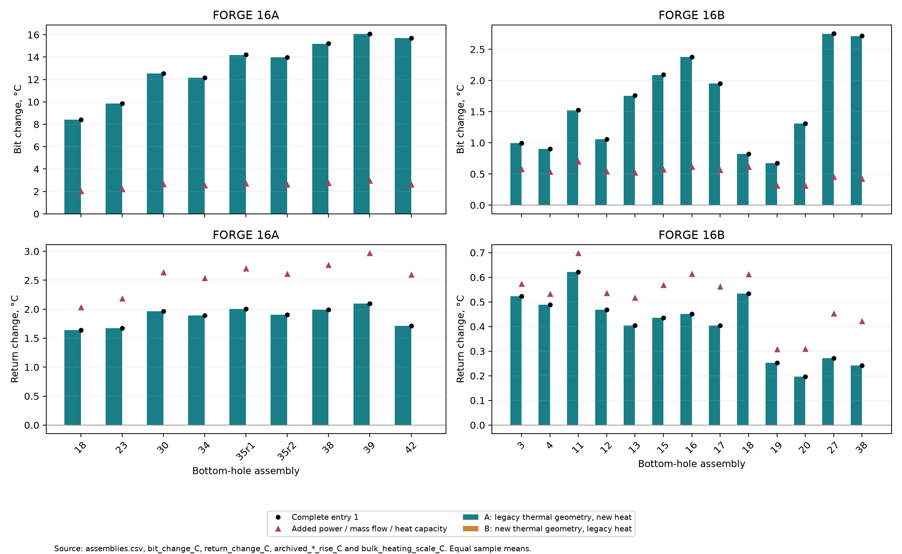

# Model development

This log records changes to BoreTHM's physical calculations and their comparison with development observations. A declaration describes the equations, inputs and predicted effects before a new comparison. Its subsequent score uses the same sample list and reports every gap, including deterioration. Reverted candidates remain in the disclosure table.

## Data statement

FORGE 16A and 16B are development data. Their observations have already been examined and cannot provide an independent validation of changes motivated by their errors. FORGE 56-32, 58-32 and 78B-32 remain reserved for later validation, with targets opened once in declared stages. The 56-32 and 58-32 input archives and pressure protocols remain unchanged. Their pressure target values have not been inspected or compared. The 78B-32 targets remain unread.

No new parameter is fitted in the primary development comparison. The annulus film multiplier is 1.0. A film coefficient converts a fluid-to-wall temperature difference into heat transfer per unit area. `site_evaluation.FILM_MULT_FORGE = 0.75` is a fitted, retired sensitivity. The full site evaluator still calculates that historical sensitivity separately from its primary result; the scoreboard does not call it. The fitting routines in `studies.validate_forge16b` remain historical study functions and are excluded from the scoreboard.

There is an additional historical calibration that must be disclosed. The frozen 16B trial geometry uses effective insulated-pipe wall conductivity 4.9237482416889895 W/(m K), obtained by fitting 16B observations. Film multiplier 1.0 does not remove that fit. The baseline retains this conductivity to reproduce the archived calculation. Trial cases using it are labelled as calibrated geometry. The regular-pipe group does not use it. An unqualified claim of no calibration would be incorrect for the full baseline. An independently sourced insulation input is required before describing a later complete primary path as uncalibrated.

Recorded well geometry, flow, mud properties and initial conditions are observational inputs. They are distinguished from correlation coefficients and engineering assumptions. No correlation coefficient may be selected from a FORGE residual. One inherited reference-programme assumption also needs correction before a source-independent candidate can be scored: ordinary-pipe connection pitch was transferred from the 16B tally. It is disclosed below and is not represented as a manufacturer value.

## Gaps

The following sizes describe the earlier comparisons. They are context for declarations, not acceptance targets. Errors are modelled minus measured.

| Gap | Quantity | Earlier reported size | Scoreboard definition |
|---|---|---|---|
| G1 | Standpipe pressure, measured at the surface pump | 16A about -1,624 psi; 16B about -969 psi after reported motor differential subtraction | Signed psi and percentage residual by assembly. 16A uses standpipe minus raw reported differential. 16B uses unadjusted standpipe on motorless runs 12, 13, 15 and 16. |
| G2 | Hydraulic power represented as heat | 16A about 500 versus 928 kW; 16B about 244 versus 527 kW | Mean modelled in-hole friction, nozzle and motor-face power against measured standpipe pressure times inlet volumetric flow, over the same pressure-available samples in each well. Surface power is reported separately and is not added to in-hole heat. |
| G3 | Deep 16A bit-temperature bias | BHA 38 about -7, BHA 39 about -9 and BHA 42 about -19 °C | Bore-fluid temperature at the bit against bit-box observations, by every 16A assembly; the deep assemblies are marked. The sensor medium is unresolved, so this is a fixed calculation proxy. |
| G4 | 16A run-in peak error | Underprediction about 20–50 °C on partial legs | Event-level peak error using the existing conditional initial-state and fixed-column treatment. The tool's internal-fluid node at the bit and the static fluid-node treatment are the single declared comparison. |
| G5 | 16A surface return bias | About -6 °C; observations exceed even the optimistic recovery bound | Equal-sample pooled return bias across all frozen 16A primary samples. Source groups and their overlaps are retained; this is not a count of independent observations. |
| G6 | 16B regular-pipe and trial temperature biases | Independent regular pipe about -8.8 °C; trial runs about +1 to +3 °C | The original independent regular-pipe group, with its declared sensor positions, and each of the four trial runs. Early unresolved-position runs remain separately reported and are excluded from the original independent pool. |

The 16B numbers above mix historical protocols. The -969 psi and 244 kW figures use the later revised-rheology comparison. The original blind settings use the earlier recorded-mud substitutions. G1 also uses a different subset and pressure target from that pooled historical number. The baseline must reproduce the original calculation and state these differences; it must not be adjusted to reproduce rounded numbers from a different protocol. Measured pump power does not establish where that power becomes fluid heat, particularly when a motor performs mechanical work.

## Frozen comparison

The [scoreboard](../../validation/scoreboard/README.md) uses the original primary sample lists, recorded mud, PV referenced to 26.7 °C, film multiplier 1.0 and cumulative circulation exposure. PV means plastic viscosity, the slope of the Bingham fluid's stress versus shear-rate relation above its yield stress. Each sample has equal weight within its declared group. No sample is selected using a new prediction or residual. Failed and unavailable cases remain in the coverage counts.

The baseline runs the explicit original hydraulic mode. Its temperature, pressure and power outputs are checked against the archived blind calculations at 0.1 °C, 1 psi and 0.1% of power. These are reproduction checks, not tolerances for accepting a physical model. The scoreboard and baseline are then fixed. A later change to their samples, reductions or input conventions is itself a development entry.

The run-in comparison retains the original observed initial tool temperature and average leg speed. Its fluid column is calculated at the start of each leg using the original local circulation/static history. Two originally unavailable run-in events remain visible in the event inventory. Their absence cannot be counted as successful model agreement.

## Candidate disclosure

This table includes work performed before this log existed. Earlier development results are not new scores under the frozen scoreboard. A missing earlier prediction is stated explicitly.

| Candidate | Declared prediction | Development result available before this log | Disposition |
|---|---|---|---|
| Original hydraulic calculation, PV at 26.7 °C | Original comparison configuration | Archived 16A and 16B blind results | Baseline reference |
| Original calculation, PV at 48.9 °C | Higher plastic viscosity for the same field PV; changed pressure and heat transfer | Separate pressure rows in the [earlier development archive](../../validation/hydraulics-v160/pressure-comparisons/README.md) | Deferred heat-transfer candidate; excluded from entry 1 |
| Revised hydraulic calculation, PV at 48.9 °C, 16A NC50 scenario | Additional connection/component losses and local dissipation | Earlier pressure and temperature predictions exist; no six-gap scoreboard score | Provisional; entry 1 awaits its separate 26.7 °C score |
| Revised hydraulic calculation, PV at 48.9 °C, 16B EIS scenario | Additional losses and local dissipation | Earlier motorless pressure predictions exist | Provisional; no acceptance decision |
| Revised hydraulic calculation, PV at 48.9 °C, 16B GPDS55 scenario | Alternative catalogue connection dimensions | Earlier motorless pressure predictions exist | Historical geometry sensitivity; excluded from the single primary scoreboard variant |
| D1 endpoint correction alone | Remove an initial solver point below the bit | Invalid-step warnings continued | Reverted as an incomplete correction |
| D1 endpoint and overlapping-ramp correction | Restore a continuous numerical geometry transition | The same short-component case converged | Retained numerical correction; gap score pending |
| D2 boundary tolerance 1e-10 K | Reduce the turnaround power residual | Reduced the numerical residual; no independent physical justification for that precision | Return to the original boundary tolerance; diagnostic-only policy below |
| D3 programme forwarding | Pass the declared geometry to design comparisons | Programme-adapter tests passed | Retained API correction; no new physical coefficient |
| D4 aggregate trial adapter | Retain the original trial geometry and remove missing serial-table lookups | Four trial geometry tests pass; all 45 trial samples and all 22 diagnosis windows converge | Retained input-contract correction; frozen scoreboard unchanged |
| Entry 1, original 26.7 °C convention, NC50/EIS | Additional hydraulic losses and local heat; temperature effects estimated at tenths to a few °C | G1/G2 deficits decrease; G3 warms by 8.4–16.1 °C, worsening five assembly biases; G6 trials become warmer | not kept; BHA representation under correction |
| Entry 2 component diagnosis | Separate a length-dependent connection contribution from assembly-passage losses | The assumed 1.25-in motor passage is a large calculated contribution on 16A; connection losses also contribute | Diagnosis only; no model change or acceptance decision |
| Thermal geometry and heat-source separation | A should reproduce a heat-source effect; B should reproduce a thermal-geometry effect; compare with the single-pass power scale | A reproduces assembly mean bit rises within 0.02 °C; B changes them by less than 0.01 °C. A exceeds the bulk scale at the bit. | Diagnosis only; no model correction selected from it |
| D5 equipment representation | Remove a motor mandrel's full-length passage and invented bit IDs; pressure and dissipation should decrease | All 467 circulation cases and nine available run-in cases calculated, with explicit thermal-only instrument assumptions and unknown internal tool losses | Debugging correction; acceptance of integrated entry 1 remains pending |
| Entry 1 with D5, original 26.7 °C convention | Revised hydraulic losses with equipment-corrected assembly passages | 16A in-hole power 654 versus measured pump power 928 kW; G3 rises 1.3–3.7 °C from legacy; G6 regular bias -7.2 °C and trial bias +3.0 °C | Kept as the working development calculation, 28 October 2026; independent review of D5 outstanding |
| Historical annulus film multiplier 0.75 | Earlier fitted heat-transfer sensitivity | Fitted on 16B and evaluated separately | Retired sensitivity; excluded from primary scoring |
| Historical insulated-pipe conductivity fit | Reproduce the 16B trial insulation result | Used by the archived trial geometry | Baseline reproduction only; calibration explicitly disclosed |

## 27 October 2026: entry 1, hydraulic losses and heat placement

This is a retrospective declaration. The implementation and some development comparisons predate this log. The predictions below are written after those results were available and are not a blind registration. The source choices and interface can be inspected at `a1927b3` (27 October 2026, 15:32 +01:00), `8bbfe2c` (16:08 +01:00) and `56d1b57` (19:27 +01:00). No new entry-1 score is made here.

### Equations and parameters

The shared calculation uses the existing Bingham straight-passage pressure gradient for mud and the existing Newtonian gradient for water. Bingham yield stress is the stress below which the idealised fluid does not shear. For each repeated connection, the body-friction contribution over its restriction length is replaced by friction at the connection bore and external diameter. The expected number of connections is string length divided by connection pitch. Serial components retain separate passages.

For an area ratio r = small area / large area, abrupt expansion uses K = (1-r)^2 and contraction uses K = 0.5(1-r)^0.75. Each local loss is K rho v_small^2 / 2. A supplied tool curve scales as dp_ref (rho/rho_ref)(Q/Q_ref)^2. A complete tool curve replaces the internal losses it already includes. Surface pressure is C rho_ppg (Q_gpm/100)^1.86 psi. Each in-hole dissipative term supplies heat at its location, q' = Q_local dp/dz. Nozzle dissipation remains at the bit; surface losses and the signed density-column pressure contribution are excluded from in-hole dissipation. The same pressure-gradient kernel supplies pressure and heat.

| Parameter or treatment | Value and provenance | Qualification |
|---|---|---|
| Straight-passage friction | Existing Bingham and Newtonian laws; Bourgoyne et al., *Applied Drilling Engineering* (1986), chapter 4 | No new roughness or residual multiplier |
| Local-loss coefficients | Expansion 1 and contraction 0.5 with exponent 0.75; [Modelica 4.0.0 sudden-change documentation](https://doc.modelica.org/Modelica%204.0.0/Resources/helpOM/Modelica.Fluid.Dissipation.Utilities.SharedDocumentation.PressureLoss.Orifice.dp_suddenChange.html), citing Idelchik | Published smooth turbulent restrictions; transfer to annular/yield-stress flow is approximate |
| Tool scaling | Density times flow squared; API RP 13D, sixth edition (2009), section 7.6.2, equation 103 | Requires a tool-specific reference point |
| Surface layouts | C = 1.00, 0.36, 0.22, 0.15 or 0.15; exponent 1.86; API RP 13D, sixth edition (2009), section 7.3, equation 60 and table 4 | Layout 5 is the declared reference assumption; installed surface plumbing is unresolved |
| Nozzle discharge coefficient | Existing 0.95 | Retained baseline convention, no refit |
| Property pressure floor | Existing thermal-friction guard, 5 MPa, applied consistently to new pressure and heat | Numerical liquid-property approximation near the surface |
| Ordinary reference connection | 7-in OD and 4-in bore; [NOV GPDS/EIS catalogue](https://www.nov.com/products/gpds-and-eis-connections), 5.5-in / 21.9-lb/ft row | Dual-wall and vacuum variants retain their body bore internally; external envelope is transferred |
| Ordinary restriction length | 29 in | Inherited engineering assumption; not an as-built throat measurement |
| Ordinary reference pitch | Existing 2,378 ft / 75 from a 16B tally | FORGE-derived transfer, not source-independent. It cannot be described as a non-FORGE model constant; replace by a compatible catalogue pitch in a declaration before scoring the reference scenario. |
| Heavy-weight pipe connection | 7.25-in OD, 3.25-in bore, approximately 31-ft pitch; [Workstrings 91005000020000](https://www.workstringsinternational.com/assets/Spec-Sheets/HWDP/91005000020000-Imperial.pdf), 1 August 2025 | 48-in effective restriction is an assumption based on published pin/box lengths |
| Reference measurement-tool loss | xBolt G2-L, Rev 7, page 2: psi = ppg times gpm squared / 30,000; [manufacturer sheet](https://www.poweredbyextreme.com/wp-content/uploads/2024/07/xBolt-G2-L-Specifications-and-Fishing-Diagrams_Rev7.pdf) | 500-gpm, 1,000-kg/m³ normalisation; flow limit 750 gpm; 165 °C rating does not qualify a hot-well tool |
| Reference tool geometry | Pulser 1.780032 m, 7-in OD / 3.38-in bore; collar 9.144 m, 6.75-in OD / 3.25-in bore | Same manufacturer drawing; covered internal tool loss replaces empty-passage losses |
| Plain reference collar | 132.075968 m | Existing 143 m less the two stated tool lengths |
| Development assembly geometry | Recorded component dimensions and the previously declared NC50 or EIS catalogue scenario | Observational well inputs are retained separately from model coefficients; unknown tool operating losses remain unknown |

The 26.7 °C viscosity reference stays unchanged in this entry. A 48.9 °C field reference is an unverified input convention and belongs to a later heat-transfer entry. Recorded field dimensions do not establish installed connection machining. The inherited reference pitch and trial insulation calibration are explicit unresolved provenance issues, not hidden fitted parameters.

### Predicted effects before the next comparison

These are order estimates, not acceptance bands. At an illustrative 40 L/s, each additional 100 psi corresponds to about 28 kW of hydraulic power. With illustrative density 1,000 kg/m³ and heat capacity 4,000 J/(kg K), full conversion would add about 0.17 °C per 100 psi. These illustrative properties are not FORGE calibration values.

| Gap | Predicted direction and rough size |
|---|---|
| G1 | Pressure should increase at fixed flow as omitted restrictions are added. Tens to order 1,000 psi are plausible for the declared tool and connection scenarios; no specific fraction of the observed deficit is promised. |
| G2 | In-hole dissipative power should increase, of order tens to hundreds of kW for the illustrative pressure/flow range. Surface loss cannot supply downhole heat. |
| G3 | Extra heat could change bit temperature by tenths to a few °C. Internal exchange and rock heat transfer may change the local sign. A large deep-run temperature correction is not predicted from dissipation alone. |
| G4 | No direct new heating during pumps-off run-in. Any effect is through the preceding fluid/rock state, plausibly a few °C or less; its sign is conditional on that history. |
| G5 | The direct hydraulic-heating contribution should raise fluid energy, with a return-temperature effect of tenths to a few °C. Changed rock exchange can alter the net return response. |
| G6 | Similar modest heating is expected in regular pipe and trial runs. Additional trial overprediction would be a deterioration that must be reported. |

Status: retrospective declaration; no six-gap score or keep decision under this log.

## 27 October 2026: D1, short serial components

Commit `c98f02e` corrected a numerical geometry error. A component shorter than half the 1-m transition width could place an initial solver point below the bit. Closely spaced transitions could overwrite one another and make the blended equations discontinuous. The correction restricts the initial mesh to the well and uses non-negative piece-occupancy weights for overlapping transitions, with the same 1-m width and unchanged per-piece equations. The explicit legacy mode retains its original path.

The justification is the solver domain and continuity of its equations. Closing a field-data gap is not its justification. Endpoint correction alone did not resolve the overlapping-transition case. The combined correction converged on that same input. No signed change is predicted for G1 to G6; the purpose is to obtain valid solutions for declared geometry. Synthetic component tests retain this correction. A separate six-gap score has not been made.

## 27 October 2026: D3, programme forwarding

Commit `0b89980` corrected the design-comparison adapter after the evaluator acquired a hydraulic-programme argument. The adapter must pass the declared programme and casing shoe to the geometry builder. This is an interface correction, justified by the argument contract. No coefficient was chosen from a prediction error, and no physical improvement in G1 to G6 is claimed.

## 27–28 October 2026: D2, energy diagnostic and boundary accuracy

Commit `8e6d0b9` tightened the boundary-condition tolerance to 1e-10 K because a small turnaround residual exceeded an excessively precise power check. The pressure/heat source integrals agreed. This diagnostic discrepancy did not establish failure of the physical boundary-value solve.

Restore the original solver tolerance: profile tolerance 1e-4, with the solver's default boundary tolerance. Report assigned power, applied power and their residual. Flag a residual exceeding the larger of 1 W and 0.1% of the compared powers. A failed diagnostic evaluation is also flagged and returned. Neither case changes solver success or raises a diagnostic exception to the caller. Solver convergence and finite physical temperatures remain separate checks.

Prediction: the representative deep-well solve remains converged at the original tolerance, and its small power residual is acceptable at the declared reporting resolution. No material G1 to G6 change is expected from removing unnecessary boundary precision. Any actual convergence failure must be identified; tolerance tightening is permitted only for such a demonstrated convergence need. No physical gap score is authorised by this numerical check.

The original tolerance has been restored. The deep-well reference and both short-component convergence cases pass at that tolerance. Tests also confirm that a flagged residual or an exception inside the diagnostic leaves a converged solve successful. No tested case requires a tighter boundary tolerance. The six-gap candidate comparison remains pending.

## 28 October 2026: legacy baseline

The single baseline calculation completed in 265.5 seconds. Its 467 circulation cases converged, and all nine originally available run-in cases were reproduced. All 2,614 archive checks passed at the stated resolutions. The two unavailable run-in cases remain unavailable. The saved [scoreboard](../../validation/scoreboard/baseline/scoreboard.csv) and its individual predictions are the reference for subsequent entries. This is a reproduction of the original calculation, not a score of entry 1.

| Gap | Legacy baseline | Source within the scoreboard archive |
|---|---|---|
| G1 | Every 16A assembly and the four motorless 16B assemblies have separate psi and percentage residuals | `scoreboard.csv`: G1 rows, `bias` and `mean_percent_error` |
| G2 | 16A 500.04 versus 928.27 kW; original-protocol 16B 264.29 versus 526.52 kW | `scoreboard.csv`: G2 rows, `model_mean`, `measured_mean` |
| G3 | Bore-at-bit biases for BHA 38, 39 and 42 are -8.12, -9.68 and -19.81 °C; all assemblies are reported | `scoreboard.csv`: G3 rows, `bias`, `deep_run` |
| G4 | The nine available event peak errors range from -54.35 to -6.53 °C for the declared internal-fluid comparison | `run-in.csv`: `peak_error_C`; unavailable events have no numerical error |
| G5 | Pooled return bias -5.85 °C over the original 358 samples | `scoreboard.csv`: G5, group ALL, `bias`, `compared` |
| G6 | Independent regular-pipe bias -8.77 °C; pooled trial bias +1.99 °C, with every trial also reported separately | `scoreboard.csv`: G6 group rows, `bias` |

The G3 figures use the fixed bore-fluid proxy specified before this run. The earlier rounded gap description did not identify one of the unresolved bore/annulus and position alternatives. Those quantities are not silently interchanged. Source and result checksums identify the frozen scoreboard; later scoring changes require their own log entry.

## 28 October 2026: heat-transfer candidate inventory

These candidates are declared for G3, G5 and G6. None has been scored by this log. A Reynolds number compares inertial and viscous flow effects; a Nusselt number converts a heat-transfer coefficient into a dimensionless quantity. The hydraulic diameter of a concentric annulus is the outer diameter minus the inner diameter.

| Treatment | Physics and provenance | Rheology states and reference temperatures |
|---|---|---|
| Current calculation | Dittus–Boelter with plastic viscosity, Nu = 0.023 Re^0.8 Pr^n in its turbulent branch, laminar Nu = 4.36, film multiplier 1.0 | Intact, central and degraded rheology; each at PV reference 26.7 °C and 48.9 °C |
| Wall-viscosity and transition treatment | Apparent viscosity at the wall includes yield stress. For a Bingham fluid, mu_wall = mu_plastic / (1 - tau_y/tau_wall) in a yielded wall layer. Wilson–Thomas or a Hedström-number transition must be declared with its validity limits before implementation. Hedström number is rho tau_y D_h² / mu_plastic². [Thomas (2018)](https://papers.acg.uwa.edu.au/d/1805_16_Thomas/16_Thomas.pdf), equations 9–12, also identifies the corrected sign in the original Wilson–Thomas expression. | The same three rheology states and both reference temperatures; no state selected from residuals |
| Annulus heat transfer | Gnielinski's concentric-annulus correlation distinguishes inner and outer heat-transfer surfaces. Diameter ratio a = D_i/D_o gives inner factor 0.75 a^-0.17 and outer factor 0.9 - 0.15 a^0.6, with the liquid wall-property correction (Pr/Pr_wall)^0.11. See [Gnielinski (2009)](https://doi.org/10.1080/01457630802528661) and the [INL implementation](https://mooseframework.inl.gov/bison/source/materials/ADWallHTCGnielinskiAnnularMaterial.html). | The same three rheology states and both reference temperatures; extension from Newtonian data to mud requires an explicit approximation statement |

Intact rheology retains the recorded PV and yield point under the declared temperature treatment. Degraded rheology approaches the water-viscosity, zero-yield limit at recorded density. A central downhole state needs independent laboratory ageing evidence or an explicitly declared interpolation bracket before it receives numerical values. No degradation factor is inferred from the FORGE temperature gaps. The unknown field measurement temperature also cannot be identified from a better residual at 48.9 °C.

The candidate inventory is a design space, not permission to run all combinations. Each subsequent entry names one primary treatment. Additional variants require a stated input uncertainty and comparison purpose in that entry's declaration. Correlation changes may alter convection by tens of percent and temperatures by several °C, but coupled bore/annulus exchange prevents a reliable signed prediction at every sensor without calculation. A model-specific declaration must narrow these order estimates before scoring.

Reheating candidates for G4 and G5 are reserved for a separate declaration before their first implementation or comparison. Existing recovery-bound diagnostics do not establish recovery as the cause of any gap.

## 28 October 2026: entry 2, string-loss diagnosis

This entry changes no model function or parameter. Earlier pressure comparisons reported a 1,150–1,730 psi string-loss increase on 16A and 130–340 psi on 16B at similar depth/flow, including overpredictions for 16A BHA 38 and 39 and a smaller increase for deeper BHA 42. These are previously observed development results, not a result of the diagnosis declared here.

Explanation A is that the assumed NC50 connection bore dominates the increase. Its prediction is a connection contribution that grows with string length and is similar among assemblies at matched flow and depth. Explanation B is that a small passage in particular assemblies dominates. Its prediction is an assembly-specific component contribution that length and flow do not explain. Both mechanisms may contribute.

Use one representative pressure-available window per assembly in each well. Select the earliest window at the median bit-depth rank, ordered by depth, time and sample identifier; for an even count use the lower middle rank. The selection uses frozen inputs alone. The 16A set contains each bit-box assembly. The 16B set contains each pressure-available primary assembly, including the trial runs. Keep the same recorded mud and PV reference of 26.7 °C as the scoreboard.

Report pipe-body friction, repeated connections, each serial assembly component, local changes of area, supplied tool losses, nozzles and surface loss separately, including external annulus contributions. Each component row names its length, bore, outer diameter and source. A complete tool curve must not receive duplicated empty-body losses. Unknown proprietary operating losses remain unknown. The budget must sum to standpipe pressure within about 1 psi. No bore, effective length or coefficient is adjusted after this breakdown.

The diagnosis and entry-1 six-gap comparison await approval. Entry 1 will then receive a keep/revert recommendation with the before/after scoreboard. The acceptance decision remains separate from the numerical calculations.

## 28 October 2026: additional candidate declarations

These declarations precede the first entry-1 score on the frozen scoreboard. They add no model term and change no scoreboard input. The estimates below describe possible physical effects; they are not calculated changes on the development samples. A later implementation needs its own declaration and score. The approved historical insulation conductivity and connection pitch remain fixed for entry 1.

### Motor power and mechanical work

The present face source uses inlet flow times the rig's reported motor differential. That differential represents the increase above the off-bottom pressure and omits the motor's no-load pressure drop. Candidate M1 accounts for total motor hydraulic power, Q times (reported differential plus independently specified no-load drop), for G2, G3 and G6. Hydraulic power includes shaft work. An implementation must separate internal motor dissipation from shaft work and any subsequent bit heat, so the same power is counted once. A manufacturer's no-load value requires a documented motor match and flow basis. It cannot be inferred from a pressure residual.

The predicted direction is increased accounted motor power and additional heat where that power is dissipated. **Estimate:** at illustrative flow 20–50 L/s and omitted drop 100–500 psi, the additional hydraulic power is about 14–172 kW. The corresponding bulk temperature increment is of order 0.1–2 °C for water-like heat capacity and typical drilling mass rates. G3 and G6 may become warmer; an existing positive trial bias could increase. These are engineering estimates, not a promise that all hydraulic power becomes immediate face heat. BICO's [7-in SSS100-B5 sheet](https://bicodrilling.com/wp-content/uploads/2022/09/7-SSS100-B5.pdf) reports a separate no-load drop and rated flow range. It is an example of the required input, with no assumed match to either development well. Zhang et al. (2024), reference C2 below, include a motor heat source.

Candidate M2 adds rotary string friction and bit work for G5, with smaller effects expected on G3 and G6. Mechanical power is torque times angular speed, P = torque times 2 pi RPM / 60. The declared string-friction deposition is in the annulus along the deviated section; bit work is deposited at the bottom. Measured surface torque contains both contributions and other mechanical losses, so partitioning requires a physical torque balance. Motor shaft power already accounted for in M1 cannot be added again as an independent heat source. Raw torque and rotational-speed channels are needed from the 16A 1-s records in GDR 1283 and the 16B Pason records. No channel is extracted or compared at this stage.

The predicted direction is warmer return fluid, with smaller positive bit-temperature effects that depend on heat exchange along the string. **Estimate:** 10 kN m at 120 RPM supplies about 126 kW. If all of that power entered 40 kg/s of fluid with heat capacity 4 kJ/(kg K), it would supply about 0.8 °C of bulk warming. An order 0.5–3 °C return response and sub-degree to a few °C local response are provisional estimates. The partition and actual channel magnitudes are unresolved. References C1, C2 and C3 discuss rotational or mechanical heat; none provides a coefficient selected for FORGE.

### Rock conduction and exposure history

Candidate R1 replaces the approximate rock resistance ln(1 + 2 sqrt(t_D)) with the exact infinite-medium cylindrical response to a constant wall-temperature step. Here t_D = alpha t / a², a is the rock-boundary radius, and alpha = k/(rho c) is thermal diffusivity. For initially uniform rock, unit wall-temperature step and temperature fixed at infinity, the dimensionless Laplace-domain temperature is K0(r_D sqrt(s))/(s K0(sqrt(s))). K0 and K1 are modified Bessel functions; s is the dimensionless Laplace variable and r_D = r/a. Differentiation at the wall gives the transformed dimensionless conductance K1(sqrt(s))/(sqrt(s) K0(sqrt(s))). Invert and tabulate that conductance, then use its reciprocal as the step resistance multiplying 1/(2 pi k). This follows the cylindrical diffusion boundary-value problem described by Carslaw and Jaeger (1959), reference C4. It is a proposed derivation, with numerical inversion and radial-solver verification required before use.

R1 bears on G3, G5 and G6; G4 is affected through the preceding rock/fluid state. Review the 3,600-s exposure floor together with the response, including fresh-wall times of minutes. The early-time conductance has an inverse-square-root singularity for an ideal instantaneous temperature step. A finite time step or finite boundary evolution needs a physically stated treatment. **Estimate:** changes of order 10–30% in the rock conductance away from the floor, potentially larger at freshly exposed wall, could change local fluid temperatures by order 1–5 °C. For rock hotter than fluid, greater conductance increases fluid heating; the sign reverses where the inlet heats shallow rock. This estimate is not an evaluated response-function comparison.

The constant-flux time functions associated with Ramey (1962) and Hasan and Kabir (1994), references C5 and C6, are excluded from this replacement. Those functions give wall temperature in response to prescribed heat flux. R1 needs flux in response to prescribed wall temperature. Their time-domain responses are different; taking the reciprocal of a constant-flux response does not produce the constant-temperature response. Ramey discusses other boundary conditions as well; this exclusion concerns the constant-flux functions. A future model that prescribes flux would require a separately consistent formulation.

Candidate R2 replaces a single exposure clock with a history response, including measured inlet-temperature changes and pumps-off reheating, for G3, G4 and G6. For a linear rock problem, superpose temperature-step responses over the boundary history. Measured inlet history must first be propagated through the circulating fluid to the depth-dependent wall boundary; it cannot be imposed directly on every rock cell. The same history continues through static periods. Duhamel superposition follows the linear conduction theory in C4; variable properties would require a stated linearisation or a nonlinear time-domain solution.

After a pause, recovery towards the undisturbed rock state is predicted to increase the heat available to a cold returning circulation and can increase run-in peaks. A colder later inlet can reduce temperatures during the corresponding circulation. **Estimate:** order 1–10 °C local history effects and potentially larger transient peak changes; neither their occurrence nor their magnitude on FORGE has been established. G5 is also relevant when reheating supplies subsequent return heat. Compare a resolved radial rock history with the linear history response in a later declared entry; existing full-recovery bounds remain optimistic diagnostics. Neither candidate is implemented here.

### Properties and geometry

| Candidate | Gaps and predicted direction | Rough size, explicitly an estimate | Published basis and input requirement |
|---|---|---|---|
| R3: depth- and temperature-dependent rock properties | G3 and G6. Higher local k increases exchange with hotter rock; a decrease in k with temperature can reduce it. The heat-capacity change also alters recovery. The net temperature sign is depth- and history-dependent. | **Estimate:** tens of percent in local conductance and order 1–5 °C in fluid temperatures. | Allis et al. (2018), C7, report depth-dependent measured conductivity in 58-32 and temperature corrections for both conductivity and heat capacity. Use these as an explicitly transferred material input. Use a consistent k(T), rho c(T) and alpha(T), with an enthalpy formulation if properties vary during recovery. No 58-32 pressure or temperature comparison target is opened. |
| R4: hole enlargement in thermal terms | G3 and G5. A larger hole increases fluid inventory and changes the rock radius, while lower annular velocity can reduce the film coefficient. Competing effects prevent a universal sign; the prediction is a depth-localised response at measured enlargements. | **Estimate:** local film changes of tens of percent and order 0.1–3 °C fluid changes, conditional on actual enlargement. | Gilmour et al. (2021), GDR 1292, supply 16A logs. A later entry must identify the caliper and ultrasonic borehole-image (UBI) channels and their depth coverage. Preserve the hydraulic geometry for a thermal-only comparison, and declare any later hydraulic change separately. |
| R5: fluid thermal mass after flow changes | G3 and G5. Retaining rho c A times dT/dt delays the approach to a new circulating state; the sign opposes the immediate temperature change after a flow step. | **Estimate:** minutes to a circulation time of lag; transient differences of order 0.1–5 °C, decreasing at steady conditions. | C2 and C3 formulate transient fluid energy storage. Low priority because the 16A pause comparisons already identify limitations in starting circulation profiles; storage has not been established as their cause. |
| R6: formation temperature at depth | G3, especially BHA 42, and G5/G6 because the wells share the adopted profile. Residual drilling cooling would make an equilibrium correction warmer. Extending a positive gradient below the log endpoint would also warm that tail; different recovery evidence could change the direction. | **Estimate:** order 0–5 °C change in the temperature input, with a smaller coupled-fluid response; no lower or upper limit is established from the gaps. | The 216-day profile and its coverage are documented in the [16A archive](../../validation/forge16a/README.md), using Jones (2022), GDR 1421. Its endpoint is 10,740 ft MD. C4 supplies recovery physics. Any correction must be obtained from a recovery calculation or later logs acquired before injection, with acquisition dates checked. A residual alone cannot define the correction. |
| P1: independently specified insulated-pipe conductivity | G6 trial runs. Less effective conductivity reduces heat leakage into downward bore fluid, tending to cool it; a greater value reverses that effect. Annulus response can have a different sign. | **Estimate:** order 1–10 °C trial-temperature changes for a substantial insulation-resistance change; sign and size require the actual construction. | Ajima and Naganawa (2022), C8, provide an independently published effective-conductivity example. It is not a manufacturer value for Eavor's 16B pipe. Obtain a value and layer dimensions for that actual product before replacing the fitted 4.9237482416889895 W/(m K). A coating-material value cannot directly replace an effective whole-wall value. No verified manufacturer value for the actual trial pipe has yet been identified. |
| P2: catalogue connection pitch for the reference programme | Reference pressure and heat provenance; it bears on G1/G2 only if later transferred into a development geometry. A shorter pitch increases connection count and losses. It has no effect on the present frozen comparison. | **Estimate:** a 31.5-ft pitch gives about 0.66% more connections than 2,378 ft / 75; only the connection contribution scales by this fraction. | Workstrings International (2025), C9, gives approximate assembly length 31.5 ft for 5.5-in, 21.9-lb/ft pipe. That sheet's Delta 544 connection differs from the reference EIS envelope, so using its pitch would be a declared dimensional transfer. No connection bore or envelope changes are authorised by this declaration. |

### Measurement diagnostics declared without execution

These entries change no model and are not executed at this stage. Each has a distinguishing observable; a better model residual cannot determine a correction.

| Diagnostic | Declared comparison and interpretation |
|---|---|
| M3: Sanvean-to-rig clock alignment | Cross-correlate independent pressure-step records, using raw timing and sustained features. Estimate offsets separately across 1 November 2020 and check whether a clock-convention change explains them. Do not select an offset from temperature agreement. |
| M4: bit-box and top-sub response | Compare bit-box minus top-sub temperatures across on-bottom and off-bottom steps, allowing for sensor separation and fluid transport. A repeatable load-linked difference can distinguish local heating from a common inlet-history change. |
| M5: sensor response after pump start | Compare pressure/flow onset with the subsequent temperature response and the predicted transport arrival. Separate a sensor response time from fluid transit and wall recovery. No response constant is chosen from a model bias. |
| M6: flow and lag | Reconstruct flow-in from pump strokes and declared pump displacement, compare it with return-flow measurements, and check the corresponding bottoms-up transport lag. Bottoms-up lag is the travel time from the bit to surface. Different meter calibration and partial losses can both alter the balance; pit-volume records distinguish them. |
| M7: 16A losses | Read daily-report loss entries alongside pit-volume changes, accounting for recorded transfers and additions. Compare their times with pressure and return flow. A volume deficit without a documented transfer supports loss; neither temperature bias nor a cooler annotation quantifies it. |
| M8: inlet-temperature agreement | Compare rig and mud-log channels at matched times after establishing sensor locations and inlet/outlet identity. The existing rig mud-temperature channel is outlet-like, so it cannot automatically be relabelled as inlet. Record missing inlet measurements. |
| M9: pressure residual remaining after entry 1 | Examine documented tool curves and differential-channel tare drift; verify pressure-transducer location and the flow-meter basis. Pressure dependence on flow and assembly identity can distinguish missing restrictions from an additive tare error. No proprietary tool curve is fitted to the residual. |

### Later superhot design questions

These items have no development-gap assignment. Each needs a separate physical scope and independently sourced parameters before implementation.

| Item | Later design purpose |
|---|---|
| Thermal-cracking regime flag | Identify conditions where cooling-induced distributed cracking can invalidate an elastic intact-rock calculation. |
| Fracture opening and weak-plane strength | Represent existing fracture opening and failure along weak planes, with orientation-dependent strength. |
| Brittle-to-ductile transition and creep | Account for temperature- and time-dependent deformation where elastic brittle failure ceases to be adequate. |
| E(T) | Use temperature-dependent Young's modulus in the thermoelastic stress calculation. |
| Static-hot column pressure | Calculate pressure from the reheated density profile during a static period. |
| Pump-start gel and surge | Evaluate transient start-up pressure from gel breaking and motion-induced pressure. |
| Loss-zone boundary condition | Allow fluid and enthalpy to leave the well at a specified loss interval. |

### Verified references for these declarations

The following author/year identities and DOI or stable publication URLs were checked on 28 October 2026. The cited works support candidate physics or input provenance; the rough FORGE effect estimates above are declarations, not results copied from those papers.

| ID | Reference |
|---|---|
| C1 | Chang, X., Zhou, J., Guo, Y., He, S., Wang, L., Chen, Y., Tang, M. and Jian, R. (2018). *Heat Transfer Behaviors in Horizontal Wells Considering the Effects of Drill Pipe Rotation, and Hydraulic and Mechanical Frictions during Drilling Procedures*. Energies 11(9), 2414. [DOI 10.3390/en11092414](https://doi.org/10.3390/en11092414). |
| C2 | Zhang, S., Fu, J., Peng, C., Su, Y., Zhang, H. and Yang, M. (2024). *The Analysis of Transient Temperature in the Wellbore of a Deep Shale Gas Horizontal Well*. Processes 12(7), 1402. [DOI 10.3390/pr12071402](https://doi.org/10.3390/pr12071402). |
| C3 | Sui, D. and Langåker, V.H. (2018). *Downhole Temperature Modeling for Non-Newtonian Fluids in ERD Wells*. Modeling, Identification and Control 39(2), 131–149. [DOI 10.4173/mic.2018.2.7](https://doi.org/10.4173/mic.2018.2.7). |
| C4 | Carslaw, H.S. and Jaeger, J.C. (1959). *Conduction of Heat in Solids*, second edition, Clarendon Press. [Published book, ISBN 9780198533689](https://books.google.com/books?id=y20sAAAAYAAJ). |
| C5 | Ramey, H.J., Jr. (1962). *Wellbore Heat Transmission*. Journal of Petroleum Technology 14(4), 427–435. [DOI 10.2118/96-PA](https://doi.org/10.2118/96-PA). |
| C6 | Hasan, A.R. and Kabir, C.S. (1994). *Aspects of Wellbore Heat Transfer During Two-Phase Flow*. SPE Production & Facilities 9(3), 211–216. [DOI 10.2118/22948-PA](https://doi.org/10.2118/22948-PA). |
| C7 | Allis, R., Gwynn, M., Hardwick, C., Hurlbut, W. and Moore, J. (2018). *Thermal Characteristics of the FORGE site, Milford, Utah*. GRC Transactions 42. [Original paper](https://publications.mygeoenergynow.org/grc/1033913.pdf). Only material-property evidence is used in this declaration. |
| C8 | Ajima, K. and Naganawa, S. (2022). *Evaluating Wellbore Cooling Effect with Insulated Drill Pipes in Supercritical Geothermal Well Drilling*. GRC Transactions 46, 805–818. [Original paper](https://publications.mygeoenergynow.org/grc/1034636.pdf). |
| C9 | Workstrings International (2025). *Drill Pipe Performance Sheet*, asset WS41-42, 1 August 2025, page 1. [Supplier catalogue](https://www.workstringsinternational.com/assets/Spec-Sheets/Drill%20Pipe/WS41-42-Imperial.pdf). |

The BICO motor sheet is undated; its identity and contents were checked directly, without assigning a publication year from its URL. GDR source identities are McLennan et al. (2021), GDR 1283, [DOI 10.15121/1776602](https://doi.org/10.15121/1776602); Gilmour et al. (2021), GDR 1292, [DOI 10.15121/1777912](https://doi.org/10.15121/1777912); Jones (2022), GDR 1421, [DOI 10.15121/1893533](https://doi.org/10.15121/1893533); and McLennan et al. (2023), GDR 1516, [DOI 10.15121/1998591](https://doi.org/10.15121/1998591). These identify the development-data inputs for future diagnostics; no new observation is extracted here.

## 28 October 2026: D4, aggregate trial geometry in the comparison adapter

The first entry-1 run exposed an input-contract error. The revised hydraulic adapter indexes a serial-component table for every assembly. The frozen 16B plan intentionally has no such rows for EOW 17–20: their existing trial geometry is aggregate. Indexing those missing keys raises an exception before a solve. This is a coding error independent of the magnitude or direction of any temperature residual.

The correction will use the existing trial geometry, retaining every segment and its original thermal layers, and add the same declared connection scenario to its ordinary and heavy-weight pipe. The partial insulated trial must retain its lower regular-pipe section. The trial heavy-weight pitch remains the recorded 913.42 ft / 30; the ordinary pitch remains the approved 2,378 ft / 75. Aggregate collar and assembly passages remain aggregate, with no invented serial dimensions or tool curves. Other assemblies keep their existing adapter path. The frozen scoreboard script and its reductions do not change.

Prediction: the 45 trial samples become calculable without changing their sample identifiers or recorded inputs; the other 422 samples and all 16A run-in inputs are unchanged. No signed physical improvement in G1–G6 is predicted from this correction. The incomplete first run is retained outside the result archive and will not supply the accepted entry-1 score.

## 28 October 2026: entry 2 component pressure result

The [component archive](../../validation/model-development/entry-2/README.md) contains 22 median-depth windows, one per pressure-available assembly. All converged in 114.5 seconds. Every named pressure budget sums to standpipe pressure within 1 psi. The calculation uses the original 26.7 °C rheology reference and the same declared NC50/EIS scenarios as entry 1. No model function or parameter was changed for the diagnosis.

| 16A assembly | String-pressure increase from legacy, psi | Current bore connection contribution, psi | Current assumed motor-passage contribution, psi |
|---|---|---|---|
| 18 | 1,064 | 261 | 728 |
| 23 | 1,143 | 340 | 827 |
| 30 | 1,227 | 402 | 850 |
| 34 | 1,295 | 448 | 883 |
| 35r1 | 1,445 | 541 | 944 |
| 35r2 | 1,406 | 531 | 914 |
| 38 | 1,497 | 585 | 959 |
| 39 | 1,635 | 653 | 1,037 |
| 42 | 1,366 | 513 | 882 |

String increases are from `entry-2/pressure-budget.csv`, `string_increase_psi`. Connection contributions sum `bore_joint_replacement_psi` and `bore_joint_local_psi` in that file. Motor contributions sum `bore_body_psi` and `bore_geometric_local_psi` over motor rows in `entry-2/component-budget.csv`. All values are calculated. The two coupled calculations also have different temperature/property profiles, so subtracting their totals does not isolate a single geometric cause.

The connection contribution is substantial, but it does not explain the complete 16A increase. The 1.25-in motor-as-passage representation supplies 959 and 1,037 psi in the selected BHA 38 and 39 windows, with respective lengths about 10.8 m. This supports the assembly-passage explanation within the calculation. It does not establish a real motor's operating loss: a motor flow path is not necessarily an empty straight tube. An independently documented passage or pressure curve would distinguish a physical restriction from an inappropriate passage idealisation. No such curve is fitted here.

BHA 42 contains about 85 m of heavy-weight pipe, compared with about 426 m in BHA 38 and 39. Its heavy-weight body/local contribution is about 105 psi, compared with 548 and 596 psi. Its top ordinary-pipe segment is also shorter, about 2,098 m against 2,216 and 2,402 m, and its flow is lower. The current adapter applies ordinary connection losses to that top segment; ordinary-pipe intervals recorded inside the BHA 42 assembly have no repeated-joint term. Total well depth therefore cannot represent connection count consistently across these assemblies. This is a disclosed adapter limitation for a later declaration; the diagnosis makes no correction to the scored candidate.

Across the thirteen selected 16B assemblies, string increases are about 105–328 psi and current bore connection contributions about 75–209 psi. Those are selected-window calculations, not well-wide means. Every component's geometry and source is in the component archive. Trial runs retain their original aggregate passages. Unknown proprietary operating losses remain unspecified.

No new solver failure or unavailable case occurred in the diagnosis. The existing local-loss validity flags identify 16B BHA 11 and 12 as outside the published Newtonian Reynolds-number range at some restrictions. All cases flag the annular or Bingham transfer approximation. These diagnostics do not reject converged solves. No energy residual was flagged. The relative importance of the calculated terms does not establish the cause of a measured temperature error.

## 28 October 2026: entry 1 six-gap score

The [entry-1 archive](../../validation/model-development/entry-1/README.md) compares the approved legacy baseline with the declared NC50/EIS candidate at the original 26.7 °C viscosity reference. The completed candidate calculation took 1,058.8 seconds (17 minutes 38.8 seconds). All 467 circulation samples converged. All nine originally available run-in events were calculated, and the same two originally unavailable events remain unavailable. No energy residual was flagged. Every comparison population is unchanged.

Every number in the following tables is from `validation/model-development/entry-1/comparison.csv`. Before and after refer to legacy and entry 1. Bias is model minus measurement. The `group` column identifies the assembly, event or population, and `before_compared` / `after_compared` give the counts. Pressure percentage errors are means of paired sample percentages, not percentages of the group means.

### G1: Standpipe pressure

Columns: `before_bias`, `after_bias`, `before_mean_percent_error` and `after_mean_percent_error`.

| Well / assembly | Samples | Before bias, psi | After bias, psi | Before, % | After, % |
|---|---|---|---|---|---|
| 16A / 18 | 15 | -1,529 | -402 | -54.7 | -14.4 |
| 16A / 23 | 13 | -1,858 | -566 | -56.9 | -17.4 |
| 16A / 30 | 29 | -1,604 | -87 | -50.7 | -2.7 |
| 16A / 34 | 9 | -1,477 | -76 | -45.9 | -2.3 |
| 16A / 35r1 | 5 | -1,884 | -297 | -50.8 | -8.0 |
| 16A / 35r2 | 4 | -1,767 | -235 | -50.1 | -6.7 |
| 16A / 38 | 20 | -1,358 | 270 | -42.1 | 8.4 |
| 16A / 39 | 25 | -1,270 | 473 | -38.6 | 14.4 |
| 16A / 42 | 15 | -2,464 | -935 | -59.8 | -22.7 |
| 16B / 12 | 12 | -157 | 56 | -13.4 | 4.8 |
| 16B / 13 | 14 | -441 | -261 | -37.8 | -22.4 |
| 16B / 15 | 4 | -433 | -239 | -36.3 | -20.1 |
| 16B / 16 | 15 | -462 | -259 | -37.1 | -20.8 |

### G2: Hydraulic power

Columns: `before_model_mean`, `after_model_mean` and `after_measured_mean`. All values are kW.

| Well | Paired samples | Before model | After model | Measured |
|---|---|---|---|---|
| 16A | 135 | 500.0 | 908.0 | 928.3 |
| 16B | 109 | 264.3 | 349.9 | 526.5 |

### G3: 16A bore-at-bit temperature

Columns: `before_bias` and `after_bias`, in °C.

| Group or event | Compared / planned | Before bias | After bias |
|---|---|---|---|
| 18 | 15 / 15 | -4.1 | 4.3 |
| 23 | 13 / 13 | -0.2 | 9.7 |
| 30 | 29 / 29 | 2.4 | 14.9 |
| 34 | 9 / 9 | -0.7 | 11.4 |
| 35r1 | 5 / 5 | -3.1 | 11.1 |
| 35r2 | 4 / 4 | -8.9 | 5.1 |
| 38 | 20 / 20 | -8.1 | 7.1 |
| 39 | 25 / 25 | -9.7 | 6.4 |
| 42 | 15 / 15 | -19.8 | -4.1 |

### G4: 16A run-in peak error

Columns: `before_bias` and `after_bias`, in °C.

| Group or event | Compared / planned | Before bias | After bias |
|---|---|---|---|
| 23-off004 | 1 / 1 | -28.4 | -23.7 |
| 23-off005 | 1 / 1 | -13.9 | -13.8 |
| 23-off006 | 0 / 1 | unavailable | unavailable |
| 35r2-off001 | 1 / 1 | -6.5 | -6.5 |
| 35r2-off006 | 1 / 1 | -41.0 | -33.9 |
| 35r2-off008 | 0 / 1 | unavailable | unavailable |
| 38-off009 | 1 / 1 | -9.4 | -6.0 |
| 39-off004 | 1 / 1 | -10.1 | -10.1 |
| 39-off007 | 1 / 1 | -46.5 | -36.5 |
| 42-off004 | 1 / 1 | -46.0 | -32.7 |
| 42-off013 | 1 / 1 | -54.4 | -43.5 |

### G5: 16A return temperature

Columns: `before_bias` and `after_bias`, in °C.

| Group or event | Compared / planned | Before bias | After bias |
|---|---|---|---|
| ALL | 358 / 358 | -5.8 | -4.0 |
| Sanvean on-bottom | 135 / 135 | -6.0 | -4.1 |
| rig inferred bit depth, return only | 223 / 223 | -5.8 | -3.9 |

### G6: 16B temperature

Columns: `before_bias` and `after_bias`, in °C.

| Group or event | Compared / planned | Before bias | After bias |
|---|---|---|---|
| independent regular pipe | 59 / 59 | -8.8 | -6.9 |
| trial | 45 / 45 | 2.0 | 3.3 |
| 3 | 3 / 3 | -4.8 | -3.8 |
| 4 | 2 / 2 | -24.2 | -23.3 |
| 11 | 4 / 4 | -16.2 | -14.8 |
| 12 | 12 / 12 | -18.3 | -17.3 |
| 13 | 14 / 14 | -8.4 | -6.7 |
| 15 | 4 / 4 | -4.2 | -2.2 |
| 16 | 15 / 15 | -4.8 | -2.5 |
| 17 | 14 / 14 | 3.2 | 5.1 |
| 18 | 10 / 10 | 1.7 | 2.5 |
| 19 | 10 / 10 | 1.2 | 1.9 |
| 20 | 11 / 11 | 1.5 | 2.8 |
| 27 | 5 / 5 | -3.8 | -1.2 |
| 38 | 5 / 5 | -1.6 | 1.1 |

### Recommendation and physical interpretation

**Recommendation: revert the integrated entry-1 candidate as currently scored. The decision is pending; no reversion has been performed.** The added pressure and dissipation terms reduce the G1/G2 deficits, but the complete change produces substantial thermal deterioration on several assemblies and retains unresolved passage/joint representations. Those limitations prevent treating the pressure improvement as confirmation of this implementation.

Calculated: all nine 16A assembly mean bit temperatures increase by 8.4–16.1 °C, exceeding the earlier tenths-to-a-few-degrees estimate. Absolute mean bit bias worsens on five assemblies. BHA 42 improves from -19.8 to -4.1 °C, while BHA 30 changes from +2.4 to +14.9 °C. G5 improves by about 1.8 °C but remains about 4.0 °C cold. The independent 16B regular-pipe pool improves from -8.8 to -6.9 °C; the trial pool deteriorates from +2.0 to +3.3 °C. G4 remains non-conservative on all nine available events, with errors about -43.5 to -6.0 °C.

Calculated: entry 2 identifies large losses in the assumed straight motor passages, with substantial connection contributions and incomplete repeated-joint coverage inside the BHA 42 assembly. These are properties of the current representation. They do not measure the physical motor pressure curve. The remaining 16B power deficit also shows that entry 1 does not complete the hydraulic-power accounting.

Inferred: changes in the serial thermal geometry or internal bore/annulus exchange could contribute to the larger-than-predicted bit warming. An alternative is that the location and concentration of the added heat dominate that response. A later declaration can separate them using fixed thermal geometry and separately changed heat-source placement. That diagnostic has not been run. The closer 16A total-power values do not establish where the measured pump power is dissipated or converted into mechanical work.

No additional candidate or measurement diagnostic from the 28 October inventory was executed. No golden was regenerated, no slow suite was run, and no held-out validation target was read. The original fitted trial conductivity and transferred pitch remain as approved. Acceptance or reversion will be recorded after the decision.

## 28 October 2026: thermal-geometry and heat-placement diagnostic declaration

Entry 1 is not kept as scored; its code remains on the development branch while the bottom-hole assembly (BHA) representation is corrected. Before D5, separate its thermal geometry from its hydraulic heat sources using the same frozen samples and original 26.7 °C rheology convention. The original fitted trial insulation conductivity and declared NC50/EIS connection scenarios remain fixed.

Case A combines the legacy thermal geometry with the entry-1 distributed heat sources. Case B combines the entry-1 thermal geometry with legacy distributed heat sources. Motor face heat is unchanged in both cases. Each source calculation retains its own passage geometry and its original nozzle/property convention. Source terms are evaluated at the mixed calculation's fluid temperatures. A study-only boundary-value solver will compose the existing conductance and source functions without replacing a package function or changing its coefficients. Matched legacy/legacy and entry-1/entry-1 controls must reproduce the archived temperatures within 0.1 °C before the mixed cases are accepted. The package model remains unchanged for this diagnostic.

Predictions: if heat placement explains the temperature rise, case A should reproduce it, with a change comparable to the added-power scale. If thermal geometry explains it, case B should reproduce most of the earlier 8–16 °C bit rise. The declared comparison scale is the additional in-hole dissipation divided by mass flow and heat capacity, Delta P / (m_dot c_p), evaluated per bit-temperature sample using the archived complete legacy and entry-1 power results and legacy bit heat capacity. Report the sign and both temperature changes for every assembly, retaining individual sample values and the original sensor proxy.

This power quotient is a bulk, single-pass heating scale. It is not generally a strict upper bound on a local temperature in a counterflow well: heat exchanged from the rising annulus into the descending bore can increase a local temperature response without increasing the net heat returned at surface by the same factor. The requested within-bound prediction will be tested and exceedances flagged, with no clipping and no failed solve caused by that diagnostic. A violation would require interpreting the bound's assumptions as well as the temperature split.

The diagnostic will not change the model or select a corrected geometry. D5 will be declared separately from equipment descriptions and source records before re-scoring. Its justification cannot be whether a gap closes.

The diagnostic population is every original bit-temperature window: 135 on 16A and 109 on 16B. Report bit and return changes over these same windows by assembly. The 223 additional return-only 16A windows are outside this bit/return pairing; the later full scoreboard retains them for G5. Before the mixed cases, repeat both matched controls at each of the 22 previously declared median-depth windows. These controls check the study composition and introduce no candidate variant.

## 28 October 2026: D5 declaration, assembly passage representation

This is an equipment-representation correction. A positive-displacement motor carries flow through a rotor/stator power section; a reported local mandrel bore cannot define a straight pipe over its full length. The original report cells also show blank bit IDs and three blank instrument bores. These records justify the correction independently of any measured pressure or temperature residual.

The [component audit](../../validation/model-development/d5/README.md) separates 248 original or explicitly transferred component records from earlier adopted dimensions, across all 22 assemblies. It lists small bores and every filled or transferred dimension, with source locators. The actual short 1.25-inch PUK-sub bore in 16A BHA 18 remains. The ordinary-pipe 4.276-inch interpretation and earlier cross-assembly transfers remain identified. No blank ID is replaced by a neighbouring component's ID.

Motor hydraulic loss will be a total-internal tool curve, using a verified matching manufacturer's no-load pressure and the declared density-times-flow-squared scaling. No complete configuration/reference-condition match has been verified in the present sources. Every motor will therefore add zero internal pressure and carry **motor loss unknown**. The reported motor ID will have no hydraulic role. Motor thermal sections will use the adjacent collar bore as an explicit assumption, with their recorded outside diameter and length retained. Geometric bore contractions at these assumed motor interfaces will also be excluded from internal hydraulics; external annulus changes remain. The existing face heat from reported differential is unchanged. In 16A, standpipe pressure minus raw reported differential includes the motor's off-bottom drop. A complete future motor curve must represent this same pressure definition.

Bits will be nozzle boundaries, with no bit-body passage loss. For serial assemblies their small finite body lengths remain in the audit but are omitted from thermal segmentation. Total depth and all other component lengths remain fixed; the top ordinary-pipe closure increases by the omitted bit length. This small placement approximation does not assign a numerical value to a blank bit bore. In the original trial aggregate, no separate bit-body segment existed.

The trial motor will be separated from the remaining compact BHA, keeping the earlier transferred Figure 90 convention and existing trial section lengths. The non-motor compact dimensions will be recalculated from the same source components after excluding the motor. Its thermal bore will be the adjacent 3.25-inch collar assumption. This is confined to removing the motor's local bore from its full-length flow representation; the partial insulated-string layout remains unchanged.

The BHA 23 MWD tool and BHA 38/39 PUK subs remain unknown. Without an authorised and separately declared thermal assumption, those assembly calculations will be reported as unavailable, with all planned samples retained in the scoreboard inventory. No observational residual will supply a missing dimension. Instrument and valve passages with reported bores retain their body losses; unquantified operating losses remain limitations.

Estimated directions before re-scoring: removing fictitious narrow motor and bit passages should decrease calculated G1 pressure and G2 dissipation, potentially by several hundred psi and hundreds of kilowatts on 16A. No numerical pressure deficit is used to size this correction. G3 and G6 temperatures may decrease, with the sign also depending on changed internal heat exchange. G5 may decrease by a few degrees; G4 changes only through its existing circulation starting states. These are estimates, with unknown motor losses preventing complete pressure accounting. The frozen scoreboard, samples, 26.7 °C reference convention and NC50/EIS scenarios remain unchanged. No diagnostic result is used to select these corrections.

### 28 October 2026: authorised thermal assumption for three instruments

The original IDs of the BHA 23 MWD tool and BHA 38/39 PUK subs remain unknown. A 3.25-inch thermal-only bore is now explicitly authorised for these three components. Their internal hydraulic loss will be zero and flagged as unknown, including restrictions inferred from their assumed thermal interfaces. Their recorded lengths and outside diameters remain unchanged. This is an engineering assumption, with no dimension inferred from a pressure or temperature residual.

The first D5 execution retains 467 planned circulation cases. The missing bores prevented 156 circulation calculations and five previously available run-in calculations; these input failures are preserved separately. Complete only those cases using the unchanged frozen circulation and run-in functions with this declared assumption. Retain the already completed unaffected predictions, restore the original sample and event order, and calculate the full frozen scoreboard from the merged results. No comparison measure or sample changes. Report both execution durations and the source qualification for the retained batch. This completion method avoids repeating unaffected solves and is declared before calculating the newly authorised cases.

## 28 October 2026: geometry and heat separation results

Source: [mixed-case archive](../../validation/model-development/geometry-heat/README.md), `assemblies.csv`, paired by well/BHA and case. All changes are °C from the legacy calculation. Complete denotes the original entry 1. Power scale is added in-hole dissipation / (mass flow × legacy bit heat capacity).

| Well | BHA | Samples | Complete bit | A bit | B bit | Complete return | A return | B return | Power scale |
|---|---|---|---|---|---|---|---|---|---|
| 16A | 18 | 15 | 8.41 | 8.40 | 0.00 | 1.64 | 1.64 | -0.00 | 2.03 |
| 16A | 23 | 13 | 9.86 | 9.85 | 0.00 | 1.67 | 1.67 | -0.00 | 2.19 |
| 16A | 30 | 29 | 12.55 | 12.54 | 0.00 | 1.96 | 1.96 | -0.00 | 2.63 |
| 16A | 34 | 9 | 12.17 | 12.16 | 0.00 | 1.89 | 1.89 | -0.00 | 2.54 |
| 16A | 35r1 | 5 | 14.21 | 14.20 | 0.00 | 2.01 | 2.01 | -0.00 | 2.70 |
| 16A | 35r2 | 4 | 13.98 | 13.97 | 0.00 | 1.90 | 1.90 | -0.00 | 2.61 |
| 16A | 38 | 20 | 15.20 | 15.19 | 0.00 | 1.99 | 1.99 | -0.00 | 2.76 |
| 16A | 39 | 25 | 16.07 | 16.06 | 0.00 | 2.10 | 2.10 | -0.00 | 2.96 |
| 16A | 42 | 15 | 15.71 | 15.70 | 0.00 | 1.71 | 1.71 | -0.00 | 2.60 |
| 16B | 11 | 4 | 1.52 | 1.52 | 0.00 | 0.62 | 0.62 | -0.00 | 0.70 |
| 16B | 12 | 12 | 1.06 | 1.06 | 0.00 | 0.47 | 0.47 | -0.00 | 0.54 |
| 16B | 13 | 14 | 1.76 | 1.76 | 0.00 | 0.40 | 0.40 | -0.00 | 0.52 |
| 16B | 15 | 4 | 2.09 | 2.09 | 0.00 | 0.44 | 0.44 | -0.00 | 0.57 |
| 16B | 16 | 15 | 2.38 | 2.38 | 0.00 | 0.45 | 0.45 | -0.00 | 0.61 |
| 16B | 17 | 14 | 1.95 | 1.95 | 0.00 | 0.40 | 0.40 | 0.00 | 0.56 |
| 16B | 18 | 10 | 0.82 | 0.82 | -0.00 | 0.53 | 0.53 | 0.00 | 0.61 |
| 16B | 19 | 10 | 0.68 | 0.68 | -0.00 | 0.25 | 0.25 | 0.00 | 0.31 |
| 16B | 20 | 11 | 1.31 | 1.31 | -0.00 | 0.20 | 0.20 | -0.00 | 0.31 |
| 16B | 27 | 5 | 2.75 | 2.75 | 0.00 | 0.27 | 0.27 | -0.00 | 0.45 |
| 16B | 3 | 3 | 0.99 | 1.00 | -0.00 | 0.52 | 0.52 | 0.00 | 0.57 |
| 16B | 38 | 5 | 2.72 | 2.71 | 0.00 | 0.24 | 0.24 | -0.00 | 0.42 |
| 16B | 4 | 2 | 0.90 | 0.90 | -0.00 | 0.49 | 0.49 | 0.00 | 0.53 |

Calculated: 44/44 matched controls pass at 0.1 °C. The mixed calculations contain 488/488 converged cases. Runtime was 1265.9 seconds, including controls. Per-sample outcomes and exceedances remain in `samples.csv`.

The heat-placement prediction has two parts: reproduction of the temperature rise and a within-scale condition. Their outcomes must be assessed separately. The bulk quotient does not impose a strict upper bound on a local bit temperature in the coupled counterflow equations. A larger local response can occur through bore/annulus exchange and changed formation heat transfer. This diagnostic does not independently partition those two contributions. D5 is justified by the equipment records, with no correction selected from the diagnostic.

## 28 October 2026: entry 1 with D5, frozen scoreboard

Sources: [corrected comparison archive](../../validation/model-development/d5/results/README.md), `comparison.csv`. Legacy is the approved baseline; original entry 1 is the second scored calculation; D5 is the corrected assembly representation. Full counts stay visible. Paired means and biases below use identical available sample IDs in all three calculations. Unavailable cases supply no numerical improvement.

### G1: standpipe pressure

| Well | Group / event | D5 compared / planned | Legacy bias | Original entry 1 bias | D5 bias | D5 mean error % |
|---|---|---|---|---|---|---|
| 16A | 18 | 15/15 | -1529.48 | -402.07 | -1132.15 | -40.50 |
| 16A | 23 | 13/13 | -1858.21 | -565.73 | -1467.37 | -44.96 |
| 16A | 30 | 29/29 | -1603.63 | -87.14 | -943.34 | -29.81 |
| 16A | 34 | 9/9 | -1477.33 | -76.48 | -988.46 | -30.69 |
| 16A | 35r1 | 5/5 | -1884.25 | -297.16 | -1277.44 | -34.43 |
| 16A | 35r2 | 4/4 | -1767.19 | -234.98 | -1172.75 | -33.28 |
| 16A | 38 | 20/20 | -1357.52 | 270.36 | -708.68 | -21.95 |
| 16A | 39 | 25/25 | -1269.88 | 473.50 | -563.95 | -17.12 |
| 16A | 42 | 15/15 | -2463.80 | -935.37 | -1874.97 | -45.53 |
| 16B | 12 | 12/12 | -157.31 | 56.49 | 50.19 | 4.27 |
| 16B | 13 | 14/14 | -440.94 | -261.36 | -267.27 | -22.90 |
| 16B | 15 | 4/4 | -432.76 | -239.16 | -245.10 | -20.56 |
| 16B | 16 | 15/15 | -462.11 | -258.87 | -264.83 | -21.28 |

Columns: `legacy_paired_bias`, `entry1_paired_bias`, `d5_paired_bias`; coverage uses `d5_compared` / `d5_planned`. Where D5 is unavailable, prior results marked full use `legacy_bias` or `entry1_bias` and make no paired-change claim. Bias is in psi; percentages use `d5_paired_mean_percent_error`.

### G2: in-hole hydraulic power

| Well | Group / event | D5 compared / planned | Legacy model kW | Original entry 1 kW | D5 model kW | Measured kW |
|---|---|---|---|---|---|---|
| 16A | paired pressure samples | 135/135 | 500.04 | 908.00 | 654.21 | 928.27 |
| 16B | paired pressure samples | 109/109 | 264.29 | 349.88 | 342.54 | 526.52 |

Columns: `legacy_paired_model_mean`, `entry1_paired_model_mean`, `d5_paired_model_mean`, `d5_paired_measured_mean`; coverage uses `d5_compared` / `d5_planned`. Where D5 is unavailable, prior results marked full use `legacy_bias` or `entry1_bias` and make no paired-change claim. Power is in kW.

### G3: 16A bit temperature

| Well | Group / event | D5 compared / planned | Legacy bias | Original entry 1 bias | D5 bias |
|---|---|---|---|---|---|
| 16A | 18 | 15/15 | -4.11 | 4.30 | -2.01 |
| 16A | 23 | 13/13 | -0.19 | 9.67 | 1.13 |
| 16A | 30 | 29/29 | 2.38 | 14.93 | 6.08 |
| 16A | 34 | 9/9 | -0.75 | 11.42 | 1.68 |
| 16A | 35r1 | 5/5 | -3.13 | 11.09 | -0.36 |
| 16A | 35r2 | 4/4 | -8.91 | 5.06 | -6.13 |
| 16A | 38 | 20/20 | -8.12 | 7.09 | -4.98 |
| 16A | 39 | 25/25 | -9.68 | 6.39 | -6.28 |
| 16A | 42 | 15/15 | -19.81 | -4.09 | -17.58 |

Columns: `legacy_paired_bias`, `entry1_paired_bias`, `d5_paired_bias`; coverage uses `d5_compared` / `d5_planned`. Where D5 is unavailable, prior results marked full use `legacy_bias` or `entry1_bias` and make no paired-change claim. Bias is in °C.

### G4: 16A run-in peak

| Well | Group / event | D5 compared / planned | Legacy bias | Original entry 1 bias | D5 bias |
|---|---|---|---|---|---|
| 16A | 23-off004 | 1/1 | -28.41 | -23.69 | -28.85 |
| 16A | 23-off005 | 1/1 | -13.87 | -13.78 | -13.87 |
| 16A | 23-off006 | 0/1 | unavailable | unavailable | unavailable |
| 16A | 35r2-off001 | 1/1 | -6.53 | -6.53 | -6.53 |
| 16A | 35r2-off006 | 1/1 | -40.97 | -33.85 | -42.13 |
| 16A | 35r2-off008 | 0/1 | unavailable | unavailable | unavailable |
| 16A | 38-off009 | 1/1 | -9.38 | -5.96 | -9.92 |
| 16A | 39-off004 | 1/1 | -10.15 | -10.15 | -10.15 |
| 16A | 39-off007 | 1/1 | -46.47 | -36.45 | -48.87 |
| 16A | 42-off004 | 1/1 | -45.96 | -32.71 | -49.42 |
| 16A | 42-off013 | 1/1 | -54.35 | -43.50 | -56.51 |

Columns: `legacy_paired_bias`, `entry1_paired_bias`, `d5_paired_bias`; coverage uses `d5_compared` / `d5_planned`. Where D5 is unavailable, prior results marked full use `legacy_bias` or `entry1_bias` and make no paired-change claim. Bias is in °C.

### G5: 16A return temperature

| Well | Group / event | D5 compared / planned | Legacy bias | Original entry 1 bias | D5 bias |
|---|---|---|---|---|---|
| 16A | ALL | 358/358 | -5.85 | -4.00 | -5.09 |
| 16A | Sanvean on-bottom | 135/135 | -6.00 | -4.11 | -5.22 |
| 16A | rig inferred bit depth, return only | 223/223 | -5.75 | -3.94 | -5.02 |

Columns: `legacy_paired_bias`, `entry1_paired_bias`, `d5_paired_bias`; coverage uses `d5_compared` / `d5_planned`. Where D5 is unavailable, prior results marked full use `legacy_bias` or `entry1_bias` and make no paired-change claim. Bias is in °C.

### G6: 16B sensor temperature

| Well | Group / event | D5 compared / planned | Legacy bias | Original entry 1 bias | D5 bias |
|---|---|---|---|---|---|
| 16B | independent regular pipe | 59/59 | -8.77 | -6.90 | -7.19 |
| 16B | trial | 45/45 | 1.99 | 3.25 | 3.03 |
| 16B | 3 | 3/3 | -4.80 | -3.81 | -3.86 |
| 16B | 4 | 2/2 | -24.17 | -23.26 | -23.31 |
| 16B | 11 | 4/4 | -16.18 | -14.76 | -15.53 |
| 16B | 12 | 12/12 | -18.27 | -17.32 | -17.35 |
| 16B | 13 | 14/14 | -8.42 | -6.72 | -6.77 |
| 16B | 15 | 4/4 | -4.21 | -2.18 | -2.23 |
| 16B | 16 | 15/15 | -4.80 | -2.48 | -2.54 |
| 16B | 17 | 14/14 | 3.18 | 5.13 | 4.90 |
| 16B | 18 | 10/10 | 1.69 | 2.52 | 2.40 |
| 16B | 19 | 10/10 | 1.18 | 1.85 | 1.65 |
| 16B | 20 | 11/11 | 1.49 | 2.80 | 2.49 |
| 16B | 27 | 5/5 | -3.80 | -1.16 | -2.34 |
| 16B | 38 | 5/5 | -1.56 | 1.05 | -0.08 |

Columns: `legacy_paired_bias`, `entry1_paired_bias`, `d5_paired_bias`; coverage uses `d5_compared` / `d5_planned`. Where D5 is unavailable, prior results marked full use `legacy_bias` or `entry1_bias` and make no paired-change claim. Bias is in °C.

### Bit-temperature changes and energy scales by assembly

Source: `bit-energy-assemblies.csv`. L denotes change from legacy; E denotes change from original entry 1. Temperatures and power scales are °C. The bit and the frozen sensor proxy remain distinct in the per-sample archive.

| Well | BHA | Compared / planned | L bit change | L return change | L power scale | E bit change | E power scale |
|---|---|---|---|---|---|---|---|
| 16A | 18 | 15/15 | 2.11 | 0.65 | 0.77 | -6.31 | -1.26 |
| 16A | 23 | 13/13 | 1.32 | 0.51 | 0.61 | -8.54 | -1.57 |
| 16A | 30 | 29/29 | 3.70 | 0.89 | 1.13 | -8.84 | -1.50 |
| 16A | 34 | 9/9 | 2.43 | 0.76 | 0.94 | -9.74 | -1.60 |
| 16A | 35r1 | 5/5 | 2.77 | 0.78 | 0.97 | -11.44 | -1.72 |
| 16A | 35r2 | 4/4 | 2.78 | 0.76 | 0.95 | -11.20 | -1.65 |
| 16A | 38 | 20/20 | 3.13 | 0.82 | 1.04 | -12.07 | -1.72 |
| 16A | 39 | 25/25 | 3.40 | 0.89 | 1.14 | -12.67 | -1.82 |
| 16A | 42 | 15/15 | 2.22 | 0.72 | 0.93 | -13.49 | -1.66 |
| 16B | 11 | 4/4 | 0.75 | 0.39 | 0.44 | -0.78 | -0.26 |
| 16B | 12 | 12/12 | 1.02 | 0.46 | 0.52 | -0.03 | -0.01 |
| 16B | 13 | 14/14 | 1.70 | 0.40 | 0.51 | -0.06 | -0.01 |
| 16B | 15 | 4/4 | 2.03 | 0.43 | 0.56 | -0.06 | -0.01 |
| 16B | 16 | 15/15 | 2.31 | 0.44 | 0.60 | -0.07 | -0.01 |
| 16B | 17 | 14/14 | 1.70 | 0.38 | 0.53 | -0.25 | -0.04 |
| 16B | 18 | 10/10 | 0.68 | 0.50 | 0.57 | -0.14 | -0.04 |
| 16B | 19 | 10/10 | 0.45 | 0.22 | 0.27 | -0.23 | -0.04 |
| 16B | 20 | 11/11 | 0.98 | 0.18 | 0.27 | -0.33 | -0.04 |
| 16B | 27 | 5/5 | 1.45 | 0.21 | 0.32 | -1.31 | -0.13 |
| 16B | 3 | 3/3 | 0.92 | 0.50 | 0.54 | -0.07 | -0.03 |
| 16B | 38 | 5/5 | 1.47 | 0.19 | 0.30 | -1.25 | -0.12 |
| 16B | 4 | 2/2 | 0.84 | 0.46 | 0.50 | -0.06 | -0.03 |

Columns: `legacy_bit_change_C`, `legacy_return_change_C`, `legacy_bulk_scale_C`, `entry1_bit_change_C`, `entry1_bulk_scale_C`. The archive also provides `assembly-power-return.csv` for all assembly-level G2 and G5 descriptive comparisons. The frozen well-level measures are unchanged.

### Interpretation, coverage and recommendation

Calculated: the heat-source case A reproduces every assembly mean bit rise from the original entry 1 within 0.02 °C. Thermal-geometry case B changes every assembly mean by less than 0.01 °C. On 16A, A raises the bit by 8.40–16.06 °C and the return by 1.64–2.10 °C. The corresponding archived power scales are 2.03–2.96 °C. The reproduction part of the heat-source prediction is supported; its within-scale condition fails at the bit. The thermal-geometry prediction is unsupported at the declared 0.1 °C resolution. These statements describe the calculation before D5, including its erroneous motor passages.

The counterflow equations exchange heat between ascending annulus fluid and descending bore fluid along the string. The power quotient describes a single traversal of the added heat. It does not limit the local temperature response after internal exchange. The small return rise and larger bit rise can coexist within those equations. The diagnostic separates the heat-source and thermal-geometry changes; it does not measure the individual contributions from internal exchange and formation heat-transfer feedback. No claim that either is the sole amplification mechanism is made.

Calculated after D5: 16A bit rises from legacy are 1.32–3.70 °C, with power scales 0.61–1.14 °C. Relative to the original entry 1, the corrected bit is cooler by 6.31–13.49 °C. The motor and bit corrections remove fictitious straight-passage dissipation. All nine 16A pressure means remain low, by about 564–1,875 psi. The 16B motorless means range from about -267 to +50 psi. These residuals retain their declared pressure definitions. Motor off-bottom losses remain unknown, so this is incomplete equipment accounting.

Calculated: G2 changes from legacy 500.04 to 654.21 kW on 16A, against measured pump power 928.27 kW. On 16B it changes from 264.29 to 342.54 kW, against 526.52 kW. These comparisons do not establish that all measured pump power becomes fluid heat. The deep-run bit biases are -4.98, -6.28 and -17.58 °C for BHA 38, 39 and 42. The BHA 30 warm bias increases from +2.38 to +6.08 °C; BHA 23 and 34 also have larger absolute mean biases than legacy. The pooled return bias improves from -5.85 to -5.09 °C. The 16B regular-pipe bias improves from -8.77 to -7.19 °C, while the trial bias increases from +1.99 to +3.03 °C. All nine available run-in peaks remain low, with errors -56.51 to -6.53 °C. The correction does not resolve the thermal gaps.

All 467 circulation cases and all nine originally available run-in cases complete. The two original unavailable events remain excluded from numerical comparison. No completed circulation case has an energy-residual flag. The initial missing-input batch took 886.31 seconds. Authorised completion of 156 circulation cases and five run-in events took 168.88 seconds, giving 1,055.19 seconds of scoring execution. The 311 unaffected circulation predictions and four unaffected run-in predictions are retained. Only the three declared instrument records change between audit batches. Source hashes and the batch distinction are in `d5/results/manifest.json`; original input failures remain in `initial-input-unavailable.csv`. Every assembly's motor and thermal-only qualifications are listed in `assembly-qualifications.csv`.

**Recommendation: keep entry 1 with D5 as the working development calculation. The acceptance decision remains pending.** The hydraulic terms have explicit physical definitions and published correlations; D5 removes equipment representations that were unjustified independently of their residuals. The recommendation does not depend on reproducing a rounded historical gap. Unknown motor losses require verified equipment curves, and the thermal gaps require their separately declared physics entries. The fitted trial insulation conductivity and FORGE-derived 16B connection pitch remain disclosed. This development score provides no independent validation.

No golden regeneration or slow suite was performed. No 56-32, 58-32 or 78B-32 target was read. No model correction was chosen from the geometry/heat diagnostic. No additional measurement diagnostic was run.

## 28 October 2026: decision on entry 1 with D5

Entry 1 with D5 is kept as the working development calculation. Later entries are declared and scored against it, and each comparison continues to report the legacy baseline beside it. The decision is based on the physical definitions of the hydraulic terms and on the equipment records behind D5. The gap changes are mixed and did not decide it: G2, G5 and the deep-run G3 biases improve, while the BHA 23, 30 and 34 biases and the trial bias grow. A review of the D5 commits by someone who did not write them is still outstanding, and its findings will be recorded here.
