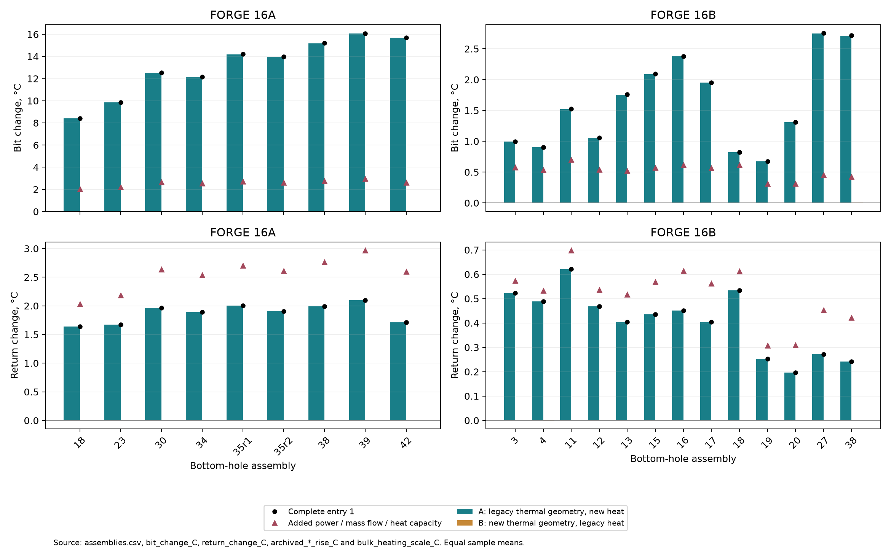

# Model development

This log records changes to BoreTHM's physical calculations and their comparison with development observations. A declaration describes the equations, inputs and predicted effects before a new comparison. Its subsequent score uses the same sample list and reports every gap, including deterioration. Reverted candidates remain in the disclosure table.

## Data statement

FORGE 16A and 16B are development data. Their observations have already been examined and cannot provide an independent validation of changes motivated by their errors. FORGE 56-32 standpipe-pressure targets were opened on 28 October 2026 for the first pressure stage below and are now pressure-development data. Its temperature targets remain reserved. During later 58-32 input preparation, two daily-report slow-circulation pressure readings were viewed before the new numerical protocol. Its Pason window-pressure targets were opened on 1 November 2026 and are now pressure-development data. Its thermal targets remain reserved. The [58-32 pressure-test protocol](../../validation/forge58-32/pressure-test/protocol.md) discloses that prior exposure and preserves the original input-only window identities. FORGE 78B-32 targets remain unread and reserved for later validation.

No new parameter is fitted in the primary development comparison. The annulus film multiplier is 1.0. A film coefficient converts a fluid-to-wall temperature difference into heat transfer per unit area. `site_evaluation.FILM_MULT_FORGE = 0.75` is a fitted, retired sensitivity. The full site evaluator still calculates that historical sensitivity separately from its primary result; the scoreboard does not call it. The fitting routines in `studies.validate_forge16b` remain historical study functions and are excluded from the scoreboard.

There is an additional historical calibration that must be disclosed. The frozen 16B trial geometry uses effective insulated-pipe wall conductivity 4.9237482416889895 W/(m K), obtained by fitting 16B observations. Film multiplier 1.0 does not remove that fit. The baseline retains this conductivity to reproduce the archived calculation. Trial cases using it are labelled as calibrated geometry. The regular-pipe group does not use it. An unqualified claim of no calibration would be incorrect for the full baseline. An independently sourced insulation input is required before describing a later complete primary path as uncalibrated.

Recorded well geometry, flow, mud properties and initial conditions are observational inputs. They are distinguished from correlation coefficients and engineering assumptions. No correlation coefficient may be selected from a FORGE residual. One inherited reference-programme assumption also needs correction before a source-independent candidate can be scored: ordinary-pipe connection pitch was transferred from the 16B tally. It is disclosed below and is not represented as a manufacturer value.

## Gaps

The following sizes describe the earlier comparisons. They are context for declarations, not acceptance targets. Errors are modelled minus measured.

| Gap | Quantity | Earlier reported size | Scoreboard definition |
|---|---|---|---|
| G1 | Standpipe pressure, measured at the surface pump | 16A about -1,624 psi; 16B about -969 psi after reported motor differential subtraction | Signed psi and percentage residual by assembly. 16A uses standpipe minus raw reported differential. 16B uses unadjusted standpipe on motorless runs 12, 13, 15 and 16. |
| G2 | Hydraulic power represented as heat | 16A about 500 versus 928 kW; 16B about 244 versus 527 kW | Mean modelled in-hole friction, nozzle and motor-face power against measured standpipe pressure times inlet volumetric flow, over the same pressure-available samples in each well. Surface power is reported separately and is not added to in-hole heat. |
| G3 | Deep 16A bit-temperature bias | BHA 38 about -7, BHA 39 about -9 and BHA 42 about -19 °C | Bore-fluid temperature at the bit against bit-box observations, by every 16A assembly; the deep assemblies are marked. The sensor medium is unresolved, so this is a fixed calculation proxy. |
| G4 | 16A run-in peak error | Underprediction about 20–50 °C on partial legs | Event-level peak error using the existing conditional initial-state and fixed-column treatment. The tool's internal-fluid node at the bit and the static fluid-node treatment are the single declared comparison. |
| G5 | 16A surface return bias | About -6 °C; observations exceed even the optimistic recovery bound | Equal-sample pooled return bias across all frozen 16A primary samples. Source groups and their overlaps are retained; this is not a count of independent observations. |
| G6 | 16B regular-pipe and trial temperature biases | Independent regular pipe about -8.8 °C; trial runs about +1 to +3 °C | The original independent regular-pipe group, with its declared sensor positions, and each of the four trial runs. Early unresolved-position runs remain separately reported and are excluded from the original independent pool. |

The 16B numbers above mix historical protocols. The -969 psi and 244 kW figures use the later revised-rheology comparison. The original blind settings use the earlier recorded-mud substitutions. G1 also uses a different subset and pressure target from that pooled historical number. The baseline must reproduce the original calculation and state these differences; it must not be adjusted to reproduce rounded numbers from a different protocol. Measured pump power does not establish where that power becomes fluid heat, particularly when a motor performs mechanical work.

## Frozen comparison

The [scoreboard](../../validation/scoreboard/README.md) uses the original primary sample lists, recorded mud, PV referenced to 26.7 °C, film multiplier 1.0 and cumulative circulation exposure. PV means plastic viscosity, the slope of the Bingham fluid's stress versus shear-rate relation above its yield stress. Each sample has equal weight within its declared group. No sample is selected using a new prediction or residual. Failed and unavailable cases remain in the coverage counts.

The baseline runs the explicit original hydraulic mode. Its temperature, pressure and power outputs are checked against the archived blind calculations at 0.1 °C, 1 psi and 0.1% of power. These are reproduction checks, not tolerances for accepting a physical model. The scoreboard and baseline are then fixed. A later change to their samples, reductions or input conventions is itself a development entry.

The run-in comparison retains the original observed initial tool temperature and average leg speed. Its fluid column is calculated at the start of each leg using the original local circulation/static history. Two originally unavailable run-in events remain visible in the event inventory. Their absence cannot be counted as successful model agreement.

## Candidate disclosure

This table includes work performed before this log existed. Earlier development results are not new scores under the frozen scoreboard. A missing earlier prediction is stated explicitly.

| Candidate | Declared prediction | Development result available before this log | Disposition |
|---|---|---|---|
| Original hydraulic calculation, PV at 26.7 °C | Original comparison configuration | Archived 16A and 16B blind results | Baseline reference |
| Original calculation, PV at 48.9 °C | Higher plastic viscosity for the same field PV; changed pressure and heat transfer | Separate pressure rows in the [earlier development archive](../../validation/hydraulics-v160/pressure-comparisons/README.md) | Deferred heat-transfer candidate; excluded from entry 1 |
| Revised hydraulic calculation, PV at 48.9 °C, 16A NC50 scenario | Additional connection/component losses and local dissipation | Earlier pressure and temperature predictions exist; no six-gap scoreboard score | Provisional; entry 1 awaits its separate 26.7 °C score |
| Revised hydraulic calculation, PV at 48.9 °C, 16B EIS scenario | Additional losses and local dissipation | Earlier motorless pressure predictions exist | Provisional; no acceptance decision |
| Revised hydraulic calculation, PV at 48.9 °C, 16B GPDS55 scenario | Alternative catalogue connection dimensions | Earlier motorless pressure predictions exist | Historical geometry sensitivity; excluded from the single primary scoreboard variant |
| D1 endpoint correction alone | Remove an initial solver point below the bit | Invalid-step warnings continued | Reverted as an incomplete correction |
| D1 endpoint and overlapping-ramp correction | Restore a continuous numerical geometry transition | The same short-component case converged | Retained numerical correction; gap score pending |
| D2 boundary tolerance 1e-10 K | Reduce the turnaround power residual | Reduced the numerical residual; no independent physical justification for that precision | Return to the original boundary tolerance; diagnostic-only policy below |
| D3 programme forwarding | Pass the declared geometry to design comparisons | Programme-adapter tests passed | Retained API correction; no new physical coefficient |
| D4 aggregate trial adapter | Retain the original trial geometry and remove missing serial-table lookups | Four trial geometry tests pass; all 45 trial samples and all 22 diagnosis windows converge | Retained input-contract correction; frozen scoreboard unchanged |
| Entry 1, original 26.7 °C convention, NC50/EIS | Additional hydraulic losses and local heat; temperature effects estimated at tenths to a few °C | G1/G2 deficits decrease; G3 warms by 8.4–16.1 °C, worsening five assembly biases; G6 trials become warmer | not kept; BHA representation under correction |
| Entry 2 component diagnosis | Separate a length-dependent connection contribution from assembly-passage losses | The assumed 1.25-in motor passage is a large calculated contribution on 16A; connection losses also contribute | Diagnosis only; no model change or acceptance decision |
| Thermal geometry and heat-source separation | A should reproduce a heat-source effect; B should reproduce a thermal-geometry effect; compare with the single-pass power scale | A reproduces assembly mean bit rises within 0.02 °C; B changes them by less than 0.01 °C. A exceeds the bulk scale at the bit. | Diagnosis only; no model correction selected from it |
| D5 equipment representation | Remove a motor mandrel's full-length passage and invented bit IDs; pressure and dissipation should decrease | All 467 circulation cases and nine available run-in cases calculated, with explicit thermal-only instrument assumptions and unknown internal tool losses | Debugging correction; acceptance of integrated entry 1 remains pending |
| Entry 1 with D5, original 26.7 °C convention | Revised hydraulic losses with equipment-corrected assembly passages | 16A in-hole power 654 versus measured pump power 928 kW; G3 rises 1.3–3.7 °C from legacy; G6 regular bias -7.2 °C and trial bias +3.0 °C | Kept as the working development calculation, 28 October 2026; upheld by independent review, 29 October 2026 |
| Entry 3, cylindrical rock response (R1) | Exact wall-temperature step response replaces the logarithmic rock term; bit +0.2 to +2.2 °C and return +0.1 to +0.35 °C in the working calculation | Every expected score change met within 0.1 °C. Cold biases shrink, except BHA 35r1, which crosses zero; warm biases grow, including the trial bias, from +3.03 to +4.62 °C | Kept under its declared rule, 28 October 2026; upheld by independent review, 29 October 2026 |
| Entry 4, rotary heat (M2) | Measured surface rotary power released as wall friction along the string and as work at the bit, split by a soft-string torque balance; warmer everywhere, most where the string rotates fast and deep | Every expected score change met within 0.25 °C. Deep 16A biases shrink to -2.1, -2.8 and -13.6 °C; 16B regular pipe -1.40 °C, with its deep runs now warm; trial bias +7.55 °C | Kept under its declared rule, 28 October 2026; upheld by independent review, 29 October 2026 |
| Entry 5, measured 16B mud rheology (I1) | Measured PV and YP replace reference-mud fills on seven 16B assemblies; 16B standpipe pressure falls by 166–524 psi; EOW 11, 12, 16 and 17 warm by 4.8–10.9 °C | Every expected change met within 1.1 °C and 20 psi. 16B G1 biases fall to -435 to -546 psi; 16B regular pipe +2.40 °C, trial +9.08 °C | Kept under its declared rule, 29 October 2026 |
| Bingham annulus candidate, Wilson–Thomas criterion on the report YP (`bec37fe`) | Shared laminar-turbulent criterion for annulus pressure and heat transfer, Gnielinski on the wall apparent viscosity | Never scored. Model-only checks found the 16A annulus laminar on the YP and turbulent with a low-shear yield stress | Removed before scoring, 30 October 2026; replaced by entry 6 |
| Entry 6, Herschel–Bulkley annulus (A1), hypotheses no-yield, gel and gel-rising | Founargiotakis slot model for annulus pressure and regime; Gnielinski on the wall viscosity; all three cool 16A, by about 4–10, 7–34 and 14–34 °C at the bit | Every expected change met. RMS of the nine 16A assembly bit biases 10.0, 19.7 and 24.6 °C against 5.6 °C for the working calculation; 16A pressure and 16B water-like runs nearly unchanged | Not adopted under its declared rule, 30 October 2026; the downhole rheology is unmeasured |
| Entry 7, plastic-viscosity heat transfer and the Erge band (A2), the same three hypotheses | Gnielinski on PV (Chhabra and Richardson eq. 6.55 class) and the transition band of Erge et al. (2015); 16A bit about −1 to −2, −1 to −19 and −4 to −26 °C from the working calculation | Every expected change met. RMS of the nine 16A assembly bit biases 6.0, 9.9 and 16.5 °C against 5.6 °C for the working calculation; 16B within 0.5 °C except EOW 3 and 4 under the gel | Not adopted under its declared rule, 30 October 2026; no-yield matches the working calculation within the 2 °C threshold |
| Entry 8, one regime criterion for annulus pressure and heat transfer (A3) | Entry 7's treatment with no yield stress as the working calculation; the score expected to equal entry 7 no-yield within 0.01 °C and 1 psi per sample, with a film band of 0.85–1.05 | The score equals entry 7 no-yield within 0.004 °C and 0.01 psi at every sample. RMS of the nine 16A assembly bit biases 6.02 °C, 8.12 °C at film 0.85 and 5.56 °C at 1.05 | Kept under its declared rule, 31 October 2026; the package default is unchanged until the stage 2 score |
| Entry 9, pressure diagnosis | Separate equipment-associated pressure from the part that increases with pipe length; test flow dependence using independently selected observations | Shallow 16B deficits of 188–483 psi; per-length slope ratios 1.54–2.23 on five groups and 1.06 on partial-insulated EOW 19. No 16A slope meets the declared coverage rule | Diagnosis only, 31 October 2026; installed equipment losses and connection machining remain unresolved |
| Entry 10, sourced pressure options | Smooth Colebrook pipe friction, with separate roughness and catalogue-connection scenarios; defaults retained | All six gaps scored; smooth Colebrook met the declared acceptance rule | Maintainer decision, 31 October 2026, corrected 1 November: adopt smooth Colebrook with zero roughness into the working calculation. Package defaults remain Blasius with zero roughness; the steel, GPDS55, FH and gradual variants are not adopted. |
| D6, original-path overlapping ramps | Apply the existing occupancy-weighted blend to original thermal pieces where ramps overlap; keep current-path pieces unchanged | All 62 original-reference windows converge with D6 and D7; frozen legacy results are unchanged | Numerical correction; equations, physical inputs and solver settings unchanged |
| D7, original-path mesh boundaries | Apply the existing well-boundary clipping to the original initial mesh | The shallow original-reference window converges at its physical ends; all 2,614 legacy archive checks pass | Numerical correction; keep inlet and turnaround conditions at the physical well ends |
| Entry 11, pressure-input consistency | Independent source checks should distinguish pressure-channel, flow, nozzle, passage and density inputs; no fitted correction | Configured regimes and approximate 95% settings found; flow-scale bounds 0.553–0.631; sweep qualifies depth increment; no 2017 installed displacement established | Diagnosis only; no corrected input adopted and P3 unchanged |
| Entry 12, installed ordinary drill pipe | Sourced smaller connection bores increase pressure and hydraulic heat; transition choice fixed by source applicability | Frozen comparisons completed; see the six-gap and trip tables below | Maintainer decision, 4 November 2026: installed geometry adopted into the working calculation with entry 13's tapered transitions. The abrupt primary, `installed_no_local`, `installed_premium` and `installed_steel` are not adopted. Package defaults unchanged. |
| Entry 13, tapered drill-pipe joints | Conical bore transitions at a published upset angle reduce the abrupt bore loss to 20.1% of its value, below the 29.7–44.8% bound of entry 12 | Frozen comparisons completed; declared predictions reproduced, and full-depth pressure and power errors increase against the abrupt treatment | Maintainer decision, 4 November 2026: `tapered_primary` adopted into the working calculation with entry 12's geometry. `tapered_long`, `tapered_steep` and `tapered_pin_length` are not adopted. Package defaults unchanged. |
| Entry 14, tool-loss allowances | Generic published allowances for tools named on the string; pressure and power deficits shrink, 16B warm biases grow | Frozen comparisons completed; declared predictions reproduced, with G1 16B RMS 240.2 psi and G6 regular bias +5.25 °C. HALO assemblies were given no pulser | Maintainer decision, 5 November 2026: package defaults in v1.8.0, made before this score; 16A and 16B do not test the defaults independently |
| Entry 14 amendment, corrected tool assignment | 6¾-in MWD pulser allowance added on the five scored HALO assemblies, from the printed BHA sheets; only those 49 samples change | Declared after the entry 14 scores had been seen. Review estimated about 170 psi at EOW 12's flow against the 144–145 psi remainder. Declared predictions reproduced, with G1 16B RMS 60.1 psi and G6 regular bias +6.82 °C. 163–353 psi remains on motor assemblies at 216–492 US gal/min | Maintainer decision, 6 November 2026: correct by declared amendment before the v1.8.0 tag; tool table, rule and defaults unchanged |
| Entry 14, tool-loss allowances and motor no-load drop | Published generic allowances added to `tapered_primary`; 16A and 16B pump pressure rise by 56–277 psi, bit temperatures by 0.1–4.6 °C, shallow windows by 25–127 psi | Declared changes reproduced in all 2,112 checks. G1 RMS 1030.36 and 240.17 psi, G2 biases -229.95 and -143.27 kW, G3 RMS 5.11 °C, G6 regular and trial biases +5.25 and +12.55 °C. Low-flow shallow gap 163–220 psi remains | Maintainer decision, 5 November 2026: package defaults in v1.8.0 with the adopted physics; unexplained shallow gap stays open |
| Historical annulus film multiplier 0.75 | Earlier fitted heat-transfer sensitivity | Fitted on 16B and evaluated separately | Retired sensitivity; excluded from primary scoring |
| Historical insulated-pipe conductivity fit | Reproduce the 16B trial insulation result | Used by the archived trial geometry | Baseline reproduction only; calibration explicitly disclosed |

## 27 October 2026: entry 1, hydraulic losses and heat placement

This is a retrospective declaration. The implementation and some development comparisons predate this log. The predictions below are written after those results were available and are not a blind registration. The source choices and interface can be inspected at `a1927b3` (27 October 2026, 15:32 +01:00), `8bbfe2c` (16:08 +01:00) and `56d1b57` (19:27 +01:00). No new entry-1 score is made here.

### Equations and parameters

The shared calculation uses the existing Bingham straight-passage pressure gradient for mud and the existing Newtonian gradient for water. Bingham yield stress is the stress below which the idealised fluid does not shear. For each repeated connection, the body-friction contribution over its restriction length is replaced by friction at the connection bore and external diameter. The expected number of connections is string length divided by connection pitch. Serial components retain separate passages.

For an area ratio r = small area / large area, abrupt expansion uses K = (1-r)^2 and contraction uses K = 0.5(1-r)^0.75. Each local loss is K rho v_small^2 / 2. A supplied tool curve scales as dp_ref (rho/rho_ref)(Q/Q_ref)^2. A complete tool curve replaces the internal losses it already includes. Surface pressure is C rho_ppg (Q_gpm/100)^1.86 psi. Each in-hole dissipative term supplies heat at its location, q' = Q_local dp/dz. Nozzle dissipation remains at the bit; surface losses and the signed density-column pressure contribution are excluded from in-hole dissipation. The same pressure-gradient kernel supplies pressure and heat.

| Parameter or treatment | Value and provenance | Qualification |
|---|---|---|
| Straight-passage friction | Existing Bingham and Newtonian laws; Bourgoyne et al., *Applied Drilling Engineering* (1986), chapter 4 | No new roughness or residual multiplier |
| Local-loss coefficients | Expansion 1 and contraction 0.5 with exponent 0.75; [Modelica 4.0.0 sudden-change documentation](https://doc.modelica.org/Modelica%204.0.0/Resources/helpOM/Modelica.Fluid.Dissipation.Utilities.SharedDocumentation.PressureLoss.Orifice.dp_suddenChange.html), citing Idelchik | Published smooth turbulent restrictions; transfer to annular/yield-stress flow is approximate |
| Tool scaling | Density times flow squared; API RP 13D, sixth edition (2009), section 7.6.2, equation 103 | Requires a tool-specific reference point |
| Surface layouts | C = 1.00, 0.36, 0.22, 0.15 or 0.15; exponent 1.86; API RP 13D, sixth edition (2009), section 7.3, equation 60 and table 4 | Layout 5 is the declared reference assumption; installed surface plumbing is unresolved |
| Nozzle discharge coefficient | Existing 0.95 | Retained baseline convention, no refit |
| Property pressure floor | Existing thermal-friction guard, 5 MPa, applied consistently to new pressure and heat | Numerical liquid-property approximation near the surface |
| Ordinary reference connection | 7-in OD and 4-in bore; [NOV GPDS/EIS catalogue](https://www.nov.com/products/gpds-and-eis-connections), 5.5-in / 21.9-lb/ft row | Dual-wall and vacuum variants retain their body bore internally; external envelope is transferred |
| Ordinary restriction length | 29 in | Inherited engineering assumption; not an as-built throat measurement |
| Ordinary reference pitch | Existing 2,378 ft / 75 from a 16B tally | FORGE-derived transfer, not source-independent. It cannot be described as a non-FORGE model constant; replace by a compatible catalogue pitch in a declaration before scoring the reference scenario. |
| Heavy-weight pipe connection | 7.25-in OD, 3.25-in bore, approximately 31-ft pitch; [Workstrings 91005000020000](https://www.workstringsinternational.com/assets/Spec-Sheets/HWDP/91005000020000-Imperial.pdf), 1 August 2025 | 48-in effective restriction is an assumption based on published pin/box lengths |
| Reference measurement-tool loss | xBolt G2-L, Rev 7, page 2: psi = ppg times gpm squared / 30,000; [manufacturer sheet](https://www.poweredbyextreme.com/wp-content/uploads/2024/07/xBolt-G2-L-Specifications-and-Fishing-Diagrams_Rev7.pdf) | 500-gpm, 1,000-kg/m³ normalisation; flow limit 750 gpm; 165 °C rating does not qualify a hot-well tool |
| Reference tool geometry | Pulser 1.780032 m, 7-in OD / 3.38-in bore; collar 9.144 m, 6.75-in OD / 3.25-in bore | Same manufacturer drawing; covered internal tool loss replaces empty-passage losses |
| Plain reference collar | 132.075968 m | Existing 143 m less the two stated tool lengths |
| Development assembly geometry | Recorded component dimensions and the previously declared NC50 or EIS catalogue scenario | Observational well inputs are retained separately from model coefficients; unknown tool operating losses remain unknown |

The 26.7 °C viscosity reference stays unchanged in this entry. A 48.9 °C field reference is an unverified input convention and belongs to a later heat-transfer entry. Recorded field dimensions do not establish installed connection machining. The inherited reference pitch and trial insulation calibration are explicit unresolved provenance issues, not hidden fitted parameters.

### Predicted effects before the next comparison

These are order estimates, not acceptance bands. At an illustrative 40 L/s, each additional 100 psi corresponds to about 28 kW of hydraulic power. With illustrative density 1,000 kg/m³ and heat capacity 4,000 J/(kg K), full conversion would add about 0.17 °C per 100 psi. These illustrative properties are not FORGE calibration values.

| Gap | Predicted direction and rough size |
|---|---|
| G1 | Pressure should increase at fixed flow as omitted restrictions are added. Tens to order 1,000 psi are plausible for the declared tool and connection scenarios; no specific fraction of the observed deficit is promised. |
| G2 | In-hole dissipative power should increase, of order tens to hundreds of kW for the illustrative pressure/flow range. Surface loss cannot supply downhole heat. |
| G3 | Extra heat could change bit temperature by tenths to a few °C. Internal exchange and rock heat transfer may change the local sign. A large deep-run temperature correction is not predicted from dissipation alone. |
| G4 | No direct new heating during pumps-off run-in. Any effect is through the preceding fluid/rock state, plausibly a few °C or less; its sign is conditional on that history. |
| G5 | The direct hydraulic-heating contribution should raise fluid energy, with a return-temperature effect of tenths to a few °C. Changed rock exchange can alter the net return response. |
| G6 | Similar modest heating is expected in regular pipe and trial runs. Additional trial overprediction would be a deterioration that must be reported. |

Status: retrospective declaration; no six-gap score or keep decision under this log.

## 27 October 2026: D1, short serial components

Commit `c98f02e` corrected a numerical geometry error. A component shorter than half the 1-m transition width could place an initial solver point below the bit. Closely spaced transitions could overwrite one another and make the blended equations discontinuous. The correction restricts the initial mesh to the well and uses non-negative piece-occupancy weights for overlapping transitions, with the same 1-m width and unchanged per-piece equations. The explicit legacy mode retains its original path.

The justification is the solver domain and continuity of its equations. Closing a field-data gap is not its justification. Endpoint correction alone did not resolve the overlapping-transition case. The combined correction converged on that same input. No signed change is predicted for G1 to G6; the purpose is to obtain valid solutions for declared geometry. Synthetic component tests retain this correction. A separate six-gap score has not been made.

## 27 October 2026: D3, programme forwarding

Commit `0b89980` corrected the design-comparison adapter after the evaluator acquired a hydraulic-programme argument. The adapter must pass the declared programme and casing shoe to the geometry builder. This is an interface correction, justified by the argument contract. No coefficient was chosen from a prediction error, and no physical improvement in G1 to G6 is claimed.

## 27–28 October 2026: D2, energy diagnostic and boundary accuracy

Commit `8e6d0b9` tightened the boundary-condition tolerance to 1e-10 K because a small turnaround residual exceeded an excessively precise power check. The pressure/heat source integrals agreed. This diagnostic discrepancy did not establish failure of the physical boundary-value solve.

Restore the original solver tolerance: profile tolerance 1e-4, with the solver's default boundary tolerance. Report assigned power, applied power and their residual. Flag a residual exceeding the larger of 1 W and 0.1% of the compared powers. A failed diagnostic evaluation is also flagged and returned. Neither case changes solver success or raises a diagnostic exception to the caller. Solver convergence and finite physical temperatures remain separate checks.

Prediction: the representative deep-well solve remains converged at the original tolerance, and its small power residual is acceptable at the declared reporting resolution. No material G1 to G6 change is expected from removing unnecessary boundary precision. Any actual convergence failure must be identified; tolerance tightening is permitted only for such a demonstrated convergence need. No physical gap score is authorised by this numerical check.

The original tolerance has been restored. The deep-well reference and both short-component convergence cases pass at that tolerance. Tests also confirm that a flagged residual or an exception inside the diagnostic leaves a converged solve successful. No tested case requires a tighter boundary tolerance. The six-gap candidate comparison remains pending.

## 28 October 2026: legacy baseline

The single baseline calculation completed in 265.5 seconds. Its 467 circulation cases converged, and all nine originally available run-in cases were reproduced. All 2,614 archive checks passed at the stated resolutions. The two unavailable run-in cases remain unavailable. The saved [scoreboard](../../validation/scoreboard/baseline/scoreboard.csv) and its individual predictions are the reference for subsequent entries. This is a reproduction of the original calculation, not a score of entry 1.

| Gap | Legacy baseline | Source within the scoreboard archive |
|---|---|---|
| G1 | Every 16A assembly and the four motorless 16B assemblies have separate psi and percentage residuals | `scoreboard.csv`: G1 rows, `bias` and `mean_percent_error` |
| G2 | 16A 500.04 versus 928.27 kW; original-protocol 16B 264.29 versus 526.52 kW | `scoreboard.csv`: G2 rows, `model_mean`, `measured_mean` |
| G3 | Bore-at-bit biases for BHA 38, 39 and 42 are -8.12, -9.68 and -19.81 °C; all assemblies are reported | `scoreboard.csv`: G3 rows, `bias`, `deep_run` |
| G4 | The nine available event peak errors range from -54.35 to -6.53 °C for the declared internal-fluid comparison | `run-in.csv`: `peak_error_C`; unavailable events have no numerical error |
| G5 | Pooled return bias -5.85 °C over the original 358 samples | `scoreboard.csv`: G5, group ALL, `bias`, `compared` |
| G6 | Independent regular-pipe bias -8.77 °C; pooled trial bias +1.99 °C, with every trial also reported separately | `scoreboard.csv`: G6 group rows, `bias` |

The G3 figures use the fixed bore-fluid proxy specified before this run. The earlier rounded gap description did not identify one of the unresolved bore/annulus and position alternatives. Those quantities are not silently interchanged. Source and result checksums identify the frozen scoreboard; later scoring changes require their own log entry.

## 28 October 2026: heat-transfer candidate inventory

These candidates are declared for G3, G5 and G6. None has been scored by this log. A Reynolds number compares inertial and viscous flow effects; a Nusselt number converts a heat-transfer coefficient into a dimensionless quantity. The hydraulic diameter of a concentric annulus is the outer diameter minus the inner diameter.

| Treatment | Physics and provenance | Rheology states and reference temperatures |
|---|---|---|
| Current calculation | Dittus–Boelter with plastic viscosity, Nu = 0.023 Re^0.8 Pr^n in its turbulent branch, laminar Nu = 4.36, film multiplier 1.0 | Intact, central and degraded rheology; each at PV reference 26.7 °C and 48.9 °C |
| Wall-viscosity and transition treatment | Apparent viscosity at the wall includes yield stress. For a Bingham fluid, mu_wall = mu_plastic / (1 - tau_y/tau_wall) in a yielded wall layer. Wilson–Thomas or a Hedström-number transition must be declared with its validity limits before implementation. Hedström number is rho tau_y D_h² / mu_plastic². [Thomas (2018)](https://papers.acg.uwa.edu.au/d/1805_16_Thomas/16_Thomas.pdf), equations 9–12, also identifies the corrected sign in the original Wilson–Thomas expression. | The same three rheology states and both reference temperatures; no state selected from residuals |
| Annulus heat transfer | Gnielinski's concentric-annulus correlation distinguishes inner and outer heat-transfer surfaces. Diameter ratio a = D_i/D_o gives inner factor 0.75 a^-0.17 and outer factor 0.9 - 0.15 a^0.6, with the liquid wall-property correction (Pr/Pr_wall)^0.11. See [Gnielinski (2009)](https://doi.org/10.1080/01457630802528661) and the [INL implementation](https://mooseframework.inl.gov/bison/source/materials/ADWallHTCGnielinskiAnnularMaterial.html). | The same three rheology states and both reference temperatures; extension from Newtonian data to mud requires an explicit approximation statement |

Intact rheology retains the recorded PV and yield point under the declared temperature treatment. Degraded rheology approaches the water-viscosity, zero-yield limit at recorded density. A central downhole state needs independent laboratory ageing evidence or an explicitly declared interpolation bracket before it receives numerical values. No degradation factor is inferred from the FORGE temperature gaps. The unknown field measurement temperature also cannot be identified from a better residual at 48.9 °C.

The candidate inventory is a design space, not permission to run all combinations. Each subsequent entry names one primary treatment. Additional variants require a stated input uncertainty and comparison purpose in that entry's declaration. Correlation changes may alter convection by tens of percent and temperatures by several °C, but coupled bore/annulus exchange prevents a reliable signed prediction at every sensor without calculation. A model-specific declaration must narrow these order estimates before scoring.

Reheating candidates for G4 and G5 are reserved for a separate declaration before their first implementation or comparison. Existing recovery-bound diagnostics do not establish recovery as the cause of any gap.

## 28 October 2026: entry 2, string-loss diagnosis

This entry changes no model function or parameter. Earlier pressure comparisons reported a 1,150–1,730 psi string-loss increase on 16A and 130–340 psi on 16B at similar depth/flow, including overpredictions for 16A BHA 38 and 39 and a smaller increase for deeper BHA 42. These are previously observed development results, not a result of the diagnosis declared here.

Explanation A is that the assumed NC50 connection bore dominates the increase. Its prediction is a connection contribution that grows with string length and is similar among assemblies at matched flow and depth. Explanation B is that a small passage in particular assemblies dominates. Its prediction is an assembly-specific component contribution that length and flow do not explain. Both mechanisms may contribute.

Use one representative pressure-available window per assembly in each well. Select the earliest window at the median bit-depth rank, ordered by depth, time and sample identifier; for an even count use the lower middle rank. The selection uses frozen inputs alone. The 16A set contains each bit-box assembly. The 16B set contains each pressure-available primary assembly, including the trial runs. Keep the same recorded mud and PV reference of 26.7 °C as the scoreboard.

Report pipe-body friction, repeated connections, each serial assembly component, local changes of area, supplied tool losses, nozzles and surface loss separately, including external annulus contributions. Each component row names its length, bore, outer diameter and source. A complete tool curve must not receive duplicated empty-body losses. Unknown proprietary operating losses remain unknown. The budget must sum to standpipe pressure within about 1 psi. No bore, effective length or coefficient is adjusted after this breakdown.

The diagnosis and entry-1 six-gap comparison await approval. Entry 1 will then receive a keep/revert recommendation with the before/after scoreboard. The acceptance decision remains separate from the numerical calculations.

## 28 October 2026: additional candidate declarations

These declarations precede the first entry-1 score on the frozen scoreboard. They add no model term and change no scoreboard input. The estimates below describe possible physical effects; they are not calculated changes on the development samples. A later implementation needs its own declaration and score. The approved historical insulation conductivity and connection pitch remain fixed for entry 1.

### Motor power and mechanical work

The present face source uses inlet flow times the rig's reported motor differential. That differential represents the increase above the off-bottom pressure and omits the motor's no-load pressure drop. Candidate M1 accounts for total motor hydraulic power, Q times (reported differential plus independently specified no-load drop), for G2, G3 and G6. Hydraulic power includes shaft work. An implementation must separate internal motor dissipation from shaft work and any subsequent bit heat, so the same power is counted once. A manufacturer's no-load value requires a documented motor match and flow basis. It cannot be inferred from a pressure residual.

The predicted direction is increased accounted motor power and additional heat where that power is dissipated. **Estimate:** at illustrative flow 20–50 L/s and omitted drop 100–500 psi, the additional hydraulic power is about 14–172 kW. The corresponding bulk temperature increment is of order 0.1–2 °C for water-like heat capacity and typical drilling mass rates. G3 and G6 may become warmer; an existing positive trial bias could increase. These are engineering estimates, not a promise that all hydraulic power becomes immediate face heat. BICO's [7-in SSS100-B5 sheet](https://bicodrilling.com/wp-content/uploads/2022/09/7-SSS100-B5.pdf) reports a separate no-load drop and rated flow range. It is an example of the required input, with no assumed match to either development well. Zhang et al. (2024), reference C2 below, include a motor heat source.

Candidate M2 adds rotary string friction and bit work for G5, with smaller effects expected on G3 and G6. Mechanical power is torque times angular speed, P = torque times 2 pi RPM / 60. The declared string-friction deposition is in the annulus along the deviated section; bit work is deposited at the bottom. Measured surface torque contains both contributions and other mechanical losses, so partitioning requires a physical torque balance. Motor shaft power already accounted for in M1 cannot be added again as an independent heat source. Raw torque and rotational-speed channels are needed from the 16A 1-s records in GDR 1283 and the 16B Pason records. No channel is extracted or compared at this stage.

The predicted direction is warmer return fluid, with smaller positive bit-temperature effects that depend on heat exchange along the string. **Estimate:** 10 kN m at 120 RPM supplies about 126 kW. If all of that power entered 40 kg/s of fluid with heat capacity 4 kJ/(kg K), it would supply about 0.8 °C of bulk warming. An order 0.5–3 °C return response and sub-degree to a few °C local response are provisional estimates. The partition and actual channel magnitudes are unresolved. References C1, C2 and C3 discuss rotational or mechanical heat; none provides a coefficient selected for FORGE.

### Rock conduction and exposure history

Candidate R1 replaces the approximate rock resistance ln(1 + 2 sqrt(t_D)) with the exact infinite-medium cylindrical response to a constant wall-temperature step. Here t_D = alpha t / a², a is the rock-boundary radius, and alpha = k/(rho c) is thermal diffusivity. For initially uniform rock, unit wall-temperature step and temperature fixed at infinity, the dimensionless Laplace-domain temperature is K0(r_D sqrt(s))/(s K0(sqrt(s))). K0 and K1 are modified Bessel functions; s is the dimensionless Laplace variable and r_D = r/a. Differentiation at the wall gives the transformed dimensionless conductance K1(sqrt(s))/(sqrt(s) K0(sqrt(s))). Invert and tabulate that conductance, then use its reciprocal as the step resistance multiplying 1/(2 pi k). This follows the cylindrical diffusion boundary-value problem described by Carslaw and Jaeger (1959), reference C4. It is a proposed derivation, with numerical inversion and radial-solver verification required before use.

R1 bears on G3, G5 and G6; G4 is affected through the preceding rock/fluid state. Review the 3,600-s exposure floor together with the response, including fresh-wall times of minutes. The early-time conductance has an inverse-square-root singularity for an ideal instantaneous temperature step. A finite time step or finite boundary evolution needs a physically stated treatment. **Estimate:** changes of order 10–30% in the rock conductance away from the floor, potentially larger at freshly exposed wall, could change local fluid temperatures by order 1–5 °C. For rock hotter than fluid, greater conductance increases fluid heating; the sign reverses where the inlet heats shallow rock. This estimate is not an evaluated response-function comparison.

The constant-flux time functions associated with Ramey (1962) and Hasan and Kabir (1994), references C5 and C6, are excluded from this replacement. Those functions give wall temperature in response to prescribed heat flux. R1 needs flux in response to prescribed wall temperature. Their time-domain responses are different; taking the reciprocal of a constant-flux response does not produce the constant-temperature response. Ramey discusses other boundary conditions as well; this exclusion concerns the constant-flux functions. A future model that prescribes flux would require a separately consistent formulation.

Candidate R2 replaces a single exposure clock with a history response, including measured inlet-temperature changes and pumps-off reheating, for G3, G4 and G6. For a linear rock problem, superpose temperature-step responses over the boundary history. Measured inlet history must first be propagated through the circulating fluid to the depth-dependent wall boundary; it cannot be imposed directly on every rock cell. The same history continues through static periods. Duhamel superposition follows the linear conduction theory in C4; variable properties would require a stated linearisation or a nonlinear time-domain solution.

After a pause, recovery towards the undisturbed rock state is predicted to increase the heat available to a cold returning circulation and can increase run-in peaks. A colder later inlet can reduce temperatures during the corresponding circulation. **Estimate:** order 1–10 °C local history effects and potentially larger transient peak changes; neither their occurrence nor their magnitude on FORGE has been established. G5 is also relevant when reheating supplies subsequent return heat. Compare a resolved radial rock history with the linear history response in a later declared entry; existing full-recovery bounds remain optimistic diagnostics. Neither candidate is implemented here.

### Properties and geometry

| Candidate | Gaps and predicted direction | Rough size, explicitly an estimate | Published basis and input requirement |
|---|---|---|---|
| R3: depth- and temperature-dependent rock properties | G3 and G6. Higher local k increases exchange with hotter rock; a decrease in k with temperature can reduce it. The heat-capacity change also alters recovery. The net temperature sign is depth- and history-dependent. | **Estimate:** tens of percent in local conductance and order 1–5 °C in fluid temperatures. | Allis et al. (2018), C7, report depth-dependent measured conductivity in 58-32 and temperature corrections for both conductivity and heat capacity. Use these as an explicitly transferred material input. Use a consistent k(T), rho c(T) and alpha(T), with an enthalpy formulation if properties vary during recovery. No 58-32 pressure or temperature comparison target is opened. |
| R4: hole enlargement in thermal terms | G3 and G5. A larger hole increases fluid inventory and changes the rock radius, while lower annular velocity can reduce the film coefficient. Competing effects prevent a universal sign; the prediction is a depth-localised response at measured enlargements. | **Estimate:** local film changes of tens of percent and order 0.1–3 °C fluid changes, conditional on actual enlargement. | Gilmour et al. (2021), GDR 1292, supply 16A logs. A later entry must identify the caliper and ultrasonic borehole-image (UBI) channels and their depth coverage. Preserve the hydraulic geometry for a thermal-only comparison, and declare any later hydraulic change separately. |
| R5: fluid thermal mass after flow changes | G3 and G5. Retaining rho c A times dT/dt delays the approach to a new circulating state; the sign opposes the immediate temperature change after a flow step. | **Estimate:** minutes to a circulation time of lag; transient differences of order 0.1–5 °C, decreasing at steady conditions. | C2 and C3 formulate transient fluid energy storage. Low priority because the 16A pause comparisons already identify limitations in starting circulation profiles; storage has not been established as their cause. |
| R6: formation temperature at depth | G3, especially BHA 42, and G5/G6 because the wells share the adopted profile. Residual drilling cooling would make an equilibrium correction warmer. Extending a positive gradient below the log endpoint would also warm that tail; different recovery evidence could change the direction. | **Estimate:** order 0–5 °C change in the temperature input, with a smaller coupled-fluid response; no lower or upper limit is established from the gaps. | The 216-day profile and its coverage are documented in the [16A archive](../../validation/forge16a/README.md), using Jones (2022), GDR 1421. Its endpoint is 10,740 ft MD. C4 supplies recovery physics. Any correction must be obtained from a recovery calculation or later logs acquired before injection, with acquisition dates checked. A residual alone cannot define the correction. |
| P1: independently specified insulated-pipe conductivity | G6 trial runs. Less effective conductivity reduces heat leakage into downward bore fluid, tending to cool it; a greater value reverses that effect. Annulus response can have a different sign. | **Estimate:** order 1–10 °C trial-temperature changes for a substantial insulation-resistance change; sign and size require the actual construction. | Ajima and Naganawa (2022), C8, provide an independently published effective-conductivity example. It is not a manufacturer value for Eavor's 16B pipe. Obtain a value and layer dimensions for that actual product before replacing the fitted 4.9237482416889895 W/(m K). A coating-material value cannot directly replace an effective whole-wall value. No verified manufacturer value for the actual trial pipe has yet been identified. |
| P2: catalogue connection pitch for the reference programme | Reference pressure and heat provenance; it bears on G1/G2 only if later transferred into a development geometry. A shorter pitch increases connection count and losses. It has no effect on the present frozen comparison. | **Estimate:** a 31.5-ft pitch gives about 0.66% more connections than 2,378 ft / 75; only the connection contribution scales by this fraction. | Workstrings International (2025), C9, gives approximate assembly length 31.5 ft for 5.5-in, 21.9-lb/ft pipe. That sheet's Delta 544 connection differs from the reference EIS envelope, so using its pitch would be a declared dimensional transfer. No connection bore or envelope changes are authorised by this declaration. |

### Measurement diagnostics declared without execution

These entries change no model and are not executed at this stage. Each has a distinguishing observable; a better model residual cannot determine a correction.

| Diagnostic | Declared comparison and interpretation |
|---|---|
| M3: Sanvean-to-rig clock alignment | Cross-correlate independent pressure-step records, using raw timing and sustained features. Estimate offsets separately across 1 November 2020 and check whether a clock-convention change explains them. Do not select an offset from temperature agreement. |
| M4: bit-box and top-sub response | Compare bit-box minus top-sub temperatures across on-bottom and off-bottom steps, allowing for sensor separation and fluid transport. A repeatable load-linked difference can distinguish local heating from a common inlet-history change. |
| M5: sensor response after pump start | Compare pressure/flow onset with the subsequent temperature response and the predicted transport arrival. Separate a sensor response time from fluid transit and wall recovery. No response constant is chosen from a model bias. |
| M6: flow and lag | Reconstruct flow-in from pump strokes and declared pump displacement, compare it with return-flow measurements, and check the corresponding bottoms-up transport lag. Bottoms-up lag is the travel time from the bit to surface. Different meter calibration and partial losses can both alter the balance; pit-volume records distinguish them. |
| M7: 16A losses | Read daily-report loss entries alongside pit-volume changes, accounting for recorded transfers and additions. Compare their times with pressure and return flow. A volume deficit without a documented transfer supports loss; neither temperature bias nor a cooler annotation quantifies it. |
| M8: inlet-temperature agreement | Compare rig and mud-log channels at matched times after establishing sensor locations and inlet/outlet identity. The existing rig mud-temperature channel is outlet-like, so it cannot automatically be relabelled as inlet. Record missing inlet measurements. |
| M9: pressure residual remaining after entry 1 | Examine documented tool curves and differential-channel tare drift; verify pressure-transducer location and the flow-meter basis. Pressure dependence on flow and assembly identity can distinguish missing restrictions from an additive tare error. No proprietary tool curve is fitted to the residual. |

### Later superhot design questions

These items have no development-gap assignment. Each needs a separate physical scope and independently sourced parameters before implementation.

| Item | Later design purpose |
|---|---|
| Thermal-cracking regime flag | Identify conditions where cooling-induced distributed cracking can invalidate an elastic intact-rock calculation. |
| Fracture opening and weak-plane strength | Represent existing fracture opening and failure along weak planes, with orientation-dependent strength. |
| Brittle-to-ductile transition and creep | Account for temperature- and time-dependent deformation where elastic brittle failure ceases to be adequate. |
| E(T) | Use temperature-dependent Young's modulus in the thermoelastic stress calculation. |
| Static-hot column pressure | Calculate pressure from the reheated density profile during a static period. |
| Pump-start gel and surge | Evaluate transient start-up pressure from gel breaking and motion-induced pressure. |
| Loss-zone boundary condition | Allow fluid and enthalpy to leave the well at a specified loss interval. |

### Verified references for these declarations

The following author/year identities and DOI or stable publication URLs were checked on 28 October 2026. The cited works support candidate physics or input provenance; the rough FORGE effect estimates above are declarations, not results copied from those papers.

| ID | Reference |
|---|---|
| C1 | Chang, X., Zhou, J., Guo, Y., He, S., Wang, L., Chen, Y., Tang, M. and Jian, R. (2018). *Heat Transfer Behaviors in Horizontal Wells Considering the Effects of Drill Pipe Rotation, and Hydraulic and Mechanical Frictions during Drilling Procedures*. Energies 11(9), 2414. [DOI 10.3390/en11092414](https://doi.org/10.3390/en11092414). |
| C2 | Zhang, S., Fu, J., Peng, C., Su, Y., Zhang, H. and Yang, M. (2024). *The Analysis of Transient Temperature in the Wellbore of a Deep Shale Gas Horizontal Well*. Processes 12(7), 1402. [DOI 10.3390/pr12071402](https://doi.org/10.3390/pr12071402). |
| C3 | Sui, D. and Langåker, V.H. (2018). *Downhole Temperature Modeling for Non-Newtonian Fluids in ERD Wells*. Modeling, Identification and Control 39(2), 131–149. [DOI 10.4173/mic.2018.2.7](https://doi.org/10.4173/mic.2018.2.7). |
| C4 | Carslaw, H.S. and Jaeger, J.C. (1959). *Conduction of Heat in Solids*, second edition, Clarendon Press. [Published book, ISBN 9780198533689](https://books.google.com/books?id=y20sAAAAYAAJ). |
| C5 | Ramey, H.J., Jr. (1962). *Wellbore Heat Transmission*. Journal of Petroleum Technology 14(4), 427–435. [DOI 10.2118/96-PA](https://doi.org/10.2118/96-PA). |
| C6 | Hasan, A.R. and Kabir, C.S. (1994). *Aspects of Wellbore Heat Transfer During Two-Phase Flow*. SPE Production & Facilities 9(3), 211–216. [DOI 10.2118/22948-PA](https://doi.org/10.2118/22948-PA). |
| C7 | Allis, R., Gwynn, M., Hardwick, C., Hurlbut, W. and Moore, J. (2018). *Thermal Characteristics of the FORGE site, Milford, Utah*. GRC Transactions 42. [Original paper](https://publications.mygeoenergynow.org/grc/1033913.pdf). Only material-property evidence is used in this declaration. |
| C8 | Ajima, K. and Naganawa, S. (2022). *Evaluating Wellbore Cooling Effect with Insulated Drill Pipes in Supercritical Geothermal Well Drilling*. GRC Transactions 46, 805–818. [Original paper](https://publications.mygeoenergynow.org/grc/1034636.pdf). |
| C9 | Workstrings International (2025). *Drill Pipe Performance Sheet*, asset WS41-42, 1 August 2025, page 1. [Supplier catalogue](https://www.workstringsinternational.com/assets/Spec-Sheets/Drill%20Pipe/WS41-42-Imperial.pdf). |
| C10 | Abate, J. and Valkó, P.P. (2004). *Multi-precision Laplace transform inversion*. International Journal for Numerical Methods in Engineering 60(5–7), 979–993. [Author's listing](https://valko.engr.tamu.edu/numerical-methods-for-the-inversion-of-the-laplace-transform). Added 28 October 2026 for entry 3. |
| C11 | Johancsik, C.A., Friesen, D.B. and Dawson, R. (1984). *Torque and Drag in Directional Wells: Prediction and Measurement*. Journal of Petroleum Technology 36(6), 987–992. [DOI 10.2118/11380-PA](https://doi.org/10.2118/11380-PA). First presented as SPE 11380 at the 1983 IADC/SPE Drilling Conference. Added 28 October 2026 for entry 4. |

The BICO motor sheet is undated; its identity and contents were checked directly, without assigning a publication year from its URL. GDR source identities are McLennan et al. (2021), GDR 1283, [DOI 10.15121/1776602](https://doi.org/10.15121/1776602); Gilmour et al. (2021), GDR 1292, [DOI 10.15121/1777912](https://doi.org/10.15121/1777912); Jones (2022), GDR 1421, [DOI 10.15121/1893533](https://doi.org/10.15121/1893533); and McLennan et al. (2023), GDR 1516, [DOI 10.15121/1998591](https://doi.org/10.15121/1998591). These identify the development-data inputs for future diagnostics; no new observation is extracted here.

## 28 October 2026: D4, aggregate trial geometry in the comparison adapter

The first entry-1 run exposed an input-contract error. The revised hydraulic adapter indexes a serial-component table for every assembly. The frozen 16B plan intentionally has no such rows for EOW 17–20: their existing trial geometry is aggregate. Indexing those missing keys raises an exception before a solve. This is a coding error independent of the magnitude or direction of any temperature residual.

The correction will use the existing trial geometry, retaining every segment and its original thermal layers, and add the same declared connection scenario to its ordinary and heavy-weight pipe. The partial insulated trial must retain its lower regular-pipe section. The trial heavy-weight pitch remains the recorded 913.42 ft / 30; the ordinary pitch remains the approved 2,378 ft / 75. Aggregate collar and assembly passages remain aggregate, with no invented serial dimensions or tool curves. Other assemblies keep their existing adapter path. The frozen scoreboard script and its reductions do not change.

Prediction: the 45 trial samples become calculable without changing their sample identifiers or recorded inputs; the other 422 samples and all 16A run-in inputs are unchanged. No signed physical improvement in G1–G6 is predicted from this correction. The incomplete first run is retained outside the result archive and will not supply the accepted entry-1 score.

## 28 October 2026: entry 2 component pressure result

The [component archive](../../validation/model-development/entry-2/README.md) contains 22 median-depth windows, one per pressure-available assembly. All converged in 114.5 seconds. Every named pressure budget sums to standpipe pressure within 1 psi. The calculation uses the original 26.7 °C rheology reference and the same declared NC50/EIS scenarios as entry 1. No model function or parameter was changed for the diagnosis.

| 16A assembly | String-pressure increase from legacy, psi | Current bore connection contribution, psi | Current assumed motor-passage contribution, psi |
|---|---|---|---|
| 18 | 1,064 | 261 | 728 |
| 23 | 1,143 | 340 | 827 |
| 30 | 1,227 | 402 | 850 |
| 34 | 1,295 | 448 | 883 |
| 35r1 | 1,445 | 541 | 944 |
| 35r2 | 1,406 | 531 | 914 |
| 38 | 1,497 | 585 | 959 |
| 39 | 1,635 | 653 | 1,037 |
| 42 | 1,366 | 513 | 882 |

String increases are from `entry-2/pressure-budget.csv`, `string_increase_psi`. Connection contributions sum `bore_joint_replacement_psi` and `bore_joint_local_psi` in that file. Motor contributions sum `bore_body_psi` and `bore_geometric_local_psi` over motor rows in `entry-2/component-budget.csv`. All values are calculated. The two coupled calculations also have different temperature/property profiles, so subtracting their totals does not isolate a single geometric cause.

The connection contribution is substantial, but it does not explain the complete 16A increase. The 1.25-in motor-as-passage representation supplies 959 and 1,037 psi in the selected BHA 38 and 39 windows, with respective lengths about 10.8 m. This supports the assembly-passage explanation within the calculation. It does not establish a real motor's operating loss: a motor flow path is not necessarily an empty straight tube. An independently documented passage or pressure curve would distinguish a physical restriction from an inappropriate passage idealisation. No such curve is fitted here.

BHA 42 contains about 85 m of heavy-weight pipe, compared with about 426 m in BHA 38 and 39. Its heavy-weight body/local contribution is about 105 psi, compared with 548 and 596 psi. Its top ordinary-pipe segment is also shorter, about 2,098 m against 2,216 and 2,402 m, and its flow is lower. The current adapter applies ordinary connection losses to that top segment; ordinary-pipe intervals recorded inside the BHA 42 assembly have no repeated-joint term. Total well depth therefore cannot represent connection count consistently across these assemblies. This is a disclosed adapter limitation for a later declaration; the diagnosis makes no correction to the scored candidate.

Across the thirteen selected 16B assemblies, string increases are about 105–328 psi and current bore connection contributions about 75–209 psi. Those are selected-window calculations, not well-wide means. Every component's geometry and source is in the component archive. Trial runs retain their original aggregate passages. Unknown proprietary operating losses remain unspecified.

No new solver failure or unavailable case occurred in the diagnosis. The existing local-loss validity flags identify 16B BHA 11 and 12 as outside the published Newtonian Reynolds-number range at some restrictions. All cases flag the annular or Bingham transfer approximation. These diagnostics do not reject converged solves. No energy residual was flagged. The relative importance of the calculated terms does not establish the cause of a measured temperature error.

## 28 October 2026: entry 1 six-gap score

The [entry-1 archive](../../validation/model-development/entry-1/README.md) compares the approved legacy baseline with the declared NC50/EIS candidate at the original 26.7 °C viscosity reference. The completed candidate calculation took 1,058.8 seconds (17 minutes 38.8 seconds). All 467 circulation samples converged. All nine originally available run-in events were calculated, and the same two originally unavailable events remain unavailable. No energy residual was flagged. Every comparison population is unchanged.

Every number in the following tables is from `validation/model-development/entry-1/comparison.csv`. Before and after refer to legacy and entry 1. Bias is model minus measurement. The `group` column identifies the assembly, event or population, and `before_compared` / `after_compared` give the counts. Pressure percentage errors are means of paired sample percentages, not percentages of the group means.

### G1: Standpipe pressure

Columns: `before_bias`, `after_bias`, `before_mean_percent_error` and `after_mean_percent_error`.

| Well / assembly | Samples | Before bias, psi | After bias, psi | Before, % | After, % |
|---|---|---|---|---|---|
| 16A / 18 | 15 | -1,529 | -402 | -54.7 | -14.4 |
| 16A / 23 | 13 | -1,858 | -566 | -56.9 | -17.4 |
| 16A / 30 | 29 | -1,604 | -87 | -50.7 | -2.7 |
| 16A / 34 | 9 | -1,477 | -76 | -45.9 | -2.3 |
| 16A / 35r1 | 5 | -1,884 | -297 | -50.8 | -8.0 |
| 16A / 35r2 | 4 | -1,767 | -235 | -50.1 | -6.7 |
| 16A / 38 | 20 | -1,358 | 270 | -42.1 | 8.4 |
| 16A / 39 | 25 | -1,270 | 473 | -38.6 | 14.4 |
| 16A / 42 | 15 | -2,464 | -935 | -59.8 | -22.7 |
| 16B / 12 | 12 | -157 | 56 | -13.4 | 4.8 |
| 16B / 13 | 14 | -441 | -261 | -37.8 | -22.4 |
| 16B / 15 | 4 | -433 | -239 | -36.3 | -20.1 |
| 16B / 16 | 15 | -462 | -259 | -37.1 | -20.8 |

### G2: Hydraulic power

Columns: `before_model_mean`, `after_model_mean` and `after_measured_mean`. All values are kW.

| Well | Paired samples | Before model | After model | Measured |
|---|---|---|---|---|
| 16A | 135 | 500.0 | 908.0 | 928.3 |
| 16B | 109 | 264.3 | 349.9 | 526.5 |

### G3: 16A bore-at-bit temperature

Columns: `before_bias` and `after_bias`, in °C.

| Group or event | Compared / planned | Before bias | After bias |
|---|---|---|---|
| 18 | 15 / 15 | -4.1 | 4.3 |
| 23 | 13 / 13 | -0.2 | 9.7 |
| 30 | 29 / 29 | 2.4 | 14.9 |
| 34 | 9 / 9 | -0.7 | 11.4 |
| 35r1 | 5 / 5 | -3.1 | 11.1 |
| 35r2 | 4 / 4 | -8.9 | 5.1 |
| 38 | 20 / 20 | -8.1 | 7.1 |
| 39 | 25 / 25 | -9.7 | 6.4 |
| 42 | 15 / 15 | -19.8 | -4.1 |

### G4: 16A run-in peak error

Columns: `before_bias` and `after_bias`, in °C.

| Group or event | Compared / planned | Before bias | After bias |
|---|---|---|---|
| 23-off004 | 1 / 1 | -28.4 | -23.7 |
| 23-off005 | 1 / 1 | -13.9 | -13.8 |
| 23-off006 | 0 / 1 | unavailable | unavailable |
| 35r2-off001 | 1 / 1 | -6.5 | -6.5 |
| 35r2-off006 | 1 / 1 | -41.0 | -33.9 |
| 35r2-off008 | 0 / 1 | unavailable | unavailable |
| 38-off009 | 1 / 1 | -9.4 | -6.0 |
| 39-off004 | 1 / 1 | -10.1 | -10.1 |
| 39-off007 | 1 / 1 | -46.5 | -36.5 |
| 42-off004 | 1 / 1 | -46.0 | -32.7 |
| 42-off013 | 1 / 1 | -54.4 | -43.5 |

### G5: 16A return temperature

Columns: `before_bias` and `after_bias`, in °C.

| Group or event | Compared / planned | Before bias | After bias |
|---|---|---|---|
| ALL | 358 / 358 | -5.8 | -4.0 |
| Sanvean on-bottom | 135 / 135 | -6.0 | -4.1 |
| rig inferred bit depth, return only | 223 / 223 | -5.8 | -3.9 |

### G6: 16B temperature

Columns: `before_bias` and `after_bias`, in °C.

| Group or event | Compared / planned | Before bias | After bias |
|---|---|---|---|
| independent regular pipe | 59 / 59 | -8.8 | -6.9 |
| trial | 45 / 45 | 2.0 | 3.3 |
| 3 | 3 / 3 | -4.8 | -3.8 |
| 4 | 2 / 2 | -24.2 | -23.3 |
| 11 | 4 / 4 | -16.2 | -14.8 |
| 12 | 12 / 12 | -18.3 | -17.3 |
| 13 | 14 / 14 | -8.4 | -6.7 |
| 15 | 4 / 4 | -4.2 | -2.2 |
| 16 | 15 / 15 | -4.8 | -2.5 |
| 17 | 14 / 14 | 3.2 | 5.1 |
| 18 | 10 / 10 | 1.7 | 2.5 |
| 19 | 10 / 10 | 1.2 | 1.9 |
| 20 | 11 / 11 | 1.5 | 2.8 |
| 27 | 5 / 5 | -3.8 | -1.2 |
| 38 | 5 / 5 | -1.6 | 1.1 |

### Recommendation and physical interpretation

**Recommendation: revert the integrated entry-1 candidate as currently scored. The decision is pending; no reversion has been performed.** The added pressure and dissipation terms reduce the G1/G2 deficits, but the complete change produces substantial thermal deterioration on several assemblies and retains unresolved passage/joint representations. Those limitations prevent treating the pressure improvement as confirmation of this implementation.

Calculated: all nine 16A assembly mean bit temperatures increase by 8.4–16.1 °C, exceeding the earlier tenths-to-a-few-degrees estimate. Absolute mean bit bias worsens on five assemblies. BHA 42 improves from -19.8 to -4.1 °C, while BHA 30 changes from +2.4 to +14.9 °C. G5 improves by about 1.8 °C but remains about 4.0 °C cold. The independent 16B regular-pipe pool improves from -8.8 to -6.9 °C; the trial pool deteriorates from +2.0 to +3.3 °C. G4 remains non-conservative on all nine available events, with errors about -43.5 to -6.0 °C.

Calculated: entry 2 identifies large losses in the assumed straight motor passages, with substantial connection contributions and incomplete repeated-joint coverage inside the BHA 42 assembly. These are properties of the current representation. They do not measure the physical motor pressure curve. The remaining 16B power deficit also shows that entry 1 does not complete the hydraulic-power accounting.

Inferred: changes in the serial thermal geometry or internal bore/annulus exchange could contribute to the larger-than-predicted bit warming. An alternative is that the location and concentration of the added heat dominate that response. A later declaration can separate them using fixed thermal geometry and separately changed heat-source placement. That diagnostic has not been run. The closer 16A total-power values do not establish where the measured pump power is dissipated or converted into mechanical work.

No additional candidate or measurement diagnostic from the 28 October inventory was executed. No golden was regenerated, no slow suite was run, and no held-out validation target was read. The original fitted trial conductivity and transferred pitch remain as approved. Acceptance or reversion will be recorded after the decision.

## 28 October 2026: thermal-geometry and heat-placement diagnostic declaration

Entry 1 is not kept as scored; its code remains on the development branch while the bottom-hole assembly (BHA) representation is corrected. Before D5, separate its thermal geometry from its hydraulic heat sources using the same frozen samples and original 26.7 °C rheology convention. The original fitted trial insulation conductivity and declared NC50/EIS connection scenarios remain fixed.

Case A combines the legacy thermal geometry with the entry-1 distributed heat sources. Case B combines the entry-1 thermal geometry with legacy distributed heat sources. Motor face heat is unchanged in both cases. Each source calculation retains its own passage geometry and its original nozzle/property convention. Source terms are evaluated at the mixed calculation's fluid temperatures. A study-only boundary-value solver will compose the existing conductance and source functions without replacing a package function or changing its coefficients. Matched legacy/legacy and entry-1/entry-1 controls must reproduce the archived temperatures within 0.1 °C before the mixed cases are accepted. The package model remains unchanged for this diagnostic.

Predictions: if heat placement explains the temperature rise, case A should reproduce it, with a change comparable to the added-power scale. If thermal geometry explains it, case B should reproduce most of the earlier 8–16 °C bit rise. The declared comparison scale is the additional in-hole dissipation divided by mass flow and heat capacity, Delta P / (m_dot c_p), evaluated per bit-temperature sample using the archived complete legacy and entry-1 power results and legacy bit heat capacity. Report the sign and both temperature changes for every assembly, retaining individual sample values and the original sensor proxy.

This power quotient is a bulk, single-pass heating scale. It is not generally a strict upper bound on a local temperature in a counterflow well: heat exchanged from the rising annulus into the descending bore can increase a local temperature response without increasing the net heat returned at surface by the same factor. The requested within-bound prediction will be tested and exceedances flagged, with no clipping and no failed solve caused by that diagnostic. A violation would require interpreting the bound's assumptions as well as the temperature split.

The diagnostic will not change the model or select a corrected geometry. D5 will be declared separately from equipment descriptions and source records before re-scoring. Its justification cannot be whether a gap closes.

The diagnostic population is every original bit-temperature window: 135 on 16A and 109 on 16B. Report bit and return changes over these same windows by assembly. The 223 additional return-only 16A windows are outside this bit/return pairing; the later full scoreboard retains them for G5. Before the mixed cases, repeat both matched controls at each of the 22 previously declared median-depth windows. These controls check the study composition and introduce no candidate variant.

## 28 October 2026: D5 declaration, assembly passage representation

This is an equipment-representation correction. A positive-displacement motor carries flow through a rotor/stator power section; a reported local mandrel bore cannot define a straight pipe over its full length. The original report cells also show blank bit IDs and three blank instrument bores. These records justify the correction independently of any measured pressure or temperature residual.

The [component audit](../../validation/model-development/d5/README.md) separates 248 original or explicitly transferred component records from earlier adopted dimensions, across all 22 assemblies. It lists small bores and every filled or transferred dimension, with source locators. The actual short 1.25-inch PUK-sub bore in 16A BHA 18 remains. The ordinary-pipe 4.276-inch interpretation and earlier cross-assembly transfers remain identified. No blank ID is replaced by a neighbouring component's ID.

Motor hydraulic loss will be a total-internal tool curve, using a verified matching manufacturer's no-load pressure and the declared density-times-flow-squared scaling. No complete configuration/reference-condition match has been verified in the present sources. Every motor will therefore add zero internal pressure and carry **motor loss unknown**. The reported motor ID will have no hydraulic role. Motor thermal sections will use the adjacent collar bore as an explicit assumption, with their recorded outside diameter and length retained. Geometric bore contractions at these assumed motor interfaces will also be excluded from internal hydraulics; external annulus changes remain. The existing face heat from reported differential is unchanged. In 16A, standpipe pressure minus raw reported differential includes the motor's off-bottom drop. A complete future motor curve must represent this same pressure definition.

Bits will be nozzle boundaries, with no bit-body passage loss. For serial assemblies their small finite body lengths remain in the audit but are omitted from thermal segmentation. Total depth and all other component lengths remain fixed; the top ordinary-pipe closure increases by the omitted bit length. This small placement approximation does not assign a numerical value to a blank bit bore. In the original trial aggregate, no separate bit-body segment existed.

The trial motor will be separated from the remaining compact BHA, keeping the earlier transferred Figure 90 convention and existing trial section lengths. The non-motor compact dimensions will be recalculated from the same source components after excluding the motor. Its thermal bore will be the adjacent 3.25-inch collar assumption. This is confined to removing the motor's local bore from its full-length flow representation; the partial insulated-string layout remains unchanged.

The BHA 23 MWD tool and BHA 38/39 PUK subs remain unknown. Without an authorised and separately declared thermal assumption, those assembly calculations will be reported as unavailable, with all planned samples retained in the scoreboard inventory. No observational residual will supply a missing dimension. Instrument and valve passages with reported bores retain their body losses; unquantified operating losses remain limitations.

Estimated directions before re-scoring: removing fictitious narrow motor and bit passages should decrease calculated G1 pressure and G2 dissipation, potentially by several hundred psi and hundreds of kilowatts on 16A. No numerical pressure deficit is used to size this correction. G3 and G6 temperatures may decrease, with the sign also depending on changed internal heat exchange. G5 may decrease by a few degrees; G4 changes only through its existing circulation starting states. These are estimates, with unknown motor losses preventing complete pressure accounting. The frozen scoreboard, samples, 26.7 °C reference convention and NC50/EIS scenarios remain unchanged. No diagnostic result is used to select these corrections.

### 28 October 2026: authorised thermal assumption for three instruments

The original IDs of the BHA 23 MWD tool and BHA 38/39 PUK subs remain unknown. A 3.25-inch thermal-only bore is now explicitly authorised for these three components. Their internal hydraulic loss will be zero and flagged as unknown, including restrictions inferred from their assumed thermal interfaces. Their recorded lengths and outside diameters remain unchanged. This is an engineering assumption, with no dimension inferred from a pressure or temperature residual.

The first D5 execution retains 467 planned circulation cases. The missing bores prevented 156 circulation calculations and five previously available run-in calculations; these input failures are preserved separately. Complete only those cases using the unchanged frozen circulation and run-in functions with this declared assumption. Retain the already completed unaffected predictions, restore the original sample and event order, and calculate the full frozen scoreboard from the merged results. No comparison measure or sample changes. Report both execution durations and the source qualification for the retained batch. This completion method avoids repeating unaffected solves and is declared before calculating the newly authorised cases.

## 28 October 2026: geometry and heat separation results

Source: [mixed-case archive](../../validation/model-development/geometry-heat/README.md), `assemblies.csv`, paired by well/BHA and case. All changes are °C from the legacy calculation. Complete denotes the original entry 1. Power scale is added in-hole dissipation / (mass flow × legacy bit heat capacity).

| Well | BHA | Samples | Complete bit | A bit | B bit | Complete return | A return | B return | Power scale |
|---|---|---|---|---|---|---|---|---|---|
| 16A | 18 | 15 | 8.41 | 8.40 | 0.00 | 1.64 | 1.64 | -0.00 | 2.03 |
| 16A | 23 | 13 | 9.86 | 9.85 | 0.00 | 1.67 | 1.67 | -0.00 | 2.19 |
| 16A | 30 | 29 | 12.55 | 12.54 | 0.00 | 1.96 | 1.96 | -0.00 | 2.63 |
| 16A | 34 | 9 | 12.17 | 12.16 | 0.00 | 1.89 | 1.89 | -0.00 | 2.54 |
| 16A | 35r1 | 5 | 14.21 | 14.20 | 0.00 | 2.01 | 2.01 | -0.00 | 2.70 |
| 16A | 35r2 | 4 | 13.98 | 13.97 | 0.00 | 1.90 | 1.90 | -0.00 | 2.61 |
| 16A | 38 | 20 | 15.20 | 15.19 | 0.00 | 1.99 | 1.99 | -0.00 | 2.76 |
| 16A | 39 | 25 | 16.07 | 16.06 | 0.00 | 2.10 | 2.10 | -0.00 | 2.96 |
| 16A | 42 | 15 | 15.71 | 15.70 | 0.00 | 1.71 | 1.71 | -0.00 | 2.60 |
| 16B | 11 | 4 | 1.52 | 1.52 | 0.00 | 0.62 | 0.62 | -0.00 | 0.70 |
| 16B | 12 | 12 | 1.06 | 1.06 | 0.00 | 0.47 | 0.47 | -0.00 | 0.54 |
| 16B | 13 | 14 | 1.76 | 1.76 | 0.00 | 0.40 | 0.40 | -0.00 | 0.52 |
| 16B | 15 | 4 | 2.09 | 2.09 | 0.00 | 0.44 | 0.44 | -0.00 | 0.57 |
| 16B | 16 | 15 | 2.38 | 2.38 | 0.00 | 0.45 | 0.45 | -0.00 | 0.61 |
| 16B | 17 | 14 | 1.95 | 1.95 | 0.00 | 0.40 | 0.40 | 0.00 | 0.56 |
| 16B | 18 | 10 | 0.82 | 0.82 | -0.00 | 0.53 | 0.53 | 0.00 | 0.61 |
| 16B | 19 | 10 | 0.68 | 0.68 | -0.00 | 0.25 | 0.25 | 0.00 | 0.31 |
| 16B | 20 | 11 | 1.31 | 1.31 | -0.00 | 0.20 | 0.20 | -0.00 | 0.31 |
| 16B | 27 | 5 | 2.75 | 2.75 | 0.00 | 0.27 | 0.27 | -0.00 | 0.45 |
| 16B | 3 | 3 | 0.99 | 1.00 | -0.00 | 0.52 | 0.52 | 0.00 | 0.57 |
| 16B | 38 | 5 | 2.72 | 2.71 | 0.00 | 0.24 | 0.24 | -0.00 | 0.42 |
| 16B | 4 | 2 | 0.90 | 0.90 | -0.00 | 0.49 | 0.49 | 0.00 | 0.53 |

Calculated: 44/44 matched controls pass at 0.1 °C. The mixed calculations contain 488/488 converged cases. Runtime was 1265.9 seconds, including controls. Per-sample outcomes and exceedances remain in `samples.csv`.

The heat-placement prediction has two parts: reproduction of the temperature rise and a within-scale condition. Their outcomes must be assessed separately. The bulk quotient does not impose a strict upper bound on a local bit temperature in the coupled counterflow equations. A larger local response can occur through bore/annulus exchange and changed formation heat transfer. This diagnostic does not independently partition those two contributions. D5 is justified by the equipment records, with no correction selected from the diagnostic.

## 28 October 2026: entry 1 with D5, frozen scoreboard

Sources: [corrected comparison archive](../../validation/model-development/d5/results/README.md), `comparison.csv`. Legacy is the approved baseline; original entry 1 is the second scored calculation; D5 is the corrected assembly representation. Full counts stay visible. Paired means and biases below use identical available sample IDs in all three calculations. Unavailable cases supply no numerical improvement.

### G1: standpipe pressure

| Well | Group / event | D5 compared / planned | Legacy bias | Original entry 1 bias | D5 bias | D5 mean error % |
|---|---|---|---|---|---|---|
| 16A | 18 | 15/15 | -1529.48 | -402.07 | -1132.15 | -40.50 |
| 16A | 23 | 13/13 | -1858.21 | -565.73 | -1467.37 | -44.96 |
| 16A | 30 | 29/29 | -1603.63 | -87.14 | -943.34 | -29.81 |
| 16A | 34 | 9/9 | -1477.33 | -76.48 | -988.46 | -30.69 |
| 16A | 35r1 | 5/5 | -1884.25 | -297.16 | -1277.44 | -34.43 |
| 16A | 35r2 | 4/4 | -1767.19 | -234.98 | -1172.75 | -33.28 |
| 16A | 38 | 20/20 | -1357.52 | 270.36 | -708.68 | -21.95 |
| 16A | 39 | 25/25 | -1269.88 | 473.50 | -563.95 | -17.12 |
| 16A | 42 | 15/15 | -2463.80 | -935.37 | -1874.97 | -45.53 |
| 16B | 12 | 12/12 | -157.31 | 56.49 | 50.19 | 4.27 |
| 16B | 13 | 14/14 | -440.94 | -261.36 | -267.27 | -22.90 |
| 16B | 15 | 4/4 | -432.76 | -239.16 | -245.10 | -20.56 |
| 16B | 16 | 15/15 | -462.11 | -258.87 | -264.83 | -21.28 |

Columns: `legacy_paired_bias`, `entry1_paired_bias`, `d5_paired_bias`; coverage uses `d5_compared` / `d5_planned`. Where D5 is unavailable, prior results marked full use `legacy_bias` or `entry1_bias` and make no paired-change claim. Bias is in psi; percentages use `d5_paired_mean_percent_error`.

### G2: in-hole hydraulic power

| Well | Group / event | D5 compared / planned | Legacy model kW | Original entry 1 kW | D5 model kW | Measured kW |
|---|---|---|---|---|---|---|
| 16A | paired pressure samples | 135/135 | 500.04 | 908.00 | 654.21 | 928.27 |
| 16B | paired pressure samples | 109/109 | 264.29 | 349.88 | 342.54 | 526.52 |

Columns: `legacy_paired_model_mean`, `entry1_paired_model_mean`, `d5_paired_model_mean`, `d5_paired_measured_mean`; coverage uses `d5_compared` / `d5_planned`. Where D5 is unavailable, prior results marked full use `legacy_bias` or `entry1_bias` and make no paired-change claim. Power is in kW.

### G3: 16A bit temperature

| Well | Group / event | D5 compared / planned | Legacy bias | Original entry 1 bias | D5 bias |
|---|---|---|---|---|---|
| 16A | 18 | 15/15 | -4.11 | 4.30 | -2.01 |
| 16A | 23 | 13/13 | -0.19 | 9.67 | 1.13 |
| 16A | 30 | 29/29 | 2.38 | 14.93 | 6.08 |
| 16A | 34 | 9/9 | -0.75 | 11.42 | 1.68 |
| 16A | 35r1 | 5/5 | -3.13 | 11.09 | -0.36 |
| 16A | 35r2 | 4/4 | -8.91 | 5.06 | -6.13 |
| 16A | 38 | 20/20 | -8.12 | 7.09 | -4.98 |
| 16A | 39 | 25/25 | -9.68 | 6.39 | -6.28 |
| 16A | 42 | 15/15 | -19.81 | -4.09 | -17.58 |

Columns: `legacy_paired_bias`, `entry1_paired_bias`, `d5_paired_bias`; coverage uses `d5_compared` / `d5_planned`. Where D5 is unavailable, prior results marked full use `legacy_bias` or `entry1_bias` and make no paired-change claim. Bias is in °C.

### G4: 16A run-in peak

| Well | Group / event | D5 compared / planned | Legacy bias | Original entry 1 bias | D5 bias |
|---|---|---|---|---|---|
| 16A | 23-off004 | 1/1 | -28.41 | -23.69 | -28.85 |
| 16A | 23-off005 | 1/1 | -13.87 | -13.78 | -13.87 |
| 16A | 23-off006 | 0/1 | unavailable | unavailable | unavailable |
| 16A | 35r2-off001 | 1/1 | -6.53 | -6.53 | -6.53 |
| 16A | 35r2-off006 | 1/1 | -40.97 | -33.85 | -42.13 |
| 16A | 35r2-off008 | 0/1 | unavailable | unavailable | unavailable |
| 16A | 38-off009 | 1/1 | -9.38 | -5.96 | -9.92 |
| 16A | 39-off004 | 1/1 | -10.15 | -10.15 | -10.15 |
| 16A | 39-off007 | 1/1 | -46.47 | -36.45 | -48.87 |
| 16A | 42-off004 | 1/1 | -45.96 | -32.71 | -49.42 |
| 16A | 42-off013 | 1/1 | -54.35 | -43.50 | -56.51 |

Columns: `legacy_paired_bias`, `entry1_paired_bias`, `d5_paired_bias`; coverage uses `d5_compared` / `d5_planned`. Where D5 is unavailable, prior results marked full use `legacy_bias` or `entry1_bias` and make no paired-change claim. Bias is in °C.

### G5: 16A return temperature

| Well | Group / event | D5 compared / planned | Legacy bias | Original entry 1 bias | D5 bias |
|---|---|---|---|---|---|
| 16A | ALL | 358/358 | -5.85 | -4.00 | -5.09 |
| 16A | Sanvean on-bottom | 135/135 | -6.00 | -4.11 | -5.22 |
| 16A | rig inferred bit depth, return only | 223/223 | -5.75 | -3.94 | -5.02 |

Columns: `legacy_paired_bias`, `entry1_paired_bias`, `d5_paired_bias`; coverage uses `d5_compared` / `d5_planned`. Where D5 is unavailable, prior results marked full use `legacy_bias` or `entry1_bias` and make no paired-change claim. Bias is in °C.

### G6: 16B sensor temperature

| Well | Group / event | D5 compared / planned | Legacy bias | Original entry 1 bias | D5 bias |
|---|---|---|---|---|---|
| 16B | independent regular pipe | 59/59 | -8.77 | -6.90 | -7.19 |
| 16B | trial | 45/45 | 1.99 | 3.25 | 3.03 |
| 16B | 3 | 3/3 | -4.80 | -3.81 | -3.86 |
| 16B | 4 | 2/2 | -24.17 | -23.26 | -23.31 |
| 16B | 11 | 4/4 | -16.18 | -14.76 | -15.53 |
| 16B | 12 | 12/12 | -18.27 | -17.32 | -17.35 |
| 16B | 13 | 14/14 | -8.42 | -6.72 | -6.77 |
| 16B | 15 | 4/4 | -4.21 | -2.18 | -2.23 |
| 16B | 16 | 15/15 | -4.80 | -2.48 | -2.54 |
| 16B | 17 | 14/14 | 3.18 | 5.13 | 4.90 |
| 16B | 18 | 10/10 | 1.69 | 2.52 | 2.40 |
| 16B | 19 | 10/10 | 1.18 | 1.85 | 1.65 |
| 16B | 20 | 11/11 | 1.49 | 2.80 | 2.49 |
| 16B | 27 | 5/5 | -3.80 | -1.16 | -2.34 |
| 16B | 38 | 5/5 | -1.56 | 1.05 | -0.08 |

Columns: `legacy_paired_bias`, `entry1_paired_bias`, `d5_paired_bias`; coverage uses `d5_compared` / `d5_planned`. Where D5 is unavailable, prior results marked full use `legacy_bias` or `entry1_bias` and make no paired-change claim. Bias is in °C.

### Bit-temperature changes and energy scales by assembly

Source: `bit-energy-assemblies.csv`. L denotes change from legacy; E denotes change from original entry 1. Temperatures and power scales are °C. The bit and the frozen sensor proxy remain distinct in the per-sample archive.

| Well | BHA | Compared / planned | L bit change | L return change | L power scale | E bit change | E power scale |
|---|---|---|---|---|---|---|---|
| 16A | 18 | 15/15 | 2.11 | 0.65 | 0.77 | -6.31 | -1.26 |
| 16A | 23 | 13/13 | 1.32 | 0.51 | 0.61 | -8.54 | -1.57 |
| 16A | 30 | 29/29 | 3.70 | 0.89 | 1.13 | -8.84 | -1.50 |
| 16A | 34 | 9/9 | 2.43 | 0.76 | 0.94 | -9.74 | -1.60 |
| 16A | 35r1 | 5/5 | 2.77 | 0.78 | 0.97 | -11.44 | -1.72 |
| 16A | 35r2 | 4/4 | 2.78 | 0.76 | 0.95 | -11.20 | -1.65 |
| 16A | 38 | 20/20 | 3.13 | 0.82 | 1.04 | -12.07 | -1.72 |
| 16A | 39 | 25/25 | 3.40 | 0.89 | 1.14 | -12.67 | -1.82 |
| 16A | 42 | 15/15 | 2.22 | 0.72 | 0.93 | -13.49 | -1.66 |
| 16B | 11 | 4/4 | 0.75 | 0.39 | 0.44 | -0.78 | -0.26 |
| 16B | 12 | 12/12 | 1.02 | 0.46 | 0.52 | -0.03 | -0.01 |
| 16B | 13 | 14/14 | 1.70 | 0.40 | 0.51 | -0.06 | -0.01 |
| 16B | 15 | 4/4 | 2.03 | 0.43 | 0.56 | -0.06 | -0.01 |
| 16B | 16 | 15/15 | 2.31 | 0.44 | 0.60 | -0.07 | -0.01 |
| 16B | 17 | 14/14 | 1.70 | 0.38 | 0.53 | -0.25 | -0.04 |
| 16B | 18 | 10/10 | 0.68 | 0.50 | 0.57 | -0.14 | -0.04 |
| 16B | 19 | 10/10 | 0.45 | 0.22 | 0.27 | -0.23 | -0.04 |
| 16B | 20 | 11/11 | 0.98 | 0.18 | 0.27 | -0.33 | -0.04 |
| 16B | 27 | 5/5 | 1.45 | 0.21 | 0.32 | -1.31 | -0.13 |
| 16B | 3 | 3/3 | 0.92 | 0.50 | 0.54 | -0.07 | -0.03 |
| 16B | 38 | 5/5 | 1.47 | 0.19 | 0.30 | -1.25 | -0.12 |
| 16B | 4 | 2/2 | 0.84 | 0.46 | 0.50 | -0.06 | -0.03 |

Columns: `legacy_bit_change_C`, `legacy_return_change_C`, `legacy_bulk_scale_C`, `entry1_bit_change_C`, `entry1_bulk_scale_C`. The archive also provides `assembly-power-return.csv` for all assembly-level G2 and G5 descriptive comparisons. The frozen well-level measures are unchanged.

### Interpretation, coverage and recommendation

Calculated: the heat-source case A reproduces every assembly mean bit rise from the original entry 1 within 0.02 °C. Thermal-geometry case B changes every assembly mean by less than 0.01 °C. On 16A, A raises the bit by 8.40–16.06 °C and the return by 1.64–2.10 °C. The corresponding archived power scales are 2.03–2.96 °C. The reproduction part of the heat-source prediction is supported; its within-scale condition fails at the bit. The thermal-geometry prediction is unsupported at the declared 0.1 °C resolution. These statements describe the calculation before D5, including its erroneous motor passages.

The counterflow equations exchange heat between ascending annulus fluid and descending bore fluid along the string. The power quotient describes a single traversal of the added heat. It does not limit the local temperature response after internal exchange. The small return rise and larger bit rise can coexist within those equations. The diagnostic separates the heat-source and thermal-geometry changes; it does not measure the individual contributions from internal exchange and formation heat-transfer feedback. No claim that either is the sole amplification mechanism is made.

Calculated after D5: 16A bit rises from legacy are 1.32–3.70 °C, with power scales 0.61–1.14 °C. Relative to the original entry 1, the corrected bit is cooler by 6.31–13.49 °C. The motor and bit corrections remove fictitious straight-passage dissipation. All nine 16A pressure means remain low, by about 564–1,875 psi. The 16B motorless means range from about -267 to +50 psi. These residuals retain their declared pressure definitions. Motor off-bottom losses remain unknown, so this is incomplete equipment accounting.

Calculated: G2 changes from legacy 500.04 to 654.21 kW on 16A, against measured pump power 928.27 kW. On 16B it changes from 264.29 to 342.54 kW, against 526.52 kW. These comparisons do not establish that all measured pump power becomes fluid heat. The deep-run bit biases are -4.98, -6.28 and -17.58 °C for BHA 38, 39 and 42. The BHA 30 warm bias increases from +2.38 to +6.08 °C; BHA 23 and 34 also have larger absolute mean biases than legacy. The pooled return bias improves from -5.85 to -5.09 °C. The 16B regular-pipe bias improves from -8.77 to -7.19 °C, while the trial bias increases from +1.99 to +3.03 °C. All nine available run-in peaks remain low, with errors -56.51 to -6.53 °C. The correction does not resolve the thermal gaps.

All 467 circulation cases and all nine originally available run-in cases complete. The two original unavailable events remain excluded from numerical comparison. No completed circulation case has an energy-residual flag. The initial missing-input batch took 886.31 seconds. Authorised completion of 156 circulation cases and five run-in events took 168.88 seconds, giving 1,055.19 seconds of scoring execution. The 311 unaffected circulation predictions and four unaffected run-in predictions are retained. Only the three declared instrument records change between audit batches. Source hashes and the batch distinction are in `d5/results/manifest.json`; original input failures remain in `initial-input-unavailable.csv`. Every assembly's motor and thermal-only qualifications are listed in `assembly-qualifications.csv`.

**Recommendation: keep entry 1 with D5 as the working development calculation. The acceptance decision remains pending.** The hydraulic terms have explicit physical definitions and published correlations; D5 removes equipment representations that were unjustified independently of their residuals. The recommendation does not depend on reproducing a rounded historical gap. Unknown motor losses require verified equipment curves, and the thermal gaps require their separately declared physics entries. The fitted trial insulation conductivity and FORGE-derived 16B connection pitch remain disclosed. This development score provides no independent validation.

No golden regeneration or slow suite was performed. No 56-32, 58-32 or 78B-32 target was read. No model correction was chosen from the geometry/heat diagnostic. No additional measurement diagnostic was run.

## 28 October 2026: decision on entry 1 with D5

Entry 1 with D5 is kept as the working development calculation. Later entries are declared and scored against it, and each comparison continues to report the legacy baseline beside it. The decision is based on the physical definitions of the hydraulic terms and on the equipment records behind D5. The gap changes are mixed and did not decide it: G2, G5 and the deep-run G3 biases improve, while the BHA 23, 30 and 34 biases and the trial bias grow. A review of the D5 commits by someone who did not write them followed; its outcome is recorded under 29 October 2026.

## 28 October 2026: entry 3 declaration, cylindrical rock response (R1)

This entry implements candidate R1, declared above before the first entry-1 score.

### Change

The circulation model passes heat from the rock to the annulus fluid through a resistance per unit length, in series with the annulus film and any hole lining. The rock part has been R = ln(1 + 2 sqrt(t_D)) / (2 pi k), where t_D = alpha t / a², a is the hole radius, alpha is the rock diffusivity and t is the exposure time. This logarithm is a quasi-steady approximation. The model's stated problem is a cylindrical hole in infinite, initially uniform rock whose wall temperature changes by a step and is then held. Its exact solution gives R = 1 / (2 pi k G(t_D)), where G is the inverse Laplace transform of K1(sqrt(s)) / (sqrt(s) K0(sqrt(s))) (reference C4). The new module `rock_response.py` computes G once by the fixed Talbot inversion of Abate and Valkó (2004, reference C10), for t_D from 1e-6 to 1e12, and interpolates it in log-log coordinates.

`tests/test_rock_response.py` checks the result in three ways. The tabulated G agrees with its short-time series to within 1e-6 relative for t_D up to 1e-4, and its departure from the two-term long-time series decreases with time. A finite-volume radial conduction solve gives the same wall flux within 0.5% at t_D = 0.03, 0.3, 3 and 30. The interpolated table agrees with direct inversion within 2e-5 relative.

Against the exact response, the logarithm overstates the rock resistance by 9.2% at t_D = 0.29, 6.5% at t_D = 7 and 4.9% at t_D = 211. For the 16A hole radius of 0.111 m and the frozen rock properties, these are exposures of one hour, one day and 30 days.

### What stays the same

The calculation is otherwise the working calculation, entry 1 with D5. The one-hour exposure floor, the cumulative exposure clock, the rock properties and the formation profiles are unchanged. The exact response does not need the floor, but removing it would be a separate change with its own declaration. The legacy mode, `hydraulics_model='v1.5.0'`, keeps the logarithm and reproduces the baseline. The frozen scoreboard, its samples and its conventions are unchanged, and nothing is fitted.

### Decision rule

The change replaces an approximation by the exact solution of the boundary problem the model already states. It comes from published theory, and no residual entered its choice. It will therefore be kept whatever the score, unless the score exposes an implementation error. The score will be reported in full, including the gaps that are predicted to worsen.

### Predictions

These come from a model-only calculation with [`predict.py`](../../validation/model-development/entry-3/predict.py). It takes one window per assembly, at the lower median bit-depth rank among the frozen circulation samples, and solves the working calculation with each rock response. No measurement was read. Changes are the exact response minus the logarithm, from `predictions.csv`.

| Well and assemblies | Bit change, °C | Return change, °C |
|---|---|---|
| 16A, BHA 18 to 35r2 | +0.47 to +0.95 | +0.10 to +0.16 |
| 16A, BHA 38, 39 and 42 | +1.16, +1.27 and +1.68 | +0.19 to +0.22 |
| 16B regular pipe (EOW 11, 12, 13, 15, 16, 27 and 38) | +0.22 to +2.03 | +0.13 to +0.23 |
| 16B trial (EOW 17 to 20) | +0.71 to +2.23 | +0.20 to +0.35 |
| 16B early runs (EOW 3 and 4) | +0.16 and +0.17 | +0.13 and +0.15 |

The expected score changes follow from these, assuming each window represents its assembly:

| Gap | Working calculation | Expected after entry 3 |
|---|---|---|
| G3, BHA 38, 39 and 42 | -4.98, -6.28 and -17.58 °C | about -3.8, -5.0 and -15.9 °C |
| G3, BHA 23, 30 and 34 | +1.13, +6.08 and +1.68 °C | each about 0.8 °C warmer, so worse |
| G5, all 358 samples | -5.09 °C | about -4.9 °C |
| G6, independent regular pipe | -7.19 °C | about -6.0 °C |
| G6, trial | +3.03 °C | about +4.6 °C, so worse |

G6 compares bore temperature 22 ft or 84 ft above the bit, so the bit change is a proxy for it. G1 and G2 change only through temperature-dependent fluid properties, and no numerical prediction is made for them. The run-in comparison (G4) starts from the circulation state before each trip. A warmer starting state should raise the predicted peaks, but no size is predicted.

## 28 October 2026: entry 3 score

Source: [entry 3 archive](../../validation/model-development/entry-3/results/README.md), `comparison.csv` and `assembly-changes.csv`. The declaration is commit `8c21e95` and the implementation `6de7abe`. All 467 circulation cases and all nine originally available run-in events completed. The sample counts equal those of the working calculation and the legacy baseline in every row, so every comparison below is paired. The scoring run took 803 seconds.

### Pressure and power (G1, G2)

Standpipe pressure falls by 0.8–3.5 psi on the nine 16A assemblies and by 1.2–1.6 psi on the four motorless 16B assemblies. The warmer fluid has a lower viscosity. Modelled in-hole power changes from 654.21 to 653.92 kW on 16A and from 342.54 to 342.46 kW on 16B, against measured 928.27 and 526.52 kW. No numerical prediction was made for these.

### Temperatures (G3, G4, G5, G6)

Biases in °C, model minus measured.

| Gap and group | Legacy | Working calculation | Entry 3 | Declared expectation |
|---|---|---|---|---|
| G3, BHA 18 | -4.11 | -2.01 | -1.53 | |
| G3, BHA 23 | -0.19 | +1.13 | +1.90 | about 0.8 warmer |
| G3, BHA 30 | +2.38 | +6.08 | +6.87 | about 0.8 warmer |
| G3, BHA 34 | -0.75 | +1.68 | +2.55 | about 0.8 warmer |
| G3, BHA 35r1 | -3.13 | -0.36 | +0.52 | |
| G3, BHA 35r2 | -8.91 | -6.13 | -5.21 | |
| G3, BHA 38 | -8.12 | -4.98 | -3.83 | about -3.8 |
| G3, BHA 39 | -9.68 | -6.28 | -5.00 | about -5.0 |
| G3, BHA 42 | -19.81 | -17.58 | -15.92 | about -15.9 |
| G5, all 358 samples | -5.85 | -5.09 | -4.93 | about -4.9 |
| G6, independent regular pipe | -8.77 | -7.19 | -5.97 | about -6.0 |
| G6, trial | +1.99 | +3.03 | +4.62 | about +4.6 |

The nine run-in peak errors (G4) change by 0.00 to +0.44 °C and now range from -56.23 to -6.53 °C. The declaration expected a positive sign without a size.

Over every sample, the mean bit change by assembly is +0.50 to +1.69 °C on 16A and +0.16 to +2.28 °C on 16B. The single-window predictions were +0.47 to +1.68 °C and +0.16 to +2.23 °C. The return changes are +0.11 to +0.22 °C on 16A and +0.12 to +0.37 °C on 16B.

### Interpretation and decision

The exact response lowers the rock resistance by about 5–8% for exposures between one hour and 30 days. More heat therefore reaches the fluid from the rock, and every circulating temperature rises. Each warm bias becomes larger, and the cold biases become smaller except where they cross zero: BHA 35r1 moves from -0.36 to +0.52 °C, so its absolute bias grows by 0.17 °C. The calculated changes reproduce the model-only predictions to within 0.1 °C in every row of the declaration table. The predictions used the same code on one window per assembly, so this agreement shows that those windows represent their assemblies. It is not an independent test of the physics.

The trial bias grows from +3.03 to +4.62 °C. The trial geometry uses an insulation conductivity that was fitted to 16B with the logarithmic rock term, so the fit may have absorbed part of that term's error. This log does not allow a refit. The check is an independently sourced value for the trial pipe's insulation (candidate P1).

Under the rule declared before scoring, entry 3 is kept: the score shows no implementation error. The calculation with entry 3 becomes the working calculation for later entries. The largest remaining temperature gaps are the deep 16A bit (BHA 42 at -15.92 °C), the 16A return at -4.93 °C, the cold 16B regular-pipe runs and every run-in peak. All of them are cold.

With entry 3 in place, the legacy mode still reproduces the baseline: all 2,614 archive checks pass, and its scoreboard differs from the saved baseline by at most 1.2e-4 °C, 2e-9 psi and 7e-7 kW. The same differences appeared when the baseline was reproduced on this computer before the change. The fast test suite passes. No golden regeneration or slow suite was run. No 56-32, 58-32 or 78B-32 target was read.

## 28 October 2026: entry 4 declaration, rotary heat (M2)

This entry implements candidate M2, declared before the first entry-1 score. The working calculation is entry 1 with D5 and entry 3.

### Inputs

The top drive turns the string, and its mechanical power, omega times torque, becomes heat in the well. The rig records give this power for every sample. [`build_rotary.py`](../../validation/model-development/entry-4/build_rotary.py) reads the ten-second records of GDR 1283 (16A) and GDR 1516 (16B). It takes the on-bottom rows with flow above 300 gal/min in each sample's frozen window: the centred 30 minutes on 16A and the frozen source rows on 16B. From them it records the mean rotary speed, the mean torque, the median weight on bit and the mean power. It also records the median off-bottom rotating torque, from rows with flow above 300 gal/min and speed above 20 rpm in the two hours before the window and during it. Only drive channels, flow and the on-bottom flag are read.

The 16A ten-second export labels top-drive torque in kft-lbs, but the values are ft-lbf. The on-bottom rotating median is about 4,300, the daily report for 26 November 2020 gives 6,500 at 50 rpm, and the raw export labels the same channel ft-lbs.

On the samples, the measured on-bottom rotary power has a median of 39 kW on 16A (interquartile range 4.5–89.5 kW) and 147 kW on 16B (78–206 kW). The low 16A values are sliding intervals, where the motor turns the bit and the string barely rotates. For comparison, the modelled in-hole hydraulic power is 654 kW on 16A and 342 kW on 16B.

### Placement

The power has two destinations. Friction where the string touches the casing or rock heats the annulus fluid along the string. Torque that reaches the bottom does work at the bit. The new module `rotary_heat.py` splits them with the soft-string torque model of Johancsik, Friesen and Dawson (reference C11). Each element of string presses on the wall with a force set by its buoyed weight, its tension and the hole's curvature. Friction torque per unit length is the friction factor times that force times the contact radius, which is the tool-joint radius where the pipe has joints.

The friction factor is set for each sample from its measured off-bottom torque, with no weight on bit. The same factor, with the measured weight on bit, then gives the on-bottom friction torque. The rest of the measured on-bottom torque does work at the bit. If the calculated friction exceeds the measured torque, the friction is scaled down to it and the bit receives none. Six 16A samples have no off-bottom reference and use the median factor of their assembly. Across the windows below, the factors are 0.11–0.32. No factor is adjusted.

The friction heat enters the annulus fluid where it is generated, averaged over 30 m, about one survey-station spacing. The bit share is added to the heat released at the bit. A new optional source in the circulation solve, `annulus_heat`, carries the friction heat; legacy mode rejects it.

### Assumptions

Each of these is a simplification of the torque balance or of where the heat goes:

- All friction heat enters the fluid locally. Part of it enters the casing and rock and only some of that returns to the fluid during the sample, so this is an upper limit for the fluid.
- All bit work enters the fluid at the bit, which is also an upper limit, since part heats the rock face and the cuttings.
- Viscous drag from rotation is part of the measured torque and is placed with the friction.
- The string has no bending stiffness and does not buckle, one friction factor applies in casing and open hole, and axial friction is neglected because the string is rotating.
- All wall layers have the density of steel, and connection steel is added over the connection length.
- Rotary speed and torque vary within a window. The mean power is used, and the torque in the split is that power divided by the mean speed.

The run-in comparison (G4) receives no rotary heat, because the rotation before each trip is not part of the frozen event inputs. G2 remains hydraulic power and excludes rotary power.

### What stays the same

The frozen scoreboard, its samples and its conventions are unchanged. [`score.py`](../../validation/model-development/entry-4/score.py) runs the frozen circulation and run-in functions and adds each sample's rotary heat to its solve. Nothing is fitted to a temperature, pressure or residual.

### Decision rule

The rotary power is measured, and conservation of energy requires it to appear as heat in the well. The torque balance and the factors come from the drilling literature and the off-bottom records. The entry will therefore be kept whatever the score, unless the score exposes an implementation error. The fraction that reaches the fluid stays an open uncertainty, and the treatment above is its upper limit. The score will be reported in full, including the gaps that are predicted to worsen.

### Predictions

These come from a model-only calculation with [`predict.py`](../../validation/model-development/entry-4/predict.py), on the windows used for entry 3. No measurement of temperature or pressure was read. Changes are from the working calculation, in `predictions.csv`.

| Well | Rotary power in the windows, kW | Bit change, °C | Return change, °C |
|---|---|---|---|
| 16A, nine windows | 3.4–126 | +0.09 to +3.68 | +0.02 to +0.53 |
| 16B, thirteen windows | 36–327 | +0.33 to +13.30 | +0.13 to +1.14 |

Three 16A windows (BHA 30, 34 and 39) fall in sliding intervals with under 5 kW of rotary power, so they do not represent their assemblies. Where the power exceeds 20 kW, the 16A bit rises 0.020–0.029 °C per kW and the return 0.004–0.006 °C per kW. The expected score changes below scale each assembly's mean measured rotary power by its window's response per kW, using the 16A median of 0.027 °C per kW where the window was sliding:

| Gap | Working calculation | Expected after entry 4 |
|---|---|---|
| G3, BHA 38, 39 and 42 | -3.83, -5.00 and -15.92 °C | about -2.1, -3.0 and -13.7 °C |
| G3, BHA 23, 30 and 34 | +1.90, +6.87 and +2.55 °C | about +2.7, +7.7 and +3.7 °C, so worse |
| G5, all 358 samples | -4.93 °C | about -4.7 °C |
| G6, independent regular pipe | -5.97 °C | about -1.5 °C |
| G6, trial | +4.62 °C | about +7.4 °C, so worse |

G6 compares bore temperature 22 ft or 84 ft above the bit, so the bit change is a proxy for it. G1 and G2 change only through temperature-dependent fluid properties. G4 is unchanged, because the run-in profiles receive no rotary heat.

## 28 October 2026: entry 4 score

Source: [entry 4 archive](../../validation/model-development/entry-4/results/README.md), `comparison.csv`, `assembly-changes.csv` and `rotary-heat-applied.csv`. The implementation is commit `a25a9d5`, the inputs `b4b8b36` and the declaration `e157fdf`. All 467 circulation cases and all nine originally available run-in events completed with the same sample counts as both reference calculations, so every comparison below is paired. The scoring run took 705 seconds.

### Rotary heat applied

Every circulation sample received its rotary heat; two had none because the string was not rotating. The friction factors have a median of 0.19 on 16A (range 0.02–0.32) and 0.24 on 16B (0.09–0.34). The median friction heat is 32 kW on 16A and 61 kW on 16B, and the median bit heat 11 kW and 86 kW. In 133 samples the calculated on-bottom friction exceeded the measured torque, so the friction was scaled to it and the bit received none. Six 16A samples used their assembly's median factor.

### Pressure, power and run-in (G1, G2, G4)

Standpipe pressure falls by 0.8–5.4 psi on 16A and 4.0–6.1 psi on 16B, from the warmer fluid's lower viscosity. Modelled hydraulic power changes by under 0.4 kW in either well. The run-in errors are unchanged, as declared.

### Temperatures (G3, G5, G6)

Biases in °C, model minus measured.

| Gap and group | Legacy | Working calculation | Entry 4 | Declared expectation |
|---|---|---|---|---|
| G3, BHA 18 | -4.11 | -1.53 | -1.03 | |
| G3, BHA 23 | -0.19 | +1.90 | +2.77 | about +2.7 |
| G3, BHA 30 | +2.38 | +6.87 | +7.58 | about +7.7 |
| G3, BHA 34 | -0.75 | +2.55 | +3.56 | about +3.7 |
| G3, BHA 35r1 | -3.13 | +0.52 | +1.22 | |
| G3, BHA 35r2 | -8.91 | -5.21 | -2.36 | |
| G3, BHA 38 | -8.12 | -3.83 | -2.09 | about -2.1 |
| G3, BHA 39 | -9.68 | -5.00 | -2.78 | about -3.0 |
| G3, BHA 42 | -19.81 | -15.92 | -13.63 | about -13.7 |
| G5, all 358 samples | -5.85 | -4.93 | -4.70 | about -4.7 |
| G6, independent regular pipe | -8.77 | -5.97 | -1.40 | about -1.5 |
| G6, trial | +1.99 | +4.62 | +7.55 | about +7.4 |

The pooled 16B regular-pipe bias hides a split. The shallow runs stay cold: EOW 4, 11 and 12 at -22.09, -14.53 and -14.61 °C. The deep runs are now warm: EOW 15, 16, 27 and 38 at +4.82, +5.30, +5.70 and +10.20 °C, and EOW 13 is at -1.95 °C. All four trial runs are warm, at +4.10 to +9.92 °C.

### Interpretation and decision

Measured rotary power reaches 340 kW on 16B and 130 kW on 16A, and it warms every circulating temperature that has rotary input. Two 16A samples on BHA 42, 16A-s0357 and 16A-s0358, record zero on-bottom torque and so receive none. On 16A it closes about 1.7–2.9 °C of the BHA 35r2, 38, 39 and 42 cold biases and widens the warm biases of BHA 23, 30 and 34 by about 0.7–1.0 °C. On 16B its effect is larger, because the power is larger and much of it reaches the bit. The deep 16B runs move from cold to warm.

The predictions used the same code and inputs on one window per assembly, so their agreement with the score shows only that the windows and the per-kW scaling represented the assemblies.

The declaration placed all rotary heat in the fluid, which is an upper limit on the energy the fluid receives. It is not a bound on every local temperature, because where the heat is released changes the exchange with the string and the rock (see the review outcome below). The warm deep 16B runs and trial runs are consistent with that limit overstating the fluid's share, but other explanations remain open: the fitted trial insulation, the unresolved 16B sensor positions and the soft-string simplifications. In the 133 capped samples the torque balance found more friction than the measured on-bottom torque allows, which suggests the off-bottom rows can overstate the friction, for example when they include reaming. A measured partition would separate these. The 16A downhole-torque channel and the 16B bit-torque channel, if their basis can be established, would measure the torque reaching the bottom.

Under the rule declared before scoring, entry 4 is kept: the score shows no implementation error, and every expected change was met within 0.25 °C. The calculation with entries 1 to 4 and D5 becomes the working calculation. The largest remaining gaps are BHA 42 at -13.63 °C, the 16A return at -4.70 °C, the shallow 16B runs, the warm 16B deep and trial runs, and every run-in peak.

With entry 4 in place, the legacy mode still passes all 2,614 baseline checks. The fast test suite passes. No golden regeneration or slow suite was run. No 56-32, 58-32 or 78B-32 target was read.

## 28 October 2026: stage 1, FORGE 56-32 standpipe pressure

This is the first comparison with a well that played no part in development. The protocol (`a1927b3`), its amendment (`8bbfe2c`) and the input completion with the primary predictions (`b357326`) were committed before any 56-32 pressure value was read. The v1.6.0 calculation is the working calculation of entries 1 and 3 with D5; entry 4 is not applied, because the registered extract has no torque. The [comparison archive](../../validation/forge56-32/comparison/README.md) gives every table.

Only BHA 9 and BHA 10 have complete inputs. Their BICO motor's 475 psi no-load loss has no stated reference flow, so each prediction is an interval about 2,000 psi wide at these flows, with its lower end at a 700 gal/min reference. On the 196 secondary on-bottom windows, the lower end of the primary v1.6.0 interval (PV at 48.9 °C) has a median residual of -295 psi (-9.2%) on BHA 9 and +234 psi (+7.2%) on BHA 10. For v1.5.0 the same figures are -1,079 psi (-33.4%) and -696 psi (-21.7%). With PV at 26.7 °C, v1.6.0's lower end is -439 psi and +16 psi. The six primary off-bottom events are consistent with this at depth, and two shallow trip events disagree with every calculation in ways the inputs don't explain.

The difference between v1.5.0 and v1.6.0 comes mostly from the connection losses. Setting the NC50 restriction length to zero lowers the v1.6.0 prediction by 620–730 psi. That scenario is a catalogue transfer, the same one used for 16A, with no measured connection bore behind it. On this well, with those connection losses included, the median residual at the low end of the motor-loss range is within 10% for both assemblies, where v1.5.0's falls 20–35% short. The comparison can't establish the motor's actual loss, and it can't separate the connection scenario from the motor's reference flow.

This result was not used to change any entry, input or setting.

## 29 October 2026: independent review of D5, entry 3 and entry 4

A review by someone who did not write the commits reran the D5, entry 3 and entry 4 calculations, rederived the cylindrical rock response and the soft-string torque balance, and checked the declarations against the commit order. It found nothing that reverses a decision. D5 stays as the working equipment representation, and entries 3 and 4 stay kept within their declared scope. The reruns reproduced the archived results: for entry 4, to within 0.0007 °C in circulation temperature and 0.0004 psi in standpipe pressure.

### Corrections to the declarations

The declarations are left as committed. These statements in them were inaccurate or too broad:

- Entries 3 and 4 say that no measurement, or no measured temperature or pressure, was read by the prediction scripts. The scripts used no scored target and no residual: no bit, MWD or return temperature target and no standpipe-pressure target. They did use measured operating inputs, as declared elsewhere: the inlet temperature, the reported motor differential for the face heat, the flow, and the formation temperature and exposure, which come from observations. Entry 4 also used the measured rotary inputs.
- The entry 4 field inventory for `build_rotary.py` omitted the timestamps, which set the windows, and the 16B bit-depth and hole-depth columns, which are read and not used. A sample's off-bottom reference also needs at least three qualifying rows.
- Entry 4 called the placement of all rotary heat in the fluid an upper limit. It is an upper limit on the rotary energy the fluid receives, and not on each local temperature. In the review's check on a capped 16B sample, moving the whole 78.7 kW to the bit raised the bit temperature by 1.38 °C and lowered the return by 0.07 °C. The partition between friction and bit work is a separate uncertainty.

The results sections have been corrected where the review found the same kind of overstatement: the entry 3 pressure range, the BHA 35r1 bias that crosses zero, and the two entry 4 samples with no rotary input.

### Code changes from the review

- The continuous annulus source joined the cell values linearly, and its exact integral differed from the friction heat by up to 5.4 W in 467 samples (0.016%). It is now scaled so that its integral equals the friction heat, and the solve reports the integral exactly. In the review's check on 16A-s0218, this changes the bit temperature by 0.0001 °C. The archived entry 4 results were calculated before the change and are not rerun.
- The 16A and 16B energy diagnostics used the logarithmic rock term whatever the diagnosed solve had used. They now take the solve's rock term.
- The entry 3 and entry 4 comparison scripts treated a row as paired when the calculations compared the same number of samples. They now also require the same successful samples. The archived comparisons are unchanged under the stricter check.

### Left open

- Before entry 4 is used as evidence of how rotary heat divides between the wall and the bit, the off-bottom reference rows need an audit of the operation, axial movement, speed and depth in each. In the five capped samples the review examined, the off-bottom speed was 1.74 to 2.25 times the on-bottom speed, so the reference torque can include speed-dependent drag and reaming.
- The motor-loss candidates considered for D5 and not adopted should be listed with the reason for each, so that no unmatched manufacturer figure is later read as a verified loss.

## 29 October 2026: entry 5 declaration, measured 16B mud rheology (I1)

### Change

For 16B, the frozen scoreboard keeps the original S1 mud ("s1_original"). Where a run's mud report gave no plastic viscosity or yield point, S1 filled the field from BoreTHM's reference programme mud: PV 27 cP and YP 28 lbf/100 ft², a weighted-mud value. Seven assemblies carry these fills:

- EOW 11 and 12: PV and YP;
- EOW 13 and 15–18: YP.

They are inconsistent with the recorded low-solids, water-rich fluid. The S2 protocol (`validation/forge16b/comparison_protocol_s2.md`, committed at `d4a4c12`) replaces a missing PV or YP with the nearest actual measurement, in either time direction, within the same fluid system. If the system has no measurement, it uses water rheology at the recorded density.

This entry scores the working calculation with the S2 mud for 16B. The fills become PV 1–2 cP and YP 1 lbf/100 ft². For EOW 16–18 the rule also replaces a PV of 2 cP, which S1 carried from an earlier period sample, with the nearest measurement of 1 cP. Every donor, its source page and its time offset are in `validation/forge16b/s2/mud-revision-ledger.csv`. Some donors come from after the run, and some are days away. 16A uses the run-averaged daily-report measurements and is unchanged.

The fills matter now because the next entry's candidate makes the yield stress decide whether the annulus flow is laminar. They also matter for the 16B pressure: the working calculation already treats the annulus as laminar for these runs, and a laminar Bingham pressure loss includes a yield-stress term.

### Provenance

The S2 rule was adopted in the 16B whole-well study after its S1 comparison had been seen. That study's revised results, under the earlier calculation, are already in the [validation guide](validation.md): the EOW 11, 12, 16, 17 and 18 run means warmed by 0.4–8.5 °C. This entry is therefore not blind to the direction of the temperature change. Its justification is input consistency: measured values replace a value taken from a different mud. Agreement with the targets played no part.

### What stays the same

The calculation is entry 4's working calculation. The scoreboard samples, the 16B densities, the geometry, the PV reference temperature of 26.7 °C, the fitted trial insulation conductivity and the legacy baseline are unchanged. The baseline keeps S1's mud, so that it reproduces the original blind result.

### Decision rule

The entry replaces default values with measurements under a protocol committed before this development work. It will be kept whatever the score, unless the score exposes an implementation error. The score will be reported in full, including the gaps predicted to worsen.

### Predictions

These come from a model-only calculation with [`predict.py`](../../validation/model-development/entry-5/predict.py). It uses the 16B windows of entries 3 and 4 and solves the working calculation with each mud record. The inputs are the frozen operating inputs, the rotary inputs and the two mud records. No scored temperature or pressure target, and no residual, was read. Changes are S2 minus S1, from `predictions.csv`.

| EOW assembly | Mud, S1 → S2 (PV cP / YP lbf/100 ft²) | Bit change, °C | Return change, °C | Standpipe change, psi |
|---|---|---|---|---|
| 11 | 27/28 → 2/1 | +7.6 | −1.2 | −576 |
| 12 | 27/28 → 2/1 | +11.3 | −1.4 | −545 |
| 13 | 2/28 → 2/1 | −0.8 | −0.2 | −165 |
| 15 | 2/28 → 2/1 | −0.9 | −0.2 | −182 |
| 16 | 2/28 → 1/1 | +4.8 | −0.7 | −275 |
| 17 | 2/28 → 1/1 | +4.6 | −0.8 | −284 |
| 18 | 2/28 → 1/1 | 0.0 | −0.5 | −293 |
| 3, 4, 19, 20, 27, 38 | unchanged | 0 | 0 | 0 |

The expected score changes follow from these, assuming each window represents its assembly:

| Gap | Working calculation | Expected after entry 5 |
|---|---|---|
| G1, 16B BHA 12, 13, 15 and 16 | +43, −273, −253 and −272 psi | about −500, −440, −435 and −550 psi, so worse |
| G2, 16B | −184 kW | more negative, by the dissipation of the removed yield-stress loss |
| G6, EOW 11 and 12 | −14.53 and −14.61 °C | about −7 and −3 °C |
| G6, EOW 16 and 17 | +5.30 and +9.92 °C | about +10 and +14.5 °C, so worse |
| G6, independent regular pipe | −1.40 °C | about 3 °C warmer |
| G6, trial | +7.55 °C | about 1 °C warmer, so worse |

The G6 group values are rough, because the window changes within each group range widely. 16A (G1–G5 for 16A) is unchanged.

## 29 October 2026: entry 5 score

Source: [entry 5 archive](../../validation/model-development/entry-5/results/README.md), `comparison.csv` and `assembly-changes.csv`. The declaration is commit `72b5281`. All 467 circulation cases and all nine originally available run-in events completed with the same sample counts as both reference calculations, so every comparison below is paired. All 109 16B samples received their S2 mud. The scoring run took 727 seconds.

### Pressure and power (G1, G2)

| Gap and group | Legacy | Working calculation | Entry 5 | Declared expectation |
|---|---|---|---|---|
| G1, 16B BHA 12 | −157 psi | +43 psi | −481 psi | about −500 psi |
| G1, 16B BHA 13 | −441 psi | −273 psi | −439 psi | about −440 psi |
| G1, 16B BHA 15 | −433 psi | −253 psi | −435 psi | about −435 psi |
| G1, 16B BHA 16 | −462 psi | −272 psi | −546 psi | about −550 psi |
| G2, 16B | −262 kW | −184 kW | −239 kW | more negative |

The yield-stress term of the laminar annulus loss had supplied much of the 16B pressure that entry 1 appeared to gain. With the measured yield point of 1 lbf/100 ft², the 16B motorless runs are 435–546 psi below the measured standpipe pressure. The legacy baseline also uses the reference mud, so it is not a like-for-like comparison: EOW 13 and 15 happen to lie within 2 psi of their legacy deficits, EOW 16 is 84 psi further below, and EOW 12, where the reference mud also supplied a PV of 27 cP, is 324 psi further below. 16A pressures are unchanged.

### Temperatures (G6)

Biases in °C, model minus measured.

| Group | Legacy | Working calculation | Entry 5 | Declared expectation |
|---|---|---|---|---|
| EOW 11 | −16.18 | −14.53 | −5.94 | about −7 |
| EOW 12 | −18.27 | −14.61 | −3.63 | about −3 |
| EOW 13 | −8.42 | −1.95 | −2.72 | |
| EOW 15 | −4.21 | +4.82 | +3.89 | |
| EOW 16 | −4.80 | +5.30 | +10.14 | about +10 |
| EOW 17 | +3.18 | +9.92 | +14.75 | about +14.5 |
| EOW 18 | +1.69 | +4.10 | +4.19 | |
| Independent regular pipe | −8.77 | −1.40 | +2.40 | about 3 °C warmer |
| Trial | +1.99 | +7.55 | +9.08 | about 1 °C warmer |

The assembly means change as the window predictions did: EOW 11 and 12 by +8.5 and +10.9 °C, EOW 16 and 17 by +4.8 °C each, and EOW 13, 15 and 18 by under 1 °C. Return temperatures fall by 0.2–1.4 °C. Assemblies whose mud does not change, and all of 16A, differ from entry 4 by at most 0.0006 °C, from the exact rotary-source scaling added after entry 4 was scored. G3, G4 and G5 are unchanged.

### Interpretation and decision

The reference mud's PV of 27 cP on EOW 11 and 12 lowered the film coefficient and cooled those runs. Its YP of 28 lbf/100 ft² raised the 16B standpipe pressure. With measurements in their place, the two shallow cold runs move most of the way to the measurements, the deep and trial runs become warmer, and the 16B pressure deficit returns to about its legacy size. The current calculation does not explain the remaining 16B pressure deficit.

Under the rule declared before scoring, entry 5 is kept: the score shows no implementation error, and every expected change was met within 1.1 °C and 20 psi. The calculation with entries 1 to 5 and D5 becomes the working calculation. For the annulus heat-transfer entry, the 16B runs with measured mud are water-like: they have a yield point of 1 lbf/100 ft², except EOW 3 and 4 at 8 and 7.

With entry 5 in place, the legacy mode still passes all 2,614 baseline checks. The fast test suite passes. No 56-32, 58-32 or 78B-32 target was read.

## 30 October 2026: entry 6 declaration, Herschel–Bulkley annulus with three downhole yield-stress hypotheses (A1)

### Change

The candidate replaces two treatments in the annulus: the Bingham pressure loss with its apparent-viscosity criterion, and the Dittus–Boelter film coefficient on plastic viscosity. One flow treatment now gives both the annulus pressure loss and the annulus heat transfer. The bore, the bit nozzles, the local entry and exit losses and the run-in transient are unchanged. It is selected with `annulus_model='herschel-bulkley'` and a mud carrying a `fluids.HerschelBulkley` rheology.

**Rheology.** Each mud is a Herschel–Bulkley fluid, τ = τ0 + Kγⁿ, built from its report.

- The report's PV and YP give the 600 and 300 rpm dial readings, R600 = 2PV + YP and R300 = PV + YP.
- With a low-shear yield stress τ0 in the same dial units, n = ln((R600 − τ0)/(R300 − τ0))/ln 2 and K = (R300 − τ0)·0.5113 Pa/511ⁿ.
- The conversions are API RP 13D's: 1.0678 lbf/100 ft² per dial degree, and 1022 and 511 s⁻¹ at 600 and 300 rpm.
- K follows the plastic viscosity's temperature dependence, which is water's. Alderman et al. (1988) found that the high-shear viscosity of bentonite muds follows water's, with activation energies of 1.2–2.4 × 10³ K against water's 1.7 × 10³ K. They also found that n rises with temperature; n is held constant here.

**Flow.** The annulus is a slot, after Founargiotakis, Kelessidis and Maglione (2008).

- The slot's gap is h = (d_o − d_i)/2. The laminar wall stress τ_w solves their eq. 5 at the mean velocity.
- A wall stress gives the local flow index n′ (eq. 14) and K′ (eq. 15). The generalised Reynolds number is Re = ρV^(2−n′)(d_o − d_i)^n′/(K′ 12^(n′−1)) (eq. 13).
- Flow is laminar below Re1 = 3250 − 1150n′ and turbulent above Re2 = 4150 − 1150n′. Between them the Fanning friction factor is interpolated linearly in Re from 24/Re1 to the Dodge–Metzner value at Re2 (eqs. 18–21). Above Re2 it is the Dodge–Metzner value (eq. 16).
- The pressure gradient is 2fρV²/(d_o − d_i) (eq. 17), solved as their figure 2 describes.
- The friction factor is not allowed below the laminar 24/Re at the same Re. In Dodge and Metzner's chart the transitional and turbulent curves lie above the laminar line. Their correlation falls below it only for n′ under about 0.4, outside their data (n′ 0.36–1.0), which happens when the yield stress approaches the wall stress. Without the bound, the equations can have several roots there.
- The annulus body and the tool-joint passages both use this treatment.

**Heat transfer.**

- **Regime.** The position in the Founargiotakis band sets the regime, so heat transfer and friction change regime together.
- **Turbulent.** Gnielinski's annulus correlation (Gnielinski 2009, eqs. 22–24) applies, with separate factors for the string wall and the hole wall. Re and Pr use the wall viscosity μ_w = τ_w/γ_w, the rheology's viscosity at the wall stress. In turbulent flow the thermal resistance lies in the viscous wall layer. The 27 October candidate list named this wall apparent viscosity.
- **Laminar.** The fully developed values of Lundberg, Reynolds and Kays (1963) apply for each wall. Soares, Naccache and Souza Mendes (2003) found the inner-wall laminar Nusselt number insensitive to Herschel–Bulkley rheology.
- **In the band.** The film coefficient is linear in Re between the two, with the friction factor's weights. Gnielinski (2013) interpolates the same way between Re 2300 and 4000 in tubes.
- **Range.** Gnielinski states the annulus correlation for Re > 10⁴. His tube correlation of the same form is stated from Re 4000. Using the annulus form down to Re2, which is about 2,900–3,900 here, is our extension.

**Solution path.** Each candidate solve starts from the converged working solution of the same sample. If it does not converge from there, it falls back to the usual uniform-exposure seeds. The seeds alone also converge, to the same answers within 0.01 °C on the windows checked, but they need meshes of up to 15,000 nodes.

### Why it replaces the Wilson–Thomas candidate

`bec37fe` added a Bingham candidate: the Wilson and Thomas (2006) criterion with the report YP, shared with the pressure loss. It was never scored, and it is removed.

**Why.** Wilson and Thomas derived their criterion for Bingham fluids in pipes. A drilling mud's Bingham YP is extrapolated from 300 and 600 rpm, and it overstates the low-shear yield stress. For three field muds, Kelessidis et al. (2006) fitted Herschel–Bulkley yield stresses of 0–35% of the Bingham YP, none above the 3-rpm reading. The Founargiotakis model was built for drilling muds in annuli. Kelessidis, Dalamarinis and Maglione (2011) tested it on bentonite dispersions in a flow loop, where transition began between Re 2,800 and 4,000.

**What was seen.** Model-only checks found that the regime depends on which yield stress is used: with the YP, every 16A window is laminar under Wilson–Thomas; with Herschel–Bulkley and the 10-s gel, none is. These checks read no target.

### Hypotheses

The reports give no low-shear viscometer readings and no rheology test temperature. So the downhole yield stress τ0 is not measured. This entry declares three hypotheses and scores each.

| Hypothesis | τ0 | Basis |
|---|---|---|
| no-yield | 0 | The lowest value the reports allow; n and K are then the power-law fit to R600 and R300 |
| gel | The 10-s gel, at all temperatures | The gel is read at 3 rpm after 10 s at rest, so it is at least the 3-rpm reading, which Kelessidis et al. (2006) found no fitted yield stress to exceed. It is the upper estimate of the surface yield stress. |
| gel-rising | The 10-s gel up to T* = 330 K (57 °C); above it, gel × exp(E_H(1/T* − 1/T)) with E_H = 2.9 × 10³ K | Alderman et al. (1988, eqs. 8–9) found the yield stress of water-based muds constant up to a characteristic temperature T*, then rising exponentially with 1/T. T* and E_H are read from their fig. 8, for their unweighted mud, to about 10%. The factor is 1.8 at 80 °C, 2.7 at 100 °C and 3.4 at 110 °C. |

T* depends on the clay's surface chemistry, and deflocculants raise it. The FORGE muds' T* is not known, so gel-rising takes the one published value.

**Gel inputs.** The gels are in [`gel_inputs.csv`](../../validation/model-development/entry-6/gel_inputs.csv), built by [`build_gel.py`](../../validation/model-development/entry-6/build_gel.py) from report inputs only.

- **16A:** each run's mean 10-s gel over its report dates, the same rows and averaging that give its PV and YP, 4.0–8.0 lbf/100 ft².
- **16B:** the S2 rule applied to the gel.
  - EOW 3 and 4 have 3 lbf/100 ft²; EOW 3's value comes from the next day's sample.
  - The post-clean fluid of EOW 11–38 has no gel measurement, so τ0 is 0 under every hypothesis.

### Provenance

This entry is not blind. The gaps' directions are known from entries 1–5, and the 16A deep runs are colder than measured.

**Model-only work before this declaration.** None of it read a target.

- Sensitivity runs of the Wilson–Thomas package.
- Regime checks under Wilson–Thomas and Herschel–Bulkley.
- A scan of τ0 at 1, 2, 3 and 5 times the gel.
- A comparison of three viscosities for the turbulent film coefficient on four windows: the Metzner–Reed apparent viscosity, the wall viscosity and the plastic viscosity. The Metzner–Reed viscosity halved the film coefficient of the water-like 16B runs, whose n of 0.58–0.74 comes from dial readings of 2–5 degrees. The candidate uses the wall viscosity, which the 27 October list named.

### What stays the same

- **The working calculation.** Entries 1–5 with D5, including the rotary heat and the S2 16B mud.
- **The frozen setup.** The scoreboard samples, the PV reference temperature of 26.7 °C, the fitted trial insulation conductivity and the legacy baseline.
- **G4.** Run-in transients keep their Dittus–Boelter films, so G4 is not rescored.

### Decision rule

The three hypotheses are scored on the frozen scoreboard. None becomes the working calculation under this entry. Which one is correct depends on the downhole mud, and the reports do not measure that. A mud recap with low-shear readings and test temperature, or measured rheology of a FORGE-type mud at temperature, would decide. The hypothesis it supports would then be adopted in a later entry.

The score will be reported in full for each hypothesis, beside the working calculation. The discriminating measures are:

- the root-mean-square of the nine 16A assembly bit biases (G3, all assemblies);
- the 16A standpipe biases (G1);
- the 16A return bias (G5).

Differences under 2 °C in RMS bit bias will not be called. The water-like 16B runs do not discriminate, because τ0 is 0 there under every hypothesis.

If the score exposes an implementation error, it will be corrected in its own entry.

### Predictions

These come from a model-only calculation with [`predict.py`](../../validation/model-development/entry-6/predict.py), over the windows of entries 3 and 4. Changes are each hypothesis minus the working calculation, from `predictions.csv`. All 22 windows converged under every hypothesis. The last column gives the shares of the drill-pipe annulus that the slot model puts in laminar, transitional and turbulent flow at the solved temperatures.

| Window | Gel, lbf/100 ft² | Bit change, °C (no-yield / gel / gel-rising) | Standpipe change, psi | Drill-pipe annulus laminar/transitional/turbulent, % (no-yield; gel; gel-rising) |
|---|---|---|---|---|
| 16A BHA 18 | 4.0 | −5.6 / −14.3 / −19.4 | −73 / −53 / −38 | 0/0/100; 0/100/0; 21/79/0 |
| 16A BHA 23 | 5.0 | −4.1 / −7.2 / −16.5 | +2 / −4 / +23 | 0/0/100; 0/13/87; 0/100/0 |
| 16A BHA 30 | 7.5 | −6.4 / −29.8 / −31.8 | −85 / +19 / +35 | 0/0/100; 0/100/0; 100/0/0 |
| 16A BHA 34 | 8.0 | −7.8 / −34.0 / −34.0 | −80 / +8 / +14 | 0/0/100; 100/0/0; 100/0/0 |
| 16A BHA 35r1 | 7.0 | −6.6 / −12.5 / −29.2 | −5 / +5 / +65 | 0/0/100; 0/0/100; 0/100/0 |
| 16A BHA 35r2 | 7.0 | −7.6 / −14.1 / −30.0 | −1 / +14 / +67 | 0/0/100; 0/28/72; 0/100/0 |
| 16A BHA 38 | 5.0 | −6.3 / −12.8 / −13.9 | 0 / −6 / +5 | 0/0/100; 0/0/100; 0/0/100 |
| 16A BHA 39 | 5.0 | −9.5 / −14.4 / −14.9 | +11 / +9 / +23 | 0/0/100; 0/6/94; 0/31/69 |
| 16A BHA 42 | 4.5 | −8.9 / −16.3 / −20.2 | +1 / −13 / +12 | 0/0/100; 0/0/100; 0/15/85 |
| 16B EOW 3 | 3.0 | −2.0 / −6.4 / −6.4 | −8 / +4 / +4 | 0/0/100; 88/12/0; 88/12/0 |
| 16B EOW 4 | 3.0 | −1.7 / −6.1 / −6.1 | −6 / +11 / +11 | 0/0/100; 100/0/0; 100/0/0 |
| 16B EOW 11 | 0.0 | −0.1 / −0.1 / −0.1 | 0 / 0 / 0 | 0/0/100; 0/0/100; 0/0/100 |
| 16B EOW 12 | 0.0 | −0.6 / −0.6 / −0.6 | 0 / 0 / 0 | 0/0/100; 0/0/100; 0/0/100 |
| 16B EOW 13 | 0.0 | −0.5 / −0.5 / −0.5 | 0 / 0 / 0 | 0/0/100; 0/0/100; 0/0/100 |
| 16B EOW 15 | 0.0 | −0.4 / −0.4 / −0.4 | 0 / 0 / 0 | 0/0/100; 0/0/100; 0/0/100 |
| 16B EOW 16 | 0.0 | +0.5 / +0.5 / +0.5 | −2 / −2 / −2 | 0/0/100; 0/0/100; 0/0/100 |
| 16B EOW 17 | 0.0 | +0.7 / +0.7 / +0.7 | −3 / −3 / −3 | 0/0/100; 0/0/100; 0/0/100 |
| 16B EOW 18 | 0.0 | +0.1 / +0.1 / +0.1 | −3 / −3 / −3 | 0/0/100; 0/0/100; 0/0/100 |
| 16B EOW 19 | 0.0 | +1.3 / +1.3 / +1.3 | −4 / −4 / −4 | 0/0/100; 0/0/100; 0/0/100 |
| 16B EOW 20 | 0.0 | +1.9 / +1.9 / +1.9 | −5 / −5 / −5 | 0/0/100; 0/0/100; 0/0/100 |
| 16B EOW 27 | 0.0 | +1.9 / +1.9 / +1.9 | −5 / −5 / −5 | 0/0/100; 0/0/100; 0/0/100 |
| 16B EOW 38 | 0.0 | +1.4 / +1.4 / +1.4 | −3 / −3 / −3 | 0/0/100; 0/0/100; 0/0/100 |

Return temperatures change by +0.1 to +1.4 °C on 16A and by −0.4 to +0.05 °C on 16B.

Every hypothesis cools 16A. Even with no yield stress, the shear-thinning wall viscosity, at 1.3–1.6 times PV, and Gnielinski's lower annulus coefficient give a film coefficient below the current Dittus–Boelter value on PV. With the gel, BHA 30 and 34 are in the transition band or below it, where the laminar coefficient is two orders of magnitude lower. Under gel-rising, BHA 23, 35r1 and 35r2 also move into the band. The water-like 16B runs change by under 2 °C. EOW 3 and 4 become laminar with the gel and cool by about 6 °C.

The expected score changes follow from these, assuming each window represents its assembly:

| Measure | Working calculation | no-yield | gel | gel-rising |
|---|---|---|---|---|
| RMS of the nine 16A assembly bit biases (G3) | 5.6 °C | about 10 °C | about 20 °C | about 25 °C |
| G3, 16A BHA 38, 39 and 42 | −2.1, −2.8 and −13.6 °C | about −8, −12 and −22 °C | about −15, −17 and −30 °C | about −16, −18 and −34 °C |
| G3, 16A BHA 23, 30 and 34 | +2.8, +7.6 and +3.6 °C | about −1, +1 and −4 °C | about −4, −22 and −31 °C | about −14, −24 and −31 °C |
| G1, 16A | −573 to −1,881 psi | changes of −85 to +11 psi | changes of −53 to +19 psi | changes of −38 to +67 psi |
| G5, 16A return | −4.70 °C | about 0.3 °C warmer | about 0.7 °C warmer | about 0.9 °C warmer |
| G6, EOW 3 and 4 | −2.6 and −22.1 °C | about 2 °C colder | about 6 °C colder | about 6 °C colder |
| G6, other 16B runs | | within 2 °C | the same as no-yield | the same as no-yield |
| G1, 16B BHA 12, 13, 15 and 16 | −435 to −546 psi | within 3 psi | the same | the same |

All three hypotheses are expected to widen the 16A temperature gaps. If the score confirms it, then under every downhole yield stress the reports allow, the sourced annulus treatment leaves 16A colder than measured. Part of the agreement of the working calculation would then come from Dittus–Boelter on plastic viscosity, which has no basis for a yield-stress mud. Annulus effects still outside the model would also come into question: eccentricity, rotation and the flow disturbance at tool joints.

## 30 October 2026: entry 6 score

**Sources.** The [entry 6 archive](../../validation/model-development/entry-6/results/README.md): `summary.csv`, `comparison.csv` and `assembly-changes.csv`. The declaration is commit `492f1b8`, pushed before scoring.

**Coverage.** Under every hypothesis, all 467 circulation cases and all nine originally available run-in events completed. The sample counts match both reference calculations, so every comparison below is paired. G4 equals the working calculation.

**Run times.** The scoring runs took 2,076 s (no-yield), 1,837 s (gel) and 1,928 s (gel-rising).

### Declared summary measures

| Calculation | RMS of the nine 16A assembly bit biases | Mean of the nine | RMS of the 16A standpipe biases | 16A return bias (G5) |
|---|---|---|---|---|
| Legacy | 8.59 °C | −5.81 °C | 1,724 psi | −5.85 °C |
| Working calculation | 5.62 °C | −0.75 °C | 1,190 psi | −4.70 °C |
| no-yield | 10.04 °C | −7.73 °C | 1,213 psi | −4.35 °C |
| gel | 19.69 °C | −17.95 °C | 1,193 psi | −3.96 °C |
| gel-rising | 24.58 °C | −23.54 °C | 1,170 psi | −3.88 °C |

The declaration expected RMS values of about 10, 20 and 25 °C, and return biases 0.3, 0.7 and 0.9 °C warmer than the working calculation. The scores are 10.0, 19.7 and 24.6 °C, and 0.35, 0.74 and 0.82 °C warmer.

### 16A bit temperatures (G3)

Biases in °C, model minus measured.

| BHA | Legacy | Working calculation | no-yield | gel | gel-rising |
|---|---|---|---|---|---|
| 18 | −4.11 | −1.03 | −6.55 | −15.27 | −19.70 |
| 23 | −0.19 | +2.77 | −1.19 | −4.23 | −12.55 |
| 30 | +2.38 | +7.58 | +0.91 | −22.04 | −25.24 |
| 34 | −0.75 | +3.56 | −4.70 | −31.94 | −31.95 |
| 35r1 | −3.13 | +1.22 | −5.28 | −10.47 | −22.55 |
| 35r2 | −8.91 | −2.36 | −9.79 | −16.57 | −33.34 |
| 38 | −8.12 | −2.09 | −8.11 | −14.22 | −15.48 |
| 39 | −9.68 | −2.78 | −12.83 | −18.37 | −19.58 |
| 42 | −19.81 | −13.63 | −22.05 | −28.43 | −31.52 |

The assembly mean changes differ from the window predictions by at most 5.6 °C. The largest differences are in BHA 34 under no-yield (−11.1 against −7.8 °C) and BHA 35r1 under gel-rising (−23.6 against −29.2 °C). There, an assembly's samples lie on both sides of the transition band.

### Pressure and power (G1, G2)

- **16A standpipe.** Changes from the working calculation are −89 to +11 psi under no-yield, −56 to +18 psi under gel and −40 to +69 psi under gel-rising. The 16A deficits stay between 545 and 1,892 psi. The annulus loss is a small part of the 16A standpipe pressure, so its treatment does not settle the 16A deficit.
- **16B motorless runs.** These change by under 3 psi.
- **G2.** The modelled 16A in-hole power changes by −10 to −1 kW, and 16B by under 1 kW.

### 16B temperatures (G6)

- **Water-like runs.** For EOW 11–38 the three hypotheses are identical, since τ0 is 0 there. Bit temperatures change by −0.5 to +1.7 °C. The independent regular-pipe bias moves from +2.40 to +2.55 °C, and the trial bias from +9.08 to +9.97 °C.
- **EOW 3 and 4.** Under no-yield these cool by about 2 °C, to −4.54 and −23.76 °C. Under gel and gel-rising they cool by about 6 °C, to −8.7 and −28.0 °C.

### Interpretation and decision

Every expected change was met. The order of the hypotheses is as declared, and the RMS differences between them, 9.6 and 4.9 °C, are above the 2 °C threshold.

On 16A, the lower the downhole yield stress, the closer the score. no-yield is closest, but it is still 7.7 °C colder than the measurements on average across the nine assemblies. It is also 4.4 °C worse in RMS than the working calculation. Under gel and gel-rising, BHA 30 and 34 are in transitional or laminar flow and are 22–32 °C too cold. The 16A data are therefore inconsistent with a transitional or laminar annulus at those runs. That conclusion would fail only if some effect outside the model raises the laminar heat transfer several times over. Drill-string rotation is the main candidate for that; eccentricity would act the other way. The working calculation's closer agreement comes from Dittus–Boelter on plastic viscosity, which has no basis for a yield-stress mud. So that agreement is not evidence for its physics.

Two explanations fit the no-yield result.

- **Missing annulus physics.** The downhole yield stress is close to zero, and some annulus effect still outside the model raises the turbulent film coefficient. The candidates are rotation, the flow disturbance at tool joints and the entrance effect after each joint.
- **The wrong viscosity.** The wall-viscosity choice understates turbulent heat transfer for these muds. The 16A wall viscosities are 1.3–1.6 times PV. In the model-only check before the declaration, Gnielinski on PV gave 0.94–0.97 of the Dittus–Boelter film coefficient along BHA 38's annulus, and Gnielinski on the wall viscosity gave 0.75–0.84. So most of the no-yield cooling comes from the viscosity choice, which is still unsourced.

The non-Newtonian heat-transfer source requested (Chhabra and Richardson, chapter 6), a quantified rotation term (Abdelhafiz 2023) and the 16A mud recap would separate these explanations.

Under the rule declared before scoring, no hypothesis becomes the working calculation. Entries 1–5 with D5 remain the working calculation. The candidate stays in the package as `annulus_model='herschel-bulkley'`, unused by default. No 56-32, 58-32 or 78B-32 target was read.

## 30 October 2026: entry 7 declaration, plastic-viscosity heat transfer and the Erge transition band (A2)

### Change

Entry 7 changes two elements of entry 6's candidate. It is selected with `annulus_model='herschel-bulkley-erge'`. Entry 6's `annulus_model='herschel-bulkley'` is unchanged; its predictions reproduce exactly.

**Turbulent heat transfer on the plastic viscosity.** Gnielinski's annulus correlation (Gnielinski 2009, eqs. 22–24) now takes Re and Pr on the plastic viscosity at the local state, in place of entry 6's wall viscosity.

- Chhabra and Richardson (2008, §6.9) give two turbulent correlations for non-Newtonian fluids:
  - For purely viscous fluids, Yoo's (eq. 6.54), on the viscosity at the nominal wall shear rate.
  - For particulate suspensions with 0.42 ≤ n ≤ 0.89, the Sieder–Tate form on the Bingham plastic viscosity (eq. 6.55).
- A drilling mud is a suspension of bentonite and barite. The 16A muds' n values from PV, YP and the gel are 0.57–0.85, inside the range of eq. 6.55.
- Gnielinski on PV agrees with eq. 6.55 to within 2% at the working calculation's states, and it keeps separate factors for the string wall and the hole wall.
- The same book cites Peixinho et al. (2007): in fully turbulent flow, the yield stress does not affect heat transfer.

**The transition band of Erge et al. (2015).** It replaces Founargiotakis' band in both the pressure loss and the heat transfer.

- Erge et al.'s Reynolds number 12ρV²/τ_w and flow index N use the same slot as Founargiotakis. Their band (eqs. 17–18) is Re1 = 2100 [N^0.331 (1 + 1.402κ − 0.977κ²) − 0.019εN^−0.868 κ] and Re2 = 2900 N^(−0.039 Re1^0.307), with κ the local diameter ratio and N = n′.
- Eq. 17 follows from their stability analysis and is stated for 0.1 < N < 1. Eq. 18 is fitted to their measurements at κ = 0.5 and 0.15 < N < 0.4. The 16A muds' N of 0.27–0.39 and κ of 0.57 lie within or close to those ranges.
- Outside 0.15–0.4, eq. 18 is evaluated at the nearest end of the range. This keeps Re2 above Re1 up to N = 1, and it affects only the water-like 16B runs, which are far above Re2.
- Eccentricity is taken as zero, because the model does not represent the pipe's position in the hole. Full eccentricity would lower Re1 by 2–3% for these muds and Re2 by under 1%.
- For the 16A muds the band is about 2,000–4,900, against Founargiotakis' 2,800–3,850.
- In the band the friction factor is interpolated linearly from 24/Re1 to the Dodge–Metzner value at Re2, as Erge et al. do after Founargiotakis. Over this wider band the gradient can fall by up to about 5% with increasing velocity before the flow is turbulent; it rises outside the band. The heat transfer is interpolated with the same weights.

Everything else is entry 6's:

- the slot model and the bound on the friction factor;
- the laminar annulus values;
- the gel inputs and the three hypotheses (no-yield, gel, gel-rising);
- the solution path starting from the working solution.

### Provenance

This entry is not blind to entry 6's score, which showed every hypothesis too cold at 16A. Liam supplied both sources after that score: Chhabra and Richardson's §6.9 and Erge et al. (2015, SPE 167950). Before choosing, he saw model-only comparisons:

- the film coefficient under each viscosity at four window states;
- the two bands at each 16A window.

He chose Gnielinski on PV over eq. 6.55 as published, and Erge's band over Founargiotakis'. No new target was read.

**The basis for each element:**

- The viscosity follows the fluid class, a particulate suspension. Its effect is known in direction: it warms 16A relative to entry 6.
- The band follows the annulus geometry and the range of N, and its effect on temperature was not computed before the choice.

### What stays the same

As entry 6:

- the working calculation (entries 1–5 with D5);
- the scoreboard samples and the PV reference temperature of 26.7 °C;
- the fitted trial insulation;
- the legacy baseline;
- G4.

### Decision rule

This is entry 6's rule. The three hypotheses are scored on the frozen scoreboard, and none becomes the working calculation under this entry, because the downhole yield stress is unmeasured. The summary measures are:

- the RMS of the nine 16A assembly bit biases;
- the 16A standpipe biases;
- the 16A return bias.

RMS differences under 2 °C are not called. An implementation error found by the score is corrected in its own entry.

### Predictions

These come from a model-only calculation with [`predict.py`](../../validation/model-development/entry-7/predict.py), on the same windows. Changes are each hypothesis minus the working calculation, from `predictions.csv`. All 22 windows converged under every hypothesis.

| Window | Bit change, °C (no-yield / gel / gel-rising) | Standpipe change, psi | Drill-pipe annulus laminar/transitional/turbulent, % (no-yield; gel; gel-rising) |
|---|---|---|---|
| 16A BHA 18 | −1.6 / −8.4 / −11.8 | −79 / −58 / −45 | 0/30/70; 0/100/0; 0/100/0 |
| 16A BHA 23 | −1.4 / −4.3 / −11.1 | −3 / −5 / +24 | 0/0/100; 0/100/0; 0/100/0 |
| 16A BHA 30 | −2.2 / −15.3 / −23.3 | −94 / −14 / +23 | 0/0/100; 0/100/0; 0/100/0 |
| 16A BHA 34 | −2.0 / −19.3 / −26.3 | −91 / −25 / +7 | 0/2/98; 0/100/0; 0/100/0 |
| 16A BHA 35r1 | −1.0 / −5.3 / −17.7 | −15 / −4 / +70 | 0/0/100; 0/100/0; 0/100/0 |
| 16A BHA 35r2 | −1.1 / −7.4 / −18.6 | −13 / +7 / +68 | 0/0/100; 0/100/0; 0/100/0 |
| 16A BHA 38 | −1.2 / −1.3 / −4.4 | −12 / −33 / −5 | 0/0/100; 0/0/100; 0/67/33 |
| 16A BHA 39 | −1.9 / −4.4 / −9.3 | −11 / −15 / +21 | 0/0/100; 0/47/53; 0/100/0 |
| 16A BHA 42 | −1.9 / −2.3 / −11.9 | −9 / −31 / +21 | 0/0/100; 0/15/85; 0/91/9 |
| 16B EOW 3 | +0.1 / −3.9 / −4.2 | −13 / −1 / 0 | 0/0/100; 0/100/0; 0/100/0 |
| 16B EOW 4 | −0.1 / −4.3 / −4.3 | −11 / +6 / +6 | 0/0/100; 0/100/0; 0/100/0 |
| 16B EOW 11–38 | −0.6 to +0.6, the same under each | −5 to −1 | turbulent |

Return temperatures change by −0.05 to +0.12 °C on 16A under no-yield, +0.02 to +0.95 °C under gel and +0.14 to +1.23 °C under gel-rising. On 16B they change by under 0.15 °C.

**Reading the predictions:**

- No window is laminar. Erge's onset is low enough that the yield stress moves cells into the band and no further.
- With no yield stress, the plastic-viscosity film coefficient leaves 16A within about 2 °C of the working calculation.
- The gel hypotheses cool 16A through transitional cells, where the film coefficient is interpolated towards the laminar value.

The expected score changes follow, assuming each window represents its assembly:

| Measure | Working calculation | no-yield | gel | gel-rising |
|---|---|---|---|---|
| RMS of the nine 16A assembly bit biases (G3) | 5.6 °C | about 6.0 °C | about 9.6 °C | about 16.8 °C |
| Mean of the nine | −0.75 °C | about −2.3 °C | about −8.3 °C | about −15.7 °C |
| G3, 16A BHA 38, 39 and 42 | −2.1, −2.8 and −13.6 °C | about −3.3, −4.7 and −15.5 °C | about −3.4, −7.2 and −15.9 °C | about −6.5, −12.0 and −25.6 °C |
| G1, 16A | −573 to −1,881 psi | changes of −94 to −3 psi | changes of −58 to +7 psi | changes of −45 to +70 psi |
| G5, 16A return | −4.70 °C | within 0.1 °C | about 0.4 °C warmer | about 0.7 °C warmer |
| G6, EOW 3 and 4 | −2.6 and −22.1 °C | within 0.1 °C | about 4 °C colder | about 4 °C colder |
| G6, other 16B runs | | within 0.6 °C | the same as no-yield | the same as no-yield |

If the score confirms these, the hypotheses would still be ranked as in entry 6. The difference between no-yield and the working calculation, 0.4 °C in RMS, would be below the 2 °C threshold.

## 30 October 2026: entry 7 score

**Sources.** The [entry 7 archive](../../validation/model-development/entry-7/results/README.md): `summary.csv`, `comparison.csv` and `assembly-changes.csv`. The declaration is commit `d3c5419`, pushed before scoring.

**Coverage.** Under every hypothesis, all 467 circulation cases and all nine originally available run-in events completed, with the sample counts of both reference calculations. Every comparison is paired, and G4 equals the working calculation.

**Run times.** The scoring runs took 2,033 s (no-yield), 1,786 s (gel) and 1,849 s (gel-rising).

### Declared summary measures

| Calculation | RMS of the nine 16A assembly bit biases | Mean of the nine | RMS of the 16A standpipe biases | 16A return bias (G5) |
|---|---|---|---|---|
| Legacy | 8.59 °C | −5.81 °C | 1,724 psi | −5.85 °C |
| Working calculation | 5.62 °C | −0.75 °C | 1,190 psi | −4.70 °C |
| no-yield | 6.02 °C | −2.47 °C | 1,222 psi | −4.64 °C |
| gel | 9.92 °C | −8.49 °C | 1,208 psi | −4.30 °C |
| gel-rising | 16.51 °C | −15.37 °C | 1,171 psi | −4.04 °C |

The declaration expected RMS values of about 6.0, 9.6 and 16.8 °C, and means of about −2.3, −8.3 and −15.7 °C. For the return bias it expected a change within 0.1 °C, about 0.4 °C warmer and about 0.7 °C warmer; the scores are 0.06, 0.40 and 0.66 °C warmer.

### 16A bit temperatures (G3)

Biases in °C, model minus measured. The entry 6 columns use the same hypotheses with the wall viscosity and Founargiotakis' band.

| BHA | Working calculation | no-yield | gel | gel-rising | Entry 6 no-yield | Entry 6 gel |
|---|---|---|---|---|---|---|
| 18 | −1.03 | −3.06 | −9.48 | −12.84 | −6.55 | −15.27 |
| 23 | +2.77 | +1.40 | −0.87 | −7.48 | −1.19 | −4.23 |
| 30 | +7.58 | +5.28 | −8.70 | −16.48 | +0.91 | −22.04 |
| 34 | +3.56 | +0.90 | −17.20 | −23.69 | −4.70 | −31.94 |
| 35r1 | +1.22 | +0.21 | −3.96 | −13.36 | −5.28 | −10.47 |
| 35r2 | −2.36 | −3.45 | −9.24 | −21.42 | −9.79 | −16.57 |
| 38 | −2.09 | −3.27 | −3.37 | −6.22 | −8.11 | −14.22 |
| 39 | −2.78 | −4.78 | −7.74 | −13.62 | −12.83 | −18.37 |
| 42 | −13.63 | −15.51 | −15.84 | −23.18 | −22.05 | −28.43 |

The assembly mean changes differ from the window predictions by at most 3.9 °C, at BHA 34 under no-yield (−5.9 against −2.0 °C).

### Pressure, power and 16B (G1, G2, G6)

- **16A standpipe.** Changes from the working calculation are −98 to −3 psi under no-yield, −58 to +4 psi under gel and −45 to +71 psi under gel-rising.
- **16B motorless runs.** These change by under 3 psi.
- **G2.** The modelled in-hole power changes by under 12 kW.
- **16B temperatures.**
  - The water-like runs, EOW 11–38, change by −0.4 to +0.5 °C. The regular-pipe bias moves from +2.40 to +2.67 °C, and the trial bias from +9.08 to +9.09 °C.
  - EOW 3 and 4 are unchanged under no-yield, and about 4 °C colder under gel and gel-rising.

### Interpretation and decision

Every expected change was met.

**No yield stress.** With the plastic-viscosity heat transfer and Erge's band, no-yield scores within 0.4 °C in RMS of the working calculation. Under the declared threshold that difference is not called. The treatment uses a turbulent correlation sourced for particulate suspensions and a transition band sourced for yield-power-law fluids in annuli of this diameter ratio. It reproduces the 16A temperatures as well as Dittus–Boelter on plastic viscosity does, and the 16B temperatures to within 0.5 °C. Entry 6's shortfall came mainly from the wall viscosity.

**The yield-stress hypotheses.** They keep their order, and each step is above the 2 °C threshold: gel is 3.9 °C worse than no-yield in RMS, and gel-rising a further 6.6 °C.

- With the 10-s gel, the cells of BHA 18, 30, 34 and 35r2 are in the transition band, and those assemblies are 9–17 °C too cold.
- The gel-rising cells are deeper into the band and colder again.
- So the 16A temperatures favour a downhole yield stress below the surface 10-s gel, or else an effect outside the model that brings transition on earlier in these runs. Drill-string rotation is the candidate: Erge et al. measured an earlier transition with rotation but gave no correlation for it.

**Decision.** Under the rule declared before scoring, no hypothesis becomes the working calculation, because the downhole yield stress is unmeasured. Entries 1–5 with D5 remain the working calculation. `annulus_model='herschel-bulkley-erge'` stays in the package, unused by default. Two additions would let a later entry adopt it under a rule declared then: a measured downhole or high-temperature rheology, or a sourced rotation term for the transition. No 56-32, 58-32 or 78B-32 target was read.

## 30 October 2026: entry 8 declaration, one regime criterion for annulus pressure and heat transfer (A3)

### Change

Entry 8 proposes entry 7's annulus treatment, with no yield stress, as the working calculation:

- `annulus_model='herschel-bulkley-erge'`: the Founargiotakis slot model with the transition band of Erge et al. (2015) for the annulus pressure loss and flow regime, and Gnielinski's annulus correlation on the plastic viscosity for turbulent heat transfer;
- each mud's rheology is the power law through its 600 and 300 rpm readings, computed from the report PV and YP (entry 6's hypothesis no-yield).

The equations are entry 7's. Two implementation details differ.

- When the yield stress is zero, `fluids.hb_annulus` now evaluates the power-law slot solution directly. It agrees with the general solver to a relative 10⁻⁸ or better (`test_power_law_path_matches_the_general_solver`), and one evaluation over 200 cells takes about 0.2 ms. With it a window takes about 1.5 s to solve on average, against 2.1 s for the working calculation.
- The solve starts from the usual seeds (`solve_seeded`). Entries 6 and 7 started it from the working solution. At the 22 windows both starts give the same bit temperature to within 0.0002 °C.

The package default stays `annulus_model='v1.6.0'`. It changes, if at all, in a release after the stage 2 score.

### Why

The working calculation decides the drill-pipe annulus flow regime twice, by two criteria:

- its pressure loss uses the Bingham apparent-viscosity Reynolds number on the report YP, with laminar flow at 2,100 and below;
- its heat transfer uses the Reynolds number on PV, with laminar flow below 2,300.

At five of the 22 windows the two disagree. The pressure loss is calculated as laminar over 32–100% of the drill-pipe annulus, while the heat transfer is calculated as turbulent over all of it (table below). Entry 8 decides the regime once, from one Reynolds number and one band, and uses that decision for both. Each part has a published basis:

- the band and the slot model are stated for yield-power-law fluids in concentric annuli, at diameter ratios and flow indices that include or adjoin the 16A values (entry 7);
- the turbulent heat transfer follows Chhabra and Richardson's (2008, §6.9) treatment of particulate suspensions, which uses the plastic viscosity.

Entry 7's score showed that this treatment, with no yield stress, reproduces the 16A temperatures within 0.4 °C in RMS of the working calculation and the 16B temperatures within 0.5 °C. Entry 8 is therefore not proposed to improve the temperature score. It is proposed so that the pressure and temperature calculations make the same statement about the flow, and so that the statement can be traced to sources.

**Cost to the pressure score.** Entry 8 lowers the 16A standpipe pressure by 3–94 psi. The 16A standpipe is already calculated 573–1,881 psi below the measurement (G1), so this moves it further away. In entry 7 the RMS of the 16A standpipe biases rose from 1,190 to 1,222 psi. The pressure shortfall is not an annulus regime question: under every annulus treatment tried, it remains above 500 psi.

### Provenance

This entry is not blind. The zero yield stress was chosen after the scores of entries 6 and 7, which showed every 16A assembly colder under a yield stress equal to the 10-s gel. The 16A and 16B scores therefore cannot test the choice. Its first test is stage 2, the 56-32 temperatures, which have not been read.

Entry 7's decision named two additions that would let a later entry adopt its treatment: a measured downhole rheology or a sourced rotation term for the transition. Neither is available, and entry 8 departs from that statement. Its case is as follows. The working calculation also makes an unmeasured choice about the downhole yield stress: it uses the report YP for the pressure loss and no yield stress for the heat transfer. Entry 8 makes one choice, the lowest yield stress the reports allow, and uses it for both. It also reports, for every sample, where a yield stress equal to the 10-s gel would move the flow into the transition band, so that a user can see where the choice matters.

### Uncertainty band

The score is repeated with the annulus film coefficients scaled by 0.85 and by 1.05. Each end of the band is an effect the model omits.

- **0.85.** The model places the pipe at the centre of the hole. Nikitin et al.'s (2009) direct numerical simulation of an eccentric annulus (Re 8,000, Pr 1, eccentricity 0.5) gives about 0.87 of the concentric Gnielinski value.
- **1.05.** Gnielinski's correlation carries an entrance factor, 1 + (d_h/L)^(2/3), which the model omits. If the flow redeveloped at every tool joint (L about 9 m, d_h about 0.1 m), the factor would be about 1.05.

The band does not include the scatter of the correlation itself. Dirker and Meyer (2003) found published annulus correlations scattered by about ±20% against their water measurements. The band is reported beside the score and does not enter the decision.

### Regime flag

For every circulation sample, `regime.csv` records the shares of drill-pipe annulus length that are laminar and transitional at the solved state. It also records the shares that would be laminar and transitional at that state if the yield stress equalled the 10-s gel. The gel shares are evaluated at the entry 8 temperatures without a new solve.

### What stays the same

As entries 6 and 7:

- the scoreboard samples and the PV reference temperature of 26.7 °C;
- the rotary heat and the S2 16B mud;
- the fitted trial insulation;
- the legacy baseline;
- G4, whose run-in transients keep their Dittus–Boelter films.

### Decision rule

[`score.py`](../../validation/model-development/entry-8/score.py) scores entry 8 on the frozen scoreboard at film multipliers 1.0, 0.85 and 1.05.

- At 1.0, every circulation sample's bit and return temperatures are expected within 0.01 °C, and its standpipe pressure within 1 psi, of entry 7's no-yield score. The summary measures are then those of entry 7 no-yield: RMS of the nine 16A assembly bit biases 6.02 °C, their mean −2.47 °C, RMS of the 16A standpipe biases 1,222 psi and 16A return bias −4.64 °C.
- If that holds, entry 8 becomes the working calculation.
- If it does not, the difference is an implementation difference between entries 7 and 8. It is reported and traced, and entry 8 is not adopted until it is resolved in its own entry.

The scores at 0.85 and 1.05 are reported as the uncertainty of the summary measures and do not change the decision.

### Predictions

These come from a model-only calculation with [`predict.py`](../../validation/model-development/entry-8/predict.py) on the same 22 windows, from `predictions.csv`. All 22 windows converged under the working calculation, under entry 8 and at both ends of the band.

- The bit and standpipe changes are entry 8 minus the working calculation.
- The laminar shares are of drill-pipe annulus length, at each calculation's own solved temperatures.
- The band columns are the bit temperature at film multipliers 0.85 and 1.05 minus entry 8 at 1.0.
- The gel column is the share that is transitional when solved with a yield stress equal to the 10-s gel, from entry 7's predictions. None is laminar.

| Window | Bit change, °C | Standpipe change, psi | Working pressure loss laminar | Working heat transfer laminar | Entry 8 laminar | Band, °C | Transitional with the gel |
|---|---|---|---|---|---|---|---|
| 16A BHA 18 | −1.6 | −79 | 100% | 0% | 0% | −1.6 to +0.5 | 100% |
| 16A BHA 23 | −1.4 | −3 | 0% | 0% | 0% | −2.1 to +0.6 | 100% |
| 16A BHA 30 | −2.2 | −94 | 32% | 0% | 0% | −2.4 to +0.7 | 100% |
| 16A BHA 34 | −2.0 | −91 | 100% | 0% | 0% | −2.6 to +0.8 | 100% |
| 16A BHA 35r1 | −1.0 | −15 | 0% | 0% | 0% | −2.9 to +0.9 | 100% |
| 16A BHA 35r2 | −1.1 | −13 | 0% | 0% | 0% | −3.1 to +0.9 | 100% |
| 16A BHA 38 | −1.2 | −12 | 0% | 0% | 0% | −3.5 to +1.0 | 0% |
| 16A BHA 39 | −1.9 | −11 | 0% | 0% | 0% | −3.6 to +1.1 | 47% |
| 16A BHA 42 | −1.9 | −9 | 0% | 0% | 0% | −4.5 to +1.3 | 15% |
| 16B EOW 3 | +0.1 | −13 | 100% | 0% | 0% | −0.7 to +0.2 | 100% |
| 16B EOW 4 | −0.1 | −11 | 100% | 0% | 0% | −0.6 to +0.2 | 100% |
| 16B EOW 11–38 | −0.6 to +0.6 | −5 to −1 | 0% | 0% | 0% | about −3.9 to +1.1 | 0% |

The bit and standpipe changes equal entry 7's no-yield predictions. At 16A BHA 18, 30% of the drill-pipe annulus is in the transition band under entry 8; every other window is turbulent throughout.

The expected score at the ends of the band follows from the window changes, assuming each window represents its assembly:

| Measure | Film 0.85 | Film 1.0 | Film 1.05 |
|---|---|---|---|
| RMS of the nine 16A assembly bit biases | about 8.2 °C | 6.02 °C | about 5.6 °C |
| Mean of the nine | about −5.4 °C | −2.47 °C | about −1.6 °C |
| 16A BHA 42 | about −20.0 °C | −15.51 °C | about −14.2 °C |

The return temperatures and standpipe pressures at the ends of the band were not predicted.

## 31 October 2026: entry 8 score

**Sources.** The [entry 8 archive](../../validation/model-development/entry-8/results/README.md): `summary.csv`, `comparison.csv`, `entry7-reproduction.csv` and `regime-summary.csv`. The declaration is commit `f3c39f8`, pushed before scoring.

**Coverage.** At every film multiplier, all 467 circulation cases and all nine originally available run-in events completed, with the sample counts of the reference calculations. Every comparison is paired, and G4 equals the working calculation.

**Run times.** The three scoring runs ran side by side on two processors and took 1,069 s (film 1.0), 1,106 s (0.85) and 1,127 s (1.05). Entry 7's no-yield run took 2,033 s alone.

### Decision check

At film multiplier 1.0, all 467 circulation samples are within the declared tolerance of entry 7's no-yield score. The largest differences are 0.0034 °C in bit temperature, 0.0002 °C in return temperature and 0.007 psi in standpipe pressure.

### Declared summary measures

| Calculation | RMS of the nine 16A assembly bit biases | Mean of the nine | RMS of the 16A standpipe biases | 16A return bias (G5) |
|---|---|---|---|---|
| Legacy | 8.59 °C | −5.81 °C | 1,724 psi | −5.85 °C |
| Working calculation (entries 1–5 with D5) | 5.62 °C | −0.75 °C | 1,190 psi | −4.70 °C |
| Entry 7 no-yield | 6.02 °C | −2.47 °C | 1,222 psi | −4.64 °C |
| Entry 8, film 1.0 | 6.02 °C | −2.47 °C | 1,222 psi | −4.64 °C |
| Entry 8, film 0.85 | 8.12 °C | −5.39 °C | 1,218 psi | −4.49 °C |
| Entry 8, film 1.05 | 5.56 °C | −1.61 °C | 1,224 psi | −4.68 °C |

The declaration expected about 8.2 °C and 5.6 °C for the RMS at the ends of the band, and about −5.4 °C and −1.6 °C for the mean.

### 16A bit temperatures (G3)

Biases in °C, model minus measured.

| BHA | Working calculation | Entry 8, film 1.0 | Film 0.85 | Film 1.05 |
|---|---|---|---|---|
| 18 | −1.03 | −3.06 | −4.61 | −2.59 |
| 23 | +2.77 | +1.40 | −0.67 | +2.01 |
| 30 | +7.58 | +5.28 | +2.79 | +6.02 |
| 34 | +3.56 | +0.90 | −1.83 | +1.71 |
| 35r1 | +1.22 | +0.21 | −2.50 | +1.02 |
| 35r2 | −2.36 | −3.45 | −6.54 | −2.54 |
| 38 | −2.09 | −3.27 | −6.70 | −2.26 |
| 39 | −2.78 | −4.77 | −8.58 | −3.65 |
| 42 | −13.63 | −15.50 | −19.84 | −14.23 |

### Pressure, power and 16B (G1, G2, G6)

- **16A standpipe.** The biases are −583 to −1,891 psi at film 1.0. Across the band they change by under 13 psi.
- **16B motorless runs.** They are within 3 psi of the working calculation at every film multiplier.
- **G2.** The modelled in-hole power is about 11 kW lower than the working calculation on 16A and 1 kW lower on 16B, at every film multiplier.
- **16B temperatures.**
  - The regular-pipe bias is +2.67 °C at film 1.0, +0.31 °C at 0.85 and +3.35 °C at 1.05. The trial bias is +9.09, +7.12 and +9.65 °C.
  - EOW 3 and 4 are −2.54 and −22.16 °C at film 1.0, and change by under 0.7 °C across the band.

### Regime

- Of the 467 circulation samples, 8 have any laminar drill-pipe annulus at the solved state, all on 16A BHA 18, 34 and 42. By assembly, the mean laminar share is 10% at BHA 18, 9% at BHA 34 and 3% at BHA 42.
- The mean transitional share is 30% at BHA 18 and 8% at BHA 34; elsewhere it is 1% or less.
- With a yield stress equal to the 10-s gel, the mean transitional share at the same states would be 84–100% at BHA 18, 23, 30, 34, 35r1 and 35r2 and at EOW 3 and 4, 45% at BHA 39 and 13% at BHA 42. BHA 38 and the water-like 16B runs would be unchanged. These shares are close to entry 7's gel predictions at the windows.

### Interpretation and decision

The score reproduced entry 7's no-yield score within the declared tolerance at every sample. Under the rule declared before scoring, entry 8 becomes the working calculation: entries 1–5 with D5 and the entry 8 annulus.

**What the adoption changes.** The temperature and pressure scores are those of entry 7 no-yield. The RMS of the nine 16A bit biases is 0.4 °C above the previous working calculation's, under the 2 °C threshold, and the 16A standpipe RMS is 32 psi higher. The working calculation now decides the annulus flow regime once, for both the pressure loss and the heat transfer.

**The film band.** Over the declared band of 0.85–1.05, the RMS of the nine 16A bit biases is 5.6–8.1 °C and their mean −5.4 to −1.6 °C. The 16B regular-pipe bias spans +0.3 to +3.4 °C. The 16A standpipe and return biases change by under 13 psi and 0.2 °C across it, so neither the pressure shortfall nor the return bias depends on the annulus film coefficient.

**What the score cannot test.** The zero yield stress was chosen after entries 6 and 7, so these 16A and 16B scores do not test it. The first test is the 56-32 temperatures at stage 2. The regime flag shows where the choice matters on these wells: on six 16A assemblies and EOW 3 and 4, a yield stress at the 10-s gel would place most of the drill-pipe annulus in the transition band.

The package default stays `annulus_model='v1.6.0'` until the stage 2 score. No 56-32, 58-32 or 78B-32 target was read.

## 31 October 2026: entry 9, pressure diagnosis declaration

The baseline is `a0819322610b772a259a2c48a8050495e6e43fd6`, after entry 8. Entry 9 diagnoses standpipe pressure, the pressure recorded in the surface supply to the drill string. It makes no change to the calculation. The [input archive](../../validation/model-development/entry-9/README.md) supplies extraction scripts and channel coverage. Its `references.json` distinguishes recorded equipment from catalogue examples.

Every subsequent comparison uses entry 8 explicitly: `annulus_model='herschel-bulkley-erge'`, with each fluid's power-law rheology from entry 6's `no-yield` hypothesis. The harness uses [entry 8's adapter](../../validation/model-development/entry-8/score.py). The package default, `annulus_model='v1.6.0'`, does not select this working calculation. The mud provenance and PV reference temperature remain those of entry 8.

### Prior information and data roles

An exploratory 16B trip comparison dated 31 October was read before this declaration. It reported an excess present at shallow depth and an excess that increased with drill-pipe length. Those observations motivated the questions below. They have not been reproduced by this entry and are not new evidence for choosing a correction.

16A and 16B remain development data. The already opened 56-32 standpipe and differential pressures are also development data. The 56-32 temperature channels remain reserved for stage 2. No 58-32 target or 78B-32 data is accessed in this preparation. The existing unseen-pressure protocols are unchanged.

### Candidate additions for G1 and G2

The following predictions concern the signature of a missing pressure term. The stated sizes estimate effects at reference conditions. No correction is selected from a well residual. G1 is the standpipe-pressure error. G2 is the hydraulic-power shortfall; a dissipative pressure loss contributes volumetric flow times pressure loss as power. A surface loss does not supply heat at a downhole tool.

| Candidate | Predicted signature | Rough size and source |
|---|---|---|
| Tool restrictions, including a pulser or a valve | An excess with little pipe in the hole; different assemblies can differ. An orifice-like term increases approximately with density times flow squared | The DrilTech Measurement-While-Drilling web page, Operating Parameters table, Pressure Drop row, describes a variable loss of approximately 28 psi per 100 gpm. This is the source's per-flow figure; it supplies no density basis or quadratic law. It identifies different equipment and cannot bound the installed tools. HALO's own technical sheet has no operating loss curve. Installed losses remain unquantified |
| Surface plumbing and pressure-tap location | A common flow-dependent excess across assemblies when compared at the same density and flow; the tap may exclude some upstream equipment | The inherited API RP 13D surface scenarios differ by a factor of about seven in coefficient. No pressure size is stated without an installed layout, flow and density. No installed layout or tap position is selected |
| Connection bore | Excess proportional to the number of connections, with a larger loss for a smaller bore | NOV's 16B catalogue scenarios have 3.5- and 4.0-inch bores. A simple constant-friction-factor bore-loss estimate scales with diameter to approximately the minus fifth power, giving about 1.95 times the restricted-passage loss. It does not multiply the complete standpipe pressure |
| Turbulent friction and roughness | A per-length excess, with a larger relative change for water-like 16B fluid at high Reynolds number | `candidate-scales.csv` gives illustrative circular-pipe estimates. At Reynolds number 500,000 the smooth Colebrook value is about 11% above Blasius; the EPA new-steel roughness scenario is about 42% above. At 40,000 the changes are about -2% and +4%. These reference friction-factor changes require a separate well-pressure evaluation |
| Flow conversion or measurement error | A similar pressure-scale error across depth and assembly, subject to the flow dependence of each term | A 10% flow error changes a quadratic term by about 21%. This is a sensitivity estimate, with no claim that such a flow error occurred. The liner changes and the channel displacement must be reconciled independently |
| Downhole rheology | A length-dependent effect on mud, with a smaller effect in water-like fluid | In a smooth turbulent power law with Blasius friction, a 20% viscosity increase changes that friction term by about 5%. A yield-stress contribution can have a different size. The existing mud treatment is retained; no rheology parameter is estimated from pressure |

The friction illustration uses the standard circular-pipe Colebrook relation and the Darcy convention, where the Darcy friction factor is four times the Fanning factor. Its source metadata were verified against Colebrook's DOI registration. The EPA manual provides the new-steel reference roughness, 45.72 micrometres, in table 3.2 on printed page 18. This is a scenario for further diagnosis; installed roughness and internal coating remain unknown.

### Observation preparation and remaining gaps

The window selection uses time and input channels only. It requires two minutes of stationary off-bottom circulation, a flow range within 5% of its mean and an input-based delay after a pump start or flow step. The archive README gives every threshold. Pressure and temperature do not select a window or assign an assembly. Unassigned observations are retained as unassigned.

The source audit found that both standardised 16A rig exports have blank bit-depth channels. Partial Sanvean recording periods provide bit depth, but no near-surface coverage. The rig temperature channel is a return proxy, with no paired time-resolved inlet channel. The depth-indexed mud log is not a replacement for that missing trip-time input. The measured-temperature bracket declared below permits the per-length and flow-step comparisons. The near-surface comparison remains unavailable.

On 16B, many shallow visits do not establish a unique assembly-change time. A depth-based excursion label is used only where new-drilling-depth anchors name exactly one assembly. A reported incoming-assembly start also separates excursions, so a single missed shallow visit cannot combine two documented assemblies. A candidate assembly cannot precede its reported incoming-equipment start, even if the depth channel crosses a rounded run-depth boundary. At 1,000 ft or shallower, a separate cited operation interval must identify incoming equipment. Mixed removal-and-makeup blocks are marked as inferred and excluded from the primary comparison. Missing tool curves and unresolved connection machining remain source uncertainties, even when an assembly is known.

### Diagnosis method

The first comparison will reproduce the exploratory reductions from committed scripts before interpreting them. That reproduction uses the existing selected one-minute 16B archive, two-minute steady periods with flow variation within 2%, and segment breaks at recorded bit depths below 200 ft or gaps above six hours. Its segment labels come from the reported hole-depth intervals. This reduction is separate from the new raw 10-second archive, which retains more channels and records unresolved assembly assignments. A gap in the selected one-minute archive may reflect its sensor selection, so it cannot establish an actual trip boundary without an input cross-check.

Named-assembly primary comparisons require an unambiguous input-based assignment. Near-surface means will be shown by assembly and flow when such an assignment is available. The report-sequence inferences are shown separately. Unassigned means remain separate and cannot identify a particular tool loss.

For the per-length comparison, windows will be grouped by excursion and by flow rounded to a 25-gpm centre. A group must remain within 2.5% of its centre, contain at least three depth stages and span at least 1,000 ft. Repeated windows within 100 ft form one stage. Measured and modelled pressure slopes will be fitted separately as descriptive statistics, with counts and uncertainty. No fitted slope enters the physical calculation.

At fixed depth, flow steps will be compared within a 5-ft depth range. A quadratic-flow diagnostic needs at least three distinct flow levels separated by 25 gpm or more. The measured-to-modelled ratio will also be reported against depth and assembly. A positive quadratic dependence alone does not distinguish a tool restriction from a flow-scale error; the length dependence provides a separate check. Different thermal and mud states are potential alternatives to an equipment explanation and must be reported.

The primary off-bottom pressure quantity is recorded standpipe pressure. The raw differential remains a separate channel, with its sign retained. An off-bottom motor's no-load drop is part of standpipe pressure. This differs from the frozen 16A on-bottom scoreboard target, which subtracts the raw differential. The definitions will be labelled separately.

Full temperature solves will be used where their required inputs are available. The isothermal shortcut will be checked against the existing solved scoreboard states before use. Its error will be reported for each assembly. A missing inlet temperature will not be inferred from a pressure residual or replaced silently by a depth-log value.

For each 16A window, the lower temperature is the minimum and the upper temperature the maximum of the finite Sanvean `top_sub_C` and `bit_box_C` observations and the rig `MUD TEMP` return-proxy observations within that window. The return proxy is converted from degrees Fahrenheit to degrees Celsius before taking the extrema. Sanvean values are retrieved from the committed source CSV using the observation extract's `source_row`; the rig values are in `temp_out_F`. Each of the three channels must contribute at least one finite observation. A window missing a channel is flagged and omitted from the bracket comparison, with its count reported. Neither temperature threshold nor pressure agreement changes the existing observation selection.

Pressure is evaluated isothermally at both limits, with the same recorded flow, geometry and mud definition. The per-length slopes and flow-step results are reported separately at each limit. This bracket is sufficient for the declared sensitivity check because the leading turbulent pipe-friction dependence is viscosity to approximately the power 0.25. The package also evaluates density and other temperature-dependent fluid properties at each limit; temperature does not enter the complete pressure calculation through viscosity alone. A measured slope outside both predictions is unresolved by that measured-temperature bracket. This conclusion is conditional on the isothermal approximation and the measured range representing the circulating fluid; it does not establish the unmeasured axial temperature profile. The near-surface 16A comparison remains unavailable because the recording periods contain no shallow trip coverage.

The shallow-string calculation also needs a source-based truncation when the bit is above the complete assembly length. That is geometry preparation for a subsequent comparison. It is not implemented or scored in this declaration.

### Status

At the declaration, only observation extraction and reference-scale arithmetic had been performed. No well-pressure diagnosis, six-gap score or correction had been run for entry 9. The annulus treatment is unchanged. The rock calculation and transient treatment are unchanged. No new fitted parameter or default is introduced.

## 31 October 2026: entry 9, pressure diagnosis results

The [result archive](../../validation/model-development/entry-9/results/README.md) contains the calculation scripts and every selected observation, including exclusions. The declaration was committed and published as `38c352c45b94e3276ec80bc5c747468c5c37b561` before these comparisons. No physical calculation or default changed.

### Observations and calculated pressures

The raw-data comparison evaluates 172 16A windows at both measured temperature limits and 1,109 16B windows. One 16B window has an inferred assembly assignment and is secondary. The original observation extracts are unchanged. `results/windows.csv`, columns `well`, `window_id`, `variant`, `role` and `status`, supplies these counts.

The ten primary near-surface 16B windows show modelled pressure below the measurement by 188–483 psi. For example, motorless EOW 12 at about 572 gpm and 309 ft records 593–594 psi against 353 psi modelled. These are raw off-bottom standpipe measurements; no raw motor differential is subtracted. The source is `results/near-surface.csv`, columns `role`, `assembly`, `flow_gpm`, `bit_depth_ft`, `measured_spp_psi` and `modelled_spp_psi`. The inferred EOW 15 observation is reported separately.

The per-length groups give the following descriptive slopes. A depth stage combines repeated windows within 100 ft. Each stage has equal weight. The intervals describe scatter between stages within one excursion; they omit equipment uncertainty and possible serial dependence.

| 16B assembly | Flow centre, gpm | Depth stages | Measured slope, psi per 1,000 ft, with 95% interval half-width | Modelled slope | Measured/modelled slope |
|---|---:|---:|---:|---:|---:|
| 17 | 500 | 3 | 84.2 ± 28.2 | 54.5 | 1.54 |
| 19 | 600 | 7 | 47.4 ± 16.9 | 44.6 | 1.06 |
| 20 | 600 | 10 | 74.5 ± 12.6 | 44.1 | 1.69 |
| 27 | 400 | 7 | 40.6 ± 6.4 | 21.3 | 1.91 |
| 27 | 600 | 4 | 114.0 ± 87.5 | 51.1 | 2.23 |
| 38 | 600 | 8 | 100.3 ± 12.8 | 50.1 | 2.00 |

Source: `results/slopes.csv`, columns `assembly`, `flow_centre_gpm`, `stages`, `measured_slope`, `measured_ci95_half`, `modelled_slope` and `slope_ratio`. `depth-stages.csv` lists the contributing windows. EOW 19 retains its recorded partial-insulated string. Its measured slope is about 6% above the model, with the model inside the stated scatter interval. This differs from EOW 20 and 38, whose measured slopes are about 69% and 100% above their modelled slopes.

No 16A group meets the declared three-stage, 1,000-ft-span rule at controlled flow. No 16A fixed-depth group has three flow levels separated by at least 25 gpm. Both temperature-limit predictions remain archived by window, so the missing slope and flow-step results are coverage limits. `slope-exclusions.csv` gives each inadequate depth group. The two primary fixed-depth flow groups are on 16B EOW 12 and 13; each has three flow levels. EOW 12 includes a recorded pressure of about 3 psi at 319 gpm, and EOW 13 includes two non-positive-pressure windows. These values remain in the fits. The limited coverage and unresolved channel behaviour prevent identifying a unique physical flow exponent (`flow-steps.csv`, including `level_measured_spp_psi` and `non_positive_pressure_windows`).

The pressure-ratio plots do not show a common scale factor across depth and assembly. Nineteen evaluated 16B windows record non-positive pressure during selected circulation. They remain in the tables and plots and are flagged in `pressure-flags.csv`. A flagged recorded zero cannot establish that the model overpredicts a physical pressure.

### Temperature shortcut and reproduction

All 467 frozen scoreboard samples converge again. The maximum changes from the archived entry 8 values are below 0.001 psi in pressure and 0.001 °C in either temperature. Using mean inlet/return from the solved state increases predicted pressure by 0.8–8.8%; mean bit/return increases it by 0.014–2.40%. Using the measured inlet/return temperatures, as in the trip comparison, changes pressure by +0.47 to +9.19%. The latter maximum exceeds the earlier exploratory description's 1.5% figure. The source is `shortcut-check.csv`, columns `archive_difference_psi`, the paired temperature columns and the three `error_percent` columns. `shortcut-summary.csv` reports the errors for each assembly.

The earlier one-minute reduction yields 747 eligible windows, of which 736 can be evaluated with the frozen inputs. Its numerical slopes do not all reproduce the preliminary description. The original executable is unavailable; the archive records operational choices and retains these exploratory assignments separately. The raw ten-second result is the primary comparison. This difference is relevant to EOW 19, whose exploratory slope is below the model while the report-constrained raw slope is about 6% above it. No selection rule was adjusted to reproduce a preliminary number.

### Diagnosis harness correction: 16A mass-flow reference

The first harness implementation used each downhole temperature limit to convert surface volume flow to mass flow at atmospheric pressure. That could select vapour properties above boiling. A model-only check at 110 °C gave about 0.63 kg/m³ at 0.1 MPa and 1,019 kg/m³ at the existing 5-MPa hydraulic property floor for the same recorded mud. The discrepancy identified a phase/reference error in the harness, with no change required in the package. `results/phase-reference.csv` records the reference temperatures, pressures and densities.

The corrected 16A comparison uses recorded nominal surface mud density, whose package reference is 20 °C, for volume-to-mass conversion at both temperature limits. The prediction was that this would preserve liquid mass flow and remove the artificial warm-limit mass reduction. All trip calculations were then repeated. No pressure residual selected this correction. The missing inlet temperature remains an uncertainty in the mass conversion. The 16B conversion retains its measured inlet temperature. The same surface-loss object is evaluated at the recorded surface flow and the inlet/reference density, replacing the uniform-temperature helper's surface term. This also prevents a hot downhole hypothesis from selecting vapour properties in the surface line. The prediction was that the surface term would be equal at both 16A limits. All isothermal predictions were repeated. Pressure properties within the well continue to use each temperature hypothesis and the unchanged property guard.

### Flow conversion and source limits

On the 16A drilling dates, the recorded conversion is about 4.183 US gallons per stroke, against 4.186 for the recorded six-inch liner, twelve-inch stroke and nominal 95% efficiency. The late-October value of about 2.898 is numerically compatible with a five-inch liner's 2.907 under the same stroke and efficiency assumptions; that compatibility does not document its installation. The 16B value of 3.519 is consistent with the recorded change to 5.5-inch liners. Its twelve-inch stroke and 95% efficiency remain declared assumptions. `flow-conversion.csv` preserves daily channel ratios beside all three reference displacements.

Conditional on those displacement and stroke-count assumptions, efficiency cannot exceed 100%. The true flow can therefore be at most 5.26% above the nominal 95%-efficiency conversion. A quadratic pressure term can be at most 10.80% higher, equivalent to 9.75% of its true value. Lower efficiency reduces the true flow and increases the pressure shortfall. These bounds are in `flow-bound.csv`. The primary shallow pressure ratios range from 1.61 on EOW 11 at 572.7 gpm to 7.16 on EOW 20 at 216.0 gpm, approximately 1.6 near 572 gpm to 7.2 near 220 gpm. EOW 12 is 1.68 near 572 gpm. The flow bound cannot explain that range (`results/additions/shallow-ratio-extrema.csv`; individual EOW 12 rows remain in `near-surface.csv`).

### Interpretation

Each statement below is an inference from development observations. It does not select a correction.

| Candidate | Status and evidence | Alternative explanation | Separating check |
|---|---|---|---|
| Assembly tool losses | Supported as a possible equipment-associated component: a deficit is present with little pipe in the hole, including motorless EOW 12. No installed tool curve is identified | Surface-line losses can also remain at shallow depth | Identify the installed tool and its operating curve, together with the pressure-tap location |
| Surface plumbing and pressure tap | Undetermined contribution. It can contribute to shallow deficits; the assembly differences prevent identifying a common surface term | Motor no-load loss or another assembly restriction | An installed surface-line inventory and simultaneous pressures across it |
| Connection bore | Undetermined. Several per-length slopes exceed the model; no source establishes the installed machining | Pipe friction or roughness can have the same length signature | Inspection or contractor connection dimensions for the actual string |
| Turbulent friction and roughness | Undetermined. The length signature is compatible on several regular-pipe groups, but the partial-insulated control does not support one universal multiplier | Different connection geometry or changing fluid state | Source the pipe coating/roughness and connection machining independently before comparing sourced options |
| Regular and insulated pipe | Added after the original result: shared friction-factor form, rheology, temperature shortcut or flow errors would affect both pipe types similarly at comparable conditions. EOW 19's 1.06 slope ratio against regular-pipe groups' 1.54–2.23 points to a property of the regular pipe, its connection bore or its internal condition. Eavor's report confirms an internal coating on the insulated pipe, which could reduce friction if it gives a smoother bore. No roughness or friction reduction is measured. This inference rests on one partial-insulated run | Different thermal history or input transfer could produce different errors between trips despite identical modelled hydraulic dimensions | Obtain the actual pipe and connection dimensions and internal-condition records; compare repeated regular and insulated trips at matched flow and fluid state |
| Flow-rate error | Contradicted as the sole explanation under the documented displacement and nominal-efficiency assumptions | Unrecorded displacement or stroke-channel error could invalidate that bound | Verify the remaining pump specification and compare delivered volume independently |
| Downhole mud rheology | Contradicted as the common sole cause of the shallow and water-like 16B deficits. Its contribution to 16A remains undetermined because the controlled-flow depth comparison lacks coverage | Pipe friction or equipment loss can also explain a pressure deficit | Obtain 16A trip coverage at repeated flow and depth with contemporaneous temperature and mud records |

No installed loss coefficient is inferred from a measured shallow residual. The next correction declaration remains separate from this diagnosis.

### 31 October 2026: additions declared after the pressure results

These additions were declared at 15:44 CET, after the entry 9 results at `ee1dec1` had been seen and before the following reductions were computed. They do not change the declared comparison or the physical calculation. Their result tables are separate from the original archive.

**Pipe identity and hydraulic inputs.** The incoming EOW 19 operation will be checked against the daily reports, with its page recorded. For every trip with a reported slope, the archive will list the model's pipe-body bore and joint dimensions, with the input mud and temperature range. The prediction is that the model assigns identical hydraulic dimensions to regular and insulated pipe. If the report places regular pipe in the length added during the EOW 19 comparison, its interpretation as an insulated-pipe contrast will be withdrawn. EOW 18 groups with two depth stages will be reported as secondary endpoint differences, with no regression uncertainty and no change to the primary three-stage rule. Groups with one stage cannot give a depth difference. A pipe-associated explanation predicts different excesses for regular and insulated lengths; a shared friction or fluid-state explanation predicts similar effects at comparable inputs.

**Shallow excess against flow.** The existing near-surface table will be grouped separately by role, assembly and excursion, with a maximum total depth span of 5 ft. The existing 25-gpm flow centres will define distinct levels. Each pair of levels at least 25 gpm apart will give the exponent `b = ln(E_high/E_low) / ln(Q_high/Q_low)`, where `E` is measured minus modelled pressure and level means have equal weight. Non-positive excess cannot define this logarithm and will be flagged. Every contributing window will be retained in the addition table. The prediction from the accepted EOW 38 observations is an exponent near 0.85, below the exponent of two in a density-times-flow-squared tool curve. Small flow differences within a single level do not constitute a separate test.

**Nozzle-floor sensitivity.** A separate sensitivity will remove a window if its recorded standpipe pressure is below `rho_nominal * (Q/A)^2 / 2`, in SI units, where `Q` is recorded surface flow and `A` is the recorded period nozzle area transferred by the original `input_sample_id`. This is the ideal nozzle equation with discharge coefficient one. It is deliberately less restrictive than the calculation's coefficient 0.95. It uses no other model pressure term or temperature correction. The equation follows the kinetic-energy term in [NASA Glenn's Bernoulli equation](https://www1.grc.nasa.gov/beginners-guide-to-aeronautics/bernoullis-equation/); the drilling-nozzle discharge-coefficient convention and its uncertainty are discussed by [Ashena et al. (2021), Discharge coefficient subsection](https://doi.org/10.1007/s13202-021-01203-4). The check assumes intact recorded nozzles, single-phase circulation and the recorded nominal density. A violation is an inconsistency under those inputs; it cannot identify which channel or equipment record is wrong. The prediction is removal of the near-zero pressure levels and possible loss of three-level flow fits. All slope and flow-step rules will then be reapplied unchanged, with original and filtered results beside each other and removals counted by assembly. Primary, secondary and exploratory roles remain separate. The declared result remains primary.

**Shortcut direction.** The accepted measured inlet/return shortcut raises pressure against the full solve at every checked scoreboard sample. The prediction is an upward pressure-scale bias in the modelled depth slopes, which would make the measured/modelled slope ratios understate the excess. This direction is conditional on the pressure error increasing with depth; a positive pressure offset alone does not establish its slope. No trip full solve is added, and this distinction will be stated with the result.

**Shallow ratio range.** The minimum and maximum ratio in the primary near-surface rows will be recomputed directly, retaining assembly and flow. The prediction from the accepted table is about 1.6 near 572 gpm on EOW 11/12 to about 7.2 near 220 gpm on EOW 20. This replaces the approximate description without altering an archived value.

#### 31 October 2026: pipe identity and inputs, added results

The report confirms the model's order. Daily report 39, for 06:00 on 25 May, in the 16B End of Well Report, page 266, records 25 stands totalling 2,378 ft of non-insulated S135 above the assembly, followed by insulated pipe after the crossover at 3,369 ft of run-in depth. The model retains 2,378.5 ft of regular pipe below the insulated section. Its order agrees with the report, with a 0.5-ft length difference from the rounded report value. The primary slope stages span 5,940.79–8,495 ft, so added length across those stages is insulated pipe. The recorded coating damage on this page does not quantify an installed hydraulic restriction. `results/additions/pipe-source-check.json` gives the source and its hash. The subsequent source audit also confirms the order in Eavor's 23 June 2023 report, page 5, *IDP Trial Operational Summary*: Eavor BHA 12 is EOW 19.

The model gives both ordinary pipe types a 5.5-in body outside diameter and a 4.67-in bore. Both use EIS joints with 7-in outside diameter, 4-in bore, 29-in restriction length and 31.7067-ft pitch, with abrupt area changes. There is no roughness input. The inherited smooth passage-friction calculation is common. These are the declared dimensions, with no claim that they establish the actual connection machining. The period fluid uses PV 1 cP and YP 1 lbf/100 ft² at a 26.7 °C PV reference, with entry 6's no-yield rheology. The model retains temperature-dependent fluid properties.

| Primary trip | Flow centre, gpm | Ordinary pipe added with depth | Nominal density, ppg | Shortcut temperature range, °C |
|---|---:|---|---:|---:|
| EOW 17 | 500 | regular | 8.4000 | 17.15–23.53 |
| EOW 19 | 600 | insulated; regular lower length constant | 8.4000 | 24.50–38.58 |
| EOW 20 | 600 | regular | 8.4475 | 20.12–35.40 |
| EOW 27 | 400 | regular | 8.4000 | 19.53–27.19 |
| EOW 27 | 600 | regular | 8.4000 | 24.80–41.52 |
| EOW 38 | 600 | regular | 8.4000 | 20.11–34.44 |

Source: `results/additions/pipe-inputs.csv`, `role`, `assembly`, `excursion`, `flow_centre_gpm`, geometry columns, `density_ppg`, `pv_cP`, `yp_lbf_100ft2`, `pv_ref_T_C` and `temperature_C`. It also lists every exploratory slope window and the heavy-weight pipe dimensions. The pipe-associated inference and its alternative are in the interpretation table above.

EOW 18 supplies two raw-data groups with two stages, shown only as secondary endpoint differences. At a 350-gpm centre, nine windows span 1,938.51 ft: measured pressure decreases by 84.8 psi per 1,000 ft while modelled pressure increases by 20.0. At 700 gpm, seven windows span 506.23 ft: measured and modelled differences are −232.2 and −41.1 psi per 1,000 ft. The separate exploratory 700-gpm group gives −317.8 and −41.5 over 506.05 ft. These negative observed depth trends have only two stages and cannot establish the full-insulated per-length friction loss. No uncertainty interval can be estimated from two stage means. `eow18-descriptive.csv` lists the windows and endpoint arithmetic.

#### 31 October 2026: shallow excess against flow, added results

Only EOW 38 supplies separated shallow flow levels at the same depth, 346.35 ft, in one primary excursion. It carries a motor. No motorless assembly has shallow coverage at two separated flow levels under this rule. All other primary shallow assemblies have one level; the exploratory shallow rows do not add a second separated level.

| EOW 38 flow, gpm | Measured pressure, psi | Modelled pressure, psi | Excess, psi | Exponent to 423.30 gpm |
|---:|---:|---:|---:|---:|
| 236.98 | 293.14 | 43.79 | 249.35 | 0.832 |
| 237.54 | 289.01 | 43.98 | 245.03 | 0.866 |
| 423.30 | 538.65 | 134.51 | 404.13 | reference level |

Sources: `results/additions/shallow-flow-levels.csv`, flow and pressure columns, and `shallow-flow-exponents.csv`, `exponent_b`. The two low-flow observations straddle a rounding boundary; their observed separation is below 25 gpm, so they are not compared to each other. A density-times-flow-squared `ReferenceToolLoss` cannot reproduce both ends of this EOW 38 excess with one coefficient at fixed density. This does not identify the responsible component or establish a transferable exponent from one excursion.

#### 31 October 2026: nozzle-floor sensitivity, added results

The ideal nozzle floor removes 30 raw-data physical windows: two on 16A and 28 on 16B. Both temperature predictions are removed for each affected 16A window. Six further windows are removed from the separate exploratory reduction, all on EOW 4. The counts apply to windows with an evaluated pressure and a period nozzle definition. Original exclusions remain excluded. `nozzle-floor.csv` records every floor and its inputs; `floor-removals.csv` includes the zero-removal assemblies.

| Role and well | Assembly | Removed physical windows |
|---|---|---:|
| primary 16A | 35r2 | 1 |
| primary 16A | 39 | 1 |
| primary 16B | 4 | 6 |
| primary 16B | 11 | 1 |
| primary 16B | 12 | 2 |
| primary 16B | 13 | 2 |
| primary 16B | 15 | 5 |
| primary 16B | 16 | 2 |
| primary 16B | 19 | 3 |
| primary 16B | 20 | 3 |
| primary 16B | 27 | 4 |
| exploratory 16B | 4 | 6 |

All six primary slopes and all six exploratory slopes are unchanged, including every regression value. No 16A slope becomes eligible. The primary comparison is beside the sensitivity below; the full precision and uncertainty columns remain in `slope-comparison.csv`.

| Primary assembly | Flow centre, gpm | Declared measured/modelled slopes, psi per 1,000 ft | Filtered measured/modelled slopes | Declared ratio | Filtered ratio |
|---|---:|---:|---:|---:|---:|
| 17 | 500 | 84.2 / 54.5 | 84.2 / 54.5 | 1.54 | 1.54 |
| 19 | 600 | 47.4 / 44.6 | 47.4 / 44.6 | 1.06 | 1.06 |
| 20 | 600 | 74.5 / 44.1 | 74.5 / 44.1 | 1.69 | 1.69 |
| 27 | 400 | 40.6 / 21.3 | 40.6 / 21.3 | 1.91 | 1.91 |
| 27 | 600 | 114.0 / 51.1 | 114.0 / 51.1 | 2.23 | 2.23 |
| 38 | 600 | 100.3 / 50.1 | 100.3 / 50.1 | 2.00 | 2.00 |

| Primary flow-step group | Declared windows | Filtered windows in fit | Declared linear / quadratic R² | Filtered linear / quadratic R² |
|---|---:|---:|---:|---:|
| EOW 12, excursion 21 | 9 | no eligible three-level fit | 0.99997 / 0.99683 | unavailable |
| EOW 13, excursion 23 | 54 | 52 | 0.89980 / 0.96307 | 0.99464 / 0.99679 |
| EOW 20, excursion 31 | no eligible fit | 6 | unavailable | 0.99579 / 0.99980 |

Source: `flow-step-comparison.csv`, the `declared_` and `filtered_` columns. R² describes overlap with the fitted level means and does not validate a loss law. On EOW 12 the near-zero level is removed and only two levels remain. EOW 13 retains three levels after two non-positive-pressure windows are removed. On EOW 20, removing low-pressure observations also removes a close flow level that had prevented the original minimum 25-gpm separation, allowing a new three-level sensitivity fit. The exploratory EOW 13 and 15 flow fits are unchanged. None of these sensitivity results replaces the declared flow fits.

#### 31 October 2026: shortcut direction and ratio wording, added results

The measured inlet/return shortcut raises modelled pressure by 0.47–9.19% in the saved full-solve comparison. Its direction suggests that the modelled slopes are, if anything, too high and the measured/modelled ratios understate the excess. That slope statement requires the shortcut error to increase with depth: a positive pressure offset alone does not prove it. The checked samples describe circulating scoreboard states. Full temperature solves of the trip windows remain unavailable, so this archive does not establish or quantify that slope bias. No numerical slope correction is made.

The exact primary shallow endpoints are 1.610497 on EOW 11 at 572.6525 gpm and 7.163717 on EOW 20 at 216.0092 gpm. The flow-conversion paragraph now gives that range and names the EOW 12 comparison separately. The original near-surface pressures and ratios are unchanged.

#### 31 October 2026: equipment-source addition

This source audit follows the entry 9 results. It checks the insulated-pipe report against the daily records, maps each motor assembly in the 16B study to a published specification only where the recorded configuration permits it, and records published FH connection dimensions. The prediction is that these documents can narrow equipment identity and identify physical alternatives, while leaving installed pressure losses unresolved. No well pressure is recalculated, no connection bore is selected, and no candidate is chosen from agreement with a measured pressure. The source inventory will distinguish recorded facts from catalogue comparisons and state the limits of each.

**Insulated pipe.** Eavor's *FORGE Insulated Drill Pipe Trial Results* (23 June 2023), page 5, records coating debris at about 8,400 ft on the full-insulated run. Page 11, *IDP Mechanical Wear*, reports internal coating delamination on a few joints and negligible external coating wear. This establishes an internal coating in addition to the external insulation. A smoother coated bore is a physical reason for lower friction, conditional on its condition. The report supplies no quantitative coating thickness, coated bore or hydraulic roughness; the regular pipe's internal condition is unrecorded. It cannot quantify the friction contrast. The document is in [GDR 1516](https://doi.org/10.15121/1998591), with page locators and hash under `eavor-idp` in the [reference inventory](../../validation/model-development/entry-9/references.json).

**Motor identification.** The following table covers every motor assembly in the archived 16B whole-well study. EOW 12–16 are motorless. Catalogue matches describe equipment identity, with no operating loss assigned. A motor converts pressure drop to rotation through its power section; its loaded maximum differential rating does not specify the off-bottom pressure needed to circulate with no bit load.

| EOW assembly | Source in the End of Well Report | Identification against the Scientific Drilling handbook |
|---|---|---|
| 3 | p38, Figure 25, Motor Data | Different model: Scientific Drilling TiTAN22 9.15 in, 7/8 lobes, 5.7 stages. Reported speed ratio 0.130 rev/gal differs from the handbook summary's 0.12 |
| 4 | p185, Appendix B | Unresolved; generic motor record. Borrowed BHA 3 geometry does not identify the actual replacement |
| 11 | p71, Figure 60; p403, MWD Run 4, HALO 781 | Configuration match to 7.15 in, 6/7 lobes, 7.1 stages and 0.23 rev/gal |
| 17 | p102, Figure 90; p261, daily report 37 | TiTAN22 configuration match, with conflicting OD and length fields retained as source uncertainties |
| 18 | p189, Appendix B; p261; Eavor p5 | Possible transfer from the preceding assembly; the new motor's power section is not independently confirmed |
| 19 | p115, Figure 102 | Configuration-compatible with the 7.15-in model; maker is not explicitly named on this drawing |
| 20 | p129, Figure 116; p271, daily report 41 | Scientific Drilling/TiTAN22 explicitly named; 7.15-in configuration match |
| 26 | p191, Appendix B | Unresolved; generic 40.15-ft motor. Existing observation exclusion is unchanged |
| 27 | p191, Appendix B | Unresolved; shared length and geometry borrowed from EOW 38 do not identify the power section |
| 38 | p160, Figure 144; p194, Appendix B | Configuration-compatible with the 7.15-in model; maker is not explicitly named on this drawing |

Sources: `16b-motor-records.assembly_mappings` in `references.json`, including qualifications for each assembly, and the corresponding rows in `tool-source-inventory.csv`. Several drawings give a 7.188-in OD or 18,680-ft-lb maximum torque, against handbook values of 7.15 in and 18,230 ft-lb. Figure 90 also gives 6.750 in and a 35-ft motor length, while Appendix B gives 41.87 ft. These conflicts are recorded without changing geometry or the calculated results.

Scientific Drilling's [Motor Handbook V2.02.5](https://scientificdrilling.com/assets/uploads/2021/04/Scientific-Drilling-Motor-Handbook-V2.02.5.pdf), printed pages 38–39 and 96, lists the 7.15-in, 6/7-lobe, 7.1-stage configuration at 0.23 rev/gal with maximum differential 1,670 psi. Its summary gives 500–750 gpm; the detail sheet gives 350–750 gpm. This discrepancy remains unresolved. Neither supplies a numerical off-bottom loss. No reference flow or new motor curve is chosen.

The [Sniper Drilling Motors sheet](https://cdn.b12.io/client_media/R8rVslJ4/6ace5e0f-f560-11f0-b20a-0242ac110002-675-67-5.0_spec_sheet.pdf), revision June 2016, page 1, gives 110 psi off-bottom for a 6.75-in, 6/7-lobe, 5.0-stage motor, with no flow or density basis attached to that value. The already recorded GeoGuidance sheet gives 100 psi for a 6.75-in, 7/8-lobe, 5.7-stage model. These are different-model analogues that could inform a later declared uncertainty scenario. Neither establishes an installed 16B value, and no scenario is calculated here.

**HALO.** Scientific Drilling's [HALO 5.00 sheet](https://scientificdrilling.com/assets/uploads/2021/10/HALO-5.00_Product-Spec-Sheet-SDI-B002_10_21-English.pdf), page 2, gives a 300–425-gpm range for that size and pressure-instrument ratings. It gives no operating pressure loss. The EOW 11 drawing records a 6.75-in HALO, so the 5-in range is not transferred. The same manufacturer supplies the identified motor family and the steering system; one request could cover both missing losses. No request has been sent. The integrated pulser must not be counted again as an independently established tool.

**FH connection dimensions.** FH identifies a full-hole rotary connection; it does not by itself identify every joint's bore. Published dimensions are recorded below as source evidence, with no change to the retained EIS scenario.

| Published configuration | Pipe weight and grade | Joint OD × bore, in | Locator and limit |
|---|---|---:|---|
| Conventional 5.5 FH | 24.70 lb/ft, S135 | 7.500 × 3.000 | [Morris catalogue](https://www.morrisup.com/wp-content/uploads/2019/09/API_5DP_7.1_HW_DRILLP-webAg19.pdf), p6, Drill Pipe Specifications; published product table, not installed pipe |
| Conventional 5.5 FH | 24.70 lb/ft, S135 | 7.500 × 3.000 | [VAM Drilling catalogue](https://totalsteel110.com/wp-content/uploads/2025/03/catalog.pdf), printed p34, PDF p32; manufacturer-authored table retrieved from a supplier-hosted copy |
| FH double shoulder | 21.90 lb/ft, G105 | 7.000 × 3.500 | [Odfjell DP-5.5-04](https://www.odfjelltechnology.com/wp-content/uploads/2024/01/docs-1056819-v4-dp-5-5-04-spec-sheet.pdf), p1; different weight and grade |
| NOV EIS, retained scenario | 24.70 lb/ft, S135 | 7.000 × 4.000 | NOV Standard EIS Configurations, already recorded; installed machining unverified |
| NOV GPDS55, recorded alternative | 24.70 lb/ft, S135 | 7.250 × 3.500 | NOV Standard GPDS Configurations, already recorded; no alternative calculated here |

These published data tables answer the standard-dimension check without asserting a requirement from an uninspected API RP 7G edition. The conventional FH dimensions differ from both recorded NOV scenarios. They do not select the actual bore.

The contractor was Frontier Drilling, using rig 16, identified in the End of Well Report pages 199–200 and the daily report headers. Its page 225 pipe inventory records 365 joints of 5.5-in, 24.7-lb/ft S135 with 5.5FH threads. The likely next source for actual machining is Frontier's detailed rig specification and pipe schedule for the 2023 campaign, with tally and inspection records. The [public Rig 16 inventory](https://www.frontierdrilling.com/rig-16) and its linked PDF omit drill-pipe bore dimensions and are undated. They cannot establish the installed string. No contact is made and no bore is selected.

#### 31 October 2026: patent source and prior information

Eavor Technologies' [US 12,140,028 B2, *Cooling for geothermal well drilling*](https://patents.google.com/patent/US12140028B2/en), granted 12 November 2024, describes possible coating systems. Its inventors are Matthew Toews, Michael Holmes, Ariel Torre, Aleksandr Vetsak and Mark Hodder. The granted PDF was inspected directly. The [source inventory](../../validation/model-development/entry-9/references.json), entry `eavor-idp-patent`, records these locators and the PDF hash.

| Described feature | Granted-text locator | Extent of the evidence |
|---|---|---|
| Inner epoxy novolac, 400–1,270 µm; inner epoxy phenolic, 100–250 µm | Column 10, lines 51–60; PDF p25 | Coating options and ranges in the granted description |
| Outer fibre-composite overwrap, about 2,540 µm | Column 10, lines 65–67, continuing in column 11, lines 1–5; PDF pp25–26 | An illustrative outer coating |
| E-glass examples, about 5 mm and 2.5 mm | Column 11, lines 56–65; column 12, lines 4–10; PDF p26 | Separate illustrative coating arrangements |
| Steel and titanium examples, 5.875-in pipe OD | Column 12, lines 54–64; column 13, lines 1–7; PDF pp26–27 | A different pipe size from the 5.5-in FORGE 16B string |

There is a transcription discrepancy: the granted PDF gives 100–250 µm for the phenolic range, while Google's HTML gives 150–250 µm. This record uses the granted text. The patent establishes described options; it does not establish the installed FORGE coating, its hydraulic roughness, connection geometry or coated bore. For dimensional orientation only, twice the largest stated inner thickness is 0.100 in of diameter. No thickness is selected or used in a comparison with measured pressure.

**Prior information.** An external comparison of three catalogue joint options with measured regular-pipe slopes was read on 31 October, before any further correction declaration. It compared the retained 7.000 × 4.000-in EIS joint with 7.250 × 3.500-in GPDS55 and 7.500 × 3.000-in conventional FH joints on the EOW 38 geometry at 600 gpm and 30 °C. Their modelled gradients were reported alongside the measured slope range. This overlap was therefore already known. It cannot provide an independent validation or a basis for selecting the installed bore. That external comparison has not been reproduced in this source preparation. A future declaration must disclose this prior comparison and identify its equipment assumptions independently of pressure agreement.

**Open equipment records.** An enquiry to the FORGE team has been reported, covering joint dimensions and the insulated coating, with pressure-transducer location and an introduction to Scientific Drilling. Draft enquiries to Scientific Drilling and Eavor have also been reported. Replies may identify the installed equipment. Further correction work awaits that source information and explicit authorisation to proceed. This entry records source preparation only; the P2 declaration has not been written.

## 31 October 2026: entry 10, sourced pressure options

### Gap and prior information

This entry addresses standpipe pressure (G1) and hydraulic power (G2). It also predicts changes in the circulation temperatures used by G3, G5 and G6. The working calculation is entry 8, with its no-yield power-law annulus, film multiplier 1.0 and cumulative exposure. Plastic viscosity remains referenced to 26.7 °C. The frozen samples and their comparison positions remain unchanged.

The entry is a development declaration. The entry 9 observations were already available. The earlier exploratory 16B comparison was also known, as was the external comparison of EIS, GPDS55 and conventional FH catalogue gradients with measured regular-pipe slopes, disclosed above. The joint bore cannot be chosen by that overlap. No new installed-equipment reply is available in this declaration. The existing NC50/EIS scenarios remain the primary geometry until an equipment record identifies the installed machining.

### Equations and implementation

The primary candidate uses the smooth Colebrook relation for turbulent internal passages. The Darcy friction factor f converts local velocity v into a pressure gradient: dp/dL = f rho v² / (2 D). Density is rho and D is the hydraulic diameter. The plastic-viscosity Reynolds number is Re = rho v D / mu_p. The candidate equation is:

    1/sqrt(f) = -2 log10(epsilon/(3.7 D) + 2.51/(Re sqrt(f)))

Here epsilon is absolute wall roughness in metres. The primary uses zero roughness as a smooth-wall reference, which introduces no unmeasured material coefficient. It does not assert that the installed pipe is hydraulically smooth. The default remains Blasius, f = 0.316 Re^(-1/4). Krause (2005), [Fluid Mechanics](https://doi.org/10.1007/b138775), section 1.7, p28, equation 1.161, states this turbulent smooth-pipe formula for Reynolds numbers up to 10⁵. The 16B body passages often operate at Re of order 5×10⁵, outside that stated range. Extending the turbulent pipe relation to those Reynolds numbers is the reason for the primary change; no pressure agreement selects it. The smooth Colebrook relation supplies that extension. Neither relation accounts for non-Newtonian turbulent stresses explicitly.

[`fluids.bingham_gradient`](../../src/borethm/fluids.py) accepts the friction selection and absolute roughness. Its laminar expressions and apparent-viscosity transition at 2,100 remain unchanged. In the turbulent branch it continues to use plastic viscosity as a Newtonian approximation. The entry 8 Herschel-Bulkley annulus retains its existing friction law and heat-transfer treatment. No rock response or transient equation changes.

The shared loss calculation applies the selected law to body passages and connection restrictions, with the same local volumetric flow times pressure loss deposited as heat. A pressure budget inherits the friction selection and roughness from its circulation result. An explicit override is a diagnostic at that temperature profile; it does not recalculate the profile. Legacy circulation retains Blasius and rejects the new selection. Package defaults are unchanged. The [Python API](../api.md#circulating_temperatures) documents the optional arguments.

A connection is represented by the existing `HydraulicJoint`: its restriction replaces the corresponding body length, with entry and exit losses added at the smaller-passage velocity. No new local-loss coefficient is introduced. The retained abrupt-change expressions are K_expansion = (1 - A_small/A_large)² and K_contraction = 0.5 (1 - A_small/A_large)^0.75. An idealised zero-local-loss connection variant retains the restricted passage friction. It is a limiting calculation, with no assertion that an unmeasured real taper produces zero local loss. Serial component transitions outside the repeated connections remain unchanged.

Tool curves continue to use the existing `ReferenceToolLoss` on a `StringSegment`, with their heat deposited over the tool's declared span. The retained scaling is dp = dp_ref (rho/rho_ref) (Q/Q_ref)². No new installed tool curve has been established, so no additional tool loss is inserted. The existing 16A transferred motor allowance remains part of the baseline. Any later installed curve needs its documented flow and fluid basis and a definition of which passage losses it replaces.

### Sources, parameters and alternatives

The [source inventory](../../validation/model-development/entry-10/references.json) records locators and limits. These are the choices used here:

| Quantity | Source and value | Choice and applicability |
|---|---|---|
| Blasius applicability | Krause (2005), [DOI](https://doi.org/10.1007/b138775), section 1.7, p28, equation 1.161: smooth turbulent pipe flow, Re up to 10⁵ | This upper range motivates extending the pipe-friction relation. The retained Bingham transition and plastic-viscosity approximation have separate limitations. |
| Colebrook coefficients 3.7 and 2.51 | Colebrook (1939), [DOI](https://doi.org/10.1680/ijoti.1939.13150); equation inspected in Majumdar (2020), [NASA text](https://www.nasa.gov/wp-content/uploads/2024/04/gfssp-finitevolumeprocedureforthermofluidsystem-2020.pdf), p13, equation 13a | Primary: smooth limit, epsilon = 0. Original 1939 full text was unavailable. Application to Bingham turbulence on plastic viscosity is an approximation. |
| Illustrative steel roughness | Rossman et al. (2020), [EPANET 2.2 manual](https://19january2021snapshot.epa.gov/sites/static/files/2020-05/documents/epanet_userss_manual_2.2.0.pdf), printed p18, table 3.2: 0.15 millifeet = 45.72 µm | Separate uniform internal-wall scenario, applied to body and restricted passages. The water-pipe table does not establish drill-pipe or BHA roughness. The entry 8 annulus is unchanged. |
| 16A NC50 scenario | Patterson data sheet, p1: joint OD 6.625 in, bore 3.250 in; body bore 4.276 in | Retained primary scenario; thread designation does not establish installed machining. |
| 16B EIS scenario | NOV Standard EIS Configurations: 5.5-in, 24.7-lb/ft S135, joint OD 7.000 in, bore 4.000 in | Retained primary scenario with the existing body bore 4.670 in. Its installed identity remains unknown. |
| 16B GPDS55 alternative | NOV Standard GPDS Configurations: same pipe size, weight and grade; joint OD 7.250 in, bore 3.500 in | Separate catalogue scenario; transferred to insulated connections as an explicit assumption. Heavy-weight pipe retains its recorded bore. |
| 16B conventional FH alternative | Morris p6 and VAM printed p34, PDF p32: same pipe size, weight and grade; joint OD 7.500 in, bore 3.000 in | Separate catalogue scenario with the same insulated-connection transfer. A 5.5FH designation alone identifies none of these bores. |
| Other published FH geometry | Odfjell DP-5.5-04 p1: 21.9-lb/ft G105 double-shoulder pipe, joint OD 7.000 in, bore 3.500 in | Recorded but excluded as a dimension substitution: different weight and grade from the reported S135 24.7-lb/ft pipe. |
| Restriction length and pitch | Retained 29-in restricted length, an engineering assumption; 16A 31.5-ft catalogue pitch; 16B recorded 2,378 ft / 75 | Fixed across variants. The FORGE-derived pitch is a disclosed operating geometry input, with no new coefficient inferred from pressure. |
| Connection local losses | Modelica 4.0.0 `dp_suddenChange` documentation, citing Idelchik; entry 9 inventory gives the correlation-domain limits | Retained abrupt-change estimates and a separate zero-local-loss idealisation. No taper length or angle is known. |
| Surface allowance and tool scaling | API RP 13D, sixth edition (2009), section 7.3, equation 60 and table 4; section 7.6.2, equation 103 | Retain surface case 5 and the existing tool API. No surface coefficient or transducer position is inferred from a deficit. |

The patent's coating thicknesses do not identify the FORGE bore or roughness, and none is selected or used in a pressure comparison. Insulated-pipe conductivity remains the historical 16B fit. It is not re-estimated. The regular and insulated pipe scenarios have identical specified hydraulic body dimensions; their material and heat-transfer properties remain distinct.

### Sampled body-passage Reynolds numbers

The model-only [Reynolds supplement](../../validation/model-development/entry-10/predictions/body-reynolds.csv) uses the same 22 windows and the archived `baseline` variant. [Its script](../../validation/model-development/entry-10/passage_reynolds.py) reproduces the baseline profiles, then samples 401 uniformly spaced measured-depth stations and every component midpoint. It evaluates density and plastic viscosity at the pressure kernel's property state, including the 5 MPa floor. `Re_PV_min` and `Re_PV_max` give rho v D / mu_p over each body segment. These are sampled ranges, with no joint restriction or nozzle included. `Re_apparent_min` and `Re_apparent_max` separately record the Reynolds number used by the retained Bingham transition criterion.

| Well and passage set | Sampled Re on plastic viscosity | Rows in `body-reynolds.csv` |
|---|---:|---|
| 16A drill-pipe bodies | 3.74×10⁴–1.17×10⁵ | `well=16A`, `role=drill-pipe body`, `body_loss_included=True` |
| 16B drill-pipe bodies, including insulated pipe | 8.59×10⁴–1.69×10⁶ | `well=16B`, `role=drill-pipe body`, `body_loss_included=True` |
| 16A all body passages with modelled passage friction | 3.74×10⁴–2.03×10⁵ | `well=16A`, `body_loss_included=True` |
| 16B all body passages with modelled passage friction | 8.59×10⁴–3.59×10⁶ | `well=16B`, `body_loss_included=True` |

The 5×10⁵ figure describes the order of the 16B operating Reynolds number. The table gives the full sampled range. The early EOW 4 drill-pipe window remains below 10⁵. Some 16A passages also exceed the cited limit. The file distinguishes drill pipe from the assembly and identifies bodies whose friction is replaced by a supplied or unresolved total-internal tool loss. Their thermal bores do not establish a hydraulic body loss. The [baseline check](../../validation/model-development/entry-10/predictions/reynolds-baseline-check.csv) compares only saved model fields, and the [supplement manifest](../../validation/model-development/entry-10/predictions/reynolds-manifest.json) records the sampling and checksums. The original prediction CSV and figures are unchanged.

### Variants and equipment uncertainty

[`options.json`](../../validation/model-development/entry-10/options.json) defines six calculations. `baseline` reproduces entry 8. `smooth` is the single primary candidate. `steel` changes only the primary's internal roughness. `gpds` and `fh` change only its 16B drill-pipe connection geometry. `gradual` removes only its repeated-connection local terms. Each variant isolates a documented input uncertainty or correlation choice; there is no factorial search for a combination with a smaller residual.

The HALO sheets give no operating pressure loss. Its integrated pulser also prevents adding a separate generic pulser without installation evidence. The SDI handbook supplies no numerical no-load loss for the 16B motor configuration. Its summary and detail flow ranges disagree. Filter, float and instrument losses remain unresolved where the source inventory records them as unknown.

The GeoGuidance 100-psi and Sniper 110-psi no-load figures are published examples for different motors. The Sniper sheet does not associate its value with reference flow or test-fluid conditions. The generic MWD pressure example also identifies no installed tool. These examples do not establish finite bounds for HALO or the installed motor, and do not define a universal tool-loss interval. No defensible numerical installed-tool band is available from the retrieved sources. A subsequent score must state that uncertainty as unquantified, beside its pressure result. The physical loss remains unknown when no additional modelled allowance is supplied. If an installed-tool range becomes available, it needs a dated source addition before use; the resulting pressure band remains separate from the working calculation. No such band enters these temperature solves.

The near-surface observations remain diagnostic evidence. No variant obtains a tool loss or surface coefficient from them. Any later variant that does so is calibrated and cannot become the primary calculation.

### Model-only predictions

[`predict.py`](../../validation/model-development/entry-10/predict.py) uses the entry 3 selection rule on the same 22 assembly windows as the earlier model-only predictions. It builds on the entry 8 calculation via the entry 9 adapter. It calculates no target error. The archive [`model-only.csv`](../../validation/model-development/entry-10/predictions/model-only.csv) identifies every window and variant. Its `_change` columns subtract that window's entry 8 model output. The `sensor_bore_C` column uses each frozen comparison position; the `bit_C` column always means the bit.

The [manifest](../../validation/model-development/entry-10/predictions/manifest.json) records 132 converged calculations, with no energy flags, in about 189 s. The [16A plot](../../validation/model-development/entry-10/predictions/16a-model-only.png) and [16B plot](../../validation/model-development/entry-10/predictions/16b-model-only.png) show the changes by assembly. The archive contains no new measured-target comparison.

The rough sizes below are estimates from these representative operating windows. They are not the frozen scoreboard's assembly or well means. The signs of target residuals cannot be established by a model-only run. The predicted output changes can be checked after the declaration.

| Gap | Primary smooth-pipe prediction relative to entry 8 | Quantities in the prediction archive |
|---|---|---|
| G1, standpipe pressure | 16A changes about -6 to +27 psi, with either sign at its Reynolds numbers. The four motorless 16B windows rise about 37–62 psi. This is much smaller than the already reported deficits. | `spp_psi_change`, by `well` and `assembly` |
| G2, hydraulic power | About -1.4 to +7.9 kW on the 16A windows and +9.8 to +24.2 kW on 16B. The fixed motor differential face source cancels in the change. | `model_hydraulic_kW_change` |
| G3, 16A bit temperature | About -0.02 to +0.29 °C; the primary is not expected to explain several-degree temperature errors. | `bit_C_change`, `well=16A` |
| G5, 16A return temperature | About -0.01 to +0.03 °C; the return deficit is expected to remain. | `return_C_change`, `well=16A` |
| G6, 16B temperature | At the frozen above-bit bore proxy, about +0.29–0.79 °C on the independent regular-pipe windows and +0.27–0.69 °C on the trials. The early unresolved-position runs remain separate. A positive trial bias could increase. | `sensor_bore_C_change` and `sensor_offset_ft`, `well=16B` |

The separate steel scenario predicts about +76–234 psi on 16A and +185–313 psi on 16B, with bit warming about 0.5–2.2 °C and 0.7–3.3 °C. The GPDS55 and conventional FH scenarios predict larger 16B effects: about +172–470 psi and +512–1,511 psi, and about +0.9–3.7 °C and +2.5–11.1 °C at the bit. These ranges include the smooth-law change. They describe equipment uncertainty; agreement with a pressure target cannot identify the installed option. The zero-local-loss connection limit lowers pressure about 222–541 psi on 16A and 9–134 psi on 16B, with correspondingly lower dissipation. Its bit change can have either sign on 16B because heat is redistributed along the coupled streams. All ranges name modelled output, with no measured target in the reduction.

**Interpretation of the connection limit.** The `gradual` limit lowers 16A standpipe pressure by 222–541 psi and 16B by 9–134 psi, from the extrema of `spp_psi_change` in `model-only.csv` for `variant=gradual`. Among the pressure assumptions varied in this declaration, the abrupt-change coefficients at tool joints are therefore the largest identified modelling assumption for 16A pressure. The actual internal connection taper is unknown and is part of the equipment information requested from the FORGE team. A real taper could produce an intermediate local loss. The alternative is an abrupt restriction for which the retained coefficients are appropriate; the connection drawing or inspection record distinguishes these geometries. This limiting calculation supplies no measured taper loss.

### Comparison and decision rule

The subsequent comparison uses the frozen scoreboard reductions for all six gaps, built on entry 8's `score.py`. The primary changes only pipe friction. All other input conventions remain those above. Report before and after by assembly where the gap defines that grouping, with G2 by well and G5 as the original pooled 16A return measure. Report G4 through the existing transient calculation; this entry changes no transient treatment. Catalogue and roughness scenarios remain separate from the primary. They receive no fitted combination or selected bore. Solver failures and energy flags remain visible in the coverage counts.

### Secondary trip-slope measure

For each variant, also report the modelled per-length pressure slope and the measured/modelled slope ratio for every entry 9 primary slope group: EOW 17 at 500 gpm, EOW 19 at 600 gpm, EOW 20 at 600 gpm, EOW 27 at 400 and 600 gpm, and EOW 38 at 600 gpm. `options.json` records their excursion identifiers from `entry-9/results/slopes.csv`, with `role=primary`. Keep the existing eligible windows and grouping rules in `entry-9/analyse.py:slopes`: 25-gpm centres with ±2.5% flow tolerance, depth groups spanning at most 100 ft, equal weight per depth-group mean, at least three depth groups and at least 1,000 ft of depth span. Preserve the entry 9 temperature treatment and inlet-density mass-rate convention. Keep each group's measured slope fixed while calculating its variant's modelled slope in psi per 1,000 ft. Report a ratio as undefined if the modelled slope is zero. Do not reselect windows from the candidate result.

Report EOW 19 separately because its added upper length is insulated pipe. Smooth Colebrook is predicted to increase regular and insulated slopes alike through their common friction relation. The `steel` example adds roughness to both. The `gpds` and `fh` scenarios also transfer their catalogue joints to insulated pipe, so both are predicted to increase its slope as well as the regular-pipe slopes; conventional FH is expected to give the larger connection increment. The `gradual` limit reduces the repeated-connection local contribution relative to `smooth`, while its change from `baseline` also includes the smooth-friction increment. `baseline` is expected to reproduce entry 9. These are declared predictions, with no new trip calculation or ratio reported here.

This is a secondary measure reported beside the six-gap score. It does not enter the acceptance rule below and cannot select a variant, roughness or joint bore.

### Acceptance criteria

Recommend keeping the smooth-pipe candidate only if its predicted pressure and heat effects are reproduced and the full comparison meets these conditions: G1 assembly-bias RMS does not worsen by more than 1 psi in either well; the magnitude of G2's well-mean error does not worsen by more than 0.1% of measured mean power; no G3 or G6 assembly/group absolute bias worsens by more than 2 °C; and the absolute pooled G5 bias does not worsen by more than 2 °C. Report G4 without changing its initial-state convention. The coefficients remain fixed independently of these acceptance criteria. If a condition fails, retain the declaration and recommend against adoption pending a separate explanation. Any geometry, tool or roughness adoption still requires an independent equipment source. The acceptance decision is pending. No new score is reported here.

### Scored development comparison, 31 October 2026

The before calculation is entry 8 at film multiplier 1.0. It already includes the retained rotary sources and annulus treatment. Its biases differ from the original blind-test biases recorded at the beginning of this log. The declaration is commit `2d183ac`. No package default or equipment dimension is selected from this comparison.

#### Calculated results

The [summary archive](../../validation/model-development/entry-10/results/summary.csv) supplies every value in the following table. G1 is the root mean square (RMS) of assembly mean pressure biases, in `G1_16A_RMS_psi` and `G1_16B_RMS_psi`. G3 and G4 are RMS values of assembly mean biases and available event peak errors, respectively. G2, G5 and G6 are signed modelled-minus-measured biases. Their columns are `G2_*_bias_kW`, `G5_16A_return_bias_C` and `G6_*_bias_C`. G2 compares calculated in-hole hydraulic power with measured pump pressure times flow. The observations do not measure fluid heat uptake.

| Calculation | G1 16A / 16B, psi | G2 16A / 16B, kW | G3, °C | G4, °C | G5, °C | G6 regular / trial, °C |
| --- | --- | --- | --- | --- | --- | --- |
| baseline | 1,222.5 / 478.8 | -285.9 / -240.4 | 6.0 | 34.9 | -4.6 | 2.7 / 9.1 |
| smooth | 1,214.6 / 432.4 | -283.7 / -225.3 | 5.9 | 34.9 | -4.6 | 3.1 / 9.5 |
| steel | 1,084.3 / 258.7 | -244.0 / -172.2 | 5.5 | 34.9 | -4.5 | 4.9 / 11.0 |
| gradual | 1,605.6 / 504.8 | -395.8 / -256.6 | 7.3 | 34.9 | -5.2 | 2.6 / 8.9 |
| gpds | 1,214.6 / 271.2 | -283.7 / -155.6 | 5.9 | 34.9 | -4.6 | 4.3 / 10.9 |
| fh | 1,214.6 / 152.8 | -283.7 / 20.2 | 5.9 | 34.9 | -4.6 | 7.1 / 14.4 |

For the primary comparison, the following assembly table comes from [comparison.csv](../../validation/model-development/entry-10/results/comparison.csv), `candidate=smooth`, `gap=G1`, columns `after_compared`, `before_bias`, `after_bias`, `before_percent` and `after_percent`. The percentage columns are means of sample percentage errors. The 16A target is measured standpipe minus raw motor differential. The 16B target is measured standpipe on the four motorless runs.

| Well / assembly | Paired samples | Before bias, psi | Smooth bias, psi | Before / smooth, % |
| --- | --- | --- | --- | --- |
| 16A / 18 | 15 | -1,211.6 | -1,211.6 | -43.3 / -43.3 |
| 16A / 23 | 13 | -1,473.7 | -1,478.4 | -45.2 / -45.3 |
| 16A / 30 | 29 | -1,046.4 | -1,049.7 | -33.1 / -33.2 |
| 16A / 34 | 9 | -1,079.7 | -1,081.1 | -33.5 / -33.6 |
| 16A / 35r1 | 5 | -1,295.2 | -1,271.2 | -34.9 / -34.3 |
| 16A / 35r2 | 4 | -1,193.7 | -1,169.6 | -33.9 / -33.2 |
| 16A / 38 | 20 | -728.1 | -700.5 | -22.5 / -21.7 |
| 16A / 39 | 25 | -583.2 | -571.5 | -17.7 / -17.3 |
| 16A / 42 | 15 | -1,891.4 | -1,884.7 | -45.9 / -45.8 |
| 16B / 12 | 12 | -482.0 | -441.6 | -41.0 / -37.6 |
| 16B / 13 | 14 | -440.3 | -400.5 | -37.7 / -34.3 |
| 16B / 15 | 4 | -436.4 | -394.0 | -36.6 / -33.1 |
| 16B / 16 | 15 | -548.0 | -487.1 | -44.0 / -39.2 |

G2 well means use `gap=G2` in the same file, columns `after_compared`, `measured_mean`, `before_model_mean`, `after_model_mean`, `before_bias` and `after_bias`. The comparison includes all paired pressure samples of each well.

| Well | Paired samples | Measured, kW | Before model, kW | Smooth model, kW | Before / smooth bias, kW |
| --- | --- | --- | --- | --- | --- |
| 16A | 135 | 928.3 | 642.4 | 644.6 | -285.9 / -283.7 |
| 16B | 109 | 526.5 | 286.2 | 301.3 | -240.4 / -225.3 |

The temperature table uses the same file and candidate, `gap=G3`, `G5` or `G6`, and columns `after_compared`, `before_bias` and `after_bias`. The 16B comparison retains each frozen above-bit bore proxy. EOW 3 and 4 remain reported separately with their unresolved sensor position. Trial results retain the previously fitted insulation conductivity. All values are calculated biases against the archived observations.

| Gap / well / assembly or group | Paired samples | Before bias, °C | Smooth bias, °C |
| --- | --- | --- | --- |
| G3 / 16A / 18 | 15 | -3.1 | -3.0 |
| G3 / 16A / 23 | 13 | 1.4 | 1.4 |
| G3 / 16A / 30 | 29 | 5.3 | 5.3 |
| G3 / 16A / 34 | 9 | 0.9 | 0.9 |
| G3 / 16A / 35r1 | 5 | 0.2 | 0.5 |
| G3 / 16A / 35r2 | 4 | -3.4 | -3.2 |
| G3 / 16A / 38 | 20 | -3.3 | -3.0 |
| G3 / 16A / 39 | 25 | -4.8 | -4.6 |
| G3 / 16A / 42 | 15 | -15.5 | -15.4 |
| G5 / 16A / ALL | 358 | -4.6 | -4.6 |
| G5 / 16A / Sanvean on-bottom | 135 | -4.8 | -4.8 |
| G5 / 16A / rig inferred bit depth, return only | 223 | -4.5 | -4.5 |
| G6 / 16B / independent regular pipe | 59 | 2.7 | 3.1 |
| G6 / 16B / trial | 45 | 9.1 | 9.5 |
| G6 / 16B / 3 | 3 | -2.5 | -2.4 |
| G6 / 16B / 4 | 2 | -22.2 | -22.1 |
| G6 / 16B / 11 | 4 | -5.6 | -5.3 |
| G6 / 16B / 12 | 12 | -3.2 | -2.9 |
| G6 / 16B / 13 | 14 | -2.3 | -1.9 |
| G6 / 16B / 15 | 4 | 4.4 | 4.8 |
| G6 / 16B / 16 | 15 | 10.4 | 11.0 |
| G6 / 16B / 17 | 14 | 14.8 | 15.4 |
| G6 / 16B / 18 | 10 | 4.2 | 4.5 |
| G6 / 16B / 19 | 10 | 5.7 | 6.0 |
| G6 / 16B / 20 | 11 | 9.3 | 9.9 |
| G6 / 16B / 27 | 5 | 5.5 | 6.2 |
| G6 / 16B / 38 | 5 | 9.8 | 10.5 |

The run-in table uses `gap=G4` in that file, with `before_bias` and `after_bias` as modelled-minus-measured peak errors. Two events were unavailable in the original archive and remain unavailable. The successful event identifiers are identical. Conditioning circulation receives the candidate friction option; the transient equations and approximate initial-state convention remain unchanged.

| Event | Before peak error, °C | Smooth peak error, °C |
| --- | --- | --- |
| 23-off004 | -28.8 | -28.8 |
| 23-off005 | -13.9 | -13.9 |
| 23-off006 | unavailable | unavailable |
| 35r2-off001 | -6.5 | -6.5 |
| 35r2-off006 | -42.0 | -42.0 |
| 35r2-off008 | unavailable | unavailable |
| 38-off009 | -9.8 | -9.8 |
| 39-off004 | -10.1 | -10.1 |
| 39-off007 | -48.4 | -48.4 |
| 42-off004 | -49.0 | -49.0 |
| 42-off013 | -56.2 | -56.2 |

The [six-gap figure](../../validation/model-development/entry-10/results/figures/six-gap-summary.png) and the [assembly pressure figure](../../validation/model-development/entry-10/results/figures/pressure-assemblies.png) show the separate variants. The [temperature assembly figure](../../validation/model-development/entry-10/results/figures/temperature-assemblies.png) retains the group detail. The [primary observation figure](../../validation/model-development/entry-10/results/figures/primary-observations.png) compares measured and modelled values for every gap, and the [pressure residual figure](../../validation/model-development/entry-10/results/figures/primary-pressure-residuals.png) reports residual against flow, depth and assembly.

#### Calculated secondary trip slopes

These values come from [secondary/slopes.csv](../../validation/model-development/entry-10/results/secondary/slopes.csv), columns `assembly`, `flow_centre_gpm`, `measured_slope`, `modelled_slope` and `slope_ratio`, grouped by `candidate`. Slopes are in psi per 1,000 ft. Each candidate cell gives modelled slope / measured-to-modelled ratio. The measured slope and window membership are fixed across variants; measured slopes are regressions of the archived pressure observations.

| EOW / gpm | Measured slope | baseline slope / ratio | smooth slope / ratio | steel slope / ratio | gpds slope / ratio | fh slope / ratio | gradual slope / ratio |
| --- | --- | --- | --- | --- | --- | --- | --- |
| 17 / 500 | 84.2 | 54.5 / 1.543 | 58.2 / 1.447 | 69.4 / 1.212 | 84.9 / 0.992 | 152.0 / 0.554 | 45.8 / 1.839 |
| 20 / 600 | 74.5 | 44.1 / 1.690 | 47.5 / 1.567 | 57.6 / 1.294 | 78.8 / 0.945 | 156.8 / 0.475 | 32.7 / 2.278 |
| 27 / 400 | 40.6 | 21.3 / 1.906 | 22.3 / 1.818 | 25.6 / 1.587 | 36.2 / 1.121 | 70.7 / 0.574 | 15.9 / 2.555 |
| 27 / 600 | 114.0 | 51.1 / 2.232 | 59.8 / 1.905 | 84.0 / 1.356 | 100.2 / 1.138 | 201.2 / 0.566 | 40.2 / 2.837 |
| 38 / 600 | 100.3 | 50.1 / 2.004 | 54.1 / 1.855 | 65.7 / 1.526 | 87.5 / 1.146 | 170.9 / 0.587 | 38.3 / 2.620 |

EOW 19 is separate because the added upper string length is insulated pipe. The catalogue scenarios transfer the same specified joints to its insulated pipe.

| EOW / gpm | Measured slope | baseline slope / ratio | smooth slope / ratio | steel slope / ratio | gpds slope / ratio | fh slope / ratio | gradual slope / ratio |
| --- | --- | --- | --- | --- | --- | --- | --- |
| 19 / 600 | 47.4 | 44.6 / 1.063 | 48.9 / 0.970 | 61.0 / 0.777 | 81.0 / 0.585 | 161.0 / 0.294 | 33.6 / 1.410 |

The [secondary figure](../../validation/model-development/entry-10/results/figures/secondary-trip-slopes.png) shows these slopes and ratios. Every variant uses the same 186 windows and six groups. The baseline reproduces entry 9 within floating-point rounding; [baseline-check.csv](../../validation/model-development/entry-10/results/secondary/baseline-check.csv) records the differences. These secondary measures do not enter the acceptance decision.

#### Coverage and acceptance

Every candidate has 467 circulation rows. There are 1,619 new scoreboard circulation calculations across the candidates, with additional circulation conditioning for the rerun transient histories. The baseline reuses the archived entry 8 values after verifying all 53 scoreboard reductions. GPDS55 and conventional FH each reuse the 358 smooth-option 16A rows and the corresponding run-in results because neither changes 16A geometry or friction. The manifests identify reuse separately from new calculation. Every candidate retains nine available run-in comparisons and the two originally unavailable events `23-off006` and `35r2-off008`. No new solver failure or circulation energy flag occurred.

All 318 before/after reduction rows have identical successful comparison identifiers and counts, recorded by `paired` in [comparison.csv](../../validation/model-development/entry-10/results/comparison.csv). The saved model-only effects pass 660 of 660 checks across the variants in [prediction-checks.csv](../../validation/model-development/entry-10/results/prediction-checks.csv), using 1 psi, 0.1 °C and 0.1% of baseline power as the respective tolerances. The primary passes 31 of 31 declared acceptance checks in [decision.json](../../validation/model-development/entry-10/results/decision.json). Installed tool-loss uncertainty remains unquantified in [pressure-uncertainty.csv](../../validation/model-development/entry-10/results/pressure-uncertainty.csv); blank endpoints do not mean zero physical loss.

#### Interpretation and recommendation

The smooth pipe-friction option meets the declared acceptance rule. Keeping it as the working pipe-friction option is recommended because the cited Blasius range is exceeded and the comparison meets every declared condition.

**Decision correction, 1 November 2026:** The decision recorded on 31 October was transcribed from an earlier instruction. The maintainer's decision on 31 October is to adopt smooth Colebrook pipe friction with zero roughness into the working calculation: entry 8 with the entry 10 primary. Working-calculation harnesses pass `friction='colebrook'` explicitly. The package default remains Blasius with zero roughness. The steel, GPDS55, FH and gradual variants are not adopted. Later entries compare against [entry 10's smooth result](../../validation/model-development/entry-10/results/smooth/scoreboard.csv). The archived result files, including `decision.json`, are unchanged.

The calculated pressure improvement is limited: the primary leaves a 16A assembly-bias RMS of 1,214.6 psi and a 16B RMS of 432.4 psi. The calculated return and run-in errors remain.

**Calculated slope pattern:** In [secondary/slopes.csv](../../validation/model-development/entry-10/results/secondary/slopes.csv), `slope_ratio` is measured slope divided by modelled slope. The five regular-pipe groups under GPDS55 (`candidate=gpds`, `added_pipe=regular`) have ratios of 0.95–1.15. EOW 19's insulated-increment ratio is 0.97 under smooth Colebrook with the EIS joints (`candidate=smooth`, `assembly=19`), and 0.59 under GPDS55 (`candidate=gpds`, `assembly=19`). The GPDS55 scenario applies its 3.5-in joint bore to the insulated pipe as well as regular pipe. This agreement is with scored development data, so it cannot identify the installed connections or select a variant. Installed dimensions for the regular and insulated pipe would test whether either catalogue geometry represents the equipment used.

**Inferred, unresolved:** The following explanations can differ between pipe types. Each needs an independent check; none is established by these slope ratios.

| Possible explanation | Difference it could produce | Separating check |
|---|---|---|
| Connection geometry differs between regular and insulated pipe | Different joint bores or internal tapers change the pressure added per unit length | Obtain installed connection drawings or inspection measurements for each pipe type, including bore and taper, and compare them with the declared catalogue dimensions. |
| Internal coating or roughness differs between pipe types | Different internal wall conditions change the friction gradient | Obtain the coating specification and internal inspection or roughness measurements separately for regular and insulated pipe. |
| Inputs transferred to each trip differ from its circulating state | Mud properties, nozzle configuration or temperature records assigned from another period can change a trip's calculated pressure slope | Check the transferred records and timestamps against contemporaneous mud measurements, the installed bit/nozzle records and trip inlet/return temperature channels for each excursion. |

The calculated zero-local-loss limit reduces pressure and increases the deficit on these development samples. Its earlier model-only changes identify the connection local-loss assumption as the largest varied 16A pressure assumption. That result does not establish the real taper or its loss. An abrupt installed restriction is an alternative to a gradual taper; a connection drawing or inspection record distinguishes them. No additional tool coefficient or roughness is estimated from a residual.

## 1 November 2026: D6, overlapping ramps in the original calculation

### Declaration

The original calculation combines each geometry transition with a linear ramp of width `BLEND`. When transitions are closer than that width, later assignments overwrite parts of earlier ramps and can make the derivative discontinuous at the mask edges. The current hydraulic path already uses occupancy weights for overlapping pieces. The original path excluded that treatment because it has no hydraulic loss-model object.

D6 applies the same occupancy formula to the original path, using its thermal pieces from `_pieces(geometry, breaks)`. The current path continues to use `loss_model.top` and `loss_model.bottom`. A piece's occupancy is the length of its intersection with the local averaging interval, divided by the interval width; reflected end intervals retain the existing boundary treatment. No heat-balance equation or constitutive relation changes. Component dimensions and property conventions remain unchanged. The ramp width, tolerance and node limit are unchanged, as are the seed sequence and boundary conditions.

The source-level bug and model-only geometry diagnostics justify this correction. The recorded original geometry has a finite starting derivative and a non-duplicated mesh. Removing the short crossovers in a diagnostic makes the old solve converge, but that altered geometry is not used for a comparison. The predicted effect is convergence on previously unresolved original-path assemblies with overlapping ramps. The current-path result and original cases without overlap are predicted to remain identical. Any overlap among the frozen samples, including exposure breaks, will be listed with its before and after values.

No measured 58-32 window pressure enters this entry. The earlier two report readings remain disclosed. The original reference retains the v1.5.0 equations with D6's overlap treatment and D7's physical-boundary mesh clipping. Starting-profile agreement for its complete model-only budget is declared before running at 0.01 °C for bit and return temperature and 1 psi for standpipe pressure.

### Calculated evidence

The unmodified original solve exhausted its mesh on the first registered window. Its initial mesh had 192 distinct nodes, a minimum spacing of 0.00469 m and a finite derivative at every node. Combining the short crossover pieces made that diagnostic solve converge; moving the casing shoe alone did not. Applying D6 to the recorded pieces also made the solve converge. The altered diagnostic geometries are absent from the registered budgets. [legacy-status.json](../../validation/forge58-32/pressure-test/model-only/legacy-status.json) records these controlled numerical comparisons.

Inspection of all 467 frozen legacy geometries, including exposure breaks, found no overlapping ramps. The same inspection found overlaps in 422 current-path geometries, where occupancy blending was already active. For a synthetic geometry without overlap, each path gives identical results before and after the correction. The full legacy reproduction retains every saved circulation and available run-in value. The entry 10 smooth reproduction has no new solver failure, and all four result CSVs are byte-identical to its archive. Each of the 422 current-path overlap cases has zero change in bit temperature, return temperature and standpipe pressure. These checks establish no change to converged frozen results; they do not establish that every possible original geometry with overlap would previously have failed.

## 1 November 2026: D7, original initial-mesh boundaries

### Declaration

A shallow original-reference window has a 0.2286 m ordinary-pipe segment at surface. Adding the existing half-ramp endpoints to the initial mesh creates a node at -0.2714 m. The original path retains that point and can apply its inlet condition above the physical surface. A short final component can similarly put a ramp endpoint below the bit. The current path already clips these initial-mesh points to the well interval.

D7 applies that same clipping to the original path. The inlet and turnaround conditions are imposed at 0 and the recorded bit depth. Geometry and physical equations are unchanged. No tolerance, node limit or seed changes, and no ramp width changes. An isolated model-only snapshot with this clipping converged on the affected shallow window.

The predicted effect is convergence at the physical boundaries for original cases whose ramp endpoints fall outside the well. The current path is unchanged. The domain inspection found no such endpoints among the 467 frozen legacy samples, including exposure breaks, so their results are predicted to remain identical. D7 introduces no source parameter and uses no measured pressure target.

### Calculated evidence

The isolated boundary correction made the shallow window converge in 1.5 seconds, with its domain beginning at the actual surface. Synthetic short-component tests check both well ends on both calculation paths. With D6 and D7 together, all 467 frozen legacy circulation cases and nine available run-in events reproduce; the same two originally unavailable events remain unavailable. All 2,614 archive checks pass. The circulation, run-in and scoreboard CSV files are byte-identical to the frozen baseline.

## 1 November 2026: 58-32 pressure comparison registration

The [prospective protocol](../../validation/forge58-32/pressure-test/protocol.md), amended 1 November 2026, compares the adopted entry 8 calculation with entry 10 smooth Colebrook against the original v1.5.0 legacy calculation. Entry 8 with Blasius is a secondary calculation; package defaults remain Blasius with zero roughness. The working annulus retains the no-yield power law with the Erge transition band. Both calculations use PV referenced to 26.7 °C, with the source input qualifications retained. Package defaults and the development scoreboard are unchanged.

Two slow-circulation report pressure readings were viewed during input preparation before this numerical registration. The Pason window targets remain unread. The protocol records this prior exposure; the eventual comparison must retain that disclosure. No pressure reading has selected a geometry, fluid convention or coefficient.

The registered input-only list has 62 motorless windows in seven events on BHA 2. Their assignments remain those of the original sampling registration at `8bbfe2c`. The [prepared cohort](../../validation/forge58-32/pressure-test/inputs/windows.csv) preserves every ID and supplies inlet coverage and mud provenance. [coverage.json](../../validation/forge58-32/pressure-test/inputs/coverage.json) records all 372 input bins and 17 source components. Every planned window has inlet coverage under the declared rule; each remains qualified by the unconfirmed installed ordinary-pipe geometry.

The end-of-well report's Figure 14 supplies the six component rows absent from the daily summary, with recorded bores for the full BHA. The [geometry ledger](../../validation/forge58-32/pressure-test/inputs/geometry.json) preserves the reported 581.73-ft total and the 580.94-ft sum after combining the source lengths, without rescaling. Heavy-weight pipe is nine joints totalling 272 ft. Its quantity does not multiply the printed total. Bit pressure loss remains in the nozzle boundary.

Ordinary-pipe size and connection machining are unresolved. The protocol declares a 4-in catalogue continuation above the recorded 4-in heavy-weight pipe and separate sourced body/joint alternatives, including a compatible 4.5-in pipe. These are input sensitivities with fixed parameters. Installed dimensions would test them. Unknown jar/shock losses and actual surface plumbing remain unquantified; no residual supplies a missing coefficient. The source reference inventory and rebuilt input manifest accompany the plan.

The primary measure is event-weighted pressure RMSE and skill `1 - RMSE_working/RMSE_original` on identical paired samples. Each event has equal weight, independently of its window count. Window-weighted measures remain secondary. Original exclusions and unavailable or failed cases stay in the coverage table. The [model-only budget](../../validation/forge58-32/pressure-test/model-only/README.md) records the calculated pressure parts for every original, adopted and secondary window, with no observed-pressure comparison. The original reference uses the v1.5.0 equations with D6's overlap treatment and D7's physical-boundary mesh clipping; unmodified v1.5.0 fails to converge on the recorded assembly. Original budgets and the declared independent-start check are calculated without reading a pressure target. No skill score has been calculated.

All 186 seeded calculations converge across the 62 windows and three variants, with no pressure-budget flag. The current-path energy checks raise no flag. Original-path energy checks are unavailable. The archive contains 3,162 component rows and 357 event-component rows. These calculated counts and the 375.7-second runtime are recorded in [manifest.json](../../validation/forge58-32/pressure-test/model-only/manifest.json). The working and secondary numerical budgets are unchanged from the earlier registration.

All 62 extra original solves initialised from the working profile converge and meet the declared tolerances. In [starting-profile.csv](../../validation/forge58-32/pressure-test/model-only/starting-profile.csv), the largest absolute `bit_C_difference` is 0.0001653 °C at `58-32-20170804T233110`; the largest `return_C_difference` is 0.000001151 °C at `58-32-20170804T233810`. The largest `spp_psi_difference` is 0.0006516 psi at `58-32-20170804T234010`. Agreement between these starts supports numerical reproducibility of the calculated reference. It does not test its physical accuracy.

## 1 November 2026: pressure scoring preparation before target access

**Calculated.** The primary pressure budget was reproduced on all 62 windows before pressure-target access. Every numerical CSV is byte-identical to the registered archive. The [three catalogue sensitivities](../../validation/forge58-32/pressure-test/predictions/README.md) add 558 independently seeded calculations and 186 original-reference starting-profile checks. All converge and pass the declared starting-profile tolerances. None raises a pressure-budget flag or a current-path energy flag. The original path has no corresponding energy check. Every sensitivity retains the registered window and event identities.

**Method clarification.** The [dated coverage clarification](../../validation/forge58-32/pressure-test/coverage-clarification.md) interprets the earlier two-model coverage wording for all three registered calculations. A paired window needs complete inputs, convergence in every calculation and a complete pressure target. Each scenario uses its own paired cohort; the common cohort is their intersection. This changes no primary model-only cohort, because all 186 primary calculations converge.

**Declared implementation.** The target-reduction and scoring script is committed before pressure access. Synthetic tests exercise the registered native-row locators and half-open time intervals. They also check the six-bin equal-weight mean, the eight-observation minimum, missing values and retained zero or negative observations. Summary tests retain events without paired windows, subtract event medians on identical window IDs and distinguish equal-event from equal-window weights. The script records source hashes and the code commit at access. Subsequent archive builds read only the saved target reduction. The model-only harness allows a dated target-access status update while continuing to reject any change to the registered numerical settings.

### Source-reader compatibility correction after access began

The first extraction attempt opened and hashed the 4 August Pason member, then stopped at the header check before converting a registered pressure value. Its heading uses 36 split cells, including `Pump` and `Press`, above 18 data columns with empty padding. The reader had expected a single `Pump Pressure` header cell. The correction recognises that split heading and the empty padding; it keeps pressure at the already registered native column 8. A synthetic example tests this layout. No input, coefficient, scenario, cohort rule or measure changes.

During the header inspection, native row 4 of `Pason_Logs/8-04-17.csv`, at 00:00:00, was displayed inadvertently. That row is outside every registered window and is not used in the reduction or any calculation choice. This additional source exposure is disclosed alongside the failed extraction attempt. The original prior report-pressure disclosure remains unchanged. The corrected extraction records both attempts and its code commit; later builds use the saved reduction only.

## 1 November 2026: FORGE 58-32 pressure comparison result

### Observations and calculated comparison

**Measured.** The saved [target reduction](../../validation/forge58-32/pressure-test/results/targets.csv) contains complete pressure observations for all 62 registered windows. All 372 bins meet the eight-finite-observation minimum. The registered psi convention is retained. The native source-member hashes and access times are in [access.json](../../validation/forge58-32/pressure-test/results/access.json).

**Calculated.** [coverage.csv](../../validation/forge58-32/pressure-test/results/coverage.csv), columns `stage`, `windows` and `events`, reports 62 windows and seven events at every stage from planned to paired for the primary and each sensitivity. Every calculation converges. The common cohort across scenarios has the same 62 windows and seven events. All observations belong to BHA 2.

**Calculated.** The primary event-weighted skill is **-0.3428**, and the secondary window-weighted skill is **-0.4158**. Skill is one minus the ratio of working to original root-mean-square error (RMSE). Negative skill means the working error is larger. These values come from [contrasts.csv](../../validation/forge58-32/pressure-test/results/contrasts.csv), column `skill`, for `primary`, `scenario`, `working_entry10` against `original`, with `event` and `window` weighting respectively.

**Calculated, primary equal-event measures.** [summary.csv](../../validation/forge58-32/pressure-test/results/summary.csv), columns `bias_psi`, `MAE_psi`, `RMSE_psi`, `min_residual_psi` and `max_residual_psi`; scenario `primary`, cohort `scenario`, weighting `event`. Mean absolute error (MAE) equals bias here because every event residual is positive.

| Calculation | Bias, psi | MAE, psi | RMSE, psi | Event residual range, psi |
| --- | --- | --- | --- | --- |
| original | 833.3 | 833.3 | 877.7 | +317.0 to +1201.2 |
| working_entry10 | 1091.7 | 1091.7 | 1178.6 | +352.0 to +1738.3 |
| secondary_entry8 | 1069.5 | 1069.5 | 1158.2 | +345.6 to +1718.8 |

**Measured targets and calculated residuals.** Residual is prediction minus observation. [events.csv](../../validation/forge58-32/pressure-test/results/events.csv), columns `paired_windows`, `target_psi`, `residual_psi` and `residual_percent`; scenario `primary`, cohort `scenario`. Percentages divide each residual by its observed event median.

| Event | Paired windows | Measured median, psi | Original residual | Working residual | Secondary residual |
| --- | --- | --- | --- | --- | --- |
| 58-32-off0081 | 2 | 205.3 | +317.0 (+154.4%) | +352.0 (+171.4%) | +345.6 (+168.3%) |
| 58-32-off0084 | 6 | 470.6 | +707.7 (+150.4%) | +812.0 (+172.5%) | +783.2 (+166.4%) |
| 58-32-off0092 | 1 | 510.3 | +713.8 (+139.9%) | +859.9 (+168.5%) | +827.2 (+162.1%) |
| 58-32-off0096 | 1 | 513.6 | +786.6 (+153.1%) | +964.3 (+187.8%) | +927.9 (+180.7%) |
| 58-32-off0162 | 12 | 624.7 | +1049.0 (+167.9%) | +1452.8 (+232.6%) | +1437.2 (+230.1%) |
| 58-32-off0163 | 5 | 621.1 | +1058.2 (+170.4%) | +1462.4 (+235.5%) | +1446.6 (+232.9%) |
| 58-32-off0192 | 35 | 633.6 | +1201.2 (+189.6%) | +1738.3 (+274.3%) | +1718.8 (+271.3%) |

**Calculated sensitivities.** [contrasts.csv](../../validation/forge58-32/pressure-test/results/contrasts.csv), columns `reference_RMSE_psi`, `candidate_RMSE_psi` and `skill`, working against original. Scenario-specific cohorts and the common cohort are identical, so both give these values. No catalogue scenario is selected from this comparison.

| Scenario | Paired windows / events | Original event RMSE, psi | Working event RMSE, psi | Event skill | Window skill |
| --- | --- | --- | --- | --- | --- |
| primary | 62 / 7 | 877.7 | 1178.6 | -0.3428 | -0.4158 |
| heavy_pipe | 62 / 7 | 920.1 | 1201.3 | -0.3056 | -0.3593 |
| wide_joint | 62 / 7 | 877.7 | 1110.6 | -0.2653 | -0.3097 |
| larger_pipe | 62 / 7 | 753.1 | 1132.0 | -0.5031 | -0.6869 |

**Calculated contrasts.** On the primary cohort, secondary entry 8 against original has event skill -0.3196 and window skill -0.3986. Working entry 10 against secondary entry 8 has event skill -0.0176 and window skill -0.0123. Every contrast uses the same window IDs. The full measures for each calculation, weighting and scenario remain in the linked summary and contrast tables.

**Calculated output.** The [primary plots](../../validation/forge58-32/pressure-test/results/primary.png) show measured and modelled pressure by window, followed by residual against flow and measured depth. The BHA panel identifies the single assembly. Separate [heavy-pipe](../../validation/forge58-32/pressure-test/results/heavy_pipe.png), [wide-joint](../../validation/forge58-32/pressure-test/results/wide_joint.png) and [larger-pipe](../../validation/forge58-32/pressure-test/results/larger_pipe.png) plots preserve scenario separation. [event-budget.csv](../../validation/forge58-32/pressure-test/results/event-budget.csv) puts additive model-only mean pressure parts beside the observed event median; its `median_predicted_psi` remains separate from `mean_predicted_psi`.

### Interpretation and limits

**Calculated sign.** All three calculations overpredict every primary window and event. Event residuals are 139.9–274.3% of the measured event median, from `residual_percent` in [events.csv](../../validation/forge58-32/pressure-test/results/events.csv), with `scenario=primary` and `cohort=scenario`. All `residual_psi` values in the corresponding [window results](../../validation/forge58-32/pressure-test/results/windows.csv) are positive. The limit declared before access expected missing jar and shock-sub operating losses to make the calculations read low. The dominant error has the opposite sign and cannot be explained by adding those losses.

**Calculated bit-nozzle comparison.** The measured event median is already at or close to the original calculation's bit-nozzle pressure loss alone in these events. Values come from [event-budget.csv](../../validation/forge58-32/pressure-test/results/event-budget.csv), columns `median_target_psi` and `bit_nozzles_psi`, for the primary scenario, scenario cohort and original calculation. The nozzle term is an event mean; the measured value is an event median, as registered.

| Event | Measured median, psi | Calculated nozzles alone, psi |
| --- | --- | --- |
| 58-32-off0081 | 205.3 | 207.6 |
| 58-32-off0084 | 470.6 | 485.7 |
| 58-32-off0092 | 510.3 | 488.7 |
| 58-32-off0096 | 513.6 | 510.9 |

**Calculated consistency check.** The remaining frictional losses are non-negative, including positive BHA-bore and annular losses. An absent ordinary-pipe segment has zero loss, and the original calculation has no separate surface-line allowance. The small buoyancy contribution is negative, only -0.05 to -0.21 psi in these four original event budgets. It cannot offset the additional losses. With the recorded nozzles, Pason `Flow In` and reported mud weight, a hydraulic calculation must also account for flow through the recorded BHA and the return path. This fixed input set cannot match the measured pressure while retaining those positive losses. At least one of these inputs, the recorded passages or the pressure channel is inconsistent with the others.

**Calculated depth increment.** From off0162 to off0192, the measured event median rises by 9.0 psi. The original calculation adds 161.1 psi and the working calculation adds 294.5 psi, from differences in `target_psi` and `predicted_psi` in [events.csv](../../validation/forge58-32/pressure-test/results/events.csv). Flow is similar: the event medians of `flow_gpm` in [inputs/windows.csv](../../validation/forge58-32/pressure-test/inputs/windows.csv) are 841.6 and 836.5 US gpm. These are shallow circulation events; the registered bit depths remain 552–1,884 ft with an approximately 581-ft BHA across the full comparison.

**Calculated flow scaling.** Between off0081 and off0084, at nearly the same depth, the measured event median rises with flow to the power 1.949. This is `ln(P_84/P_81) / ln(Q_84/Q_81)`, using `target_psi` in [events.csv](../../validation/forge58-32/pressure-test/results/events.csv) and the event medians of `flow_gpm` in [inputs/windows.csv](../../validation/forge58-32/pressure-test/inputs/windows.csv): 205.3 to 470.6 psi and 572.34 to 875.90 US gpm. The event depth ranges are 552.4 ft and 571.3–580.3 ft. **Inferred.** The near-quadratic response is consistent with a circulating pressure. A constant-factor flow error preserves that exponent, so this response is also consistent with such an error; it does not establish one.

**Inferred skill interpretation.** The registered negative skill remains the stage result. When every calculation reads high, a calculation that adds pressure scores worse regardless of the physical merit of those added terms. The working calculation includes API surface case 5, repeated joint losses and smooth Colebrook pipe friction, and predicts more pressure in every event. Its negative skill follows from that direction of change against these inconsistent inputs. This is the reverse of the registered check: if every calculation read low, added pressure could produce positive skill while every calculation still read low. Here the added pressure produces negative skill while every calculation reads high. The 58-32 result neither supports nor counts against the entry 8 and entry 10 changes until the input inconsistency is resolved. No tool-loss value is inferred from a residual and no correction is fitted.

**Calculated input relationship.** Across the 62 registered windows, `Flow In` divided by summed pump strokes is 5.5574–5.5576 US gal per stroke, within the rounded 5.55–5.57 range. For each window, the ratio uses its six registered ten-second bin means of `flow_gpm`, `pump1_spm` and `pump2_spm` in the [input projection](../../validation/forge58-32/rig_inputs_10s.csv.gz), located by [source-bins.csv](../../validation/forge58-32/pressure-test/inputs/source-bins.csv). **Inferred.** Flow is probably derived from strokes multiplied by a configured displacement. That is unconfirmed. No candidate input is selected from this relationship.

**Inferred candidate inputs and source checks.** Each remains unresolved. These are checks for later work; none is run here.

| Candidate input | Check that would test it |
| --- | --- |
| Pason `Flow In` and its possible configured displacement | Rig pump liner and stroke records, including pump type and the configured volume per stroke |
| Bit nozzle area | Bit record with the installed nozzle count and diameters |
| Ordinary-pipe and heavy-weight drill-pipe (HWDP) bores | Installed string records with body and connection passages |
| Mud density | Mud reports and the density measurements used for these periods |
| Pressure channel | Daily-report pump pressures against the corresponding rig records |

**Inferred scope and equipment limit.** One motorless assembly and seven shallow events give weak evidence about other assemblies or depths in either direction. Every calculation omits the same unquantified operating losses for the jar and shock sub, together with any other tool without a published curve. Agreement or disagreement cannot identify the installed pipe or select a catalogue scenario. No new scenario, coefficient or registered measure is introduced after access. The calculations and archived results remain unchanged. FORGE 58-32 pressure is now development data and cannot be treated as unseen in later entries.

**Source disclosure, unchanged from registration.** Before this numerical protocol, two slow-circulation pressure readings were viewed in report 10 for 5 August 2017, in `1006.zip!58-32_EOWR.zip!58-32_EOWR/DailyDrillingReport.pdf`, PDF p13.

**Access disclosure.** The first extraction stopped at its header check. The separately recorded reader correction changes no method. The additional off-window row exposed during that correction is described in the preceding subsection and in the access record. The successful registered reduction used code commit `16d5dca01734a9c02f2a1c087bb023943f46936f` at 18:56:20 UTC on 1 November 2026. Two clean builds from that saved reduction are byte-identical in every generated file. Registered window identities, events and the entire primary model-only archive remain unchanged. No package code changes.

**Data status.** FORGE 58-32 pressure is development data from this comparison onward. A later entry cannot describe it as unseen. Its thermal targets and the reserved 78B-32 targets remain unopened. This comparison changes no working-calculation decision or package default.

## 1 November 2026: entry 11, pressure-input consistency

**Measured data status.** This diagnosis uses already opened 58-32 pressure as development data. Its declaration was committed at `ea5f8b5` before the new checks. The [entry archive](../../validation/model-development/entry-11/README.md) records the checks and [source-qualified findings](../../validation/model-development/entry-11/results/README.md). No P3 file or existing 16A/16B result changes.

**Calculated pressure checks.** Retained pump-off medians are 14.61, 26.04, 17.66 and 18.42 psi by day for 3–6 August. Event-neighbourhood medians are 16.89–31.38 psi. These come from `A1-offset-summary.csv`, column `median_pressure_psi`. No offset is applied. In `A2-report-comparison.csv`, the report 9–11 on-bottom medians are 538.83, 631.09 and 677.60 psi, against reported pressures of 580, 680 and 675 psi. Their median rig flows are 866.43, 845.09 and 840.17 US gpm, against 613 US gpm in each report. Every other parsed report interval and its unavailable coverage remain visible. All slow-circulation periods are retained in `A3-slow-periods.csv`; several brief readings are close to the report's 95 and 104 psi, while other selected periods differ.

**Inferred pressure meaning.** Nonzero pump-off readings leave an offset or retained pressure possible, but cannot provide a dynamic correction. Their sign and magnitude do not explain the registered model excess. The -41.17, -48.91 and +2.60 psi differences between native and daily-report medians do not establish that either pressure is measured at the model's standpipe boundary. The slow periods are brief and cannot uniquely identify the report's two readings.

**Calculated flow relationship.** The full 58-32 source record has repeated flow/stroke ratios near 5.523, then 5.557 during the comparison dates, then 5.850, with later September values near 5.843–5.844 US gal per stroke. The per-day and per-pump-combination summaries are archived; every exact native change is reproducible externally, with hashes in the manifest. No dated pump-liner or configuration record was found to identify those changes. **Inferred.** This supports a configured-output channel, without verifying delivered flow.

**Measured equipment sources.** The 2017 inventory confirms 4-in, 14-lb/ft ordinary pipe with S-135 and TSDS40 labels in reports 8 and 9. Earlier grade and HWDP-thread conflicts are preserved. Figure 14 supplies the HWDP's recorded 2.500-in bore. The bit summary and daily tables give three 22/32-in nozzles and printed flow area 1.114 in². The report records a 5.25-in hex kelly, while the inherited API surface case 5 represents a top-drive layout. The complete line and kelly bores remain unverified; no surface case changes.

**Calculated and inferred equipment limits.** The nozzle area calculates to 1.113670 in², so the source gives no numerical area correction. Nominal pipe size and weight do not identify installed body or connection bores. Kenai's later public Rig 10 sheet lists 6.75-in by 10-in triplex pumps, giving 4.647364 US gal per stroke at 100% efficiency. Its PDF metadata is dated August 2021. The 2017 applicability is unproved; the archived per-window flows from that sheet are time-transferred arithmetic, not corrected inputs. No model replay uses them.

**Measured density and calculated bound.** The 3–6 August mud reports give 8.6–9.2 lb/US gal. `E-density-bounds.csv` gives density equivalents of 2.431–3.585 lb/US gal to reconcile event medians under uniform scaling at fixed velocities and friction factors. **Inferred.** The reported range excludes those bounds, weakening density alone as an explanation. No bound supplies an input.

**Calculated checks on the other wells.** The 16A drilling export has only total strokes, so its per-pump comparison is unavailable. Its labelled total-only supplement has repeated ratios near 4.1832, with initial and final recorded days near 2.898 US gal per stroke. The daily reports give six-inch liners and mostly 12-in strokes, with an unresolved 11-in stroke entry on 29 October. The separate Pason LAS is a later stimulation job and is not substituted. The 16B record includes a third pump; its combinations are retained explicitly. Ratios near 4.1895 change to near 3.5192, alongside the report's 6-in to 5.5-in liner change. Exact change timing and installed stroke/configuration remain unresolved. **Inferred.** Both records support derived-output behaviour, without establishing every study channel's provenance. No earlier result or decision changes.

**Calculated qualifications.** The declaration's missing-channel rule is retained: 16A per-pump coverage is unavailable. Its total-only supplement and 16B's expanded third-pump labels are disclosed changes after declaration. An elapsed-time conversion error in the new diagnostic script was corrected before final interpretation and the pressure checks were rerun; all archived results use explicit seconds. No package function changed. No newly established 2017 numerical correction met the condition for a diagnostic hydraulic replay, and no solve or skill score was made.

**Inferred disposition.** No corrected input is adopted. The source records confirm some values already used and identify unresolved pump and pressure-channel provenance. The [enquiries](../../validation/model-development/entry-11/results/enquiries.csv) prioritise the historical rig and Pason configuration records and transducer location. A source-based correction requires those records before a later calculation. The P3 result and its original interpretation remain frozen; the additional source qualification below applies to later use of its depth comparison.

### Additional source arithmetic and bounds

**Calculated.** The [regime table](../../validation/model-development/entry-11/results/flow-regimes.csv) gives about 5.5233 US gal per stroke on 31 July to 2 August, 5.5575 on 3–11 August, 5.8500 on 12 August to 2 September and 5.843–5.844 from 3 September. These regimes occur for every recorded pump combination. The rounded registered/later ratio is 0.9500; the ratio recomputed from daily medians is 0.95000133. **Inferred.** A 5.85-gal/stroke configuration at 95% efficiency in the registered period is consistent with these values, without establishing that configuration or delivered flow.

**Calculated.** [Pump arithmetic](../../validation/model-development/entry-11/results/pump-displacement-arithmetic.csv) gives `D²L = 573.530753 in³` for 5.85 US gal per stroke at 100% efficiency. A 10-in stroke would require a 7.5732-in liner, against the later sheet's 6.75 in and 4.647364 US gal per stroke. Its 2017 applicability remains unverified. The formula gives 4.406390 for 6 × 12 in and 3.702591 for 5.5 × 12 in. Ratios of the archived 16A and 16B regimes to those displacements are 0.949349, 0.950788 and 0.950479, respectively. The 16B after/before ratio is 0.840005, against the liner-area ratio 0.840278. **Inferred.** The recorded liners with a 12-in stroke explain the channels at about 95% efficiency, with the 16B change following the liner record. The 16A 11-in report conflict and unconfirmed 16B stroke remain. No earlier result changes.

**Calculated diagnostic bound.** [flow-factor-bounds.csv](../../validation/model-development/entry-11/results/flow-factor-bounds.csv) scales the original calculation's mean nozzle term by `k²`, pipe/BHA bore terms by `k^1.75` and `k^1.85`, and annulus by `k`, with buoyancy unchanged. The summed mean terms are equated to the measured event median, preserving the inherited mean/median distinction. No hydraulic solve is run. The per-event bounds and equivalent uniform pressure gains are:

| Event | Flow factor, n=1.75 | Flow factor, n=1.85 | Equivalent pressure gain |
| --- | --- | --- | --- |
| 58-32-off0081 | 0.6002 | 0.6101 | 2.5436 |
| 58-32-off0084 | 0.6082 | 0.6178 | 2.5037 |
| 58-32-off0092 | 0.6213 | 0.6309 | 2.3988 |
| 58-32-off0096 | 0.6031 | 0.6131 | 2.5315 |
| 58-32-off0162 | 0.5792 | 0.5915 | 2.6792 |
| 58-32-off0163 | 0.5750 | 0.5874 | 2.7039 |
| 58-32-off0192 | 0.5529 | 0.5661 | 2.8957 |

The overall flow-factor range is 0.552922–0.630900. Fixed exponents and fixed rheology, without temperature effects, limit this approximate bound. It supplies no input. Off0081's BHA plus annulus is 314.78 psi and nozzle plus annulus is 216.76 psi, both above its 205.34-psi measurement, even with its small buoyancy term. **Inferred.** A correction to either single component cannot reconcile that event. The cross-event scale behaviour makes flow the leading candidate, with pressure-channel gain still possible in the absence of independently identified gauges.

**Measured and calculated sweep coincidence.** [sweep-record.csv](../../validation/model-development/entry-11/sources/sweep-record.csv) cites summary report 9, PDF p1, extracted line 64: 23:15–23:45 on 4 August, “Pumped sweep and circulated for survey.” Every off0162 window from 23:29 to 23:42 is inside that reported period, subject to unresolved independent clock alignment. **Inferred.** A sweep could raise off0162 pressure and reduce the increment to off0192; the size is unquantified. This qualifies the earlier depth-increment argument without changing P3.

**Calculated on-bottom comparison.** [A2-depth-increments.csv](../../validation/model-development/entry-11/results/A2-depth-increments.csv) gives median depth, pressure and flow for every interval, with successive differences:

| Report | Median bit depth, ft | Median pressure, psi | Median flow, US gpm | Pressure change, psi | Depth change, ft | Pressure change/depth change, psi/ft |
| --- | --- | --- | --- | --- | --- | --- |
| 9 | 1163.07 | 538.83 | 866.43 | 144.88 | 720.61 | 0.2011 |
| 10 | 1735.22 | 631.09 | 845.09 | 92.26 | 572.15 | 0.1613 |
| 11 | 2095.65 | 677.60 | 840.17 | 46.51 | 360.43 | 0.1290 |

These are interval-median differences with flow and operating changes, not isolated depth gradients. **Inferred disposition.** Ask Kenai for the pump model, stroke and installed liners on 3–6 August 2017, and Pason for displacement/efficiency settings on 3–11 August and from 12 August. No correction is adopted. The 16A/16B installed-pipe work need not wait for those records.

## 4 November 2026: entry 12, installed ordinary drill pipe

**Measured source record.** Kevin England, personal communication via John McLennan, November 2026, from the drill pipe data sheets, supplies ordinary-pipe body and connection dimensions for 16A and 16B. No correspondence text is reproduced. The [entry declaration](../../validation/model-development/entry-12/README.md) lists every value and its application. The installed joint bores are 2.750 in on 16A and 3.000 in on 16B. Pin plus box tong lengths give 25-in and 22-in source-length approximations. These are not measured made-up constant-bore lengths. The thermal body geometry is unchanged; 16B insulated pipe keeps its EIS dimensions and HWDP retains its existing records.

**Measured source limits and inferred declared choice.** Published nominal upset tables do not establish the finished welded and made-up bore profile. The inspected API copy is committee-draft marked; supplier catalogue dimensions differ and do not identify the installed machining. The accessible Crane conical correlation also leaves its numerical Reynolds range unresolved. The primary therefore uses the prescribed abrupt fallback, declared before scoring. The idealised zero-local-loss limit and a transferred water-steel roughness are separate sensitivities. No new taper coefficient or package option is introduced.

**Measured prior exposure.** The entry 10 FH catalogue comparison was already seen: 16B G1 RMS 152.8 psi and regular-pipe measured/modelled trip-slope ratios 0.47–0.59. It shares the newly sourced 3-in bore but used different OD and restriction length, with a transfer to insulated pipe. The installed dimensions come from the source. No score or slope chooses the restriction approximation or transition treatment.

**Calculated declaration.** The [model-only archive](../../validation/model-development/entry-12/predictions/model-only.csv) gives per-window pressure and hydraulic-power changes on the same 22 representative inputs used in entry 10, with temperature effects at the bit, sensor position and return. No measured target enters these predictions. The [trip predictions](../../validation/model-development/entry-12/predictions/trips/slopes.csv) give each of the six groups' modelled slopes and multipliers of its archived working ratio; no new observation-based ratio is computed before scoring. EOW 19 adds insulated pipe. The working replay matches its archived model-only fields within the declared tolerances.

**Inferred decision rule.** Recommend the source-corrected ordinary geometry if paired frozen coverage and the declared model-only effects are reproduced within 1 psi, 0.1 °C and 0.1% of hydraulic power, regardless of score direction. Transition treatment is selected from source applicability; the abrupt treatment is an unresolved-profile fallback. Scores and slopes are reported independently of that choice. Adoption requires a maintainer decision. No package default changes, and no 58-32 data is used.

### Installed-pipe comparison results

**Calculated.** [Entry 12 results](../../validation/model-development/entry-12/results/README.md) compare all six gaps on the unchanged frozen samples. Bias is model minus observation. G1 RMS gives equal weight to the assembly biases, with 16B restricted to its four motorless assemblies. The before result is entry 10 smooth; its historical FH result is a separate reference. Values below come from `summary.csv`; assembly and event detail is in `comparison.csv`.

| Calculation | G1 16A RMS, psi | G1 16B RMS, psi | G2 16A bias, kW | G2 16B bias, kW |
| --- | --- | --- | --- | --- |
| working | 1214.61 | 432.42 | -283.66 | -225.25 |
| installed_primary | 556.82 | 129.42 | -40.75 | -36.35 |
| installed_abrupt | 556.82 | 129.42 | -40.75 | -36.35 |
| installed_no_local | 1476.99 | 450.75 | -359.27 | -238.59 |
| installed_premium | 556.82 | 51.98 | -40.75 | -72.73 |
| installed_steel | 537.80 | 324.65 | 7.85 | 27.50 |
| entry10_fh | 1214.61 | 152.85 | -283.66 | 20.18 |

| Calculation | G3 16A bias RMS, °C | G4 peak-error RMS, °C | G5 return bias, °C | G6 regular bias, °C | G6 trial bias, °C |
| --- | --- | --- | --- | --- | --- |
| working | 5.94 | 34.86 | -4.63 | 3.14 | 9.54 |
| installed_primary | 5.72 | 34.83 | -3.50 | 6.95 | 13.13 |
| installed_abrupt | 5.72 | 34.83 | -3.50 | 6.95 | 13.13 |
| installed_no_local | 6.79 | 34.87 | -4.99 | 2.97 | 9.20 |
| installed_premium | 5.72 | 34.83 | -3.50 | 6.22 | 12.46 |
| installed_steel | 6.53 | 34.82 | -3.29 | 8.94 | 14.84 |
| entry10_fh | 5.94 | 34.86 | -4.63 | 7.12 | 14.37 |

**Calculated direction of effects.** Primary lowers G1 assembly-bias RMS from 1214.61 to 556.82 psi on 16A and from 432.42 to 129.42 psi on 16B. The G2 well biases move from -283.66 to -40.75 kW and from -225.25 to -36.35 kW, respectively. G6 regular-pipe bias increases from +3.14 to +6.95 °C, and trial bias from +9.54 to +13.13 °C. G4 run-in error RMS remains about 34.8 °C. These changes come from the summary columns above. **Inferred limit.** Improved aggregate pressure and power errors leave substantial temperature errors. The residual temperature errors and finished transition profile remain unresolved; the joint-loss contrast below addresses the additional warming.

**Calculated assembly detail.** The [G1 tables](../../validation/model-development/entry-12/results/README.md#g1-by-assembly) give every 16A and motorless 16B assembly bias beside working and FH. The full comparison retains every G3 assembly and G4 event, with before/after coverage. Pressure and heat changes are in `sample-changes.csv` and `assembly-changes.csv`.

**Calculated secondary slopes.** `secondary/slopes.csv`, column `slope_ratio`, retains all six original groups. Primary and abrupt are identical; EOW 19 adds insulated pipe with EIS dimensions.

| EOW / added pipe | Excursion | Flow, US gpm | Working | Entry 10 FH | Primary/abrupt | No local | Premium | Steel |
| --- | --- | --- | --- | --- | --- | --- | --- | --- |
| 17 / ordinary | 27 | 500 | 1.45 | 0.55 | 0.57 | 1.54 | 0.65 | 0.52 |
| 19 / insulated | 29 | 600 | 0.97 | 0.29 | 0.95 | 1.42 | 0.95 | 0.76 |
| 20 / ordinary | 31 | 600 | 1.57 | 0.48 | 0.49 | 1.76 | 0.57 | 0.45 |
| 27 / ordinary | 40 | 400 | 1.82 | 0.57 | 0.60 | 1.97 | 0.69 | 0.56 |
| 27 / ordinary | 40 | 600 | 1.91 | 0.57 | 0.58 | 2.30 | 0.67 | 0.50 |
| 38 / ordinary | 52 | 600 | 1.86 | 0.59 | 0.61 | 2.07 | 0.70 | 0.55 |

#### Pressure compensation and joint-loss bound

**Calculated:** [Installed-primary scoreboard](../../validation/model-development/entry-12/results/installed_primary/scoreboard.csv) and [working scoreboard](../../validation/model-development/entry-12/results/working/scoreboard.csv), selected by `gap=G1`, `well=16B` and `group`, give the motorless assembly biases below. Bias is model minus measured pressure. Working biases span -487.15 to -394.02 psi; installed-primary biases span +15.10 to +179.88 psi.

| 16B assembly | Working bias, psi | Installed-primary bias, psi |
| --- | --- | --- |
| 12 | -441.62 | +15.10 |
| 13 | -400.45 | +120.59 |
| 15 | -394.02 | +179.88 |
| 16 | -487.15 | +140.98 |

**Calculated:** The installed-primary 16A assembly biases span -896.08 to +609.96 psi in the same scoreboard, selected by `well=16A`. BHA 38 is +389.61 psi and BHA 39 is +609.96 psi.

**Calculated:** [shallow-diagnostic.csv](../../validation/model-development/entry-12/results/shallow-diagnostic.csv), columns `bit_depth_ft`, `installed_primary_deficit_psi` and `pressure_change_psi`, gives ten shallow 16B windows at 35.34–370.38 ft. Their partial strings contain no ordinary pipe, and every installed correction is zero. The model still reads low by 187.75–480.67 psi, about 188–481 psi. The four full-depth motorless assembly means now read high by 15.10–179.88 psi.

**Calculated:** In [secondary/slopes.csv](../../validation/model-development/entry-12/results/secondary/slopes.csv), regular-pipe measured/modelled slope ratios span 0.4942–0.6104 under `installed_primary`, about 0.49–0.61, and 1.5442–2.2971 under `installed_no_local`, about 1.54–2.30. Thus the abrupt modelled rise is 1.64–2.02 times the measured rise; the no-local rise is 0.44–0.65 times measured. The measured rise lies between them. All five flow groups across four assemblies are retained, including both EOW 27 flow groups.

**Inferred:** The shallow pressure shortfall, positive full-depth biases and excessive per-length rise together indicate that the abrupt joint treatment with the installed 3.0-in bore overstates the loss added with ordinary pipe on 16B. This excess per-length pressure offsets missing near-surface tool and surface losses at full depth. The G1 RMS reduction from 432.42 to 129.42 psi therefore includes compensation between two errors. Improved full-depth G1 does not establish that the abrupt treatment is physically appropriate.

**Calculated bound, never an input:** Approximate each modelled slope as a body-friction baseline plus joint local loss. Use the no-local slope `S_0` as that baseline, the abrupt slope `S_a`, and the unchanged measured slope `S_m`. The fraction `f = (S_m - S_0)/(S_a - S_0)` gives the joint-local-loss share that would match the measured slope under this approximation. All slope columns below are psi per 1000 ft.

| EOW | Excursion | Flow group, US gpm | Measured slope | No-local slope | Abrupt slope | Joint-local-loss fraction |
| --- | --- | --- | --- | --- | --- | --- |
| 17 | 27 | 500 | 84.155 | 54.498 | 147.740 | 0.3181 |
| 20 | 31 | 600 | 74.497 | 42.257 | 150.754 | 0.2972 |
| 27 | 40 | 400 | 40.607 | 20.564 | 67.725 | 0.4250 |
| 27 | 40 | 600 | 113.963 | 49.611 | 194.829 | 0.4431 |
| 38 | 52 | 600 | 100.344 | 48.380 | 164.404 | 0.4479 |

The fractions span 0.2972–0.4479, or 29.7–44.8% of the abrupt contribution. This assumes additive slopes and the same trip groups with their fixed temperature treatment. Other modelled contributions, including distributed restriction friction, are absorbed into the no-local baseline. It is a diagnostic bound, without a measured loss coefficient. It selects no treatment and supplies no model input.

**Calculated:** [summary.csv](../../validation/model-development/entry-12/results/summary.csv), columns `G6_regular_bias_C` and `G6_trial_bias_C`, gives:

| Calculation | G6 regular bias, °C | G6 trial bias, °C |
| --- | --- | --- |
| working | +3.14 | +9.54 |
| installed_primary | +6.95 | +13.13 |
| installed_no_local | +2.97 | +9.20 |

Primary warms the regular and trial comparisons by 3.81 and 3.59 °C relative to working. Its contrast with the same installed geometry without joint local losses is 3.98 and 3.93 °C, respectively. The no-local biases remain close to working.

**Inferred:** Nearly all of the extra G6 warming is associated with the joint-local-loss term and its dissipation in this calculation. If the abrupt joint loss is overstated, that additional warming is overstated with it. This concerns the increment from the connection treatment; the earlier temperature biases remain unresolved.

**Inferred source gap:** A sourced transition treatment requires the installed pipe's internal upset diameter and taper length at the weld neck, and the bore length through the made-up tool joint, from the drill-pipe data sheets or manufacturer drawings. No taper angle or loss coefficient is selected from these bounds.

**Calculated reproduction.** 660/660 representative field checks and 36/36 modelled slope checks pass their declared tolerances. The child manifests retain failures and original unavailable run-in events. These checks do not use the direction of score changes.

**Calculated shallow diagnostic and inferred equipment limit.** The ten original primary shallow 16B identities were replayed at their frozen mass rate and mean inlet/return temperature. Every working/installed-primary partial-string geometry is identical and every pressure change is zero. `shallow-diagnostic.csv` records the current Colebrook deficit of 187.75–480.67 psi, about 188–481 psi, alongside the earlier entry 9 values. No circulation solve or coefficient fit is made. The ordinary-pipe correction therefore leaves the shallow surface/BHA-tool gap unresolved. A 16A shallow comparison remains unavailable; its G1 assembly changes are reported above.

**Inferred recommendation.** Recommend installed ordinary-pipe geometry for the working calculation. This follows the source correction and the predeclared prediction/coverage rule, regardless of score direction. The abrupt treatment is the existing working treatment. The regular-pipe trip slopes show that it overstates loss at the installed 3.0-in bore, so it remains a source-gap fallback pending the finished internal profile and an applicable gradual-loss treatment. The premium and transferred-steel cases remain sensitivities. No geometry, roughness or coefficient is selected by agreement. The historical trial-insulation fit remains disclosed. Adoption, including whether to adopt before the transition treatment is sourced, remains Liam's decision as maintainer. Package defaults and goldens remain unchanged.

**Decision, 4 November 2026.** Liam, as maintainer, adopted entry 12's installed ordinary-pipe geometry into the working calculation together with [entry 13's tapered transitions](#4-november-2026-entry-13-tapered-drill-pipe-joints). The abrupt primary (`installed_primary`, identical to `installed_abrupt`) was not adopted, and neither were `installed_no_local`, `installed_premium` and `installed_steel`.

## 4 November 2026: entry 13, tapered drill-pipe joints

**Calculated change.** `HydraulicJoint` gains an optional conical treatment of the bore transitions of a connection, with the included angle as an argument. The default remains abrupt, and the annulus side keeps the abrupt treatment. [Entry 13](../../validation/model-development/entry-13/README.md) declares four variants: `tapered_primary` at 11.5°, `tapered_long` at 6.3°, `tapered_steep` at 30° as an unsourced sensitivity, and `tapered_pin_length` at 11.5° with the restriction length set to the pin tong length. All other settings follow entry 12's `installed_primary`.

**Measured prior exposure.** The treatment was examined after the entry 12 scores, its slope ratios of 0.49–0.61 and 1.54–2.30, its joint-local-loss bound of 29.7–44.8%, and an informal mapping of that bound to about 13–20°, made during the review of entry 12, had been seen. **Calculated.** With the coefficients used here the bound corresponds to 17.0–25.8°. No angle or coefficient was chosen from these values or from G1, G2 or trip-slope agreement.

**Measured sources and limits.** The internal taper length of 3.838 in is from Tsukano et al. (1988), Figure 9, as quoted in EP0756682B1, and the upset bore of 3.500 in and transition length of 7.000 in are from Table I of that patent. The paper itself could not be accessed, and both sources describe curved transitions. The coefficients are those of Crane Technical Paper 410, A-26, checked against two secondary statements because the paper could not be accessed. The accessible statements give no numerical Reynolds range. **Inferred.** The published angle is extended beyond the published bore span and transferred to 16B. The [declaration](../../validation/model-development/entry-13/README.md) gives the complete sources, values and limits.

**Calculated results.** [Entry 13 results](../../validation/model-development/entry-13/results/README.md) compare all six gaps on the unchanged frozen samples, with `installed_primary` and `installed_no_local` taken from the entry 12 archive. Bias is model minus observation.

| Calculation | G1 16A RMS, psi | G1 16B RMS, psi | G2 16A bias, kW | G2 16B bias, kW | G3 16A RMS, °C | G4 RMS, °C | G5 return bias, °C | G6 regular bias, °C | G6 trial bias, °C |
| --- | --- | --- | --- | --- | --- | --- | --- | --- | --- |
| Working | 1214.61 | 432.42 | -283.66 | -225.25 | 5.94 | 34.86 | -4.63 | 3.14 | 9.54 |
| `installed_primary` (abrupt) | 556.82 | 129.42 | -40.75 | -36.35 | 5.72 | 34.83 | -3.50 | 6.95 | 13.13 |
| `installed_no_local` | 1476.99 | 450.75 | -359.27 | -238.59 | 6.79 | 34.87 | -4.99 | 2.97 | 9.20 |
| `tapered_primary`, 11.5° | 1228.41 | 331.56 | -287.53 | -190.66 | 6.00 | 34.86 | -4.65 | 3.82 | 10.17 |
| `tapered_long`, 6.3° | 1324.28 | 381.83 | -315.45 | -208.14 | 6.28 | 34.86 | -4.78 | 3.47 | 9.83 |
| `tapered_steep`, 30° | 908.41 | 157.84 | -189.39 | -129.23 | 5.34 | 34.85 | -4.19 | 5.07 | 11.34 |
| `tapered_pin_length`, 11.5° | 1362.94 | 368.79 | -326.89 | -203.19 | 6.38 | 34.86 | -4.84 | 3.58 | 9.95 |

**Calculated 16B G1 assembly biases, psi.**

| Calculation | BHA 12 | BHA 13 | BHA 15 | BHA 16 |
| --- | --- | --- | --- | --- |
| Working | -441.62 | -400.45 | -394.02 | -487.15 |
| `installed_primary` (abrupt) | +15.10 | +120.59 | +179.88 | +140.98 |
| `installed_no_local` | -454.42 | -414.74 | -410.67 | -515.31 |
| `tapered_primary`, 11.5° | -355.97 | -301.67 | -285.17 | -375.08 |
| `tapered_long`, 6.3° | -398.15 | -349.67 | -338.03 | -433.71 |
| `tapered_steep`, 30° | -207.99 | -133.29 | -99.74 | -169.36 |
| `tapered_pin_length`, 11.5° | -388.14 | -339.16 | -326.40 | -414.50 |

**Calculated measured/modelled trip-slope ratios.** EOW 19 adds insulated pipe.

| Calculation | EOW 17, 500 gpm | EOW 19, 600 gpm (insulated) | EOW 20, 600 gpm | EOW 27, 400 gpm | EOW 27, 600 gpm | EOW 38, 600 gpm |
| --- | --- | --- | --- | --- | --- | --- |
| Working | 1.45 | 0.97 | 1.57 | 1.82 | 1.91 | 1.86 |
| `installed_primary` (abrupt) | 0.57 | 0.95 | 0.49 | 0.60 | 0.58 | 0.61 |
| `installed_no_local` | 1.54 | 1.42 | 1.76 | 1.97 | 2.30 | 2.07 |
| `tapered_primary`, 11.5° | 1.13 | 0.96 | 1.12 | 1.30 | 1.39 | 1.35 |
| `tapered_long`, 6.3° | 1.27 | 0.96 | 1.30 | 1.50 | 1.64 | 1.56 |
| `tapered_steep`, 30° | 0.81 | 0.95 | 0.74 | 0.89 | 0.90 | 0.91 |
| `tapered_pin_length`, 11.5° | 1.23 | 0.96 | 1.25 | 1.46 | 1.51 | 1.49 |

**Calculated joint-loss fraction.** At the sourced angle of 11.5° the bore local loss of one ordinary joint is 20.1% of the abrupt value. On the five regular-pipe trip groups the modelled slope fraction of `tapered_primary`, which also includes the retained abrupt annulus loss, is 21.7–22.6%. Entry 12's bound is 29.7–44.8%, so the sourced angle lies below it on every group. The unsourced 30° sensitivity lies above it, at 53.0–53.5%. Columns come from [secondary/slopes.csv](../../validation/model-development/entry-13/results/secondary/slopes.csv); slopes are in psi per 1000 ft.

| EOW, flow | Measured slope ± 95% | `tapered_primary` slope ± 95% | Entry 12 bound | `tapered_long` | `tapered_primary` | `tapered_pin_length` | `tapered_steep` |
| --- | --- | --- | --- | --- | --- | --- | --- |
| 17, 500 gpm | 84.2 ± 28.2 | 74.8 ± 54.9 | 0.318 | 0.128 | 0.217 | 0.152 | 0.530 |
| 20, 600 gpm | 74.5 ± 12.6 | 66.7 ± 6.0 | 0.297 | 0.137 | 0.225 | 0.162 | 0.534 |
| 27, 400 gpm | 40.6 ± 6.4 | 31.2 ± 2.4 | 0.425 | 0.138 | 0.226 | 0.154 | 0.535 |
| 27, 600 gpm | 114.0 ± 87.5 | 82.1 ± 40.5 | 0.443 | 0.136 | 0.224 | 0.177 | 0.533 |
| 38, 600 gpm | 100.3 ± 12.8 | 74.5 ± 7.8 | 0.448 | 0.137 | 0.225 | 0.162 | 0.534 |

**Calculated slope ratios.** Measured/modelled regular-pipe ratios are 1.12–1.39 under `tapered_primary`, against 0.49–0.61 under `installed_primary`, 1.54–2.30 under `installed_no_local` and 1.45–1.91 for working. A ratio above one means that the modelled rise with added pipe is smaller than measured. The measured and modelled 95% intervals in the table overlap on EOW 17 at 500 gpm, EOW 20 at 600 gpm and EOW 27 at 600 gpm and are separate on EOW 27 at 400 gpm and EOW 38 at 600 gpm, so the shortfall is resolved on those two groups only. EOW 19 adds insulated pipe, retains EIS connections and moves little in every variant.

**Calculated G6 change.** Against `installed_primary`, `tapered_primary` changes the G6 regular-pipe bias by -3.12 °C, from +6.95 to +3.82 °C, and the trial bias by -2.96 °C, from +13.13 to +10.17 °C. Against working the changes are +0.68 and +0.63 °C. Of the G6 contrast between `installed_no_local` and `installed_primary`, 21.5% on regular pipe and 24.6% on trial pipe remains.

**Calculated pressure and power.** Against `installed_primary`, G1 assembly-bias RMS rises from 556.82 to 1228.41 psi on 16A and from 129.42 to 331.56 psi on 16B. Against working it is +13.80 psi on 16A and -100.86 psi on 16B. G2 well biases are -287.53 and -190.66 kW, against -40.75 and -36.35 kW under `installed_primary` and -283.66 and -225.25 kW for working.

**Calculated near-surface gap.** All ten primary shallow 16B windows have identical geometry under every variant, and every pressure change is zero. The remaining deficit is 187.75–480.67 psi, about 188–481 psi, as in entry 12. The windows are in [shallow-diagnostic.csv](../../validation/model-development/entry-13/results/shallow-diagnostic.csv), columns `candidate_deficit_psi`, `pressure_change_psi` and `geometry_identical`.

**Inferred pressure balance.** The four motorless 16B assemblies now read low by 285.17–375.08 psi at full depth, which is the same order as the near-surface gap. This is consistent with entry 12's finding that the abrupt per-length excess offset missing near-surface losses. It does not establish that those losses account for the full-depth deficit: only EOW 12 appears in both sets, at 226.9–228.2 psi in the shallow windows and 356.0 psi at full depth, at different depths and flows. The 16A deficits are larger, at 590.25–1901.70 psi, and have no shallow comparison.

**Inferred slope shortfall.** The sourced angle and the coefficients as stated give a smaller central per-length rise than the measured slope on all five regular-pipe groups, so a conical treatment at this angle does not by itself reproduce the measured rise, although the intervals resolve the difference on only two groups. The 30° case is not a sourced alternative, and no angle is selected from the bracket that the 11.5° and 30° cases form. The curved published profile, the unsourced step from upset to tool-joint bore, the transfer of the angle to 16B and the application of the correlation to mud are all unresolved.

**Calculated reproduction, and what it tests.** Scored changes reproduce the model-only predictions in 440/440 checks across the 22 declared windows, with the largest difference 3.2e-08 of its declared tolerance, in [prediction-checks.csv](../../validation/model-development/entry-13/results/prediction-checks.csv). All 42 modelled trip-slope checks pass in [secondary/prediction-checks.csv](../../validation/model-development/entry-13/results/secondary/prediction-checks.csv). The model-only calculation and the score use the same solver on the same inputs, so these checks establish that the score applied the declared treatment; they are not a forecast of an independent result. The forecast that could differ is the interpolation of entry 12's scores given in the declaration, whose largest difference from the score is 0.10 °C.

| Variant | G5 expected | G5 scored | G6 regular expected | G6 regular scored | G6 trial expected | G6 trial scored |
| --- | --- | --- | --- | --- | --- | --- |
| `tapered_primary`, 11.5° | -4.65 | -4.65 | +3.86 | +3.82 | +10.08 | +10.17 |
| `tapered_long`, 6.3° | -4.79 | -4.78 | +3.51 | +3.47 | +9.73 | +9.83 |
| `tapered_steep`, 30° | -4.19 | -4.19 | +5.09 | +5.07 | +11.29 | +11.34 |

**Inferred recommendation under the declared rule.** Recommend `tapered_primary` as the joint treatment for the working calculation. The scored changes reproduce the model-only predictions within 1 psi, 0.1 °C and 0.1% of power, paired coverage is retained, and the angle lies within the formula branch to 45°. The rule applies whatever the direction of the score change, and the direction is mixed. Against `installed_primary`, G1, G2, G3 and G5 are worse and G6 is better. Against working, G1 and G2 are better on 16B, G1 and G2 are slightly worse on 16A, and G6 is slightly worse. The rule's reproduction test is a test of implementation, as stated above. Its range test is limited: no numerical Reynolds range is stated in the accessible sources, the Crane formulas were checked through secondary statements, and the angle is extended beyond the published bore span and transferred to 16B. Adoption of entry 12's geometry and of this treatment remains Liam's decision as maintainer. Package defaults and golden files are unchanged.

**Decision, 4 November 2026.** Liam, as maintainer, adopted `tapered_primary` into the working calculation. The working calculation is now entry 8 for the annulus and rheology, entry 10's smooth Colebrook pipe friction with zero roughness, entry 12's installed ordinary drill-pipe geometry on 16A and 16B (new-pipe body and tool-joint dimensions, with restriction lengths of 25 in and 22 in), and tapered bore transitions at 11.5° on the ordinary drill-pipe joints, with the annulus treatment abrupt. The 16B insulated pipe keeps its EIS joints and the abrupt treatment, and heavy-weight drill pipe and the BHA are unchanged. Package defaults remain Blasius friction, zero roughness and abrupt transitions, and working-calculation harnesses pass the options explicitly. `installed_abrupt`, `installed_no_local`, `installed_premium`, `installed_steel`, `tapered_long`, `tapered_steep` and `tapered_pin_length` are not adopted. Later entries compare against [`entry-13/results/tapered_primary/`](../../validation/model-development/entry-13/results/tapered_primary/scoreboard.csv).

**Calculated limitations of the adopted treatment.** The score changes are mixed. Against `installed_primary`, G1, G2, G3 and G5 are worse and G6 is better. Against the previous working calculation, G1 and G2 are better on 16B, G1 and G2 are slightly worse on 16A, and G6 is slightly worse. On the regular-pipe groups of 16B the modelled per-length rise is 72–90% of the measured rise. The remaining 16B deficit of 285–375 psi at full depth and the near-surface gap of 188–481 psi are unresolved. 16A remains at about 1,228 psi G1 RMS, close to the 1,215 psi of the previous working calculation.

**Inferred limitations of the adopted treatment.** The reproduction criterion tests the implementation and not an independent forecast. The source-range criterion is thin: no Reynolds range is stated, the Crane formulas were checked through secondary statements, the Tsukano et al. taper length is combined with a bore from a separate patent design, the 5 in angle is transferred to 16B, and a cone approximates a curved profile.

## 5 November 2026: entry 14, tool-loss allowances on the adopted calculation

**Calculated change.** Generic pressure-loss allowances for downhole tools, taken from published specification sheets, are added to entry 13's `tapered_primary`, and a motor's no-load drop is added to its differential on bottom and released as heat with it. [Entry 14](../../validation/model-development/entry-14/README.md) gives the source table, the rule, the FORGE configuration and the predictions. The allowances and the settings adopted in entries 8, 10 and 13 become package defaults, with `physics='v1.7.0'` restoring the previous behaviour.

**Measured prior exposure.** The entry 9 shallow excess of 188–481 psi and its flow dependence were known. On 5 November 2026, before this entry, published analogue figures were compared informally with the 16B shallow gap: at about 600 gpm they gave about 170–390 psi against 222–241 psi measured, and at about 230 gpm they gave about 25–60 psi against about 190–250 psi measured. The zero yield stress of entry 8 was chosen after entries 6 and 7, so 16A and 16B do not test it. No value, rule or exponent was chosen from agreement with G1–G6, the trip slopes or the shallow windows.

**Calculated rule and defaults.** Each usable published figure is converted to water at the band's reference flow, using its own exponent where it gives one and 2 otherwise. Variants of one tool family in one band reduce to their median, and the default is the median across sources.

| Class | Band, in | Reference flow, US gal/min | Default in water, psi | Exponent | Range of sources, psi | Status | Sources |
| --- | --- | --- | --- | --- | --- | --- | --- |
| MWD pulser | 4.75 | 250 | 149.9 | 1.61 | 107.6–208.5 | multiple sources | gordon-gt-mwd, telepacer, xbolt-g2-l, xbolt-g2-r |
| MWD pulser | 6.75 | 600 | 187.7 | 2.00 | 87.0–293.9 | multiple sources | ap400p, gordon-gt-mwd, kambi, phx-p360, telepacer, telescope, xbolt-g2-l, xbolt-g2-r |
| MWD pulser | 8.0 | 800 | 185.0 | 1.82 | 94.3–309.2 | multiple sources | gordon-gt-mwd, telepacer, xbolt-g2-l, xbolt-g2-r |
| MWD pulser | 9.5 | 1,000 | 100.0 | 1.00 | 100.0 | single source | telepacer |
| Rotary steerable | 4.75 | 250 | 69.0 | 2.00 | 35.9–102.0 | multiple sources | aps-rss475, powerdrive-orbit |
| Rotary steerable | 6.75 | 600 | 91.8 | 2.00 | 53.6–130.0 | multiple sources | aps-rsm675, powerdrive-orbit |
| Rotary steerable | 8.0 | 800 | 0.0 | 2.00 | none | no source | none |
| Rotary steerable | 9.5 | 1,000 | 32.2 | 2.00 | 32.2 | single source | powerdrive-orbit |
| Mud motor, no load | 4.75 | 250 | 0.0 | 2.00 | none | no source | none |
| Mud motor, no load | 6.75 | 600 | 0.0 | 2.00 | none | no source | none |
| Mud motor, no load | 8.0 | 800 | 0.0 | 2.00 | none | no source | none |
| Mud motor, no load | 9.5 | 1,000 | 0.0 | 2.00 | none | no source | none |
| Filter sub | 4.75 | 250 | 0.0 | 2.00 | none | no source | none |
| Filter sub | 6.75 | 600 | 0.0 | 2.00 | none | no source | none |
| Filter sub | 8.0 | 800 | 0.0 | 2.00 | none | no source | none |
| Filter sub | 9.5 | 1,000 | 0.0 | 2.00 | none | no source | none |
| Float sub | 4.75 | 250 | 0.0 | 2.00 | none | no source | none |
| Float sub | 6.75 | 600 | 0.0 | 2.00 | none | no source | none |
| Float sub | 8.0 | 800 | 0.0 | 2.00 | none | no source | none |
| Float sub | 9.5 | 1,000 | 0.0 | 2.00 | none | no source | none |

**Measured gaps.** No published motor no-load figure with a stated flow was found, so the motor default is zero with a warning. The same applies to filter subs, to float subs and to rotary steerable tools in the 8-in band. The 9.5-in pulser and rotary steerable rows each have a single source. Scientific Drilling figures are not public and are not used.

**Calculated predictions.** Against `tapered_primary`, the model-only changes on the 467 samples are +56 to +267 psi on 16A and +76 to +277 psi on 16B. G1 assembly-bias RMS is expected to fall from 1228.4 to 1030.4 psi on 16A and from 331.6 to 240.2 psi on 16B. G2 well biases are expected to change by +57.6 and +47.4 kW. G3 RMS is expected to fall from 6.00 to 5.11 °C, with every assembly warmer. The G5 bias is expected to change by +0.24 °C, and the G6 biases by +1.42 °C on regular pipe and +2.39 °C on trial pipe, so the warm 16B biases grow. The ten shallow windows are expected to rise by 83–127 psi at 423–573 gpm and by 25–30 psi at 216–238 gpm.

**Calculated trip slopes.** The expectation was no change, since the added terms do not depend on pipe length. The ratios change by multipliers of 0.919–1.024, because flow differs among the depth stages of each group and the allowance depends on flow. The stage flows alone account for each slope change to within 0.14 psi per 1000 ft.

**What counts as reproduced.** The scored changes must match the predictions within entry 12's tolerances of 1 psi, 0.1 °C and 0.1% of power. As in entries 12 and 13, this tests the implementation. The unseen wells are the test of the defaults.

**Calculated score.** [Entry 14 results](../../validation/model-development/entry-14/results/README.md) use the unchanged frozen samples. Bias is model minus observation.

| Measure | `tapered_primary` | Expected | Entry 14 | Direction |
| --- | --- | --- | --- | --- |
| G1 16A RMS, psi | 1228.41 | 1030.36 | 1030.36 | lower error |
| G1 16B RMS, psi | 331.56 | 240.17 | 240.17 | lower error |
| G2 16A bias, kW | -287.53 | -229.95 | -229.95 | smaller deficit |
| G2 16B bias, kW | -190.66 | -143.27 | -143.27 | smaller deficit |
| G3 16A RMS, °C | 6.00 | 5.11 | 5.11 | lower error |
| G4 RMS, °C | 34.86 | within 0.1 of 34.86 | 34.83 | unchanged within 0.03 °C |
| G5 return bias, °C | -4.65 | -4.41 | -4.41 | smaller cold bias |
| G6 regular bias, °C | 3.82 | +5.25 | 5.25 | larger warm bias |
| G6 trial bias, °C | 10.17 | +12.55 | 12.55 | larger warm bias |

**Calculated direction.** The direction is mixed. G1, G2, G3 RMS and G5 move toward the measurements. On 16A, the five assemblies with cold bit biases come closer to the measurements, and the four with warm bit biases move further from them. The 16B regular-pipe and trial biases, already warm, grow by 1.42 and 2.39 °C. The 16A assemblies still read low in pump pressure by 355–1,673 psi, and the motorless 16B assemblies by 194–282 psi.

**Calculated reproduction, and what it tests.** All 2,112 per-sample checks pass within 1 psi, 0.1 °C and 0.1% of power. The model-only calculation and the score use the same solver on the same inputs, so this tests the implementation. The unseen wells are the test of the defaults.

**Calculated shallow windows.** Before and after are entry 13's `tapered_primary` and this entry.

| Window | Assembly | Flow, US gal/min | Measured, psi | Before, psi | After, psi | Gap before, psi | Accounted, psi | Gap after, psi | Part accounted |
| --- | --- | --- | --- | --- | --- | --- | --- | --- | --- |
| 16B-01342 | 20 | 216 | 218.2 | 30.5 | 55.1 | 187.8 | 24.7 | 163.1 | 13% |
| 16B-01343 | 20 | 222 | 224.8 | 32.1 | 58.1 | 192.7 | 26.0 | 166.7 | 13% |
| 16B-03263 | 38 | 237 | 293.1 | 44.1 | 73.6 | 249.0 | 29.5 | 219.6 | 12% |
| 16B-03262 | 38 | 238 | 289.0 | 44.3 | 73.9 | 244.7 | 29.6 | 215.1 | 12% |
| 16B-03261 | 38 | 423 | 538.6 | 136.2 | 230.2 | 402.5 | 94.0 | 308.5 | 23% |
| 16B-01812 | 27 | 492 | 668.8 | 188.1 | 315.4 | 480.7 | 127.3 | 353.4 | 26% |
| 16B-00464 | 12 | 572 | 592.7 | 365.8 | 448.4 | 226.9 | 82.6 | 144.2 | 36% |
| 16B-00456 | 11 | 572 | 649.4 | 416.0 | 499.7 | 233.5 | 83.7 | 149.7 | 36% |
| 16B-00465 | 12 | 572 | 594.0 | 365.8 | 448.6 | 228.2 | 82.8 | 145.4 | 36% |
| 16B-00457 | 11 | 573 | 649.4 | 416.8 | 500.8 | 232.6 | 84.0 | 148.6 | 36% |

**Calculated low-flow result.** At 216–238 US gal/min, in four windows of EOW 20 and 38, the measured excess over the model was 188–249 psi. The defaults account for 25–30 psi of it, which is 12–13%, and 163–220 psi remains. Most of the low-flow gap is unexplained.

**Calculated higher-flow result.** At 423–573 US gal/min, in six windows of EOW 11, 12, 27 and 38, the excess was 227–481 psi. The defaults account for 83–127 psi, which is 23–36%, and 144–353 psi remains.

**Inferred.** The allowances scale close to the square of the flow, so they are small at low flow, and the remaining gap changes much less with flow than the allowances do: on EOW 38 the allowance rises by a factor of 3.2 from 237 to 423 US gal/min, and the remaining gap by a factor of 1.4. A loss that varies little with flow would look like this, and the recorded motor sheets print no-load figures of about 100–300 psi that are not used because no flow is stated. This does not identify the source. EOW 12 has no motor and still has 144–145 psi remaining, so a motor loss cannot be the whole gap. No term is added for it, and it stays open.

**Calculated trip slopes.** Slopes are in psi per 1000 ft. EOW 19 adds insulated pipe.

| Group | Measured slope ± 95% | Modelled before | Modelled after | Ratio before | Ratio after |
| --- | --- | --- | --- | --- | --- |
| EOW 17, 500 gpm | 84.2 ± 28.2 | 74.8 | 81.3 | 1.13 | 1.03 |
| EOW 19, 600 gpm (insulated) | 47.4 ± 16.9 | 49.5 | 50.1 | 0.96 | 0.95 |
| EOW 20, 600 gpm | 74.5 ± 12.6 | 66.7 | 65.9 | 1.12 | 1.13 |
| EOW 27, 400 gpm | 40.6 ± 6.4 | 31.2 | 30.5 | 1.30 | 1.33 |
| EOW 27, 600 gpm | 114.0 ± 87.5 | 82.1 | 88.7 | 1.39 | 1.29 |
| EOW 38, 600 gpm | 100.3 ± 12.8 | 74.5 | 76.0 | 1.35 | 1.32 |

**Measured limits of the defaults.** The figures come from marketing and technical data sheets, whose test conditions are mostly not stated. Filter subs, float subs and motors contribute nothing here, because no figure with a stated flow was found. HALO is represented by other makers' rotary steerable sheets, whose range at 600 US gal/min is 53.6–130 psi in water. The 16B tool assignment for the aggregated trial assembly is inferred from the end-of-well records.

**Open item.** The part of the shallow gap that the defaults do not account for, 144–353 psi at 423–573 US gal/min and 163–220 psi at 216–238 US gal/min, is unexplained. No term is added for it.

**Decision, 5 November 2026.** Liam, as maintainer, decided that the adopted physics and the published tool-loss allowances become the package defaults in the release that follows this entry. The decision was made before this score and does not rest on it. FORGE 16A and 16B do not test the defaults independently.

### Entry 14 amendment, 6 November 2026: tool assignment

**Date and status.** 6 November 2026. This amendment corrects the tool assignment of entry 14. It was committed before any rescoring. The tool table, the rule and the package defaults do not change, and the original declaration, predictions and archive stay as committed.

**Measured error.** Entry 14 gave each HALO assembly the rotary steerable default and no MWD (measurement while drilling) pulser, on the ground that HALO integrates steering, measurement and pulser. The 16B end-of-well report prints a pulser serial number in the comments of every HALO sheet, beside the HALO, Eye, gamma and battery. The steering figures in the tool table cover the steering unit only, so a HALO assembly carries both allowances.

| BHA | Report page | Printed |
| --- | --- | --- |
| 11 | 71 | Halo 7600-0781; Pulser 128-481 |
| 12 | 75 | Halo 7600-1125; Pulser 128-474 |
| 13 | 80 | Halo 7600-1125; Pulser 128-474 |
| 14 | 85 | Halo 7600-0233; Pulser 213-006 |
| 15 | 93 | Halo 7600-1711; Pulser 122-1243F |
| 16 | 97 | Halo 7600-0406; Pulser 213-004F |

BHA 14 has no sample in the scoreboard.

**Disclosure.**

- The error was found in review after the entry 14 scores had been seen.
- The review estimated that the pulser adds about 170 psi at EOW 12's flow, against the 144–145 psi remainder reported.
- The correction comes from the printed BHA sheets, and the scores do not choose it.

**Measured tool audit.** [`predictions/assembly-tools-audit.csv`](../../validation/model-development/entry-14/predictions/assembly-tools-audit.csv) records the MWD pulser, rotary steerable, motor, filter sub and float sub of each scoreboard assembly, with the source page of each, and [`amended/build_audit.py`](../../validation/model-development/entry-14/amended/build_audit.py) writes it. The differences from the declared assignment are:

| Assemblies | Printed | Declared | Correction | Effect |
| --- | --- | --- | --- | --- |
| 16B EOW 11, 12, 13, 15 and 16 | Pulser serial number in the sheet comments | No pulser | 6¾-in MWD pulser allowance added | 187.7 psi in water at 600 US gal/min |
| 16B EOW 18, 19 and 20 | 6¾ float sub, sheet row 11 and Appendix B page 189 | No float sub | Added to the record | None, because the float sub default is zero |

The motor, filter sub, rotary steerable and other float sub rows agree with the declared assignment on all 22 assemblies.

**Measured limits of the audit.** On 16B EOW 3 and 4 the word "pulser" is not printed. The daily reports name MWD on these runs and the sheets list a hangoff sub, so the declared 9.5-in pulser stays. On 16A the component tables name MWD and do not print the word "pulser", so the declared 6¾-in pulser stays. The 16A rows use the component table already audited in entry 9, which gives each report member, page and hash. The sheet for EOW 13 repeats the comment of EOW 12, while its own row 2 and Appendix E name HALO 0233, so that sheet's pulser serial number is uncertain, though a pulser is printed. The daily reports of 23–25 May 2023 record that the pulser failed at 8,585 ft, the end of EOW 18. The reports do not say when it failed or what happened to its pressure loss, so EOW 18 keeps its allowance.

**Inferred position.** The sheets do not print the pulser's position in a HALO assembly. They print the Eye at 22 ft and gamma at 17 ft from the bit, inside the HALO row's first 36 ft, so the allowance is placed on the HALO segment. The position does not alter the pressure loss. It sets where the heat enters.

**Calculated predictions.** [`amended.py`](../../validation/model-development/entry-14/amended.py) runs the entry 14 scripts with [`amended/options.json`](../../validation/model-development/entry-14/amended/options.json), and its outputs are in [`amended/predictions`](../../validation/model-development/entry-14/amended/predictions). All 467 sample pairs solved with no measured target, no solver failures and no energy flags. The 49 samples of the five HALO assemblies change. The other 418 samples are identical to the original predictions, within 1e-9 in every field. The default-route check again gives zero difference on its five samples. Changes in this section are from the original entry 14 predictions.

| Assembly | Samples | Flow, US gal/min | Pressure, psi | Hydraulic power, kW | Bit, °C | Sensor proxy, °C | Return, °C |
| --- | --- | --- | --- | --- | --- | --- | --- |
| 11 | 4 | 544–651 | +204.1 | +56.4 | +1.80 | +1.59 | +0.27 |
| 12 | 12 | 597–611 | +189.4 | +50.3 | +1.83 | +1.63 | +0.23 |
| 13 | 14 | 591–604 | +187.2 | +49.4 | +1.93 | +1.74 | +0.21 |
| 15 | 4 | 594–604 | +187.5 | +49.7 | +2.12 | +1.93 | +0.21 |
| 16 | 15 | 596–603 | +190.5 | +51.0 | +2.52 | +2.32 | +0.19 |

**G1, pump pressure.** The expected assembly-bias RMS on the motorless 16B assemblies is 60.1 psi, from 240.2 psi in the original entry 14 and 331.6 psi in `tapered_primary`. 16A does not change.

| Assembly | `tapered_primary` bias, psi | Original entry 14 bias, psi | Predicted change, psi | Expected bias, psi |
| --- | --- | --- | --- | --- |
| 12 | -356.0 | -263.5 | +189.4 | -74.1 |
| 13 | -301.7 | -210.3 | +187.2 | -23.1 |
| 15 | -285.2 | -193.6 | +187.5 | -6.1 |
| 16 | -375.1 | -282.1 | +190.5 | -91.6 |

**G2, hydraulic power.** The 16B well bias is expected to change by +22.8 kW, to -120.5 kW. 16A does not change.

**G3, G4 and G5.** These measures use only 16A, so the expected change in each is zero, and their values stay at 5.11 °C, 34.83 °C and −4.41 °C.

**G6, 16B sensor proxies.** Every HALO assembly warms by 1.6–2.3 °C. EOW 11, 12 and 13 move toward zero or through it, and EOW 15 and 16, already warm, grow. The trial bias does not change.

| Measure | Samples | `tapered_primary` bias, °C | Original entry 14 bias, °C | Predicted change, °C | Expected bias, °C |
| --- | --- | --- | --- | --- | --- |
| G6, 16B independent regular pipe | 59 | +3.82 | +5.25 | +1.57 | +6.82 |
| G6, EOW 11 | 4 | -4.92 | -4.15 | +1.59 | -2.56 |
| G6, EOW 12 | 12 | -2.53 | -1.73 | +1.63 | -0.11 |
| G6, EOW 13 | 14 | -1.44 | -0.60 | +1.74 | +1.14 |
| G6, EOW 15 | 4 | +5.38 | +6.31 | +1.93 | +8.24 |
| G6, EOW 16 | 15 | +11.70 | +12.83 | +2.32 | +15.14 |

**Shallow windows.** Only the EOW 11 and 12 windows change. The measured values are the archived values of entry 13, which were known before this amendment. At about 572 US gal/min the model is expected to read 22–25 psi above the measurement on these four windows, where the original entry 14 read 144–150 psi below it. The other six windows, on EOW 20, 27 and 38, do not change, including all four at 216–238 US gal/min.

| Window | Assembly | Flow, US gal/min | Original entry 14, psi | Predicted, psi | Change, psi | Archived measured, psi | Expected gap, psi |
| --- | --- | --- | --- | --- | --- | --- | --- |
| 16B-01342 | 20 | 216 | 55.1 | 55.1 | +0.0 | 218.2 | 163.1 |
| 16B-01343 | 20 | 222 | 58.1 | 58.1 | +0.0 | 224.8 | 166.7 |
| 16B-03263 | 38 | 237 | 73.6 | 73.6 | +0.0 | 293.1 | 219.6 |
| 16B-03262 | 38 | 238 | 73.9 | 73.9 | +0.0 | 289.0 | 215.1 |
| 16B-03261 | 38 | 423 | 230.2 | 230.2 | +0.0 | 538.6 | 308.5 |
| 16B-01812 | 27 | 492 | 315.4 | 315.4 | +0.0 | 668.8 | 353.4 |
| 16B-00464 | 12 | 572 | 448.4 | 617.4 | +169.0 | 592.7 | -24.7 |
| 16B-00456 | 11 | 572 | 499.7 | 671.0 | +171.2 | 649.4 | -21.5 |
| 16B-00465 | 12 | 572 | 448.6 | 617.9 | +169.3 | 594.0 | -23.9 |
| 16B-00457 | 11 | 573 | 500.8 | 672.5 | +171.8 | 649.4 | -23.1 |

**Trip slopes.** The six groups use EOW 17, 19, 20, 27 and 38, none of which changes, so every slope and ratio is expected to stay at its original entry 14 value.

**What counts as reproduced.** As in the original declaration, the scored changes must match these predictions within 1 psi, 0.1 °C and 0.1% of power. This tests the implementation. The unseen wells are the test of the defaults.

### Entry 14 amendment, 6 November 2026: score

[Amended results](../../validation/model-development/entry-14/results/entry14-amended/README.md) are beside the original archive, which is unchanged, and the external files are hashed in [`bulk-manifest.json`](../../validation/model-development/entry-14/amended/bulk-manifest.json).

**Calculated scope.** Bias is model minus observation, on the same frozen samples and gap definitions as entries 12, 13 and 14. Declaration commit `facf5897aba844e0858a4da01f2feaf270969aae`. All 467 circulation samples and all available run-in events converged, with no energy flags. The original archive is unchanged.

**Calculated reproduction, and what it tests.** All 2,112 per-sample checks pass within 1 psi, 0.1 °C and 0.1% of power, and the largest difference is 3.6e-13 of its tolerance. Eleven frozen groups moved from the original entry 14, all on 16B: G1 on four assemblies, G2, the regular-pipe G6 and G6 on five assemblies. These are the groups the amendment predicted, and each moved by its predicted amount. The model-only calculation and the score use the same solver on the same inputs, so this tests the implementation.

| Measure | `tapered_primary` | Original entry 14 | Expected | Amended entry 14 | Direction from the original |
| --- | --- | --- | --- | --- | --- |
| G1 16A RMS, psi | 1228.41 | 1030.36 | 1030.36 | 1030.36 | unchanged |
| G1 16B RMS, psi | 331.56 | 240.17 | 60.11 | 60.11 | lower error |
| G2 16A bias, kW | -287.53 | -229.95 | -229.95 | -229.95 | unchanged |
| G2 16B bias, kW | -190.66 | -143.27 | -120.47 | -120.47 | smaller deficit |
| G3 16A RMS, °C | 6.00 | 5.11 | 5.11 | 5.11 | unchanged |
| G4 RMS, °C | 34.86 | 34.83 | 34.83 | 34.83 | unchanged |
| G5 return bias, °C | -4.65 | -4.41 | -4.41 | -4.41 | unchanged |
| G6 regular bias, °C | 3.82 | 5.25 | +6.82 | 6.82 | larger warm bias |
| G6 trial bias, °C | 10.17 | 12.55 | +12.55 | 12.55 | unchanged |

**Calculated direction.** Pump pressure and hydraulic power on 16B move toward the measurements, and the 16B regular-pipe temperature bias, already warm, grows from +5.25 to +6.82 °C. Every 16A measure, G4, the 16B trial bias and the trip slopes are unchanged from the original entry 14.

**Inferred limit.** The low G1 16B value uses the wells and the generic figures this entry already used, and the correction was found after the original score had been seen. It tests no unseen well.

**Calculated G1 on the motorless 16B assemblies.**

| Assembly | `tapered_primary`, psi | Original entry 14, psi | Amended entry 14, psi | Predicted change from the original, psi | Scored change, psi |
| --- | --- | --- | --- | --- | --- |
| 12 | -355.97 | -263.49 | -74.11 | +189.38 | +189.38 |
| 13 | -301.67 | -210.27 | -23.09 | +187.18 | +187.18 |
| 15 | -285.17 | -193.62 | -6.09 | +187.54 | +187.54 |
| 16 | -375.08 | -282.13 | -91.61 | +190.53 | +190.53 |

**Calculated G6 on the 16B HALO assemblies.**

| Measure | Samples | `tapered_primary`, °C | Original entry 14, °C | Amended entry 14, °C | Predicted change from the original, °C | Scored change, °C |
| --- | --- | --- | --- | --- | --- | --- |
| Independent regular pipe | 59 | +3.82 | +5.25 | +6.82 | +1.57 | +1.57 |
| EOW 11 | 4 | -4.92 | -4.15 | -2.56 | +1.59 | +1.59 |
| EOW 12 | 12 | -2.53 | -1.73 | -0.11 | +1.63 | +1.63 |
| EOW 13 | 14 | -1.44 | -0.60 | +1.14 | +1.74 | +1.74 |
| EOW 15 | 4 | +5.38 | +6.31 | +8.24 | +1.93 | +1.93 |
| EOW 16 | 15 | +11.70 | +12.83 | +15.14 | +2.32 | +2.32 |

**Calculated.** EOW 11, 12 and 13 now lie between -2.56 and +1.14 °C. EOW 15 and 16, the deepest of the five, read warmer, at +8.24 and +15.14 °C.

**Calculated.** The gap is measured minus modelled standpipe pressure, and "accounted" is the rise that the corrected allowances add to `tapered_primary`. "Motor" comes from the assembly's BHA sheet.

| Window | Assembly | Motor | Flow, US gal/min | Measured, psi | Before, psi | After, psi | Gap before, psi | Accounted, psi | Gap after, psi | Part accounted |
| --- | --- | --- | --- | --- | --- | --- | --- | --- | --- | --- |
| 16B-01342 | 20 | yes | 216 | 218.2 | 30.5 | 55.1 | 187.8 | 24.7 | 163.1 | 13% |
| 16B-01343 | 20 | yes | 222 | 224.8 | 32.1 | 58.1 | 192.7 | 26.0 | 166.7 | 13% |
| 16B-03263 | 38 | yes | 237 | 293.1 | 44.1 | 73.6 | 249.0 | 29.5 | 219.6 | 12% |
| 16B-03262 | 38 | yes | 238 | 289.0 | 44.3 | 73.9 | 244.7 | 29.6 | 215.1 | 12% |
| 16B-03261 | 38 | yes | 423 | 538.6 | 136.2 | 230.2 | 402.5 | 94.0 | 308.5 | 23% |
| 16B-01812 | 27 | yes | 492 | 668.8 | 188.1 | 315.4 | 480.7 | 127.3 | 353.4 | 26% |
| 16B-00464 | 12 | no | 572 | 592.7 | 365.8 | 617.4 | 226.9 | 251.6 | -24.7 | 111% |
| 16B-00456 | 11 | yes | 572 | 649.4 | 416.0 | 671.0 | 233.5 | 255.0 | -21.5 | 109% |
| 16B-00465 | 12 | no | 572 | 594.0 | 365.8 | 617.9 | 228.2 | 252.1 | -23.9 | 110% |
| 16B-00457 | 11 | yes | 573 | 649.4 | 416.8 | 672.5 | 232.6 | 255.8 | -23.1 | 110% |

**Calculated low flow, still unexplained.** At 216–238 US gal/min, in four windows of EOW 20 and 38, the measured excess over the model was 188–249 psi. The allowances account for 25–30 psi of it, which is 12–13%, and 163–220 psi remains. These windows do not change in the amendment.

**Calculated high flow, still partly unexplained.** At 423–492 US gal/min, in two windows of EOW 27 and 38, the excess was 402–481 psi. The allowances account for 94–127 psi, which is 23–26%, and 308–353 psi remains. These windows also do not change. At 572–573 US gal/min, in four windows of EOW 11 and 12, the excess was 227–233 psi. The allowances add 252–256 psi, which is 109–111% of it, so the model reads 22–25 psi above the measurement.

**Inferred.** The closure on EOW 11 and 12 is a sum of generic figures for tools that are not HALO's own, and the 6¾-in sources span 87.0–293.9 psi for a pulser and 53.6–130 psi for a rotary steerable tool at 600 US gal/min. It shows that generic figures for the printed tools are large enough to account for the gap at this flow. It does not establish HALO's loss. The earlier inference from EOW 12, that a motor loss could not be the whole gap because 144–145 psi remained with no motor, depended on the missing pulser and is withdrawn. Every window with a remaining gap is on an assembly with a motor, but EOW 11 also has a motor and has no remaining gap at 572 US gal/min. The windows at low flow all have motors and the windows without a motor all have a flow near 572 US gal/min, so these ten windows cannot separate flow from assembly. The source of the remainder is unknown, and no term is added for it.

**Calculated.** Slopes are in psi per 1000 ft, and every value equals the original entry 14 value, as declared. EOW 19 adds insulated pipe.

| Group | Measured slope ± 95% | Modelled before | Modelled after | Ratio before | Ratio after |
| --- | --- | --- | --- | --- | --- |
| EOW 17, 500 gpm | 84.2 ± 28.2 | 74.8 | 81.3 | 1.13 | 1.03 |
| EOW 19, 600 gpm (insulated) | 47.4 ± 16.9 | 49.5 | 50.1 | 0.96 | 0.95 |
| EOW 20, 600 gpm | 74.5 ± 12.6 | 66.7 | 65.9 | 1.12 | 1.13 |
| EOW 27, 400 gpm | 40.6 ± 6.4 | 31.2 | 30.5 | 1.30 | 1.33 |
| EOW 27, 600 gpm | 114.0 ± 87.5 | 82.1 | 88.7 | 1.39 | 1.29 |
| EOW 38, 600 gpm | 100.3 ± 12.8 | 74.5 | 76.0 | 1.35 | 1.32 |

**Calculated.** The run-in peak error RMS remains 34.83 °C, as declared, since G4 uses only 16A.

**Open item.** The part of the shallow gap that the corrected allowances do not account for is 163–220 psi at 216–238 US gal/min and 308–353 psi at 423–492 US gal/min, and its source is unknown. This replaces the open item above. The motorless 16B assemblies now read low by 6–92 psi, where the original entry 14 gave 194–282 psi. The tool table, the rule and the package defaults are unchanged.

## Phase 0 checks, November 2026

**Measured data roles, 7 November.** FORGE 16A and 16B supply the
development comparisons. The GDR 1561 downhole sensor extract adds
run 17 as development data. Runs 11–16 have a separate reserved
temperature archive. The standpipe and differential pressure work
on 56-32 and the pressure work on 58-32 are development comparisons.
Thermal measurements from both wells are reserved. The 78B-32 data
remain reserved.

**Measured records, 16A run-in.** All eleven frozen run-in legs use
the bit-box channel. The export includes rig pressure and flow on
the tool clock. The records contain no independent downhole pressure
or flow for these legs. Seven selected peaks precede a detected
pump-on by 10–720 s. Each of those seven legs has a higher bit-box
reading within five minutes of restart. Four legs have no detected
restart within the 15-minute search window. No raw flow above
100,000 US gal/min occurs inside these eleven leg windows. The
reported bit-box offset is blank. The carrier dimensions, elapsed
static time and coverage are in the
[run-in records](../../validation/model-development/phase-0/README.md).
The available Sanvean pressure matches the rig at zero minute shift
after 1 November 2020. The first Sanvean export starts on 14 November,
so the offset before the clock change is unresolved.

**Calculated and measured, 16A sensor channels.** The v1.8.0 sensor
table compares the bore temperature at the bit with the bit box and
the bore 40 ft above the bit with the top sub. For BHA 42 the mean
bit-box residual is −12.3 °C. For the 22 paired steps with similar
flow, the measured difference between bit box and top sub changes
by −0.45 to +0.33 °C. The lower-mandrel runs and earlier top-sub
runs lack a frozen paired prediction with reviewed geometry.
[Sensor residuals](../../validation/model-development/phase-0/16a-sensor-residuals.csv)
and [step comparisons](../../validation/model-development/phase-0/16a-bit-and-top-sub-steps.csv)
give the paired counts.

**Measured records, 16A equipment.** The 18 and 19 December daily
reports list 279.30 ft of heavy-weight pipe on BHA 42. The drilling
summary names heavy-weight push pipe and a Vibe Scout agitator on
BHAs 41 and 42. It gives no separate push-pipe tally. The daily
reports list another 3,411.82 ft as drill pipe with 3.25 in bore.
The inspected pipe class and the agitator's loss curve remain
unresolved. The circulation calculation uses the depth-indexed
mud-log inlet temperature. The mud tests do not give a PV or YP
measurement temperature. See the [equipment and inlet records](../../validation/model-development/phase-0/README.md#16a-records).

**Calculated, 16B formation sensitivity.** The full 16A 216-day
log was mapped through the 16B survey by true vertical depth, with
the endpoint held constant. This was compared with the packaged
tabulation of the same formation survey at 109 frozen samples.
The mean absolute change was 0.103 °C at the bit and 0.011 °C at
the return. The signed bit change was −0.289 to +0.089 °C.
The [paired calculations](../../validation/model-development/phase-0/formation-and-sensor-samples.csv)
are a sensitivity. The separate 2024 Baker gauge record was
unavailable for this check.

**Measured, 16B run 17.** Eight trip stages and three drilling
connections satisfy the input event rule. The Pason clock leads
the Sanvean export by 7 s in the depth and flow comparison.
The bit channel peaks at 137.8 °C during stage 7 and at 138.8 °C
in its first five minutes after pump-on. The Black Box mean peaks
at 111.2 °C during stage 6 and 114.5 °C within its first five minutes
after pump-on. The sensors' carrier positions differ. The EYE
channel changes 147 times while pumping and zero times during
pumps-off intervals on consecutive finite rows. Some off rows
still carry a reading. The [extract and event definitions](../../validation/forge16b/sanvean/README.md)
link to the time and sensor tables.

**Calculated, published circulation comparisons.** The closed
forms agree with an independent numerical solution to 1.5e-9 K.
The matched BoreTHM forward and reverse calculations agree with
the closed forms to 2.4e-7 K using a benchmark harness. The
Brown et al. steel and insulated cases give 169.56 and 69.82 °C,
9.14 and 3.78 K below the respective published maxima. Both
exceed their declared tolerance. The papers' rock heat-transfer
treatments differ, and the comparison does not quantify each
difference's contribution. The
[benchmark definitions](../../validation/benchmarks/README.md)
also record the recovery cases and tolerances for the static-column
calculation. The
[blind comparators](../../validation/comparators/README.md)
specify how the preceding physics, the analytical solution,
undisturbed formation and persistence will be evaluated.

**Calculated, 56-32 forecast.** Commit `ba564450f2129fa1adfe522cc3880ce651e4a1d9`
records the [v1.8.0 model-only predictions](../../validation/forge56-32/predictions-v1.8.0/README.md).
The 618 input intervals comprise 422 drilling samples, 151 pauses
and 45 trip stages. Both numerical presets and the analytical
circulation comparator have predictions for 510 intervals.
Return temperature is available in all 618. MWD temperature is
absent from those intervals.

**Inferred, 56-32 coverage.** The
[gap coverage table](../../validation/model-development/phase-0/gap-exposure.md)
relates motor use, mud, flow and formation temperature to the
development cases. Among matched drilling intervals, development
return residual endpoints span −12.0 to +2.9 °C. The other ranges
are downhole context. The 56-32 records provide no overlapping
MWD observations in the selected intervals. The
[58-32 availability inventory](../../validation/forge58-32/thermal-inventory/README.md)
identifies which of its pressure-temperature logs can be paired
with nearby circulation records.

### Entry 15. Run-in column and restart, 7 November 2026

The [declaration](../../validation/model-development/entry-15/declaration.md)
and [comparison protocol](../../validation/model-development/entry-15/protocol.md)
record the candidate and the measures. A radial column with a static liquid
node missed the Well 4 recovery tolerance under conduction-floor coupling.
The published case leaves static capacity and film unspecified. The
[verification](../../validation/benchmarks/entry15.md) reports the effect
of those assumptions. The candidate stopped at this verification step
before an integrated event forecast or comparison. The default run-in
calculation remains in use.

### Entry 15 benchmark correction, 7 November 2026

The [wall recovery comparison](../../validation/benchmarks/entry15-wall.md)
uses zero fluid capacity and an insulated wall during shut-in. The
maximum errors are 0.152 and 0.091 in recovery fraction for the two
circulation durations, exceeding the ±0.05 tolerance. The earlier
fluid-node results describe sensitivity to static coupling. Event
calculations and scoring remain pending at this benchmark checkpoint.

### Entry 15 recovery verification

Well 4 is a comparison with an adjusted-time line-source calculation.
The [filled-hole and wall comparisons](../../validation/benchmarks/entry15-wall.md)
retain the published and calculated fractions. An independent radial
solver verifies the insulated-wall recovery at the ten tabulated times
for both durations within 0.005 in recovery fraction.

The revised adoption criterion requires this independent reference
test and the existing Carslaw and Jaeger and Jaeger (1956) exact-solution
tests. The primary configuration must reduce RMSE on D1 and D3
compared with v1.8.0 on the same samples. The original steady
circulation criterion remains in force, with the formation remapping
reported separately. Band coverage is reported as a diagnostic.

### Entry 15 bit depth rebuild, 7 November 2026

The constant depth subtractions of the first screen are withdrawn. A
stand count on run 17 did not support them. The
[depth rebuild](../../validation/forge16b/sanvean/README.md#depth-rebuild-from-rig-motion-7-november-2026)
removes rig tally resets and anchors each trip at the drilling bottom.
It uses rig depth, block height and hook load only. A block-travel
rebuild agrees within 29 ft on the one-second trips of runs 11 to 17.
Where only ten-second Pason data exist, resets taken while the string
hangs leave an uncertainty of up to about 150 ft.

The amended event archive keeps its event counts and eligibility. The
H3 stage pump-on depths change on six assemblies. Run 17 starts at
2,094 ft against 2,291 ft recorded. The run 17 descent and connection
pilot tables predate the rebuild and are to be regenerated before any
event calculation uses them.

### Entry 15 bit depth from tally entries, 8 November 2026

The 7 November depth rebuild is withdrawn as an input. Most steps it
removed are depths the driller typed from the pipe tally: they land on a
whole foot or the hole depth with the block still, and on runs 17 and 20
successive entries are whole stands of 95.12 ft apart. The block encoder
drifts by several feet per stand between them, and the block-travel
check shared that scale. The
[tally-entry depth](../../validation/forge16b/sanvean/README.md#bit-depth-from-tally-entries-8-november-2026)
follows the recorded hole depth while drilling, closes each trip on it,
takes the entries as anchors off bottom, including entries under 20 ft,
and fits a scale to the rig increments between anchors within each run.
It reads rig depth, block height and hook load only.

The event archive keeps its counts, ids and eligibility. Run 17 starts
at about 1,739 ft, against 2,094 ft from the 7 November rebuild and
2,291 ft recorded, with ±35 ft carried from an offset the reported
string does not explain. The early run 20 stages are at 4,859 ft. The
[pump-on depth table](../../validation/model-development/entry-15/pump-on-depths.csv)
gives every H3 and run 17 stage under each depth reference with its
uncertainty. The last entry of each trip carried to the bottom on the
run's other fits closes within 10 ft at 55 of 63 closings; run 7 (+125 ft)
and run 21 (−261 ft) do not, and on run 21 the encoder scale changes
between two trips. The rebuilt bit stays within 10 ft of the hole depth.
The run 17 descent and two-configuration connection pilots are
regenerated with the new depths, and the connection refinement is written
separately.
