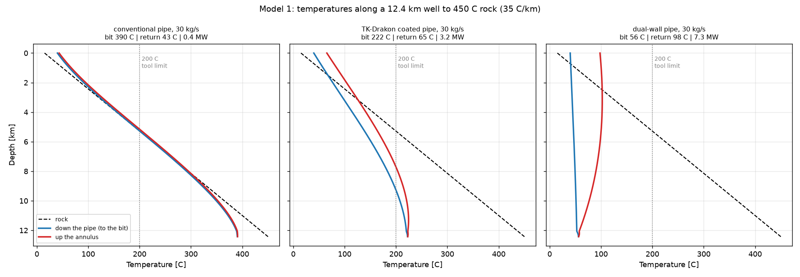
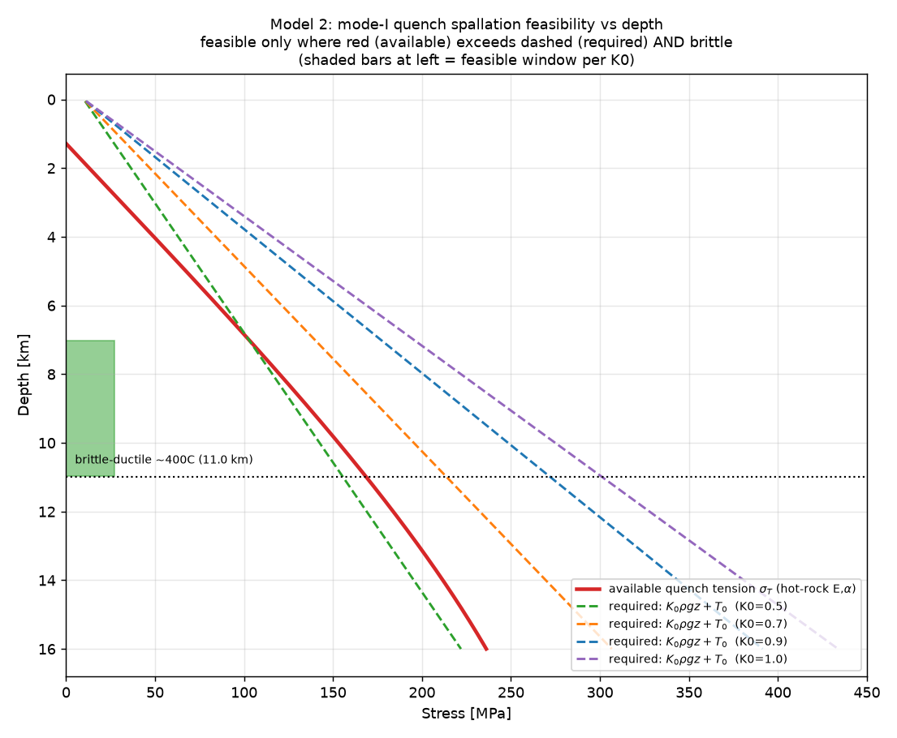
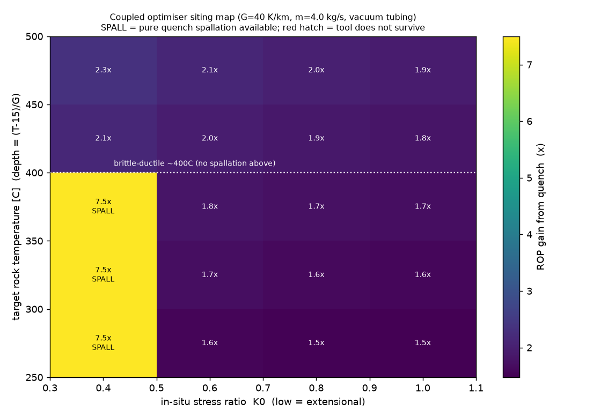
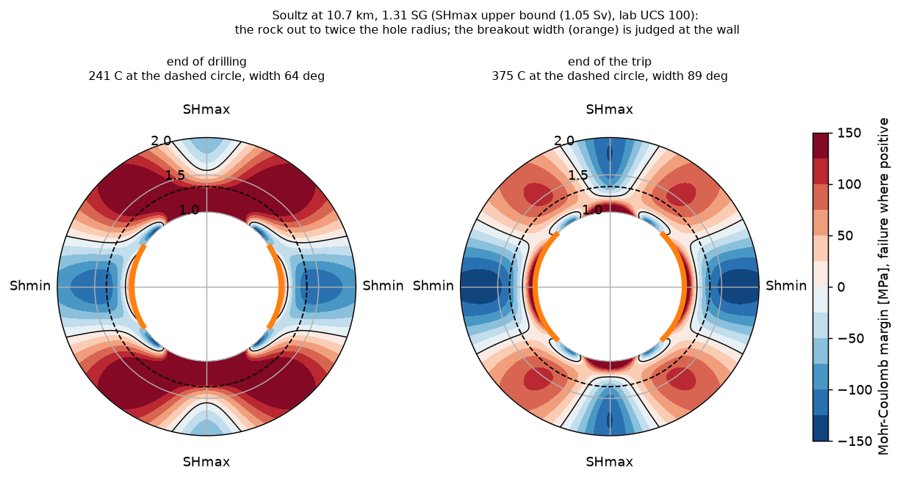

# Physical models and programme evaluation

This guide explains what the model components calculate and how they are combined. Start with the [output guide](../guides/interpreting-results.md) to use an assessment. The [validation guide](validation.md) distinguishes field comparisons from calibration and analytic checks; the [limitations](limitations.md) describe the open assumptions. Scientific citations are collected in [sources](sources.md).

## Purpose and scope

BoreTHM examines circulating fluid as a means of drilling into superhot rock. Cooling can protect tools and slow modelled creep; its effect on breakout demand depends on the exposure and thermal-stress assumptions. The heat returned to surface is a by-product of drilling, and reservoir production is outside the site assessments.

The thermal models are one-dimensional or axisymmetric. Spallation, drilling-rate and creep calculations supply screening estimates based on literature parameters. They do not replace a detailed well design.

## Circulation and heat transfer

The circulation model (Model 1, `model1_coupled.py`) calculates fluid temperature down the drill string and back up the annulus, the space between the string and the borehole wall. It represents the casing and cement, the string geometry and the steel and insulation layers in the pipe. Friction in the pipe, annulus, connections, assembly components and bit nozzles generates heat where it occurs, and so do supplied tool losses. Surface equipment adds to standpipe pressure without heating the well. Heat transfer to the rock depends on how long each depth has been exposed to circulation. The programme evaluations supply the exposure of rock encountered while drilling; the circulation rock term applies a one-hour minimum to that exposure, as described in the [equations](#circulation-heat-balance).

Figure 1 is a separate illustrative comparison with rock exposed to circulation for a year. It uses a 12.4 km well reaching 450 °C rock at a mass flow of 30 kg/s. The calculated bit temperatures are 390 °C with conventional pipe, 222 °C with NOV TK-Drakon coated pipe and 56 °C with the dual-wall pipe of Xiao et al. (2022). These are the conditions of that figure; the [site programmes](#programme-evaluation) have their own targets, flows and exposure histories. Heat returned to surface in the figure is limited by conduction from the surrounding rock and does not constitute a reservoir-production assessment.

Water properties depend on both temperature and pressure. Water is supercritical only above both critical values, 373.946 °C and 22.064 MPa ([IAPWS critical-point release](https://iapws.org/public/documents/CU3rZ/crits.pdf)). Colder water can remain a compressed liquid at high pressure. Depth alone does not establish its phase. Whether water flashes into vapour depends on the local pressure and temperature along the flow path.

Circulation evaluates fluid properties at the approximate absolute pressure `P_surface + 10 MPa/km × TVD`, where TVD is true vertical depth and the default `P_surface` is 0.1 MPa absolute. The programme's wall-pressure budget is calculated separately. Circulation represents a single-phase fluid and has no liquid-vapour flow calculation. The [applicability table](limitations.md#applicability-and-numerical-guards) gives the cached property limits and numerical guards; the [property-pressure comparison, A1](approximation-comparisons.md#what-each-comparison-changes), tests a different property-pressure treatment.

*Fig. 1. Illustrative year-long circulation case, separate from the drilling programmes: temperature of the downgoing fluid, returning fluid and rock along a 12.4 km well reaching 450 °C rock, at 30 kg/s. The coated-pipe bit temperature exceeds the 200 °C reference tool limit in this example. Passing the bit-temperature check alone would not establish programme feasibility.*

## Drilling rate and creep

Thermal spallation is the detachment of rock fragments caused by rapid cooling. In the spallation component (Model 2, `model2_spallation.py`), the thermal tension at the quenched face must exceed both tensile strength and confining stress. The illustrated feasible range is restricted to low horizontal stress relative to vertical stress, expressed by a stress ratio K0 below about 0.5, and the assumed brittle regime (Fig. 4).

The coupled drilling-rate component (Model 3, `model3_optimiser.py`) uses these assumptions to estimate the change in the mechanical energy needed to cut rock. The illustrated rate gains reach about 7.5 times the unquenched rate where spallation is permitted; outside that range, the illustrated gains are 1.5 to 2.3 times (Fig. 5). These are estimates from the component model, with literature-based parameters. They do not establish those gains in the reference wells. Holtzman et al. (2023) discuss quench-assisted drilling in the related literature.

*Fig. 4. Thermal tension from the quench (red) against the tension required by the spallation criterion at each horizontal-to-vertical stress ratio K0 (dashed). The shaded range satisfies the criterion below the component model's assumed 400 °C transition.*

*Fig. 5. Estimated gain in rate of penetration across target temperature and stress ratio K0, under the component model's fracture and energy assumptions. The 7.5× band permits spallation; elsewhere the illustrated gain is 1.5 to 2.3×.*

The spallation calculation assumes a brittle-to-ductile transition at 400 °C and does not permit spallation at or above that formation temperature. This is an imposed component-model approximation. It does not establish a universal temperature at which granite ceases to fracture. The result depends on that assumption; the thin cooled layer at the cutting face does not change the formation-temperature restriction used by the calculation.

The creep component (Model 4, `model4_hole_stability.py`) estimates inward closure of the borehole using a temperature-dependent flow law with wet-quartzite parameters as a proxy. Its illustrative calculations predict that cooling the wall to 200 °C can reduce creep by factors of 10^5 to 10^6. Absolute closure rates depend on the assumed flow law and stress state. This screening calculation is separate from the drilling-cycle assessment and does not demonstrate sustained stability in a superhot well.

The convergence-confinement calculation (Model 5, `model5_convergence_confinement.py`) estimates inward displacement and the radius of yielded rock under fluid support. It uses an idealised circular opening with an isotropic far-field stress. A small yielded zone in an illustrative cooled case does not establish that breakouts are shallow or stable in every site programme. The anisotropic breakout and pressure checks described below remain separate requirements.

## Borehole stability

Drilling a vertical hole concentrates the in-situ stresses around its circumference. Where hoop stress exceeds rock strength, the wall can fail in two lobes in the direction of Shmin, forming breakouts. The stability diagnostic uses the empirical 90° breakout-width criterion of Zoback (2007): water can suffice, a heavier fluid can be required within the pressure limit, or no such interval can exist. Connections and trips are checked separately within the stability cycle.

These are stability checks. The [programme assessment](../../README.md#reading-a-result) also considers whole-hole pressure windows and independent tool and equipment gates. Its overall status is not determined by breakout width alone. The equations are given below.

### Wall reheating and thermal stress

The temperature of the rock around the hole through the drilling cycle is calculated by implicit finite volumes for radial conduction (`wall_thermal.py`). While the fluid circulates, the wall exchanges heat with the annulus at the temperature and film coefficient that Model 1 gives. When circulation stops, the fluid in the hole is treated as a single well-mixed volume coupled to the wall by the laminar film coefficient (a Nusselt number of 4.36), the conservative floor Model 1 already uses, so that the fluid slows the reheating; the case with no fluid, in which the wall reheats faster, is a sensitivity. Jaeger (1956) gave the corresponding solution for a cylinder containing a perfect conductor. The solver reproduces the heat flow from a cylinder held at constant temperature (Carslaw and Jaeger, 1959) to within 1.2% and the recovery after a period of constant heat flow to within 2%, both evaluated by numerical inversion of the Laplace-transform solutions (Abate and Valkó, 2004). The line-source approximation (Bullard, 1947) differs from the cylinder solution by 6 to 13% over the times of interest and is reported for comparison only.

The thermal stresses in the rock follow from the temperature field for plane strain with a free wall (Timoshenko and Goodier, 1970). They are added to the full Kirsch solution with the wellbore pressure (Jaeger et al., 2007), and the Mohr-Coulomb criterion is applied at each radius and angle with the strength at the local temperature (`model5_convergence_confinement.py`). In an elastic Mohr-Coulomb analysis the failed region reaches wider just behind the wall than at the wall itself, at the edges of the breakout, so the angular extent of failure in the rock is not a measure of breakout width (Fig. 6). The width is therefore judged at the wall, as an image log measures it and as the 90° criterion and the UD-1 calibration assume, but with the temperature of the rock at the depth to which the breakout would reach in uncooled rock with water in the hole, about 4 cm at Soultz. A cooled zone thicker than that keeps its benefit, and a thin or reheated one is judged by the warmer rock behind it. With no cooling the result is the width at the wall.

The base programme assumes breakouts begin as the bit exposes the rock. Moore et al. (2011) compared images logged at the bit, minutes after drilling, with images taken 30 minutes to 3 days later in four boreholes of the NanTroSEIZE transect, in sediment, and found breakouts already present at the bit and widening with time in all four. The base programme applies the width check from the moment of exposure (the programme evaluation below). The sediment observations do not establish a formation time or growth law in hot crystalline rock. The [breakout-timing study](breakout-timing.md) evaluates assumed delays and their effect on the whole-hole drilling-fluid window. Near-bit pre-cooling remains a separate open question. In the first minutes of cooling, the contracting skin pushes hoop stress into the rock just behind it, and the failed depth from the full stress field at Soultz, at the drilling fluid's weight, grows from 1.6 cm in uncooled rock to 1.7 cm after a minute, falling below the uncooled depth within 5 minutes. Over that time the width check uses rock within a few kelvin of formation temperature, so the effect does not conceal a worse case.

*Fig. 6. Historical v1.3.3 diagnostic, retained to illustrate the skin heuristic; the programme results are in the [site assessments](../../README.md#example-results). Mohr-Coulomb margin in the rock out to twice the hole radius at Soultz at 10.7 km and 1.31 SG, at the end of drilling (left) and at the end of a 44-hour trip (right), in the case of stress and strength that decides the site's verdict. Failure is where the margin is positive (red, bounded by the black contour). The dashed circle is the depth the uncooled breakout reaches, whose temperature sets the width at the wall (orange). The failed regions behind intact wall, at about 45° to the stress directions, arise from the elastic criterion; at the wall in the direction of SHmax the margin is positive where the hoop stress is tensile.*

## Programme evaluation

The reference design uses Wu et al.'s well geometry, with the intermediate shoe at 4,000 m where the target is deeper, and TK-Drakon coated pipe. The flow search includes the fluid's effects on friction and tool temperature, together with the pump limit and the rig's pressure-dependent capacity. Surface volume flow is reported in L/s for weighted fluids. Newberry's water flow remains 30 kg/s.

The drilling fluid is water where it holds the wall. Elsewhere it is a barite-weighted water-based mud whose water properties follow IAPWS-95. Its surface barite mass fraction is conserved; local volume fractions follow the changing component densities. The plastic-viscosity law and yield point retain the existing reference mud (Anawe and Folayan, 2018). Every pass simulates the weights required by the common windows down the hole, and reruns the tool and hydraulic checks until the density change is below 0.002 SG and the drilling rate settles. If the trip needs a heavier fluid, that fluid occupies the whole column from the start of the trip and supplies the run-in tool calculation. This is the uniform-column bound; displacement is not modelled.

In the base case, every open-hole depth is checked at its own exposure under the immediate-formation assumption, together with its connection and trip states. The final stand and target are included. The spacing is halved twice around the binding bounds, which must settle within 0.002 SG. Final-depth circulation supplies the shallow thermal boundaries. The [approximation study](approximation-comparisons.md) includes a separate shallow-circulation comparison, identified as A7 in its saved results.

## Equations

The equations are given in the notation used in the code.

### Circulation heat balance

The loop model (Model 1) solves coupled heat balances for the downgoing and returning fluid along measured depth z, with the rock at the temperature of its true vertical depth, and with the heat dissipated by friction (pressure gradient dp/dz) added to each stream:

$$\dot{m}c_p\frac{dT_d}{dz}=UA_i(T_u-T_d)+\frac{\dot{m}}{\rho}\left|\frac{dp}{dz}\right|_d$$

$$\dot{m}c_p\frac{dT_u}{dz}=UA_i(T_u-T_d)-UA_o\big(T_{\text{rock}}(z)-T_u\big)-\frac{\dot{m}}{\rho}\left|\frac{dp}{dz}\right|_u$$

$$T_d(0)=T_{\text{inj}},\qquad T_u(L)=T_d(L)+\frac{Q_{\text{face}}}{\dot{m}c_p}+\frac{\Delta p_{\text{bit}}}{\rho c_p}$$

The conductances per unit length are resistances in series: the films on each side, each layer of the pipe wall, and on the rock side any casing and cement and the conduction into the rock, which limits the heat per unit length:

$$\frac{1}{UA_i}=\frac{1}{2\pi r_b h_d}+\sum_j\frac{\ln(r_{j+1}/r_j)}{2\pi k_j}+\frac{1}{2\pi r_o h_u},\qquad \frac{1}{UA_o}=\frac{1}{2\pi r_w h_u}+\sum_c\frac{\ln(r_{c+1}/r_c)}{2\pi k_c}+\frac{1}{2\pi k_{\text{rock}}G(t_D)}$$

The rock term is the exact response of a cylindrical hole of radius r_r in infinite, initially uniform rock whose wall temperature changes by a step and is then held (Carslaw and Jaeger, 1959). With t_D = α t_eff / r_r², G is the inverse Laplace transform of

$$\bar G(s)=\frac{K_1(\sqrt s)}{\sqrt s\,K_0(\sqrt s)},$$

where K_0 and K_1 are modified Bessel functions. `rock_response.py` evaluates it once by numerical inversion and interpolates it. At short times G ≈ 1/√(π t_D) + 1/2; at long times it falls slowly, as 2/(ln 4t_D − 2γ). The original calculation used the quasi-steady approximation 1/G ≈ ln(1 + 2√t_D), which overstates the rock resistance by about 5% after 30 days and 9% after one hour. The explicit v1.5.0 mode keeps it.

Here t(z) is the time the wall at z has been exposed to circulation, and t_eff is the effective time used by `model1_coupled.exposure_seconds` in the rock term. For a depth-dependent exposure history,

$$t_{\text{eff}}(z)=\max\big(t(z),\;3600\ \mathrm{s}\big).$$

With a uniform `t_years` and no exposure history, the minimum is 0.001 years, about 8.8 hours. Programme evaluations supply each depth's own exposure, including the youngest rock at the target, and the circulation calculation applies the one-hour floor to that history.

The cylindrical response is valid at all exposure times; the one-hour floor is retained so that earlier results remain comparable, and removing it would be a separate change. The separate radial wall-temperature solver used by the stability checks and the [breakout-timing study](breakout-timing.md) resolves early cooling with its supplied state durations and does not apply these circulation floors. Its fluid-temperature and film-coefficient boundaries come from the circulation calculation. The exposure floor sets no breakout formation time; the timing study's assumed delay is a separate input.

Where a pipe has bare tool joints over a fraction f of its length, UA_i is the length-weighted mean of the insulated body and bare steel. The bit nozzles lose

$$\Delta p_{\text{bit}}=\frac{\rho Q^2}{2C_d^2A_n^2},\qquad C_d=0.95$$

The standpipe pressure is the sum of the friction losses down the pipe and up the annulus, the bit loss, the surface-equipment loss, and the buoyancy of the hotter annulus, the integral of (ρ_u − ρ_d) g over true vertical depth.

### Pressure losses and their heat

`hydraulic_losses.py` calculates every in-hole pressure loss with one kernel and releases each as heat where it occurs, q' = Q |dp/dz|, in the stream that carries it. Straight passages use the Bingham law for mud and the Newtonian law for water (Bourgoyne et al., 1986). Repeated connections replace the body friction over their restriction length with friction at the connection's bore and outside diameter. Changes of area lose K ρ v²/2 at the smaller area, with K = (1 − r)² for an expansion and 0.5(1 − r)^0.75 for a contraction, r being the area ratio. A supplied tool curve scales as Δp_ref (ρ/ρ_ref)(Q/Q_ref)² (API RP 13D, 2009) and replaces the internal passage losses it covers. Surface equipment uses the API RP 13D layout coefficients and adds to standpipe pressure only. The sources and the development comparisons are recorded in the [development log](model-development.md#27-october-2026-entry-1-hydraulic-losses-and-heat-placement).

### Rotary heat

A circulation solve can also take heat released into the annulus fluid along the string, `annulus_heat`, and heat released at the bit, as part of `Q_face`. `rotary_heat.partition` derives both from measured surface rotary speed and torque. A soft-string torque balance (Johancsik et al., 1984) gives the force with which each element of string presses on the wall, from its buoyed weight, tension and the hole's curvature. A friction factor set from the off-bottom rotating torque then splits the on-bottom torque into wall friction and work at the bit. The site evaluations do not use it, since a programme has no measured torque; it is used in the [development comparisons](model-development.md#28-october-2026-entry-4-declaration-rotary-heat-m2), where all of the heat is assumed to reach the fluid, an upper limit.

### Quenched-face stress

Spallation (Model 2) requires the constrained thermal stress of the quenched face to exceed the confining stress and the tensile strength, with the face temperature given by the convective half-space solution:

$$\sigma_T=\frac{E\alpha\Delta T}{1-\nu},\qquad \sigma_T-K_0\rho g z>T_0$$

$$T(x,t)=T_{\text{rock}}+(T_{\text{cold}}-T_{\text{rock}})\big[\mathrm{erfc}(\eta)-e^{-\eta^2}\mathrm{erfcx}(\eta+\beta)\big],\qquad \eta=\frac{x}{2\sqrt{\alpha t}},\quad \beta=\frac{h\sqrt{\alpha t}}{k}$$

### Drilling rate and face heat

The drilling model (Model 3, `model3_optimiser.py`) converts cooling at the cutting face into an effective mechanical specific energy (MSE), the energy needed to remove a unit volume of rock. It uses that energy to calculate the rate of penetration (ROP).

`effective_mse` selects the spallation branch when the formation temperature is below the assumed brittle-to-ductile transition, `model2_spallation.T_BDT = 400 °C`, and the thermal tension exceeds confinement plus tensile strength, as defined in the Model 2 equations above. Other thermally assisted cases use a damage fraction D. Disabling thermal assistance with `quench=False` in `evaluate` or `evaluate_at` selects the mechanical branch:

$$\text{MSE}_{\text{eff}}=\begin{cases}
40\ \mathrm{MPa}, & \text{spallation},\\
\text{MSE}(1-D), & \text{assisted},\\
\text{MSE}, & \text{mechanical}.
\end{cases}$$

The intact-rock MSE defaults to 300 MPa. The spallation branch uses `MSE_SPALL`, fixed at 40 MPa, and returns D = 1 as a regime label. The damage formula applies only to the assisted branch; the mechanical branch returns D = 0.

The assisted branch combines a damage fraction from the change in differential stress, D_macro, with a fraction representing thermal microcracking, D_micro:

$$D=\min(D_{\text{macro}}+D_{\text{micro}},\;0.6),\qquad D_{\text{macro}}=\chi_{\text{macro}}\operatorname{clip}\!\left(\frac{\Delta\sigma_{\text{dev}}}{\sigma_{\text{dev,fail}}},0,1\right),\qquad D_{\text{micro}}=\chi_{\text{micro}}\operatorname{clip}\!\left(\frac{\Delta T}{\Delta T_{\text{ref}}},0,1\right).$$

Here `clip(x, 0, 1)` limits x to the interval from 0 to 1, and ΔT = T_rock − T_cold. The default coefficients are χ_macro = 0.5, χ_micro = 0.4 and ΔT_ref = 400 K. They are assumed damage parameters that need calibration by experiment.

`model2_spallation.deviatoric_increase` supplies the differential stresses before and after cooling. It uses the face thermal tension σ_T returned by `model2_spallation.sigma_thermal_surface` at the specified exposure time and film coefficient. In its tension-positive convention, σ_v = −ρgz and σ_h = −K0ρgz, with rock density ρ and gravitational acceleration g:

$$\Delta\sigma_{\text{dev}}=\left|\sigma_v-(\sigma_h+\sigma_T)\right|-\left|\sigma_v-\sigma_h\right|,\qquad \sigma_{\text{dev,fail}}=\mathrm{UCS}+(q-1)K_0\rho gz,\qquad q=\tan^2\!\left(45^\circ+\frac{\phi}{2}\right).$$

UCS is the reference unconfined compressive strength, and the friction angle φ defaults to 30° in `effective_mse`. `rop_from_power` divides mechanical power P_mech by the effective energy per unit volume and the bit area A_bit, then applies `ROP_CAP`:

$$\mathrm{ROP}=\min\!\left(\frac{P_{\text{mech}}}{\mathrm{MSE}_{\text{eff}}\,A_{\text{bit}}},\;\frac{20}{3600}\ \mathrm{m/s}\right).$$

The cap is 20 m/h.

`face_load` sums conduction from the face with the mechanical cutting heat and the sensible heat of the removed rock:

$$Q_{\text{face}}=Q_{\text{cond}}+Q_{\text{cut}}+Q_{\text{spall}},\qquad Q_{\text{cut}}=\begin{cases}
0, & \text{spallation},\\
P_{\text{mech}}, & \text{assisted or mechanical},
\end{cases}$$

$$Q_{\text{spall}}=\rho c\,A_{\text{bit}}\,\mathrm{ROP}\,\Delta T,\qquad Q_{\text{cond}}=2\pi ka\,\Delta T.$$

Here ρ, c and k are rock density, specific heat capacity and thermal conductivity; a is the face-cavity radius, `CAVITY_RADIUS = 0.108 m`. These heat terms use ROP in m/s and return watts. The term named Q_spall represents the sensible heat of removed rock in every regime.

The standalone `model3_optimiser.evaluate` iterates Model 1 with the face load returned by `face_load`. The reference site evaluation supplies the fixed `Q_FACE_SITE = 30 kW` to circulation and calls `evaluate_at` with the resulting coolant temperature. `evaluate_at` returns ROP and a face load without feeding that load back into the circulation calculation. The [face-load approximation comparison, A2](approximation-comparisons.md#what-each-comparison-changes), replaces the fixed load in a separate test.

### Creep and borehole mechanics

Creep closure (Model 4) follows an Arrhenius power law, and convective heat resupply is checked through the Péclet number:

$$\dot\varepsilon=A\sigma^{n}\exp\left(-\frac{Q}{RT}\right),\qquad \mathrm{Pe}=\frac{vL}{\alpha}\ll 1$$

Yielding at the wall (Model 5) follows the ground-reaction curve:

$$k=\frac{1+\sin\phi}{1-\sin\phi},\qquad p_{\text{cr}}=\frac{2p_0-\sigma_{cm}}{1+k}$$

The stability verdict uses the hoop stress at the wall of a vertical hole, at angle θ from the direction of the maximum horizontal stress, including the thermal stress from cooling the wall:

$$\sigma_\theta(\theta)=S_H+S_h-2(S_H-S_h)\cos 2\theta-P_w+\Delta\sigma_T,\qquad \Delta\sigma_T=-\frac{E\alpha}{1-\nu}\,(T_{\text{rock}}-T_{\text{wall}})$$

The wall fails where the Mohr-Coulomb criterion is exceeded in effective stress, with pore pressure P_p and drilling-fluid pressure P_w:

$$\sigma_\theta-P_p>\sigma_{cm}(T_{\text{wall}})+k\,(P_w-P_p)$$

which holds over a breakout of width

$$W=\arccos\!\left(-\frac{a}{d}\right),\qquad a=S_H+S_h-P_w+\Delta\sigma_T-P_p-\sigma_{cm}-k(P_w-P_p),\quad d=2(S_H-S_h)$$

The temperature in the rock around the hole through the drilling cycle follows radial conduction. While circulating, the wall exchanges heat with the annulus fluid at T_f; when circulation stops, the fluid in the hole is one well-mixed volume of heat capacity C per unit length, coupled to the wall by the laminar film, h = 4.36 k_f/D_h:

$$\frac{\partial T}{\partial t}=\frac{\alpha}{r}\frac{\partial}{\partial r}\left(r\frac{\partial T}{\partial r}\right),\qquad -k\frac{\partial T}{\partial r}\Big|_{a}=h\,\big(T_f-T(a)\big),\qquad C\frac{dT_f}{dt}=2\pi a h\,\big(T(a)-T_f\big)$$

The thermal stresses behind the wall are those of plane strain with a free wall, for a temperature change ΔT(r) from the rock temperature, compression positive:

$$\Delta\sigma_r=\frac{E\alpha}{1-\nu}\,\frac{1}{r^2}\int_a^r\Delta T\,s\,ds,\qquad \Delta\sigma_\theta=\frac{E\alpha}{1-\nu}\left[\Delta T(r)-\frac{1}{r^2}\int_a^r\Delta T\,s\,ds\right]$$

and are added to the Kirsch stresses at radius r and angle θ from SHmax, with S = (S_H + S_h)/2 and D = (S_H − S_h)/2:

$$\sigma_r=S\Big(1-\frac{a^2}{r^2}\Big)+D\Big(1-\frac{4a^2}{r^2}+\frac{3a^4}{r^4}\Big)\cos 2\theta+P_w\frac{a^2}{r^2},\qquad \sigma_\theta=S\Big(1+\frac{a^2}{r^2}\Big)-D\Big(1+\frac{3a^4}{r^4}\Big)\cos 2\theta-P_w\frac{a^2}{r^2}$$

$$\tau_{r\theta}=-D\Big(1+\frac{2a^2}{r^2}-\frac{3a^4}{r^4}\Big)\sin 2\theta$$

The Mohr-Coulomb criterion is applied to the principal stresses in the plane of the hole. The breakout width used for the verdict is that of the wall equations above with T_wall replaced by the temperature at a + d, where d is the depth the uncooled breakout reaches in the direction of Shmin.

Each stress state is also required to be within the frictional strength of the crust, with a friction coefficient μ of 0.8 (Reinecker et al., 2021), or at Newberry the 0.55 and 0.70 of Davatzes and Hickman (2011):

$$\frac{S_1-P_p}{S_3-P_p}\le\left(\sqrt{1+\mu^2}+\mu\right)^2$$

See the [sources and related work](sources.md) for the cited publications.
