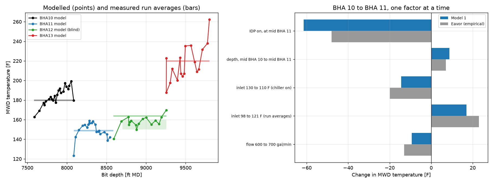
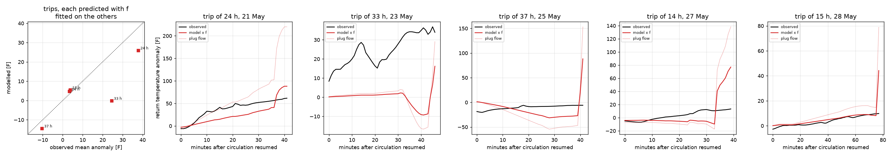

# Validation, calibration and analytic checks

Circulation temperatures have been compared with Utah FORGE observations and a published simulator, and standpipe pressure with FORGE 56-32, a well that played no part in the model's development. In the table below, blind means that nothing in the comparison was fitted to the observations it is scored against. The version column names the calculation that produced each result; the current defaults use the v1.8.0 physics. Together they do not validate a complete 10-13 km drilling programme.

## Results at a glance

| Comparison | Quantity | Samples | Error | Model version | Blind or fitted | Section |
|---|---|---|---|---|---|---|
| UT Austin benchmark | Fluid temperature from a published simulator | 6 cases | Conventional and dual-wall pipe within 7 °C (vertical) and 2 °C (horizontal); coated pipe 34 to 63 °C hotter, or 9 to 34 °C colder with the whole-wall reading | v1.7.0 physics, with v1.8.0 values also given | Unfitted (a) | [Circulation](#circulation) |
| FORGE 16B insulated-pipe trial | MWD fluid temperature | 4 runs | Partial-insulation run (BHA 12) within 4 to 6 °F with the film unfitted; regular-pipe runs 4 to 12 °F high | Not stated | Fitted (b) | [FORGE 16B](#forge-16b) |
| FORGE 16B whole well | Downhole fluid temperature (Pason EYE) | 109 samples, 13 assemblies | Run-mean bias −24.3 to +3.2 °C in the original protocol, and −24.3 to +8.7 °C with the revised mud; on EOW 27, RMSE 13.0 °C | v1.5.0 | Blind | [16B whole well](#forge-16b-whole-well-circulation-comparison) |
| FORGE 16A, downhole | Bit-box temperature | 135 samples, 9 runs | Pooled RMSE 8.9 to 9.6 °C; BHA 42 mean error −19.9 to −18.7 °C | v1.5.0 | Blind | [16A](#forge-16a-blind-circulation-comparison) |
| FORGE 16A, surface return | Mud-log return temperature | 135 samples | Mean error −6.0 °C, RMSE 6.4 °C | v1.5.0 | Blind | [16A](#forge-16a-blind-circulation-comparison) |
| FORGE 16A and 16B pressure | Standpipe pressure less the reported differential | 135 (16A), 109 (16B) | Mean −1,624 psi on 16A and −969 psi on 16B with the revised mud | v1.5.0 | Blind | [Pressure accounting](#pressure-and-heat-input-accounting) |
| FORGE 56-32 pressure | Standpipe pressure less the motor differential | 196 windows | Median residual −9.2% (BHA 9) and +7.2% (BHA 10), at the lower end of the prediction interval | v1.6.0 | Blind | [56-32](#forge-56-32-standpipe-pressure-on-an-unseen-well) |
| FORGE 56-32 return temperature | Surface return temperature | 401 windows | RMSE 20.8 °C; assemblies 6 to 11, RMSE 0.9 to 2.1 °C; assemblies 2 to 5, bias −28.8 to −39.2 °C | v1.8.0 | Blind | [Commit `c1b9e27`](https://github.com/ldocallaghan/BoreTHM/commit/c1b9e27b022b3226c9982e2aa6ab424f28d80135) (c) |
| FORGE 16B trips | Return-temperature anomaly after each trip | 5 trips | RMS 12 °F, against observed anomalies of −10 to +38 °F | Not stated | Fitted (d) | [Rock reheating](#rock-reheating) |
| FORGE 16A run-in legs | Peak tool temperature | 9 legs | Mean peak error −28.5 to −20.4 °C; BHA 42's two legs −50.3 to −33.1 °C | Not stated | Unfitted (e) | [16A transients](#forge-16a-conditional-transient-checks) |
| FORGE 16A pauses | Temperature change while pumps are off | 60 pauses | Mean end-rise error +0.0 to +0.3 °C | Not stated | Unfitted (e) | [16A transients](#forge-16a-conditional-transient-checks) |
| Analytic checks | Heat flow and recovery of a cylinder | 2 solutions | Within 1.2% and 2% | Not stated | Analytic | [Analytic checks](#analytic-checks) |
| UD-1 | Breakout width and onset | 24 breakouts | Widths 53 to 57° near the base against 50 to 53° logged; onset from about 2.9 km against 2.2 and 3.1 km | Not stated | Fitted (f) | [UD-1](#ud1-strength-calibration) |
| Soultz | Breakout onset | 2 wells | First breakouts at 2.6 to 3.8 km against about 3.0 km in GPK4 | Not stated | Unfitted (g) | [Soultz](#soultz-cross-check) |
| Newberry | Breakout width | 1 well | Modal width of 36° matched for a wall 25 to 35 K below its static temperature; the pattern by rock type is not reproduced | Not stated | Fitted (h) | [Newberry](#newberry-cross-check) |

**Notes.**

- (a) A comparison with another simulator, with nothing fitted.
- (b) The heat-transfer multiplier was fitted on the regular-pipe runs and the pipe conductivity on BHA 11; BHA 12 was predicted with no further fitting.
- (c) Scored on 15 November 2026 on the `gap-closure` branch; the cause of the shallow difference is under investigation.
- (d) One attenuation factor, fitted on four trips and used to predict the fifth, in turn.
- (e) Each leg or pause starts from its first observed temperature.
- (f) Rock strength is fitted to the breakout widths.
- (g) Rock strength is taken from UD-1 without refitting.
- (h) The wall-cooling range is scanned for widths matching the observations.

## What each comparison depends on

An observation is held out when it is excluded from the parameter fit being assessed. A comparison can still share inputs inferred from those observations. The table separates those dependencies:

MWD means measurement while drilling; the 16B comparison uses fluid temperature at the downhole sensor. The sensing medium of 16A's exported bit-box and top-sub channels is unresolved. BHA means bottom-hole assembly, the equipment near the bit; the BHA numbers identify the trial's assemblies and runs. Plug flow transports the fluid column to surface without modelling heat exchange during its ascent.

| Comparison | Observed or reference quantity | What was fitted | Inputs shared with or inferred from the observations | What was held out | What the comparison can establish |
|---|---|---|---|---|---|
| UT Austin benchmark | Wu et al.'s published fluid temperatures and standpipe pressures | No parameter fit; the initial comparison identified omitted friction heating | Published well geometry, pipe properties and operating conditions; assumptions where the paper is silent, including the unspecified bit nozzles | The published outputs were compared without fitting parameters to them | Agreement with another simulator for specified cases, with unresolved coated-pipe differences; this is a code-to-code benchmark |
| FORGE 16B circulation | Measured MWD fluid temperatures during regular-pipe and insulated-pipe runs | Multiplier on the annulus heat-transfer coefficient, fitted on the regular-pipe runs; effective insulated-pipe conductivity on BHA 11. The chain with the coefficient unfitted still fits that conductivity on BHA 11 | The 16B survey and rig record; formation temperatures from neighbouring well 16A; measured core thermal properties | BHA 12's partial-insulation temperatures, predicted without further fitting | Fluid-temperature prediction for the held-out run under the trial conditions, with the fitted-input dependencies stated |
| FORGE 16B whole-well circulation | Pason EYE downhole temperatures in 109 half-hour samples from 13 assemblies | No new fit; film multiplier 1.0 is primary. Insulated runs retain previously fitted pipe conductivity | Recorded operating conditions and assembly dimensions; missing rheology substitutions are revised explicitly after S1 | Periods outside the earlier trial supplied no fitted parameter; trial runs retain their earlier fit roles | Blind disagreement across a wider depth range, with both mud protocols retained; the temperature error changes sign between runs |
| FORGE 16A circulation | Bit-box and top-sub temperatures while drilling, and mud-log surface return | Nothing on 16A; film multiplier 1.0 is primary, with the 16B-fitted 0.75 as a sensitivity | Recorded geometry, mud and operating inputs; FORGE core properties; formation logs previously used for 16B; unresolved sensor medium/offset and surface probe location | 16A downhole and return temperatures were not used to fit the primary calculation | Blind disagreement, including deep underprediction and shallower scatter; the cumulative circulation clock omits recovery |
| FORGE hydraulic and energy accounting | Standpipe pressure and outlet-minus-inlet temperature; motorless 16B pressure terms | Nothing; declared geometry scenarios are retained without selecting by pressure agreement | The same fixed circulation inputs; generic joint and surface layouts where as-built dimensions are unavailable; proprietary tool restrictions remain unquantified | Measured pressures set no loss coefficient or model correction | Quantifies included pressure and heat terms and the remaining discrepancies; it does not locate the missing losses or identify a cause of the temperature errors |
| FORGE 56-32 standpipe pressure | Standpipe pressure in off-bottom circulation and, less the reported motor differential, while drilling | Nothing; method, inputs and primary predictions committed before any pressure value was read | The well's own survey, BHA sheets, mud and rig records; the 16A formation profile and FORGE rock properties; a catalogue connection scenario; the motor's published no-load loss with its unstated reference flow as a range | Every 56-32 pressure value | Pressure accounting on an unseen well for two assemblies, as intervals set by the motor's unknown reference flow; it cannot fix the motor's actual loss or the connection bores |
| FORGE 16A transients | Pauses and peaks in observed run-in legs | Nothing | Approximate earlier wall history, local operating inputs and tool dimensions; run-in nodes start at the first observation; later operating-input boundaries enter earlier wall conditioning | Later temperatures within a leg or pause; the initial run-in observation is an input | Conditional transient comparison, with five unavailable cases; it does not independently validate complete trips or establish recovery as the cause |
| FORGE pauses | Return-temperature anomalies after five trips | One attenuation factor for the plug-flow temperature anomaly; each trip is predicted with the factor fitted on the other four | The FORGE geometry and circulation record; pipe conductivity from the MWD comparison; each pause's pre-stop return temperature sets an offset, and the restart record supplies flow and inlet conditions | Each trip's return-temperature anomaly is excluded from its own attenuation-factor fit | Limited predictive performance for the return anomaly; the comparison is too coarse to distinguish the wall-reheating treatments |
| UD-1 strength calibration | BGS breakout widths and intervals without breakouts in the near-vertical section | Weak-zone strengths and an intact-rock lower bound | Published stress and pore-pressure profiles; assumed wall-cooling range and fluid weight; strengths inferred directly from the breakout observations | The deeper deviated-section breakouts are excluded from the fit and used as a qualitative check | Strength ranges conditional on the adopted stresses and cooling; the calibration does not independently verify those inputs |
| Soultz cross-check | Breakout onset and failures at depth in GPK3 and GPK4 | No strength refit in this cross-check | Valley and Evans stress bounds derived partly from wellbore failures; UD-1 calibrated strengths or Soultz laboratory strengths; assumed wall cooling | Soultz observations were excluded from the UD-1 strength calibration, but wellbore failures contributed to the stress bounds | Consistency at a second granite site, with limited independence in the breakout-onset comparison |
| Newberry cross-check | Volcanic breakout widths and the absence of granodiorite breakouts | The wall-cooling range is scanned for widths matching the observations; published stresses and porosity-derived strengths are fixed | Maximum horizontal stress inferred from these breakouts; strength inferred from the porosity log; static temperature and pore-pressure logs | No independent breakout-width set, stress determination or measured wall-temperature profile | Consistency of the thermal term with an assumed cooling range; the granodiorite pattern is not reproduced |
| Analytic checks | Cylinder heat-flow and recovery solutions | No fitted parameter | The numerical and analytic calculations use the same material properties and boundary conditions | No field observations are involved | Numerical reproduction of the specified conduction problems; applicability to a well requires separate evidence |

- [Circulation](#circulation): benchmark and FORGE temperatures.
- [Rock reheating](#rock-reheating): pause comparison and analytic solutions.
- [Stability checks](#stability-checks): strength calibration and other wells.

## Circulation

Model 1 was first compared with the transient simulator of Wu et al. (2025), with their published well, string, fluid and flow and nothing fitted (`benchmark_utaustin.py`). The comparison identified one omission in Model 1, the heat generated by friction. Their dual-wall pipe loses about 70 MPa to friction, which warms the mud by about 18 °C; with this heat included, Model 1 agrees with their results for conventional and dual-wall pipe to within 7 °C in the vertical well and 2 °C in the horizontal well. The results for coated pipe do not agree. With the 1 mm coatings described in their text, Model 1 is 34 to 63 °C hotter than their results, and with the single conductivity per pipe given in their table applied across the whole wall, it is 9 to 34 °C colder. Their results lie between the two, and the paper does not state which interpretation their model uses. The standpipe pressures from Model 1 are 10 to 25% higher than theirs, of which 1.4 MPa is the loss across a bit whose nozzles they do not specify. The figures below use the cylindrical rock response of development entry 3; with the original logarithmic rock term, the bit temperatures were up to 2 °C lower.

| Base case, 600 gal/min, 24 °C/km | Wu et al. | Model 1 | Model 1, whole-wall reading |
|---|---|---|---|
| Vertical, conventional | 179 °C | 173 °C | 173 °C |
| Vertical, internally coated | 76 °C | 128 °C | 67 °C |
| Vertical, externally coated | 121 °C | 155 °C | 92 °C |
| Vertical, dual-wall | 59 °C | 61 °C | 61 °C |
| Horizontal, conventional | 206 °C | 208 °C | 208 °C |
| Horizontal, dual-wall | 65 °C | 67 °C | 66 °C |

The table gives the values with `physics='v1.7.0'`, which reproduces the recorded comparison. With the v1.8.0 default physics, Model 1 gives the values below. Benchmark dataset 1.0 is unchanged.

| Base case, 600 gal/min, 24 °C/km | Wu et al. | Model 1, v1.8.0 | Model 1, whole-wall reading, v1.8.0 |
|---|---|---|---|
| Vertical, conventional | 179 °C | 170 °C | 170 °C |
| Vertical, internally coated | 76 °C | 127 °C | 67 °C |
| Vertical, externally coated | 121 °C | 152 °C | 92 °C |
| Vertical, dual-wall | 59 °C | 61 °C | 60 °C |
| Horizontal, conventional | 206 °C | 205 °C | 205 °C |
| Horizontal, dual-wall | 65 °C | 67 °C | 66 °C |

### FORGE 16B

The field comparison uses the trial of Eavor's insulated drill pipe in Utah FORGE well 16B in May 2023 (`validate_forge16b.py`). Four bits were run in 9.5-inch hole at 60 to 70° inclination: two on regular pipe, one on a full string of insulated pipe and one with about 70% insulated pipe above regular pipe. The well's survey, casing, string, rock properties and drilling record come from the public FORGE dataset, the flow and inlet temperature minute by minute from the rig's records, and the measured MWD temperatures from Eavor's trial report. The model is run at half-hourly intervals while each bit was drilling and compared with the fluid temperature in the pipe at the MWD sensor. Without fitting, the model overestimated the temperature on the runs with regular pipe by 4 to 12 °F. A multiplier of 0.75 on the annulus heat-transfer coefficient, fitted to those runs, brings them within 5 °F. One effective conductivity for Eavor's pipe, fitted on the full insulated run, gives 4.9 W/m·K across the pipe wall, which is within about 15% of the wall resistance of a 1 mm coating at 0.47 W/m·K on steel, the coating Eavor has described (Vetsak et al., 2024). The run with partial insulation was then predicted with no further fitting.

| Run | Measured MWD | Fitted model | Model with the film unfitted |
|---|---|---|---|
| BHA 10, regular pipe | 180 °F | 184 °F | 192 °F |
| BHA 11, insulated pipe (fitted) | 149 °F | 149 °F | 149 °F |
| BHA 12, partial, blind | 164 °F | 157 °F | 160 °F |
| BHA 12 after levelling, blind | 150 to 160 °F | 159 °F | 161 °F |
| BHA 13, regular pipe | 220 °F | 218 °F | 228 °F |

Eavor estimated from the data how each change between the first two runs moved the MWD temperature. Rebuilt one factor at a time, the model attributes −9 °F to the higher flow (Eavor −12 to −14), +17 °F to the warmer inlet (+23), +9 °F to the added depth (+7) and −61 °F to the insulated pipe. Eavor's breakdown gives −47 to −49 °F for the pipe, which they describe as conservative, and their overall estimate of its benefit, against the runs before and after, is 47 to 75 °F. The site evaluations use the unfitted coefficient, since the multiplier absorbs all the effects the model omits at FORGE and there is no evidence that it applies to a 12 km well; it is reported as a sensitivity. With the coefficient unfitted, BHA 12 is predicted to within 4 to 6 °F, and the model overestimates the MWD fluid temperatures on the regular-pipe runs. That overestimate is conservative for the tool-temperature check under those conditions. It does not establish that every pressure or stability result is conservative.

*Fig. 2. Left: modelled MWD temperature while drilling each run (points), against the measured run averages (bars) and BHA 12's levelled range (shaded). Right: the change between the first two runs, one factor at a time, from the model and from Eavor's estimate.*

### FORGE 16B: whole-well circulation comparison

The whole-well comparison uses the existing v1.5.0 calculation at `85f23db51f6661e6ca09bd05c16b9ffb48881d83`, after the 16A validation was added. It compares 109 half-hour samples from 13 bottom-hole assemblies with Pason's EYE temperature channel. Nothing is fitted in this comparison. Film multiplier 1.0 and cumulative circulating exposure are primary. The [input protocol](../../validation/forge16b/comparison_protocol.md) fixes the sampling and observational filters; the [S1 protocol](../../validation/forge16b/comparison_protocol_s1.md) records the reviewed geometry and sensor treatments. The source is GDR 1516, [DOI 10.15121/1998591](https://doi.org/10.15121/1998591), CC BY 4.0.

EOW below means the End of Well Report assembly number. EOW 17–20 correspond to trial BHA 10–13 above. EOW 17 and 20 supplied the earlier film fit; EOW 18 supplied the insulated-pipe conductivity fit. EOW 19 was held out from those fits, but uses that conductivity. Other assemblies supplied neither fit. The insulated cases retain the previously fitted conductivity of 4.923748 W/(m K). The original trial calculation chains were replayed first on their own saved samples and parameters; all 150 solves converged, with maximum run-mean difference 0.000044 °F from the saved results.

The first blind result, S1 version 1, uses the original period-mud substitutions. Positive bias means the bore-fluid prediction is hotter than EYE. Sensor-position ranges below retain every declared comparison and are not uncertainty intervals.

| EOW assembly | Samples | Measured mean, °C | S1 v1 mean bias, °C | Sensor position above bit, ft |
|---|---:|---:|---:|---|
| 3 | 3 | 65.02 | −4.89 to −4.80 | 22, 69 and 84, unresolved |
| 4 | 2 | 76.29 | −24.27 to −24.17 | 22 and 84, unresolved |
| 11 | 4 | 62.97 | −16.18 | 22, drawing |
| 12 | 12 | 68.75 | −18.27 | 22, drawing |
| 13 | 14 | 64.34 | −8.42 | 22, drawing |
| 15 | 4 | 63.04 | −4.21 | 22, drawing |
| 16 | 15 | 73.85 | −4.80 | 22, drawing |
| 17 | 14 | 81.36 | +3.18 | 84, earlier trial assumption |
| 18 | 10 | 65.47 | +1.69 | 84, earlier trial assumption |
| 19 | 10 | 71.29 | +1.18 | 84, drawing |
| 20 | 11 | 105.57 | +1.49 | 84, drawing |
| 27 | 5 | 113.27 | −3.80 to −3.73 | 84 assumed; 22 sensitivity |
| 38 | 5 | 121.01 | −1.56 to −1.49 | 84 assumed; 22 sensitivity |

The original primary underpredicts all pre-trial run means, overpredicts the four trial means and underpredicts the two later means. Small signed means can conceal scatter: at the assumed 84-ft position, EOW 27 has mean absolute error 11.84 °C and root-mean-square error 13.00 °C, despite its −3.80 °C bias. EOW 38 has mean absolute error 5.49 °C. The maximum within-sample spread over the requested sensor positions is below 0.10 °C. EOW 38's drawing gives 85 ft; the reviewed 84-ft assumption is retained, with the 85-ft interpolation archived. EOW 14 and 26 have no accepted comparison window.

*Original S1 version 1. The shaded depth interval is the earlier insulated-pipe trial. Per-run errors, fixed sensor branches and fit roles remain separate.*

An optimistic full-recovery sensitivity resets the exposure clock after continuously observed pumps-off intervals longer than two hours and retains the existing one-hour floor. It brackets the measured means in EOW 15, 16, 27 and 38, while leaving other pre-trial means too cold and increasing trial overprediction. It raises the later EOW 27/38 means by about 24/27 °C. Reducing the film multiplier to 0.75 lowers the predictions and increases the pre-trial underprediction. These sensitivities remain attached to S1 version 1; they have not been rerun with the revised mud. Neither establishes recovery or heat transfer as the cause. The [original-protocol results](../../validation/forge16b/s1/results.md) gives the complete temperature, recovery and water-property comparisons in °C and °F.

#### Labelled mud-protocol revision

S1's missing-property fallback used the reference programme mud, with plastic viscosity (PV) 27 cP and yield point (YP) 28 lbf/100 ft². Those values describe a weighted mud and are inconsistent with the input record's low-solids, water-rich system. After the original comparison, the protocol changed: missing PV or YP takes the nearest actual measurement in either time direction within the same fluid system; a system without a measurement uses water rheology at its recorded density. No donor crosses a fluid-system boundary. Some donors are days away, so contemporaneous rheology remains uncertain. The [revision ledger](../../validation/forge16b/s2/mud-revision-ledger.csv) identifies every source and signed time offset.

The original comparison remains version 1. The revised primary is version 2, calculated on the same 109 windows with the same geometry and film coefficient. Five run means change:

| EOW assembly | S1 v1 bias, °C | Revised v2 bias, °C | Change in model mean, °C |
|---|---:|---:|---:|
| 11 | −16.18 | −8.49 | +7.69 |
| 12 | −18.27 | −9.80 | +8.48 |
| 16 | −4.80 | +0.14 | +4.94 |
| 17 | +3.18 | +8.74 | +5.56 |
| 18 | +1.69 | +2.08 | +0.39 |

All other run means are unchanged. The revision removes an input-inconsistent substitution; it does not remove the changing sign of the field discrepancy. The [revised-rheology results](../../validation/forge16b/s2/results.md) preserves both complete versions and their input provenance.

### FORGE 16A: blind circulation comparison

The unfitted calculation was compared with well 16A(78)-32 using model v1.5.0 at `b9a8a93` (`v1.5.0-1-gb9a8a93`). Nothing was fitted to its downhole or return temperatures. The primary annulus-film multiplier is 1.0; the 16B-fitted 0.75 is a sensitivity. Measured FORGE core properties are retained. The [source extracts and archived evidence](../../validation/forge16a/README.md) identify the survey, casing, mud properties and temperature logs.

The comparison uses 135 half-hourly drilling samples from nine runs. Each observation averages the qualified drilling measurements within its centred half-hour window. Flow must exceed 300 gal/min, the bit must be within 5 ft of hole depth, and the source must indicate on-bottom drilling. The sensing medium and exact element offsets remain unresolved, so bore and annulus predictions at the bit and 40 ft above it are all retained. A range below spans those four fixed comparisons; it is not a confidence interval or a selection of the closest prediction.

| BHA | Bit-box samples | Measured mean °C | Four model means °C | Mean errors °C | RMSE values °C |
|---|---:|---:|---:|---:|---:|
| 18 | 15 | 80.07 | 75.91–77.04 | -4.16–-3.03 | 3.28–4.34 |
| 23 | 13 | 82.04 | 81.80–82.94 | -0.24–0.90 | 1.44–1.66 |
| 30 | 29 | 82.42 | 84.74–85.80 | 2.32–3.38 | 3.86–4.62 |
| 34 | 9 | 86.14 | 85.33–86.50 | -0.81–0.36 | 6.59–6.67 |
| 35r1 | 5 | 92.51 | 89.32–90.45 | -3.19–-2.06 | 6.56–6.95 |
| 35r2 | 4 | 101.41 | 92.43–93.87 | -8.98–-7.54 | 9.01–10.16 |
| 38 | 20 | 90.24 | 82.05–83.39 | -8.18–-6.85 | 7.58–8.78 |
| 39 | 25 | 93.28 | 83.54–84.80 | -9.75–-8.49 | 9.54–10.65 |
| 42 | 15 | 114.61 | 94.74–95.92 | -19.87–-18.69 | 19.31–20.45 |

The pooled bit-box RMSE is 8.93–9.60 °C. The top-sub channel has 118 accepted samples and RMSE 6.42–7.05 °C; it has no BHA 42 observations, so those channel totals cover different depths. The maximum position spread is 0.145 °C and the maximum bore/annulus spread is 1.693 °C. Neither covers BHA 42's roughly 19 °C mean deficit. Full per-channel errors in °C and °F, with percentage errors defined on Kelvin temperatures, are retained in the [circulation table](../../validation/forge16a/circulation-metrics.csv).

The modelled surface annulus outlet is also low: mean error -6.00 °C and RMSE 6.43 °C against mud-log TEMPOUT at the same 135 sample depths. A separate, overlapping comparison uses 223 rig samples with inferred bit depth; its mean error is -5.75 °C and RMSE 6.41 °C. It covers only intervals with resolved assemblies, not the whole well. A flowline temperature may differ from the model's wellhead outlet. Both BHA 35 runs carry pipe-washout flags; excluding them leaves the downhole and return discrepancies present. The earlier reported seepage-loss interval is outside the modelled subset.

The circulation calculation counts accumulated circulating exposure and does not restore the wall's thermal state during trips. The separate radial wall solver can calculate recovery, but its wall state is not fed into these circulation equations. This is a limitation of the blind result. The following diagnostics assess possible explanations without replacing that result.

#### Diagnostic bounds and inlet counterfactuals

An optimistic warm bound resets exposure after every continuously observed pumps-off interval longer than two hours, assuming full recovery. The unchanged v1.5.0 one-hour exposure floor is retained. The cumulative clock is the cold bound. For BHA 42, the warm mean range is 117.35–118.57 °C, compared with 114.61 °C measured and 94.74–95.92 °C in the blind result. BHA 39 is bracketed by the annulus comparisons; its warm bore predictions remain about 0.5–0.6 °C low. This demonstrates potential magnitude under an optimistic limit. It does not establish the actual recovery or identify it as the cause.

The surface return provides a further constraint. All 135 saved warm cases were compared with their saved cold counterparts, with no additional solves. The logged run mean is above the warm result in every run:

| BHA | Logged TEMPOUT mean °C | Cold return mean °C | Warm return mean °C | Logged mean bracketed? |
|---|---:|---:|---:|---|
| 18 | 64.67 | 61.40 | 62.52 | No |
| 23 | 65.48 | 60.51 | 61.71 | No |
| 30 | 64.73 | 59.57 | 60.58 | No |
| 34 | 63.44 | 56.94 | 59.97 | No |
| 35r1 | 66.51 | 57.93 | 60.90 | No |
| 35r2 | 66.26 | 57.86 | 60.77 | No |
| 38 | 50.48 | 43.32 | 46.03 | No |
| 39 | 48.62 | 42.37 | 44.02 | No |
| 42 | 51.00 | 43.49 | 46.51 | No |

The warm return deficits are 2.16–5.61 °C. Thus a bound that spans several deep downhole means still fails to span the logged return means.

A separate inlet counterfactual retains the cumulative clock and adds one uniform offset to each run's logged inlet series. Each of the four fixed comparisons is inverted independently to reproduce the measured bit-box mean. These are inverse input estimates, not fitted model parameters or revised validation results. The [inlet table](../../validation/forge16a/inlet-counterfactual.csv) reports the required temperatures and the resulting return temperatures for every run.

For BHA 42, the required mean inlet is 56.20–57.70 °C, compared with logged inlet 33.48 °C and outlet 51.00 °C. It exceeds even the maximum logged outlet, 52.22 °C, and predicts return means of 64.25–65.63 °C. The inlet counterfactual is therefore ruled out as a sole explanation for the joint BHA 42 downhole/return discrepancy under the existing model. The unknown probe location does not establish an alternative inlet correction.

The shallower residual scatter also remains. BHA 30 is already 2.32–3.38 °C too warm on average with no recovery; its four RMSE values are 3.86–4.62 °C. Full recovery warms it further. BHA 34's mean errors span -0.81 to +0.36 °C, but its RMSE is 6.59–6.67 °C and maximum absolute errors reach 19.21 °C. Run averages alone conceal those differences.

The source records distinguish cooler installation from operation. The 24 October 2020 daily report records Drill Cool delivery and rig-up. The first explicit operating annotation found in the PDF mud log is **1 Mud Cooler on**, on 29 November near 7,260 ft MD; **3 Mud Coolers on** appears later near 8,550 ft. These annotations do not establish the actual first-ever operating date. The TEMPIN probe position and the cooler/pump connection order remain unresolved, so the inlet-temperature fall alone cannot identify a start date or a sensor correction.

*Crop from the GDR 1292 graphical mud log, page 2, CC BY 4.0; attribution is in the source-extract guide.*

The frozen [primary records](../../validation/forge16a/circulation-primary.csv) and [evidence manifest](../../validation/forge16a/evidence-manifest.json) preserve the comparison. Regression tests recompute summary arithmetic from those records without rerunning S1. They check the archived evidence; they do not test a future physical calculation against the field data.

### FORGE wells: rheology and energy checks

These diagnostics use the unchanged calculation and the fixed S1 samples. The original blind results above remain the field comparisons. They are followed by sensitivities and pressure accounting, with no parameter fitted to remove the discrepancies.

#### 16A water-rheology sensitivity

The sensitivity replaces viscosity and yield point with water rheology while retaining recorded density and the mixture's thermal properties. Inlet volumetric flow and mass flow remain unchanged. It evaluates all 358 primary samples, including 135 with downhole observations and 223 with return observations only. The ranges below retain the four fixed bore/annulus and bit/40-ft comparisons.

| 16A assembly | Downhole samples | Original blind bias, °C | Water-rheology bias, °C |
|---|---:|---:|---:|
| 18 | 15 | −4.16 to −3.03 | +7.74 to +8.84 |
| 23 | 13 | −0.24 to +0.90 | +17.35 to +18.45 |
| 30 | 29 | +2.32 to +3.38 | +22.27 to +23.30 |
| 34 | 9 | −0.81 to +0.36 | +20.81 to +21.95 |
| 35r1 | 5 | −3.19 to −2.06 | +14.13 to +15.25 |
| 35r2 | 4 | −8.98 to −7.54 | +10.54 to +11.96 |
| 38 | 20 | −8.18 to −6.85 | +13.18 to +14.50 |
| 39 | 25 | −9.75 to −8.49 | +16.84 to +18.09 |
| 42 | 15 | −19.87 to −18.69 | +12.72 to +13.89 |

All nine run means become too hot. BHA 42 increases by 32.57–32.60 °C. Across all 358 samples, mean return-temperature error worsens from −5.85 to −7.98 °C. Water rheology is a sensitivity, and is not established as the field mud's rheology. The two BHA 35 runs retain their washout flags.

#### Annulus regime and film coefficient

Reynolds number compares inertial and viscous effects in the flow. Every sampled annulus cell uses the turbulent branch of the heat-transfer correlation; the strong temperature sensitivities occur within that branch. Minimum sampled heat-transfer Reynolds numbers are 7,445 in original 16A and 5,113 in original 16B, above its 2,300 threshold. The annulus film coefficient describes local convective heat transfer, excluding the casing and rock resistance.

| Treatment | Samples | Mean length-weighted annulus film, W/(m² K) | Mean hydraulic laminar length, % |
|---|---:|---:|---:|
| 16A blind | 358 | 2,020 | 29.7 |
| 16A water rheology | 358 | 6,928 | 0.0 |
| 16B S1 v1 | 109 | 3,218 | 71.4 |
| 16B revised v2 | 109 | 3,874 | 4.6 |

The heat-transfer correlation uses plastic viscosity. The Bingham hydraulic calculation uses apparent viscosity, which includes yield point, and its own 2,100 transition threshold. Thus a reported hydraulic laminar interval can still use the turbulent heat-transfer branch. The distributed friction-heating routine uses its existing plastic-viscosity friction factor and 5 MPa property-pressure floor. These treatments are reported separately and remain unchanged. Higher downhole predictions accompany larger film coefficients while calculated friction heat decreases; the whole rheology sensitivity does not isolate either contribution. [Per-sample diagnostics](../../validation/forge16b/s2/energy-samples.csv) and [depth profiles](../../validation/forge16b/s2/annulus-profiles.csv.gz) retain both regimes, film coefficients and applied rheology.

#### Pressure and heat-input accounting

The pressure comparison uses 135 paired Sanvean samples in 16A and 109 Pason windows in 16B. The 223 return-only 16A samples have no substituted pressure. The original S2 table below retains its subtraction of raw reported differential on every paired sample. That channel is not a verified total motor/MWD loss and is nonzero on motorless runs too. S2b separately examines the motorless 16B runs against raw measured standpipe pressure, without that subtraction.

| Treatment | Pressure samples | Mean model minus (SPP minus raw differential), psi | Measured SPP × inlet flow, kW | Model distributed friction + nozzle + motor-face heat, kW |
|---|---:|---:|---:|---:|
| 16A blind | 135 | −1,624 | 928 | 500 |
| 16A water rheology | 135 | −2,291 | 928 | 329 |
| 16B S1 v1 | 109 | −770 | 527 | 264 |
| 16B revised v2 | 109 | −969 | 527 | 244 |

The measured hydraulic-power temperature equivalent, obtained by dividing SPP × inlet flow by inlet mass flow and heat capacity, averages 5.88 °C in 16A and 2.98 °C in 16B. These are scale comparisons, not predicted missing temperature increments. Surface dissipation and mechanical work need not enter the downhole fluid at the same location. The model's rock exchange and internal heat-capacity term remain in the temperature balance. Numerical quadrature reproduces that implemented balance to within 0.001 °C; this does not establish exact physical enthalpy conservation.

Across all temperature samples, mean outlet-minus-inlet error is −5.85 °C for original 16A and −2.08 °C for revised 16B. The complete [per-run energy table](../../validation/forge16b/s2/energy-run-summary.csv) retains sample counts and all heat terms. The [matched-depth table](../../validation/forge16b/s2/matched-primary-comparison.csv) reports ten shared predeclared 500-ft MD bins and three unmatched bins. It includes flow and inlet temperature, geometry, applied mud, sensor branches, cooler context and pressure, with regime and film columns. Actual sampled depth ranges can differ within a shared bin. Time since a long observed pumps-off interval is a proxy; confirmed surface-trip timing is unavailable. These comparisons do not identify a unique cause for either well's temperature errors.

#### Motorless 16B pressure accounting

EOW 12, 13, 15 and 16 have no motor, but include the HALO steering and measurement-while-drilling assembly. Across their 45 fixed samples, the existing pressure calculation includes pipe and BHA bore friction, nozzles and annulus friction, with the signed density-column correction. HWDP is a separate segment and the lower BHA uses length-weighted dimensions. Tool joints, surface lines and proprietary tool restrictions have no separate term.

The S2b diagnostic estimates the additional losses from recorded serial BHA passages and transitions. It also calculates two declared, FH-compatible catalogue joint geometries and generic API surface layouts. These external estimates are not fed back into the model. The installed joint machining and effective restricted length are unresolved. The representative comparison below uses an assumed 29-in restriction per joint, abrupt area changes and the API top-drive surface case; it is not an as-built reconstruction.

| EOW | Samples | Measured mean SPP, psi | Included model, psi | Accounted with EIS geometry, psi | Accounted with GPDS55 geometry, psi | Remaining residual, EIS / GPDS55, psi |
|---|---:|---:|---:|---:|---:|---:|
| 12 | 12 | 1,175 | 539 | 707 | 842 | 468 / 333 |
| 13 | 14 | 1,166 | 562 | 739 | 895 | 427 / 271 |
| 15 | 4 | 1,189 | 577 | 769 | 941 | 420 / 249 |
| 16 | 15 | 1,244 | 519 | 712 | 896 | 532 / 348 |

The included model accounts for 42–49% of the run-mean measured pressure. Resolving lower-BHA bores adds about 30–37 psi, abrupt BHA transitions add 24–27 psi and the two joint scenarios add about 72–285 psi. The generic top-drive surface case adds about 35 psi. Full loss through the integrated HALO pulser/steering assembly and the float/filter internals cannot be estimated from the reported body IDs alone: their operating loss curves and open areas are missing. Their extra loss remains unquantified, with numeric pressure-per-unit-loss-coefficient values supplied in the archive. An omitted allowance in a subtotal is not evidence of zero loss.

The raw differential means are +39.65, +15.65, −0.37 and +14.12 psi for EOW 12, 13, 15 and 16. Seven of the 45 windows have negative differential. The channel is retained without subtracting it or using it to set a loss coefficient. Other generic surface layouts give larger allowances, and some scenarios over-account individual sample pressures. Unknown pressure-tap position can also make part of a full surface-layout allowance inapplicable. No scenario is selected for agreement, and the remaining residual is not assigned to HALO or to distributed friction.

*Revised mud; both assumed joint geometries use the same generic top-drive surface case. Black ticks show measured run-mean pressure. Unknown tool losses have no assigned numerical allowance.*

The [motorless pressure results](../../validation/forge16b/s2b/results.md) gives the included-term split and cited estimation methods, with limitations of the turbulent sudden-change correlations. It links every sample's pressure accounting, all geometry/layout sensitivities and the reported differential. All 90 original/revised circulation replays reproduce the saved S2 pressure and temperature endpoints exactly. The new archive tests recompute summary arithmetic from saved records; they introduce no physical regression tolerance or fitted parameter. The [limitations](limitations.md#circulation-hydraulics-and-heat-input) explain how the pressure and heat-input findings affect interpretation.

### FORGE 56-32: standpipe pressure on an unseen well

Well 56-32 was drilled in 2021 and supplied nothing to BoreTHM's development. Its comparison protocol, the remaining input choices and the primary predictions were committed before any of its pressure records were read ([comparison](../../validation/forge56-32/comparison/README.md)). Only two assemblies, BHA 9 and BHA 10, have complete inputs. Their motor's published 475 psi no-load loss has no reference flow, so each prediction is an interval, about 2,000 psi wide at the drilling flows, whose lower end takes the reference flow as 700 gal/min.

On 196 ten-minute drilling windows at 7,219–8,809 ft, with measured standpipe pressure less the reported motor differential as the target, the lower end of the v1.6.0 interval has a median residual of -9.2% for BHA 9 and +7.2% for BHA 10. The v1.5.0 calculation's lower end is -33.4% and -21.7%. Most of the difference comes from the connection losses: removing the NC50 connection scenario lowers the v1.6.0 prediction by 620–730 psi. That scenario is a catalogue transfer with no measured bore behind it, so this comparison supports the hydraulic terms only as far as the connection and motor inputs are right. Two shallow trip events disagree with every calculation, and one window records 0 psi at 376 gal/min; the archive reports them as found.

### FORGE 56-32: blind return temperature

The v1.8.0 model-only predictions for well 56-32 were committed on
7 November 2026 in `ba56445`, before any 56-32 temperature was read
([forecast](https://github.com/ldocallaghan/BoreTHM/blob/main/validation/forge56-32/predictions-v1.8.0/README.md)).
The [scoring protocol](https://github.com/ldocallaghan/BoreTHM/blob/main/validation/forge56-32/scoring_protocol.md)
and [scorer](https://github.com/ldocallaghan/BoreTHM/blob/main/validation/forge56-32/score_thermal.py) were committed
and pushed on 15 November 2026 in `7b4ae21` and `93bd21c`. The measured
return temperature was then extracted and committed on 15 November in
`741573b` ([targets](https://github.com/ldocallaghan/BoreTHM/blob/main/validation/forge56-32/targets/return_temperature.csv)),
and scored with the unchanged scorer in `c1b9e27`
([scores](https://github.com/ldocallaghan/BoreTHM/blob/main/validation/forge56-32/scores/summary.csv)).

The measure is the mean of the Pason `Temp OUT` channel over the
qualified seconds of each half-hour drilling window. Qualified seconds
are those in 10 s bins with flow above 300 US gal/min, the bit within
5 ft of hole depth and penetration above 1 ft/h. The channel is labelled
`Degrees`; it is read as Fahrenheit, the convention used for the inlet,
and converted to °C. A converted reading at or below 0 °C or above
120 °C counts as missing, and a window needs 80 % of its qualified
seconds valid. Errors are model minus measured.

Of 422 drilling windows, 402 have converged predictions. Nineteen have
no uniquely assigned assembly and one lacks a required input. One
predicted window, `56b-0506` on assembly 10, has 424 valid seconds of
1,800 and is excluded under the 80 % rule. The remaining 401 windows
are scored, 391 of them
with a persistence value. No scored window has a return more than 5 °C
below its inlet.

| Windows | Prediction | n | Bias, °C | MAE, °C | RMSE, °C | Within 2 °C, % | Within 5 °C, % | Skill of v1.8.0 |
|---|---|---:|---:|---:|---:|---:|---:|---:|
| All scored | v1.8.0 | 401 | -11.77 | 12.05 | 20.75 | 57.6 | 67.8 | |
| All scored | v1.7.0 | 401 | -11.42 | 11.77 | 20.26 | 57.1 | 67.8 | -0.024 |
| All scored | Analytical | 401 | -8.52 | 13.32 | 20.17 | 15.2 | 54.9 | -0.029 |
| With persistence | v1.8.0 | 391 | -11.74 | 12.02 | 20.81 | 58.8 | 68.3 | |
| With persistence | v1.7.0 | 391 | -11.39 | 11.75 | 20.32 | 58.6 | 68.3 | -0.024 |
| With persistence | Analytical | 391 | -8.47 | 13.37 | 20.22 | 14.6 | 54.7 | -0.029 |
| With persistence | Persistence | 391 | -0.10 | 0.86 | 1.40 | 87.0 | 99.0 | -13.884 |

Skill is 1 − RMSE(v1.8.0)/RMSE(comparator) on the same windows.
The v1.8.0 errors by assembly are:

| Assembly | n | Bias, °C | MAE, °C | RMSE, °C | Within 2 °C, % | Within 5 °C, % |
|---|---:|---:|---:|---:|---:|---:|
| 2 | 21 | -32.90 | 32.90 | 34.40 | 0.0 | 0.0 |
| 3 | 2 | -39.15 | 39.15 | 39.15 | 0.0 | 0.0 |
| 4 | 60 | -37.30 | 37.30 | 37.87 | 0.0 | 0.0 |
| 5 | 53 | -28.84 | 29.75 | 33.16 | 0.0 | 15.1 |
| 6 | 33 | -1.61 | 1.69 | 2.09 | 63.6 | 100.0 |
| 7 | 31 | -0.92 | 1.31 | 1.68 | 80.6 | 100.0 |
| 8 | 110 | -0.44 | 0.61 | 0.87 | 95.5 | 100.0 |
| 9 | 11 | -1.54 | 1.54 | 1.64 | 81.8 | 100.0 |
| 10 | 74 | -0.32 | 0.72 | 1.22 | 93.2 | 98.6 |
| 11 | 6 | -2.06 | 2.06 | 2.14 | 33.3 | 100.0 |

By quartile of the inputs over the 402 predicted windows, the v1.8.0
errors are:

| Input | Quartile | n | Bias, °C | MAE, °C | RMSE, °C | Within 2 °C, % | Within 5 °C, % |
|---|---|---:|---:|---:|---:|---:|---:|
| Bit depth, ft | 640.70 to 4,812.78 | 101 | -37.20 | 37.20 | 37.95 | 0.0 | 0.0 |
| Bit depth, ft | 4,812.78 to 6,031.94 | 100 | -8.62 | 9.25 | 16.44 | 47.0 | 73.0 |
| Bit depth, ft | 6,031.94 to 7,089.27 | 100 | -0.43 | 0.61 | 0.87 | 95.0 | 100.0 |
| Bit depth, ft | 7,089.27 to 9,115.35 | 100 | -0.57 | 0.87 | 1.31 | 89.0 | 99.0 |
| Flow, US gal/min | 375.12 to 662.51 | 100 | -16.79 | 16.99 | 25.26 | 47.0 | 56.0 |
| Flow, US gal/min | 662.51 to 670.13 | 100 | -4.99 | 5.18 | 12.31 | 81.0 | 85.0 |
| Flow, US gal/min | 670.13 to 680.76 | 100 | -7.00 | 7.58 | 16.06 | 64.0 | 80.0 |
| Flow, US gal/min | 680.76 to 928.04 | 101 | -18.23 | 18.37 | 25.94 | 38.6 | 50.5 |
| Inlet, °C | 2.14 to 10.71 | 101 | -37.35 | 37.35 | 37.96 | 0.0 | 0.0 |
| Inlet, °C | 10.71 to 37.81 | 100 | -8.50 | 8.52 | 16.35 | 67.0 | 74.0 |
| Inlet, °C | 37.81 to 42.12 | 100 | -0.69 | 1.03 | 1.50 | 83.0 | 99.0 |
| Inlet, °C | 42.12 to 56.30 | 100 | -0.27 | 1.03 | 1.57 | 81.0 | 99.0 |

The Phase 0 [gap coverage](https://github.com/ldocallaghan/BoreTHM/blob/main/validation/model-development/phase-0/gap-exposure.md),
labelled inferred, gave development return residual endpoints of
-12.0 to +2.9 °C for 266 of the 422 return forecasts. The 16A blind
surface return had a mean error of -6.00 °C and an RMSE of 6.43 °C.
These were declared as context and were not pass marks.

The test covers the surface return temperature in drilling windows on
assemblies 2 to 11; the predicted windows span bit depths of 640.70 to
9,115.35 ft. It does not
cover pauses, connections, trip stages or downhole temperatures. It
does not resolve the scale of the `Degrees` label, which is a declared
convention, or where on the flowline the return is measured. With the
targets read, 56-32 return temperature is development data.

#### Post-hoc diagnosis of the shallow assemblies

This analysis was done after the forecast was scored, and the declared result above stands unchanged. The [diagnosis](https://github.com/ldocallaghan/BoreTHM/blob/main/validation/forge56-32/diagnosis/README.md) sets each window's measured heat gain, the mass flow times the mud's heat capacity times the return minus inlet temperature, against an upper bound on the heat that the rock and the pumps could supply. The bound is calculated on the forecast's code at `ba56445` with every setting moved to raise heat gain. In 113 of the 136 windows of assemblies 2 to 5 the measured gain exceeds 1.25 times that bound, and in none of the 265 windows of assemblies 6 to 11. The 56-32 cement bond log temperature of August 2021 lies within 5 °C of the 16A transfer over the shallow hole, and using it changes the shallow bias by 0.12 °C or less. At 18:12 on 15 February the Pason inlet channel lost its signal for 25 minutes and came back 32 K higher, with no step of that size in the return. The diagnosis infers that the Pason inlet before that time does not represent the mud pumped into the well. The reports read do not record where the sensor was.

| Windows | n | v1.8.0 bias, °C | RMSE, °C |
|---|---:|---:|---:|
| All scored (declared) | 401 | -11.77 | 20.75 |
| Energy-consistent (post-hoc) | 288 | -1.73 | 5.54 |
| Assemblies 2 to 5 with the inlet set to the measured return less 9.13 K (sensitivity) | 136 | -4.23 | 4.31 |

### FORGE 58-32: blind return temperature and recovery logs

Well 58-32 (MU-ESW1) was drilled from July to September 2017. Its pressure records are development data; its temperature records had not been read. The inputs, the [thermal protocol](https://github.com/ldocallaghan/BoreTHM/blob/main/validation/forge58-32/thermal_protocol.md) and the BoreTHM 1.9.0 model-only predictions ([forecast](https://github.com/ldocallaghan/BoreTHM/blob/main/validation/forge58-32/predictions-v1.9.0/README.md)) were committed on 17 November 2026 in `aba3da1`, `a2cb31b` and `82ec06c`. GitHub recorded the push of `82ec06c` at 15:57:46 UTC that day. The measured temperatures were then extracted and committed in `3d6d523` ([targets](https://github.com/ldocallaghan/BoreTHM/blob/main/validation/forge58-32/targets/manifest.json)) and scored in `ff8e85f` ([scores](https://github.com/ldocallaghan/BoreTHM/blob/main/validation/forge58-32/scores/summary.csv)). The formation boundary is the well's own PT log of 8 November 2018 (PT118), recorded more than a year after drilling.

Part A is the return temperature during drilling. The measure is the mean of the Pason `Temp Out` channel over the qualified seconds of each half-hour drilling window, with the rules of the 56-32 scoring protocol. The return is read as Fahrenheit, the convention used for the inlet. Two flows are forecast. The primary flow is Pason `Flow In` times 0.70551, the median ratio of report flow to Pason flow on eleven September report rows; the secondary flow is Pason `Flow In` as recorded. Part B is the four depth logs and four timed logs recorded on wireline on 3 and 4 September, 7.0 to 24.9 hours after circulation stopped, forecast with the v1.9.0 static fluid column. Errors are model minus measured.

Of 821 drilling windows, 760 have converged predictions for both flows. Fifty-two lie in a run whose reports name two assemblies and nine have no recorded nozzle set. No predicted window is excluded by the reading rules, so 760 are scored, 746 of them with a persistence value. Four scored windows, all on assembly 5, have a return more than 5 °C below their inlet.

| Flow | Windows | Prediction | n | Bias, °C | MAE, °C | RMSE, °C | Within 2 °C, % | Within 5 °C, % | Skill of v1.9.0 |
|---|---|---|---:|---:|---:|---:|---:|---:|---:|
| Primary | All scored | v1.9.0 | 760 | -1.18 | 1.55 | 1.95 | 74.5 | 97.8 | |
| Primary | All scored | v1.7.0 | 760 | -0.74 | 1.17 | 1.72 | 80.9 | 97.8 | -0.138 |
| Primary | All scored | Analytical | 760 | -3.51 | 3.67 | 3.89 | 6.4 | 83.9 | 0.497 |
| Primary | With persistence | Persistence | 746 | -0.05 | 0.30 | 0.56 | 98.7 | 99.7 | -2.442 |
| Primary | Energy-consistent | v1.9.0 | 693 | -1.27 | 1.68 | 2.04 | 72.0 | 97.5 | |
| Primary | Energy-consistent | v1.7.0 | 693 | -0.80 | 1.27 | 1.80 | 79.1 | 97.5 | -0.138 |
| Primary | Energy-consistent | Analytical | 693 | -3.58 | 3.76 | 3.98 | 6.2 | 82.4 | 0.486 |
| Secondary | All scored | v1.9.0 | 760 | 0.11 | 1.22 | 1.78 | 85.9 | 97.4 | |
| Secondary | All scored | v1.7.0 | 760 | 0.88 | 1.36 | 1.93 | 79.6 | 96.8 | 0.081 |
| Secondary | All scored | Analytical | 760 | -3.74 | 3.90 | 4.16 | 7.6 | 80.4 | 0.573 |
| Secondary | With persistence | Persistence | 746 | -0.05 | 0.30 | 0.56 | 98.7 | 99.7 | -2.133 |
| Secondary | Energy-consistent | v1.9.0 | 693 | -0.02 | 1.19 | 1.80 | 84.6 | 97.1 | |
| Secondary | Energy-consistent | v1.7.0 | 693 | 0.80 | 1.33 | 1.95 | 80.5 | 96.5 | 0.075 |
| Secondary | Energy-consistent | Analytical | 693 | -3.86 | 4.04 | 4.29 | 6.2 | 78.5 | 0.580 |

Skill is 1 − RMSE(v1.9.0)/RMSE(comparator) on the same windows. Persistence is the measured return of the preceding scored window on the same assembly; it is context only, because no forecast sees a measured return. The full table, with the three model predictions on the persistence windows, is in the [summary](https://github.com/ldocallaghan/BoreTHM/blob/main/validation/forge58-32/scores/summary.csv).

The energy-consistent windows are those whose measured heat gain, ṁ c_p (T_return − T_inlet), is at most 1.25 times the declared bound: the hydraulic power from the measured pump pressure plus the larger of two rock-heat bounds calculated before unsealing. With the primary flow, 67 of the 760 windows exceed it, 65 on assembly 2 and 2 on assembly 1, at bit depths of 288 to 2,133 ft. Their heat gain is 1.01 to 1.93 times the limit. With the secondary flow, 78 exceed it.

With the primary flow, the v1.9.0 errors by assembly are:

| Assembly | n | Bias, °C | MAE, °C | RMSE, °C | Within 2 °C, % | Within 5 °C, % | Skill vs v1.7.0 | Skill vs analytical |
|---|---:|---:|---:|---:|---:|---:|---:|---:|
| 1 | 6 | 0.28 | 0.31 | 0.40 | 100.0 | 100.0 | -0.236 | 0.491 |
| 2 | 105 | 0.01 | 0.31 | 0.46 | 100.0 | 100.0 | -0.052 | 0.819 |
| 3 | 63 | -0.93 | 0.97 | 1.01 | 100.0 | 100.0 | -0.347 | 0.654 |
| 5 | 92 | 0.65 | 1.93 | 2.75 | 72.8 | 89.1 | 0.058 | 0.148 |
| 6 | 10 | -0.55 | 0.55 | 0.60 | 100.0 | 100.0 | -1.533 | 0.802 |
| 7 | 42 | -2.59 | 2.66 | 3.11 | 28.6 | 90.5 | -0.222 | 0.401 |
| 8 | 61 | -1.60 | 1.60 | 1.81 | 80.3 | 98.4 | -0.341 | 0.550 |
| 9 | 52 | -1.15 | 1.15 | 1.23 | 92.3 | 100.0 | -0.621 | 0.694 |
| 10 | 158 | -1.67 | 1.67 | 1.78 | 85.4 | 99.4 | -0.556 | 0.513 |
| 11 | 55 | -1.14 | 1.14 | 1.20 | 98.2 | 100.0 | -0.984 | 0.654 |
| 13 | 7 | -1.36 | 1.36 | 1.38 | 100.0 | 100.0 | -0.384 | 0.654 |
| 17 | 67 | -2.70 | 2.70 | 2.81 | 11.9 | 98.5 | -0.088 | 0.494 |
| 18 | 31 | -2.47 | 2.47 | 2.50 | 6.5 | 100.0 | 0.000 | 0.530 |
| 20 | 11 | -3.25 | 3.25 | 3.27 | 0.0 | 100.0 | -0.002 | 0.476 |

By quartile of the inputs over the 760 predicted windows, with the primary flow, the v1.9.0 errors are:

| Input | Quartile | n | Bias, °C | MAE, °C | RMSE, °C | Within 2 °C, % | Within 5 °C, % | Skill vs v1.7.0 | Skill vs analytical |
|---|---|---:|---:|---:|---:|---:|---:|---:|---:|
| Bit depth, ft | 171.89 to 3,437.33 | 190 | 0.07 | 0.86 | 1.58 | 92.6 | 97.4 | 0.042 | 0.416 |
| Bit depth, ft | 3,437.33 to 4,636.91 | 190 | -1.17 | 1.71 | 2.20 | 72.1 | 94.7 | -0.140 | 0.449 |
| Bit depth, ft | 4,636.91 to 5,411.45 | 190 | -1.52 | 1.52 | 1.65 | 88.4 | 99.5 | -0.554 | 0.557 |
| Bit depth, ft | 5,411.45 to 7,530.58 | 190 | -2.10 | 2.10 | 2.28 | 44.7 | 99.5 | -0.109 | 0.526 |
| Primary flow, US gal/min | 386.92 to 435.94 | 190 | -2.07 | 2.07 | 2.22 | 54.2 | 99.5 | -0.156 | 0.508 |
| Primary flow, US gal/min | 435.94 to 487.74 | 190 | -1.51 | 1.52 | 1.67 | 80.5 | 100.0 | -0.345 | 0.568 |
| Primary flow, US gal/min | 487.74 to 514.29 | 190 | -0.72 | 1.71 | 2.31 | 74.2 | 94.2 | -0.061 | 0.402 |
| Primary flow, US gal/min | 514.29 to 742.41 | 190 | -0.42 | 0.90 | 1.49 | 88.9 | 97.4 | -0.103 | 0.533 |
| Inlet, °C | 34.40 to 40.55 | 190 | -1.71 | 1.73 | 1.91 | 76.3 | 98.9 | -0.433 | 0.518 |
| Inlet, °C | 40.55 to 45.54 | 190 | -1.24 | 1.33 | 1.57 | 88.9 | 99.5 | -0.444 | 0.568 |
| Inlet, °C | 45.54 to 52.13 | 190 | -1.68 | 1.81 | 2.24 | 45.8 | 98.4 | -0.061 | 0.514 |
| Inlet, °C | 52.13 to 63.49 | 190 | -0.08 | 1.32 | 2.04 | 86.8 | 94.2 | 0.028 | 0.361 |

In part B every forecast point has a valid reading: 2,723 points on the depth logs at 10 ft spacing and 156 on the timed logs at 10 s spacing, all at 6,798 ft. Above the 2,172 ft casing shoe the headline forecast is the annulus temperature at the end of circulation, as in the v1.9.0 trip column. The analytical comparator has no static solution and gives its circulating annulus temperature, and the PT118 formation temperature is shown for context.

| Flow | Points | n | Bias, °C | MAE, °C | RMSE, °C | Within 2 °C, % | Within 5 °C, % | Skill vs v1.7.0 | Skill vs analytical | Skill vs PT118 |
|---|---|---:|---:|---:|---:|---:|---:|---:|---:|---:|
| Primary | All depth logs | 2,723 | -1.56 | 6.38 | 9.38 | 31.5 | 59.4 | 0.101 | 0.743 | 0.750 |
| Primary | Depth logs, cased | 871 | 6.71 | 7.92 | 11.32 | 22.8 | 54.5 | 0.169 | -0.186 | 0.107 |
| Primary | Depth logs, open hole | 1,852 | -5.45 | 5.65 | 8.32 | 35.6 | 61.7 | 0.027 | 0.810 | 0.814 |
| Primary | RUN1 | 681 | -2.22 | 7.14 | 10.07 | 14.1 | 56.7 | 0.048 | 0.659 | 0.769 |
| Primary | RUN2 | 681 | -1.87 | 6.34 | 9.02 | 31.4 | 59.8 | 0.093 | 0.736 | 0.769 |
| Primary | RUN3 | 680 | -1.11 | 6.01 | 8.90 | 39.1 | 60.1 | 0.137 | 0.770 | 0.744 |
| Primary | RUN4 | 681 | -1.03 | 6.02 | 9.49 | 41.6 | 61.1 | 0.129 | 0.777 | 0.696 |
| Primary | All timed logs | 156 | -36.03 | 36.03 | 36.12 | 0.0 | 0.0 | -0.084 | 0.638 | -0.015 |
| Primary | TIME1 | 22 | -36.57 | 36.57 | 36.61 | 0.0 | 0.0 | -0.226 | 0.559 | 0.272 |
| Primary | TIME2 | 41 | -35.81 | 35.81 | 35.85 | 0.0 | 0.0 | -0.128 | 0.612 | 0.127 |
| Primary | TIME3 | 37 | -33.19 | 33.19 | 33.22 | 0.0 | 0.0 | -0.069 | 0.664 | 0.035 |
| Primary | TIME4 | 56 | -37.87 | 37.87 | 37.93 | 0.0 | 0.0 | -0.027 | 0.657 | -0.669 |
| Secondary | All depth logs | 2,723 | 7.32 | 9.53 | 10.99 | 5.8 | 14.1 | 0.137 | 0.663 | 0.707 |
| Secondary | Depth logs, cased | 871 | 13.16 | 13.16 | 14.62 | 0.0 | 0.0 | 0.116 | -0.603 | -0.154 |
| Secondary | Depth logs, open hole | 1,852 | 4.57 | 7.82 | 8.77 | 8.5 | 20.8 | 0.162 | 0.776 | 0.803 |
| Secondary | All timed logs | 156 | -31.16 | 31.16 | 31.36 | 0.0 | 0.0 | -0.108 | 0.663 | 0.119 |

The declared sensitivity that reheats the cased section with the wall model at the casing bore gives, with the primary flow, an RMSE of 4.77 °C above the shoe and 7.37 °C over all depth-log points, with biases of +1.60 and −3.19 °C. With the secondary flow the same RMSEs are 8.47 and 8.67 °C.

The 56-32 deep-section RMSE was 0.87 to 2.14 °C by assembly, and the 16A blind surface return had a mean error of −6.00 °C and an RMSE of 6.43 °C. These were declared as context and were not pass marks.

The test covers the surface return in drilling windows on 14 assemblies, numbered 1 to 20, at bit depths of 171.89 to 7,530.58 ft, and the fluid column in the open and cased hole on 3 and 4 September. Every assembly except BHA 2 is modelled as ordinary drill pipe to the bit, because no passage ID is recorded, and motor heat is zero. The pumping recorded during the trip out before the logs, about 9,400 US gal of Pason flow, is not modelled. The logger clock is taken as two hours behind the rig clock from one report time. The scale of the Pason flow is unresolved, and both flows are reported. With the targets read, 58-32 return temperature and the 2017 PT logs are development data.

### FORGE 78B-32: blind downhole and return temperature

Well 78B-32 was drilled from 28 June to 29 July 2021 (GDR 1330). Its data had been reserved, and before this test only the column headings and first row of its ten-second Pason export had been read. The inputs, the [thermal protocol](https://github.com/ldocallaghan/BoreTHM/blob/main/validation/forge78b-32/thermal_protocol.md) and the BoreTHM 1.9.0 model-only predictions ([forecast](https://github.com/ldocallaghan/BoreTHM/blob/main/validation/forge78b-32/predictions-v1.9.0/README.md)) were committed on 21 November 2026 in `12be48a`, `13aa9b7` and `d874e0f`, with a correction to the message of `13aa9b7` in `b6e889f`. GitHub recorded the push of `b6e889f` at 02:56:56 UTC that day. The measured temperatures were then extracted and committed in `39b8647` ([targets](https://github.com/ldocallaghan/BoreTHM/blob/main/validation/forge78b-32/targets/downhole.csv)) and scored in `8658be1` ([scores](https://github.com/ldocallaghan/BoreTHM/blob/main/validation/forge78b-32/scores/summary.csv)). The formation temperature is the FORGE 16A 216-day survey, transferred by true vertical depth.

Part A is the temperature reported by the MWD tool (`MWD Temp`) in half-hour drilling windows on the assemblies that carry it. The channel updates about once per window and holds its value between updates, so the measure is the mean of the fresh readings in the window's qualified ten-second bins, and a window with no fresh reading is excluded (R3). The forecast is the drill-string fluid temperature at the midpoint of the MWD item. Part B is `EYE TEMP` on the Scientific Drilling assemblies 14 and 15, by the same rules at the lower monel collar; the return temperature `TEMP OUT` from 9 July, with the 56-32 measure; and the two Sanvean sensor subs on assemblies 3, 4 and 15. From 28 June to 8 July the inlet temperature is that of the day's mud check, and from 9 July it is Pason `TEMP IN`. Errors are model minus measured.

Of 214 drilling windows, 160 are on MWD assemblies, and all three predictors converged on all of them. Fifty-one have no fresh reading and one has a valid reading in fewer than 80 % of its qualified bins, so 108 are scored, 102 of them with a persistence value. Of the 108, 90 take the inlet from a mud check and 18, all on assembly 10, take the Pason inlet. No scored window falls on a day with an inlet flag. Part E flags one window, on assembly 1 at 04:30 on 28 June with the bit at 378.8 ft: the mean of its two fresh readings is 103.4 °C, against a formation temperature of 36.7 °C at the sensor and a v1.9.0 forecast of 29.9 °C. No scored window is more than 3 °C below its inlet; the lowest is 2.83 °C below.

| Windows | Prediction | n | Bias, °C | MAE, °C | RMSE, °C | Within 2 °C, % | Within 5 °C, % | Skill of v1.9.0 |
|---|---|---:|---:|---:|---:|---:|---:|---:|
| All scored | v1.9.0 | 108 | -3.00 | 4.24 | 9.55 | 58.3 | 78.7 | |
| All scored | v1.7.0 | 108 | -2.95 | 4.64 | 9.44 | 42.6 | 77.8 | -0.012 |
| All scored | Analytical | 108 | -9.95 | 10.49 | 13.58 | 8.3 | 26.9 | 0.297 |
| With persistence | Persistence | 102 | -0.74 | 3.28 | 9.46 | 76.5 | 89.2 | 0.014 |
| Part E unflagged | v1.9.0 | 107 | -2.34 | 3.59 | 6.44 | 58.9 | 79.4 | |
| Part E unflagged | v1.7.0 | 107 | -2.30 | 4.00 | 6.28 | 43.0 | 78.5 | -0.026 |
| Part E unflagged | Analytical | 107 | -9.36 | 9.90 | 11.62 | 8.4 | 27.1 | 0.446 |
| Part E unflagged, with persistence | Persistence | 101 | -0.05 | 2.61 | 6.40 | 77.2 | 90.1 | 0.083 |
| Pason inlet only | v1.9.0 | 18 | -3.36 | 3.83 | 6.98 | 61.1 | 77.8 | |
| Pason inlet only | v1.7.0 | 18 | -4.47 | 4.49 | 7.56 | 50.0 | 77.8 | 0.076 |
| Pason inlet only | Analytical | 18 | -17.31 | 17.31 | 18.16 | 0.0 | 0.0 | 0.615 |
| Pason inlet only, with persistence | Persistence | 17 | 0.89 | 1.78 | 2.26 | 76.5 | 94.1 | -0.967 |

Skill is 1 − RMSE(v1.9.0)/RMSE(comparator) on the same windows. Persistence is the measured value of the preceding scored window on the same assembly; it is context only, because no forecast sees a measured value. The headline is the set of all scored windows and the part E unflagged set is the declared secondary. The full table is in the [summary](https://github.com/ldocallaghan/BoreTHM/blob/main/validation/forge78b-32/scores/summary.csv).

The v1.9.0 errors by assembly are:

| Assembly | n | Bias, °C | MAE, °C | RMSE, °C | Within 2 °C, % | Within 5 °C, % | Skill vs v1.7.0 | Skill vs analytical |
|---|---:|---:|---:|---:|---:|---:|---:|---:|
| 1 | 3 | -25.78 | 25.78 | 42.47 | 33.3 | 66.7 | -0.000 | 0.006 |
| 3 | 18 | -3.29 | 4.75 | 5.90 | 22.2 | 66.7 | -0.165 | 0.170 |
| 4 | 10 | 0.63 | 0.78 | 0.88 | 100.0 | 100.0 | 0.749 | 0.599 |
| 6 | 15 | -6.56 | 7.84 | 10.42 | 20.0 | 53.3 | -0.153 | -0.077 |
| 7 | 44 | -0.79 | 2.29 | 5.42 | 77.3 | 88.6 | 0.030 | 0.541 |
| 10 | 18 | -3.36 | 3.83 | 6.98 | 61.1 | 77.8 | 0.076 | 0.615 |

Assembly 9 has one part A window, which has no fresh reading. By quartile of the inputs over the 160 predicted windows, the v1.9.0 errors are:

| Input | Quartile | n | Bias, °C | MAE, °C | RMSE, °C | Within 2 °C, % | Within 5 °C, % | Skill vs v1.7.0 | Skill vs analytical |
|---|---|---:|---:|---:|---:|---:|---:|---:|---:|
| Bit depth, ft | 261.73 to 2,980.78 | 29 | -4.58 | 5.79 | 14.43 | 44.8 | 75.9 | -0.007 | 0.031 |
| Bit depth, ft | 2,980.78 to 4,059.28 | 25 | -5.21 | 6.19 | 8.48 | 20.0 | 60.0 | -0.103 | 0.152 |
| Bit depth, ft | 4,059.28 to 5,341.02 | 28 | -0.19 | 0.53 | 0.70 | 100.0 | 100.0 | 0.454 | 0.932 |
| Bit depth, ft | 5,341.02 to 6,685.71 | 26 | -2.13 | 4.63 | 8.75 | 65.4 | 76.9 | 0.035 | 0.502 |
| Flow, US gal/min | 495.51 to 810.73 | 26 | -6.64 | 7.47 | 16.14 | 34.6 | 73.1 | -0.033 | 0.067 |
| Flow, US gal/min | 810.73 to 818.43 | 27 | -2.76 | 3.14 | 5.27 | 63.0 | 74.1 | 0.097 | 0.644 |
| Flow, US gal/min | 818.43 to 828.25 | 30 | -1.47 | 3.51 | 7.74 | 70.0 | 86.7 | -0.014 | 0.399 |
| Flow, US gal/min | 828.25 to 1,002.89 | 25 | -1.31 | 2.95 | 4.56 | 64.0 | 80.0 | 0.067 | 0.346 |
| Inlet, °C | 29.44 to 35.00 | 28 | -6.34 | 9.05 | 17.10 | 39.3 | 60.7 | -0.025 | 0.060 |
| Inlet, °C | 35.00 to 36.11 | 34 | -0.97 | 1.24 | 2.06 | 79.4 | 94.1 | 0.187 | 0.804 |
| Inlet, °C | 36.11 to 43.33 | 21 | -2.76 | 4.15 | 5.47 | 33.3 | 71.4 | -0.163 | 0.359 |
| Inlet, °C | 43.33 to 47.97 | 25 | -2.21 | 3.00 | 5.95 | 72.0 | 84.0 | 0.122 | 0.594 |

The declared secondary measure, the 56-32 mean of the valid readings over all qualified bins with R3 applied to a constant record, scores 110 windows:

| Prediction | n | Bias, °C | MAE, °C | RMSE, °C | Within 2 °C, % | Within 5 °C, % | Skill of v1.9.0 |
|---|---:|---:|---:|---:|---:|---:|---:|
| v1.9.0 | 110 | -2.64 | 3.60 | 7.06 | 54.5 | 80.9 | |
| v1.7.0 | 110 | -2.58 | 3.93 | 6.93 | 45.5 | 76.4 | -0.019 |
| Analytical | 110 | -9.60 | 9.77 | 11.92 | 9.1 | 29.1 | 0.408 |

In part B, `EYE TEMP` has 45 windows, all with converged predictions. Twelve have no fresh reading and three have a valid reading in fewer than 80 % of their qualified bins, two of them failing both rules, so 32 are scored, all with the Pason inlet. The return temperature has 76 windows; 75 are forecast, the window on assembly 19 having no nozzle area, and all 75 are scored, one of them on a day with an inlet flag.

| Target | Windows | Prediction | n | Bias, °C | MAE, °C | RMSE, °C | Within 2 °C, % | Within 5 °C, % | Skill of v1.9.0 |
|---|---|---|---:|---:|---:|---:|---:|---:|---:|
| `EYE TEMP` | All scored | v1.9.0 | 32 | 0.10 | 14.19 | 19.23 | 9.4 | 31.2 | |
| `EYE TEMP` | All scored | v1.7.0 | 32 | -1.23 | 14.08 | 19.30 | 15.6 | 34.4 | 0.003 |
| `EYE TEMP` | All scored | Analytical | 32 | -16.72 | 21.15 | 24.63 | 0.0 | 0.0 | 0.219 |
| `EYE TEMP` | Assembly 14 | v1.9.0 | 17 | -5.83 | 11.28 | 16.12 | 11.8 | 52.9 | |
| `EYE TEMP` | Assembly 15 | v1.9.0 | 15 | 6.82 | 17.49 | 22.24 | 6.7 | 6.7 | |
| Return | All scored | v1.9.0 | 75 | -1.38 | 1.52 | 2.25 | 74.7 | 96.0 | |
| Return | All scored | v1.7.0 | 75 | -1.50 | 1.59 | 2.32 | 72.0 | 96.0 | 0.031 |
| Return | All scored | Analytical | 75 | 4.85 | 4.98 | 5.57 | 13.3 | 52.0 | 0.597 |
| Return | Excluding inlet-flagged days | v1.9.0 | 74 | -1.27 | 1.41 | 1.98 | 75.7 | 97.3 | |
| Return | Excluding inlet-flagged days | v1.7.0 | 74 | -1.39 | 1.49 | 2.06 | 73.0 | 97.3 | 0.037 |
| Return | Excluding inlet-flagged days | Analytical | 74 | 4.96 | 5.00 | 5.60 | 13.5 | 51.4 | 0.646 |

The v1.9.0 return errors by assembly are:

| Assembly | n | Bias, °C | MAE, °C | RMSE, °C | Within 2 °C, % | Within 5 °C, % | Skill vs v1.7.0 | Skill vs analytical |
|---|---:|---:|---:|---:|---:|---:|---:|---:|
| 9 | 1 | -9.42 | 9.42 | 9.42 | 0.0 | 0.0 | 0.010 | -1.685 |
| 10 | 25 | -2.14 | 2.14 | 2.30 | 60.0 | 100.0 | 0.043 | 0.209 |
| 11 | 3 | -1.11 | 1.11 | 1.44 | 66.7 | 100.0 | 0.008 | 0.496 |
| 14 | 22 | -1.01 | 1.25 | 2.10 | 81.8 | 90.9 | 0.027 | 0.630 |
| 15 | 23 | -0.48 | 0.70 | 1.27 | 91.3 | 100.0 | 0.042 | 0.835 |
| 21 | 1 | -4.09 | 4.09 | 4.09 | 0.0 | 100.0 | 0.037 | -11.310 |

No Sanvean window is scored. In the three Sanvean files (76,320, 50,762 and 149,675 rows), no row's time matched a time format declared in the extractor, so no clock offset was found, and the 63 windows of each sensor are excluded by the declared alignment rule.

*Post-hoc, after the targets were read.* The files write their times as `2021/06/30 02:06:07.000`; the declared formats include this form without the fraction of a second. With that one format added and every declared rule unchanged ([post-hoc analysis](https://github.com/ldocallaghan/BoreTHM/blob/main/validation/forge78b-32/posthoc-sanvean/README.md)), each file aligns at +10 s with a pump-state agreement of 0.996 to 0.998 and a median hole-depth difference of 0.0 to 0.1 ft, and all 63 windows of each sensor are scored:

| Sensor | Prediction | n | Bias, °C | MAE, °C | RMSE, °C | Within 2 °C, % | Within 5 °C, % | Skill of v1.9.0 |
|---|---|---:|---:|---:|---:|---:|---:|---:|
| Lower | v1.9.0 | 63 | -2.47 | 5.21 | 7.67 | 27.0 | 58.7 | |
| Lower | v1.7.0 | 63 | -1.54 | 4.43 | 7.37 | 39.7 | 74.6 | -0.042 |
| Lower | Analytical | 63 | -10.64 | 10.68 | 13.89 | 4.8 | 25.4 | 0.447 |
| Upper | v1.9.0 | 63 | -2.98 | 5.72 | 7.95 | 12.7 | 55.6 | |
| Upper | v1.7.0 | 63 | -2.06 | 4.47 | 7.47 | 42.9 | 69.8 | -0.064 |
| Upper | Analytical | 63 | -11.06 | 11.07 | 13.98 | 3.2 | 17.5 | 0.431 |

By assembly, the v1.9.0 RMSE at the lower and upper sensors is 6.97 and 7.69 °C on assembly 3 (21 windows), 2.04 and 2.94 °C on assembly 4 (19) and 10.65 and 10.58 °C on assembly 15 (23).

In the 16B comparisons the run-average MWD temperature on regular pipe was 180 °F on BHA 10 and 220 °F on BHA 13, against 192 °F and 228 °F from the model with the film coefficient unfitted, and the 58-32 return temperature had an RMSE of 1.95 °C. These were declared as context and were not pass marks.

The test covers the MWD temperature in drilling windows on six assemblies, numbered 1 to 10, from 28 June to 11 July at bit depths of 261.73 to 6,653.34 ft; `EYE TEMP` on assemblies 14 and 15 from 14 to 16 July at 6,793.69 to 8,489.46 ft; and the return temperature on six assemblies from 10 to 28 July at 5,807.19 to 8,549.03 ft. No source states the MWD sensor offset, and the sensor is placed at the midpoint of the MWD item. Motor heat is zero. Of the scored part A windows, 90 take the inlet from a daily mud check. The temperature log of 22 July 2021 is not forecast, and the Sanvean records are scored only in the post-hoc analysis. With the targets read, 78B-32 downhole and return temperature is development data.

## Rock reheating

The reheating of the wall when circulation stops is calculated with a transient model of conduction in the rock around the hole, described in the [physical-model guide](models.md#wall-reheating-and-thermal-stress). It was compared with the return temperature recorded in FORGE 16B when circulation resumed after each of the five trips in the trial (`validate_forge_pauses.py`). While the pumps are off, the fluid in the hole drifts towards the temperature of the rock around it, warming in the deep part of the hole and cooling near surface, and when they restart the annulus column reaches surface over the first bottoms-up, shallowest fluid first. In the model, the rock at points every 200 ft along the hole is taken through its own history of circulation and pauses from the rig's minute-by-minute record, and the column of fluid temperatures is pushed to surface as plug flow. Plug flow ignores the heat the returning fluid exchanges with the string and the rock on its way up, so one factor scales the modelled anomaly in the return temperature. Fitted on four of the five trips and used to predict the fifth, in turn, the factor is 0.56, and the predicted mean anomalies differ from the observed ones by 12 °F (root mean square), against observed anomalies of −10 to +38 °F (Fig. 3). The largest miss is the 33-hour trip, observed at +25 °F and predicted at 0 °F. With the fluid in the hole taken at the wall's temperature, the sensitivity used for the sites, the factor is 0.39 and the misfit 13 °F. The pauses with the bit on bottom could not be used, as most were for gyroscopic surveys or circulation at reduced flow, and their first bottoms-up runs into the next operation. The modelled curves are dominated by the arrival of the hot fluid from the bottom of the hole, which the observed curves do not show, and the fit barely separates the base case from the case with no fluid in the hole. The comparison is therefore too coarse to confirm or reject the reheating model, which rests on the [analytic checks](#analytic-checks). The 16A comparison below supplies a separate conditional check.

*Fig. 3. Return temperature anomaly over the first bottoms-up after each trip in FORGE 16B: observed (black), from the plug-flow column (dotted) and scaled by the factor fitted on the other trips (red). Left: the mean anomaly over each bottoms-up, predicted against observed.*

### FORGE 16A: conditional transient checks

The existing `wall_temperatures` and `tool_trip_in` calculations were compared with pumps-off and run-in records from 16A. Nothing was fitted. Event criteria were fixed before calculating their errors: valid flow no higher than 100 gal/min for at least one minute, at least 80% temperature coverage, and usable endpoint observations. Pauses must remain within 100 ft of bottom with no more than 100 ft bit movement. A run-in leg must descend at least 500 ft, with upward movement no greater than 10% of downward movement.

The selection contains 63 pauses and 11 run-in legs. Sixty pauses and nine legs have complete comparisons. Three low-flow circulation boundaries exceeded the existing mesh-node limit. One pause lacks a fixed-depth wall history at its start, and one run-in leg lacks its final depth. All five unavailable comparisons are retained in the [event table](../../validation/forge16a/transient-events.csv).

The run-in checks are partial legs between pumping intervals, not complete observed trips from surface. Both tool nodes start at the first measured temperature. Average endpoint speed approximates the variable motion, and the fluid column is frozen at leg start. Earlier circulation is represented by a conditioning spell where the previous string position is unavailable; all nine modelled legs use at least one later-observed operating-input boundary in that earlier wall conditioning. Those assumptions limit the independence and scope of the comparison.

Across the nine modelled legs, mean peak errors span -28.50 to -20.39 °C across the four primary steel/internal-fluid and bit/40-ft comparisons. For BHA 42's two legs the corresponding range is -50.28 to -33.14 °C. This is disagreement under the stated initial conditions; it does not establish the reason for it or validate a complete-trip prediction.

For the 60 modelled pauses, observed mean end-minus-start change is 0.005 °C and primary mean end-rise errors span +0.028 to +0.349 °C. Thirty-eight of all 63 selected pauses cool between their first and last observations. The 15.5-minute pause with a measured 4.6 °C rise is among the unavailable comparisons. The small pooled rise error therefore cannot be treated as validation of reheating. Absolute temperatures also retain run-dependent offsets.

Several pause predictions start 10–40 °C above the measurement. The [pause boundary audit](../../validation/forge16a/pause-outliers.md) reconstructs every selected pause's profile key and starting temperatures. The named outliers use the correct runs and converged profiles at their declared rounded depths. Their reduced pre-stop flows produce hot steady circulation profiles, and the study resets the tool to those profiles at each pause. For example, BHA 42-off020 uses 175 gal/min and starts the bore-fluid node at 154.74 °C, against a measured peak of 114.41 °C. Its neighbouring pauses use 500 and 375 gal/min and start at 96.05 and 114.27 °C. These jumps are already present at pump stop; they are a limitation of the independent quasi-steady starting states, not calculated rapid reheating. Short or varying low-flow periods do not establish that the observed tool reached that steady state. No study-code selection error was found in the named cases, and their results are retained. The audit also records the small endpoint clamp for 23-off012, whose pause position is 5.8 ft beyond its rounded preceding profile.

The well-mixed static-fluid node with laminar heat transfer is primary; the no-fluid-node case is a sensitivity. Both existing tool nodes are reported because the sensor medium is unknown. Casing and cement are not resolved in the radial solver, following the 16B pauses treatment. Neither static treatment is selected for its agreement. Full time-series errors and sensitivity metrics are in the [transient comparison table](../../validation/forge16a/transient-comparisons.csv).

*Examples selected by duration, including unavailable cases. Run-in curves are absolute temperatures conditional on the initial observation; pause curves are changes from the first observation. The separate wall history is not fed back into the circulation model.*

### Analytic checks

The temperature of the rock around the hole through the drilling cycle is calculated by implicit finite volumes for radial conduction (`wall_thermal.py`). While the fluid circulates, the wall exchanges heat with the annulus at the temperature and film coefficient that Model 1 gives. When circulation stops, the fluid in the hole is treated as a single well-mixed volume coupled to the wall by the laminar film coefficient (a Nusselt number of 4.36), the conservative floor Model 1 already uses, so that the fluid slows the reheating; the case with no fluid, in which the wall reheats faster, is a sensitivity. Jaeger (1956) gave the corresponding solution for a cylinder containing a perfect conductor. The solver reproduces the heat flow from a cylinder held at constant temperature (Carslaw and Jaeger, 1959) to within 1.2% and the recovery after a period of constant heat flow to within 2%, both evaluated by numerical inversion of the Laplace-transform solutions (Abate and Valkó, 2004). The line-source approximation (Bullard, 1947) differs from the cylinder solution by 6 to 13% over the times of interest and is reported for comparison only.

## Stability checks

### UD1 strength calibration

UD-1 was drilled into the Carnmenellis granite with drilling fluid below 1.05 SG (specific gravity relative to water) in its 12.25-inch section, and stress magnitudes at the site have been published by Reinecker et al. (2021). The British Geological Survey's interpretation of the UD-1 borehole images (BGS, 2024) records 24 breakouts in the near-vertical part of the well between 900 and 4,000 m measured depth, each with its depth and angular width. Given the stresses, the width of a breakout fixes the strength of the rock in which it formed, so the rock strength can be fitted directly (`calibrate_ud1.py`). The intervals that did not break out set a lower bound on the strength of intact rock.

The temperature of the drilling fluid at the wall was not published, and its cooling effect was therefore bracketed between 0 and 40 K. Over that range the median strength of the rock that broke out is 118 to 147 MPa, and intact rock must have a strength of at least 172 to 203 MPa. With these values the model predicts breakouts from about 2.9 km depth, compared with one logged at 2.2 km and the rest from 3.1 km (measured depth, which differs from vertical depth by less than 10 m in this section), and widths of 53 to 57° near the base of the section, compared with 50 to 53° logged (Fig. 7). The 51 breakouts recorded in the deeper, deviated part of the well were not used in the fit; they fall between the predictions for weak and intact rock. The interpretation summarised by Reinecker et al. (2021) contains more breakouts over the same interval (27, totalling 139 m against 46 m), and the calibration is accordingly specific to the BGS reading of the images.

The calibration was repeated with the cooling credited only as deep as the breakout reaches. Each depth was taken as circulated against from the time the bit passed it, at a rate of penetration of 3.6 m/h (2.0 to 5.2 m/h as a sensitivity, from the drilling times in Reinecker et al., 2021). The weak-zone strength becomes 119 to 147 MPa, and the intact bound is unchanged, because the cooled zone at UD-1 extends further into the rock than its breakouts.

*Fig. 7. Left: breakout widths logged in UD-1 (filled, 12.25-inch section; hollow, deviated 8.5-inch section) and widths predicted for weak-zone and intact rock. Right: rock strength implied by each breakout over the 0 to 40 K range of wall cooling.*

### Soultz cross-check

The Soultz wells GPK3 and GPK4 reached 5 km with breakouts, and their stress state has been characterised to that depth by Valley and Evans (2007). Without refitting rock strength in the Soultz cross-check (`crosscheck_soultz.py`), the model predicts breakouts at 5 km with a drillable range of fluid weights in 46 of 48 combinations of rock strength, wall cooling and stress. Using the weak-zone strengths from UD-1 without adjustment, it places the first breakouts at 2.6 to 3.8 km depth; in GPK4 they appear at about 3.0 km and become dense below 3.7 km. With the laboratory strength of Soultz granite (100 to 130 MPa) and the lower bound on the maximum horizontal stress, the onset falls at 3.64 km, consistent with the analysis of Valley and Evans (2007). These results check the use of UD-1 strengths at a second granite site. The Valley and Evans stress bounds were themselves derived partly from wellbore failures, which limits the independence of the breakout-onset comparison. Two wells provide a limited basis for generalisation. Judged with the temperature of the rock behind the wall, after 1 or 24 hours of circulation at 40 K below formation temperature, the widths at 5 km increase by up to 3°, and the window of fluid weights stays open in every case.

### Newberry cross-check

NWG 55-29 at Newberry, Oregon, was imaged with a borehole televiewer in 2008 during a programme of injecting cold water to cool the well, at up to 277 °C. Davatzes and Hickman (2011) found breakouts throughout the volcanic rocks above about 8,610 ft and none in the granodiorite below, and derived the stresses from them with a strength taken from the neutron porosity log. They set the thermal stress of the cooled wall to zero. The cross-check uses their published stresses and porosity-derived strengths, with the well's logs from the Geothermal Data Repository (Cladouhos, 2012), in `crosscheck_newberry.py`.

With the published stresses and porosity-derived strengths held fixed, the predicted breakout width in the volcanics matches the observed modal width of 36° for a wall 25 to 35 K below its static temperature. The difference between the log's maximum temperature and the static temperature at its base is 20 K, providing context for the cooling range in this comparison at about 290 °C. The stresses were derived from these breakouts and the wall temperature was not measured, so this is a consistency check of the thermal term. An independent test would need stresses derived without these breakouts and a measured wall temperature.

With the cooling credited only as deep as the breakout reaches, the width in the volcanics is matched at 25 to 40 K. The model also predicts breakouts over most of the logged granodiorite, where none were seen, as does the authors' own criterion. The porosity relation gives the granodiorite 60 to 82 MPa against 51 to 74 MPa in the volcanics, too little contrast to separate them, so the pattern by rock type is not reproduced. Their friction coefficient (0.55, with 0.70 as an alternative) is used for this well and for the site, because their stresses were derived with it; it differs from the 0.8 used at United Downs. The Shmin they quote at 8,420 ft corresponds to their formula at 0.70, and both cases are run.

Equations are in the [physical-model guide](models.md#equations). The [bibliography](sources.md#references) gives the source publications.
