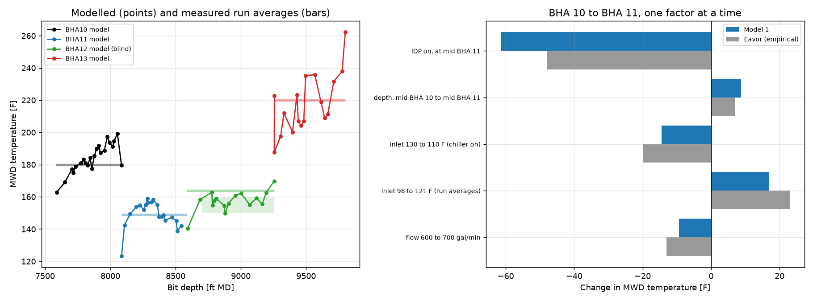
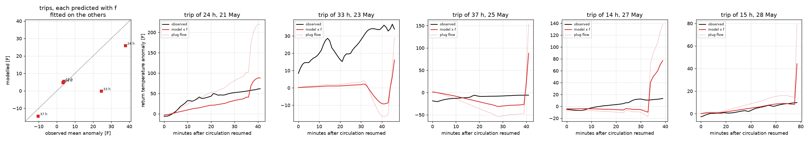

# Validation, calibration and analytic checks

The checks below have different scopes. Circulation temperatures have been compared with Utah FORGE observations and a published simulator. Rock reheating has analytic checks and a limited field comparison. Rock strength is calibrated at UD-1; checks at other wells test parts of the stability calculation. Together they do not validate a complete 10-13 km drilling programme.

## Evidence and independence

An observation is held out when it is excluded from the parameter fit being assessed. A comparison can still share inputs inferred from those observations. The table separates those dependencies:

MWD means measurement while drilling; the FORGE temperatures are fluid measurements at the downhole sensor. BHA means bottom-hole assembly, the equipment near the bit; the BHA numbers identify the trial's assemblies and runs. Plug flow transports the fluid column to surface without modelling heat exchange during its ascent.

| Comparison | Observed or reference quantity | What was fitted | Inputs shared with or inferred from the observations | What was held out | What the comparison can establish |
|---|---|---|---|---|---|
| UT Austin benchmark | Wu et al.'s published fluid temperatures and standpipe pressures | No parameter fit; the initial comparison identified omitted friction heating | Published well geometry, pipe properties and operating conditions; assumptions where the paper is silent, including the unspecified bit nozzles | The published outputs were compared without fitting parameters to them | Agreement with another simulator for specified cases, with unresolved coated-pipe differences; this is a code-to-code benchmark |
| FORGE 16B circulation | Measured MWD fluid temperatures during regular-pipe and insulated-pipe runs | Multiplier on the annulus heat-transfer coefficient, fitted on the regular-pipe runs; effective insulated-pipe conductivity on BHA 11. The chain with the coefficient unfitted still fits that conductivity on BHA 11 | The 16B survey and rig record; formation temperatures from neighbouring well 16A; measured core thermal properties | BHA 12's partial-insulation temperatures, predicted without further fitting | Fluid-temperature prediction for the held-out run under the trial conditions, with the fitted-input dependencies stated |
| FORGE pauses | Return-temperature anomalies after five trips | One attenuation factor for the plug-flow temperature anomaly; each trip is predicted with the factor fitted on the other four | The FORGE geometry and circulation record; pipe conductivity from the MWD comparison; each pause's pre-stop return temperature sets an offset, and the restart record supplies flow and inlet conditions | Each trip's return-temperature anomaly is excluded from its own attenuation-factor fit | Limited predictive performance for the return anomaly; the comparison is too coarse to distinguish the wall-reheating treatments |
| UD-1 strength calibration | BGS breakout widths and intervals without breakouts in the near-vertical section | Weak-zone strengths and an intact-rock lower bound | Published stress and pore-pressure profiles; assumed wall-cooling range and fluid weight; strengths inferred directly from the breakout observations | The deeper deviated-section breakouts are excluded from the fit and used as a qualitative check | Strength ranges conditional on the adopted stresses and cooling; the calibration does not independently verify those inputs |
| Soultz cross-check | Breakout onset and failures at depth in GPK3 and GPK4 | No strength refit in this cross-check | Valley and Evans stress bounds derived partly from wellbore failures; UD-1 calibrated strengths or Soultz laboratory strengths; assumed wall cooling | Soultz observations were excluded from the UD-1 strength calibration, but wellbore failures contributed to the stress bounds | Consistency at a second granite site, with limited independence in the breakout-onset comparison |
| Newberry cross-check | Volcanic breakout widths and the absence of granodiorite breakouts | The wall-cooling range is scanned for widths matching the observations; published stresses and porosity-derived strengths are fixed | Maximum horizontal stress inferred from these breakouts; strength inferred from the porosity log; static temperature and pore-pressure logs | No independent breakout-width set, stress determination or measured wall-temperature profile | Consistency of the thermal term with an assumed cooling range; the granodiorite pattern is not reproduced |
| Analytic checks | Cylinder heat-flow and recovery solutions | No fitted parameter | The numerical and analytic calculations use the same material properties and boundary conditions | No field observations are involved | Numerical reproduction of the specified conduction problems; applicability to a well requires separate evidence |

- [Circulation](#circulation): benchmark and FORGE temperatures.
- [Rock reheating](#rock-reheating): pause comparison and analytic solutions.
- [Stability checks](#stability-checks): strength calibration and other wells.

## Circulation

Model 1 was first compared with the transient simulator of Wu et al. (2025), with their published well, string, fluid and flow and nothing fitted (`benchmark_utaustin.py`). The comparison identified one omission in Model 1, the heat generated by friction. Their dual-wall pipe loses about 70 MPa to friction, which warms the mud by about 18 °C; with this heat included, Model 1 agrees with their results for conventional and dual-wall pipe to within 7 °C in the vertical well and 2 °C in the horizontal well. The results for coated pipe do not agree. With the 1 mm coatings described in their text, Model 1 is 30 to 60 °C hotter than their results, and with the single conductivity per pipe given in their table applied across the whole wall, it is 10 to 36 °C colder. Their results lie between the two, and the paper does not state which interpretation their model uses. The standpipe pressures from Model 1 are 10 to 25% higher than theirs, of which 1.4 MPa is the loss across a bit whose nozzles they do not specify.

| Base case, 600 gal/min, 24 °C/km | Wu et al. | Model 1 | Model 1, whole-wall reading |
|---|---|---|---|
| Vertical, conventional | 179 °C | 172 °C | 172 °C |
| Vertical, internally coated | 76 °C | 126 °C | 66 °C |
| Vertical, externally coated | 121 °C | 153 °C | 91 °C |
| Vertical, dual-wall | 59 °C | 61 °C | 61 °C |
| Horizontal, conventional | 206 °C | 207 °C | 207 °C |
| Horizontal, dual-wall | 65 °C | 67 °C | 66 °C |

The field comparison uses the trial of Eavor's insulated drill pipe in Utah FORGE well 16B in May 2023 (`validate_forge16b.py`). Four bits were run in 9.5-inch hole at 60 to 70° inclination: two on regular pipe, one on a full string of insulated pipe and one with about 70% insulated pipe above regular pipe. The well's survey, casing, string, rock properties and drilling record come from the public FORGE dataset, the flow and inlet temperature minute by minute from the rig's records, and the measured MWD temperatures from Eavor's trial report. The model is run at half-hourly intervals while each bit was drilling and compared with the fluid temperature in the pipe at the MWD sensor. Without fitting, the model overestimated the temperature on the runs with regular pipe by 4 to 12 °F. A multiplier of 0.75 on the annulus heat-transfer coefficient, fitted to those runs, brings them within 5 °F. One effective conductivity for Eavor's pipe, fitted on the full insulated run, gives 4.9 W/m·K across the pipe wall, which is within about 15% of the wall resistance of a 1 mm coating at 0.47 W/m·K on steel, the coating Eavor has described (Vetsak et al., 2024). The run with partial insulation was then predicted with no further fitting.

| Run | Measured MWD | Fitted model | Model with the film unfitted |
|---|---|---|---|
| BHA 10, regular pipe | 180 °F | 184 °F | 192 °F |
| BHA 11, insulated pipe (fitted) | 149 °F | 149 °F | 149 °F |
| BHA 12, partial, blind | 164 °F | 157 °F | 160 °F |
| BHA 12 after levelling, blind | 150 to 160 °F | 159 °F | 161 °F |
| BHA 13, regular pipe | 220 °F | 218 °F | 228 °F |

Eavor estimated from the data how each change between the first two runs moved the MWD temperature. Rebuilt one factor at a time, the model attributes −9 °F to the higher flow (Eavor −12 to −14), +17 °F to the warmer inlet (+23), +9 °F to the added depth (+7) and −61 °F to the insulated pipe. Eavor's breakdown gives −47 to −49 °F for the pipe, which they describe as conservative, and their overall estimate of its benefit, against the runs before and after, is 47 to 75 °F. The site evaluations use the unfitted coefficient, since the multiplier absorbs all the effects the model omits at FORGE and there is no evidence that it applies to a 12 km well; it is reported as a sensitivity. With the coefficient unfitted, BHA 12 is predicted to within 4 to 6 °F, and the model overestimates the MWD fluid temperatures on the regular-pipe runs. That overestimate is conservative for the tool-temperature check under those conditions. It does not establish that every pressure or stability result is conservative.

*Fig. 2. Left: modelled MWD temperature while drilling each run (points), against the measured run averages (bars) and BHA 12's levelled range (shaded). Right: the change between the first two runs, one factor at a time, from the model and from Eavor's estimate.*

## Rock reheating

The reheating of the wall when circulation stops is calculated with a transient model of conduction in the rock around the hole, described in the [physical-model guide](models.md#wall-reheating-and-thermal-stress). It was compared with the return temperature recorded in FORGE 16B when circulation resumed after each of the five trips in the trial (`validate_forge_pauses.py`). While the pumps are off, the fluid in the hole drifts towards the temperature of the rock around it, warming in the deep part of the hole and cooling near surface, and when they restart the annulus column reaches surface over the first bottoms-up, shallowest fluid first. In the model, the rock at points every 200 ft along the hole is taken through its own history of circulation and pauses from the rig's minute-by-minute record, and the column of fluid temperatures is pushed to surface as plug flow. Plug flow ignores the heat the returning fluid exchanges with the string and the rock on its way up, so one factor scales the modelled anomaly in the return temperature. Fitted on four of the five trips and used to predict the fifth, in turn, the factor is 0.56, and the predicted mean anomalies differ from the observed ones by 12 °F (root mean square), against observed anomalies of −10 to +38 °F (Fig. 3). The largest miss is the 33-hour trip, observed at +25 °F and predicted at 0 °F. With the fluid in the hole taken at the wall's temperature, the sensitivity used for the sites, the factor is 0.39 and the misfit 13 °F. The pauses with the bit on bottom could not be used, as most were for gyroscopic surveys or circulation at reduced flow, and their first bottoms-up runs into the next operation. The modelled curves are dominated by the arrival of the hot fluid from the bottom of the hole, which the observed curves do not show, and the fit barely separates the base case from the case with no fluid in the hole. The comparison is therefore too coarse to confirm or reject the reheating model, which rests on the [analytic checks](#analytic-checks). It is nonetheless the only field record of reheating found in the public data.

*Fig. 3. Return temperature anomaly over the first bottoms-up after each trip in FORGE 16B: observed (black), from the plug-flow column (dotted) and scaled by the factor fitted on the other trips (red). Left: the mean anomaly over each bottoms-up, predicted against observed.*

### Analytic checks

The temperature of the rock around the hole through the drilling cycle is calculated by implicit finite volumes for radial conduction (`wall_thermal.py`). While the fluid circulates, the wall exchanges heat with the annulus at the temperature and film coefficient that Model 1 gives. When circulation stops, the fluid in the hole is treated as a single well-mixed volume coupled to the wall by the laminar film coefficient (a Nusselt number of 4.36), the conservative floor Model 1 already uses, so that the fluid slows the reheating; the case with no fluid, in which the wall reheats faster, is a sensitivity. Jaeger (1956) gave the corresponding solution for a cylinder containing a perfect conductor. The solver reproduces the heat flow from a cylinder held at constant temperature (Carslaw and Jaeger, 1959) to within 1.2% and the recovery after a period of constant heat flow to within 2%, both evaluated by numerical inversion of the Laplace-transform solutions (Abate and Valkó, 2004). The line-source approximation (Bullard, 1947) differs from the cylinder solution by 6 to 13% over the times of interest and is reported for comparison only.

## Stability checks

### UD1 strength calibration

UD-1 was drilled into the Carnmenellis granite with drilling fluid below 1.05 SG (specific gravity relative to water) in its 12.25-inch section, and stress magnitudes at the site have been published by Reinecker et al. (2021). The British Geological Survey's interpretation of the UD-1 borehole images (BGS, 2024) records 24 breakouts in the near-vertical part of the well between 900 and 4,000 m measured depth, each with its depth and angular width. Given the stresses, the width of a breakout fixes the strength of the rock in which it formed, so the rock strength can be fitted directly (`calibrate_ud1.py`). The intervals that did not break out set a lower bound on the strength of intact rock.

The temperature of the drilling fluid at the wall was not published, and its cooling effect was therefore bracketed between 0 and 40 K. Over that range the median strength of the rock that broke out is 118 to 147 MPa, and intact rock must have a strength of at least 172 to 203 MPa. With these values the model predicts breakouts from about 2.9 km depth, compared with one logged at 2.2 km and the rest from 3.1 km (measured depth, which differs from vertical depth by less than 10 m in this section), and widths of 53 to 57° near the base of the section, compared with 50 to 53° logged (Fig. 7). The 51 breakouts recorded in the deeper, deviated part of the well were not used in the fit; they fall between the predictions for weak and intact rock. The interpretation summarised by Reinecker et al. (2021) contains more breakouts over the same interval (27, totalling 139 m against 46 m), and the calibration is accordingly specific to the BGS reading of the images.

The calibration was repeated with the cooling credited only as deep as the breakout reaches. Each depth was taken as circulated against from the time the bit passed it, at a rate of penetration of 3.6 m/h (2.0 to 5.2 m/h as a sensitivity, from the drilling times in Reinecker et al., 2021). The weak-zone strength becomes 119 to 147 MPa, and the intact bound is unchanged, because the cooled zone at UD-1 extends further into the rock than its breakouts.

*Fig. 7. Left: breakout widths logged in UD-1 (filled, 12.25-inch section; hollow, deviated 8.5-inch section) and widths predicted for weak-zone and intact rock. Right: rock strength implied by each breakout over the 0 to 40 K range of wall cooling.*

### Soultz cross-check

The Soultz wells GPK3 and GPK4 reached 5 km with breakouts, and their stress state has been characterised to that depth by Valley and Evans (2007). Without refitting rock strength in the Soultz cross-check (`crosscheck_soultz.py`), the model predicts breakouts at 5 km with a drillable range of fluid weights in 46 of 48 combinations of rock strength, wall cooling and stress. Using the weak-zone strengths from UD-1 without adjustment, it places the first breakouts at 2.6 to 3.8 km depth; in GPK4 they appear at about 3.0 km and become dense below 3.7 km. With the laboratory strength of Soultz granite (100 to 130 MPa) and the lower bound on the maximum horizontal stress, the onset falls at 3.64 km, consistent with the analysis of Valley and Evans (2007). These results check the use of UD-1 strengths at a second granite site. The Valley and Evans stress bounds were themselves derived partly from wellbore failures, which limits the independence of the breakout-onset comparison. Two wells provide a limited basis for generalisation. Judged with the temperature of the rock behind the wall, after 1 or 24 hours of circulation at 40 K below formation temperature, the widths at 5 km increase by up to 3°, and the window of fluid weights stays open in every case.

### Newberry cross-check

NWG 55-29 at Newberry, Oregon, was imaged with a borehole televiewer in 2008 during a programme of injecting cold water to cool the well, at up to 277 °C. Davatzes and Hickman (2011) found breakouts throughout the volcanic rocks above about 8,610 ft and none in the granodiorite below, and derived the stresses from them with a strength taken from the neutron porosity log. They set the thermal stress of the cooled wall to zero. The cross-check uses their published stresses and porosity-derived strengths, with the well's logs from the Geothermal Data Repository (Cladouhos, 2012), in `crosscheck_newberry.py`.

With the published stresses and porosity-derived strengths held fixed, the predicted breakout width in the volcanics matches the observed modal width of 36° for a wall 25 to 35 K below its static temperature. The difference between the log's maximum temperature and the static temperature at its base is 20 K, providing context for the cooling range in this comparison at about 290 °C. The stresses were derived from these breakouts and the wall temperature was not measured, so this is a consistency check of the thermal term. An independent test would need stresses derived without these breakouts and a measured wall temperature.

With the cooling credited only as deep as the breakout reaches, the width in the volcanics is matched at 25 to 40 K. The model also predicts breakouts over most of the logged granodiorite, where none were seen, as does the authors' own criterion. The porosity relation gives the granodiorite 60 to 82 MPa against 51 to 74 MPa in the volcanics, too little contrast to separate them, so the pattern by rock type is not reproduced. Their friction coefficient (0.55, with 0.70 as an alternative) is used for this well and for the site, because their stresses were derived with it; it differs from the 0.8 used at United Downs. The Shmin they quote at 8,420 ft corresponds to their formula at 0.70, and both cases are run.

Equations are in the [physical-model guide](models.md#equations). The [bibliography](sources.md#references) gives the source publications.
