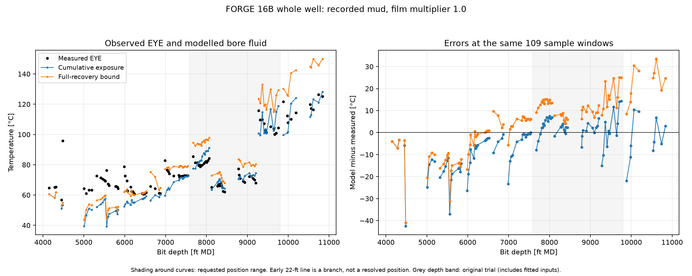
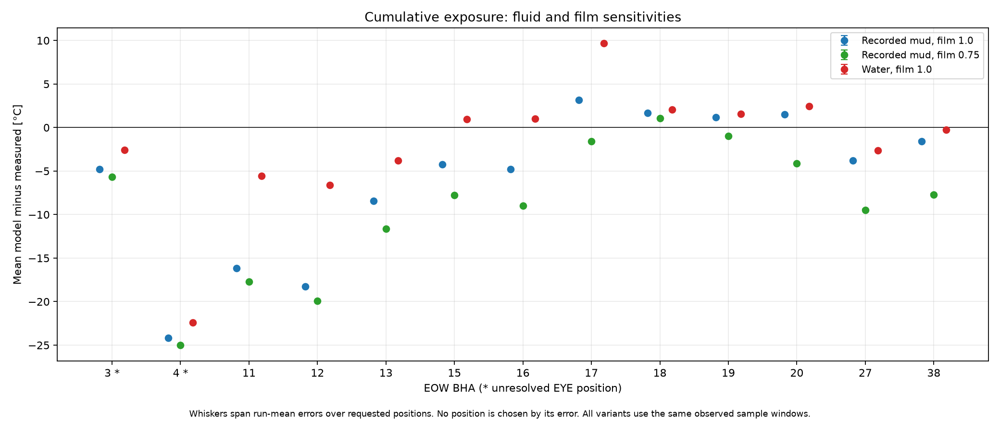

# FORGE 16B whole-well comparison: original protocol results

## Existing trial water check

The check was completed before whole-well predictions. Both saved calculation chains use their original samples and their own saved film and pipe-conductivity parameters; no fitting entry point was called. All 150 solves converged. The largest absolute difference from a saved run mean is 0.00004399 °F, within the existing 1 °F regression tolerance.

| Trial BHA | Saved fitted-chain water result, °F | Reproduced, °F | Saved unfitted-chain water result, °F | Reproduced, °F |
|---|---:|---:|---:|---:|
| 10 | 184.057308 | 184.057308 | 192.040725 | 192.040725 |
| 11 | 148.989894 | 148.989894 | 148.980408 | 148.980408 |
| 12 | 157.404404 | 157.404404 | 160.305218 | 160.305218 |
| 13 | 217.880717 | 217.880717 | 227.659973 | 227.660017 |

The whole-well comparisons below use the newly frozen observation windows and recorded mud, with water as a separate sensitivity. Their run averages need not reproduce the old trial averages. Insulated-pipe cases use the one previously fitted conductivity specified at S0, 4.9237482416889895 W/(m K), with both film multipliers. The saved unfitted chain above used its own different fitted conductivity, 4.7025289484090305 W/(m K).

A further implementation control replayed all 150 identical legacy sample/parameter combinations through the new whole-well study water path, using the legacy clock. All converged; the largest sample difference from the original entry point was 1.42108547e-14 °C. This check was performed after the whole-well run, without changing its plan or results. The original golden replay above was completed first, before whole-well predictions. Details are in [water-path-check.csv](water-path-check.csv).

The frozen S1 protocol anticipated 146 replay solves in error. The original entry point returns 75 samples per chain (22 + 20 + 16 + 17), so each complete check actually ran 150. This is a count correction; no replay sample was added or removed.

## Primary comparison

Baseline `85f23db51f6661e6ca09bd05c16b9ffb48881d83`, branch `forge16b-wholewell`. Primary inputs are recorded period mud, film multiplier 1.0 and cumulative exposure. Errors below are modelled bore fluid minus measured EYE; positive means too hot. Each half-hour sample has equal weight. MD is measured depth along the hole; EOW is the End of Well Report assembly number.

| EOW BHA | Position above bit, ft | Samples | Measured mean, °C | Model mean, °C | Bias, °C (°F) | MAE, °C | RMSE, °C |
|---|---:|---:|---:|---:|---:|---:|---:|
| 3 | 22 | 3 | 65.02 | 60.22 | -4.80 (-8.65) | 4.80 | 5.06 |
| 3 | 69 | 3 | 65.02 | 60.15 | -4.87 (-8.77) | 4.87 | 5.12 |
| 3 | 84 | 3 | 65.02 | 60.13 | -4.89 (-8.81) | 4.89 | 5.14 |
| 4 | 22 | 2 | 76.29 | 52.11 | -24.17 (-43.51) | 24.17 | 30.35 |
| 4 | 84 | 2 | 76.29 | 52.02 | -24.27 (-43.68) | 24.27 | 30.43 |
| 11 | 22 | 4 | 62.97 | 46.80 | -16.18 (-29.12) | 16.18 | 16.95 |
| 12 | 22 | 12 | 68.75 | 50.48 | -18.27 (-32.89) | 18.27 | 19.34 |
| 13 | 22 | 14 | 64.34 | 55.93 | -8.42 (-15.15) | 8.42 | 10.79 |
| 15 | 22 | 4 | 63.04 | 58.83 | -4.21 (-7.58) | 4.21 | 5.24 |
| 16 | 22 | 15 | 73.85 | 69.05 | -4.80 (-8.64) | 4.80 | 8.03 |
| 17 | 84 | 14 | 81.36 | 84.54 | +3.18 (+5.73) | 4.96 | 5.43 |
| 18 | 84 | 10 | 65.47 | 67.16 | +1.69 (+3.05) | 2.09 | 2.38 |
| 19 | 84 | 10 | 71.29 | 72.47 | +1.18 (+2.12) | 2.85 | 3.58 |
| 20 | 84 | 11 | 105.57 | 107.06 | +1.49 (+2.68) | 7.57 | 9.31 |
| 27 | 22 | 5 | 113.27 | 109.54 | -3.73 (-6.72) | 11.84 | 12.99 |
| 27 | 84 | 5 | 113.27 | 109.47 | -3.80 (-6.84) | 11.84 | 13.00 |
| 38 | 22 | 5 | 121.01 | 119.52 | -1.49 (-2.69) | 5.49 | 5.77 |
| 38 | 84 | 5 | 121.01 | 119.45 | -1.56 (-2.81) | 5.49 | 5.78 |

EOW 3/4 positions remain unresolved: every requested branch is shown. EOW 27/38 use 84 ft as the assumed position and 22 ft as sensitivity. EOW 38's newly inspected drawing states EYE = 85 ft; the instructed 84-ft treatment is retained, with the 85-ft interpolation saved in the raw results. EOW 14 and 26 have no S0 candidate sample and are not added here.

The grey depth band is the original trial. EOW 17/20 supplied the prior film fit; EOW 18 supplied the pipe-conductivity fit; EOW 19 was held out but depends on that fitted conductivity. The other periods contributed to neither fit. The unresolved early positions are excluded from the independent-period pool.

| Group, primary settings | Samples | Bias, °C | MAE, °C | RMSE, °C |
|---|---:|---:|---:|---:|
| independent regular pipe | 59 | -8.77 | 9.79 | 12.59 |
| trial film-fit runs | 25 | +2.44 | 6.11 | 7.39 |
| trial IDP-fit run | 10 | +1.69 | 2.09 | 2.38 |
| trial held-out IDP run, fitted conductivity | 10 | +1.18 | 2.85 | 3.58 |

## Findings

The sign of the discrepancy changes within 16B. The recorded-mud primary underpredicts every pre-trial run mean, with biases of −18.27 to −4.21 °C for EOW 11–16. The four trial means are overpredicted by +1.18 to +3.18 °C. The late EOW 27 and 38 mean biases are −3.80 and −1.56 °C, but their mean absolute errors are 11.84 and 5.49 °C: the small signed means conceal sample scatter. A single description of 16B as overpredicted does not cover this expanded comparison.

The early recorded-mud comparison depends materially on missing-rheology substitutions. EOW 11 and 12 use reference PV and YP; their water sensitivities have biases of −5.59 and −6.60 °C. Replacing the entire mud treatment with water therefore changes their mean predictions by more than 10 °C. This is a fluid-property sensitivity, not an isolated test of PV, and does not identify the true field rheology. Reducing the film multiplier to 0.75 lowers the predictions and increases the pre-trial underprediction.

Full recovery brackets the measured run mean in EOW 15, 16, 27 and 38. It leaves the other pre-trial means too cold and increases the trial overprediction. At EOW 27/38 it raises primary mean temperatures by 23.54/27.49 °C. This optimistic bound does not establish recovery as the explanation of the discrepancies. The requested EYE position brackets change primary predictions by less than 0.10 °C per sample and cannot account for those larger residuals.

## Fluid, film and recovery sensitivities

The water sensitivities keep measured volumetric flow and inlet temperature, using water inlet density to obtain mass flow. Film 0.75 is a fixed historical sensitivity, not a new fit. The recovery bound caps exposure at observed circulation since the last continuously observed pumps-off spell longer than two hours, retaining the existing one-hour floor. It assumes full recovery and does not establish that recovery occurred.

| EOW BHA | Position, ft | Cumulative mean, °C | Full-recovery mean, °C | Change, °C | Measured mean bracketed? |
|---|---:|---:|---:|---:|---|
| 3 | 22 | 60.22 | 60.22 | -0.00 | No |
| 3 | 69 | 60.15 | 60.15 | -0.00 | No |
| 3 | 84 | 60.13 | 60.13 | -0.00 | No |
| 4 | 22 | 52.11 | 54.03 | +1.92 | No |
| 4 | 84 | 52.02 | 53.94 | +1.92 | No |
| 11 | 22 | 46.80 | 50.27 | +3.47 | No |
| 12 | 22 | 50.48 | 53.65 | +3.17 | No |
| 13 | 22 | 55.93 | 61.54 | +5.62 | No |
| 15 | 22 | 58.83 | 68.86 | +10.03 | Yes |
| 16 | 22 | 69.05 | 78.55 | +9.50 | Yes |
| 17 | 84 | 84.54 | 94.85 | +10.31 | No |
| 18 | 84 | 67.16 | 72.30 | +5.14 | No |
| 19 | 84 | 72.47 | 81.00 | +8.53 | No |
| 20 | 84 | 107.06 | 122.63 | +15.57 | No |
| 27 | 22 | 109.54 | 133.08 | +23.54 | Yes |
| 27 | 84 | 109.47 | 133.01 | +23.54 | Yes |
| 38 | 22 | 119.52 | 147.00 | +27.48 | Yes |
| 38 | 84 | 119.45 | 146.93 | +27.49 | Yes |

This table uses recorded mud and film 1.0. All fluid/film/clock variants are retained in [run-metrics.csv](run-metrics.csv); [depth-metrics.csv](depth-metrics.csv) gives errors by run and predeclared 500-ft MD bin. All errors are supplied in °C and °F. [recovery-bracket.csv](recovery-bracket.csv) retains paired counts and Fahrenheit changes.

| EOW BHA | Requested positions, ft | Mean position spread, °C | Maximum position spread, °C |
|---|---|---:|---:|
| 3 | 22;69;84 | 0.090 | 0.093 |
| 4 | 22;84 | 0.091 | 0.093 |
| 27 | 22;84 | 0.069 | 0.086 |
| 38 | 22;84 | 0.071 | 0.086 |

Position spreads are calculated separately within each matched sample, not from a range of independent observations. [position-spreads.csv](position-spreads.csv) contains all variants.

## Mud provenance and motorless-pressure diagnostic

| EOW BHA | Mud density, lb/US gal | PV, cP | YP, lbf/100 ft² | Earlier-value fields | Reference fields | Whole mud sample carried? |
|---|---:|---:|---:|---:|---:|---|
| 3 | 9.0000 | 11.000 | 8.000 | 0 | 0 | No |
| 4 | 9.1000 | 13.000 | 7.000 | 0 | 0 | Yes |
| 11 | 8.4000 | 27.000 | 28.000 | 0 | 2 | No |
| 12 | 8.3500 | 27.000 | 28.000 | 0 | 2 | No |
| 13 | 8.3500 | 2.000 | 28.000 | 0 | 1 | No |
| 15 | 8.3500 | 2.000 | 28.000 | 2 | 2 | No |
| 16 | 8.4000 | 2.000 | 28.000 | 1 | 1 | No |
| 17 | 8.4000 | 2.000 | 28.000 | 1 | 1 | No |
| 18 | 8.4000 | 2.000 | 28.000 | 1 | 1 | Yes |
| 19 | 8.4000 | 1.000 | 1.000 | 0 | 0 | Yes |
| 20 | 8.4475 | 1.000 | 1.000 | 4 | 0 | No |
| 27 | 8.4000 | 1.000 | 1.000 | 0 | 0 | Yes |
| 38 | 8.4000 | 1.000 | 1.000 | 2 | 0 | No |

PV denotes plastic viscosity and YP yield point. Field counts refer to completed source rows before averaging, not additional independent measurements. [mud-assignment-ledger.csv](mud-assignment-ledger.csv) identifies each original sample, every donor and each reference value. The 12 May pit cleaning separates the rheology histories. No earlier measurement is borrowed across that boundary. This leaves reference YP in much of the pre-trial and early-trial primary comparison; those results are conditional on that default. All recorded densities are treated as 20 °C surface densities, following the 16A treatment; the field measurement temperature is unknown.

| Motorless EOW BHA | Candidate windows | Candidate mean differential, psi | Candidate range, psi | Accepted 10-s EYE-row mean, psi |
|---|---:|---:|---:|---:|
| 12 | 12 | +39.65 | +6.89 to +94.12 | +27.73 |
| 13 | 14 | +15.65 | -10.93 to +80.95 | +14.17 |
| 14 | 0 | none | none | +35.71 |
| 15 | 4 | -0.37 | -45.52 to +39.13 | +30.27 |
| 16 | 15 | +14.12 | -12.60 to +36.60 | +12.94 |

The motorless channel is not identically zero. It cannot be interpreted as verified motor-only loss. The two averaging columns use different sampling weights. No zero-offset correction is applied; motor-face heat is zero on these assemblies. Raw values, including negative values, remain in the inputs. Pressure/energy comparisons with 16A are deferred to S2.

## Numerical coverage

All 872 planned cases converged. The exposure history has 229 missing-flow rows, 23 incomplete ten-minute bins and four gaps longer than ten minutes. Missing coverage contributes no observed circulation and does not establish a known stop. The [summary](summary.json) retains solver coverage and numerical versions.
