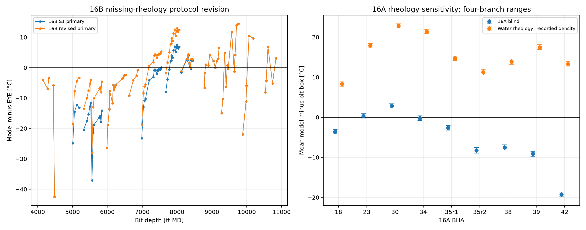
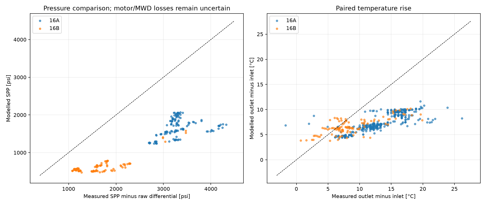

# FORGE 16B and 16A: S2 review

## Protocol revision and preserved evidence

The revised missing-rheology rule was fixed from the inputs after S1 review. Missing PV/YP uses the nearest actual measurement in either time direction within the same fluid system; a system without a measurement uses water viscosity or zero yield point at recorded density. The original S1 primary remains version 1. The new 16B primary is version 2. The 16A blind result remains unchanged; its water-rheology run is a sensitivity. No parameter was fitted and no model function, constant, default, golden or regression tolerance was changed.

The earlier weighted-programme reference PV 27 cP and YP 28 lbf/100 ft² are inconsistent with the reported low-solids water-rich 16B mud. The revised early low-solids assignments use PV 2 cP and YP 1 lbf/100 ft². The [donor ledger](mud-revision-ledger.csv) includes signed time offsets; no donor crosses a fluid-system boundary. The post-TD high-viscosity sweep/logging fluid is separated from drilling fluid using the 17 June operations report. Some nearest measurements remain days away from the selected sample, so the actual contemporaneous rheology remains uncertain.

PV means plastic viscosity; YP means yield point. MD is measured depth along the hole; TVD is true vertical depth. Error signs are model minus measurement. Annulus film means the model's local convective coefficient, not overall conductance through casing and rock.

## Findings

The 16B revision raises the EOW 11 and 12 model means by 7.69 and 8.48 °C, leaving biases of −8.49 and −9.80 °C. EOW 16 changes from −4.80 to +0.14 °C, while trial EOW 17 changes from +3.18 to +8.74 °C. Several other runs are unchanged. The revision removes the input-inconsistent reference fallback; it does not remove the changing sign of the field discrepancy.

At 16A BHA 42, the unchanged blind bias of −19.87 to −18.69 °C becomes +12.72 to +13.89 °C with water rheology, a model-mean increase of 32.57–32.60 °C. All nine run means become too hot in this sensitivity. Across all 358 16A samples, mean return-temperature error worsens from −5.85 to −7.98 °C. Water rheology at recorded density is a diagnostic sensitivity, not an established description of the measured drilling mud.

All reported annulus profile cells are on the turbulent heat-transfer branch. Minimum sampled thermal Re is 7,445 for original 16A and 5,113 for original 16B; the sensitivities increase those minima. The strong temperature changes occur within that branch. Mean length-weighted annulus film increases from 2,020 to 6,928 W/(m² K) across the same 358 16A samples. In contrast, the apparent-viscosity hydraulic test gives mean laminar length fractions of 29.7% in original 16A, 71.4% in original 16B and 4.6% in revised 16B. These distinct model tests must not be conflated. Higher downhole predictions accompany higher film coefficients even though the calculated friction-heating input decreases.

The model underpredicts measured SPP minus raw differential by a mean 1,624 psi in original 16A and 969 psi in revised 16B. Measured mean SPP × inlet flow is 928/527 kW for 16A/16B. The model's distributed friction plus nozzle and motor-face heat is 500/244 kW on the same pressure-supported samples. Motor/MWD losses and the meaning of the differential remain uncertain, so this pressure gap cannot be assigned to distributed friction alone. The temperature equivalent of all measured hydraulic power, using inlet mass flow and heat capacity, averages 5.88/2.98 °C. Rock exchange and internal transfer remain essential to interpreting the thermal results.

Ten predeclared depth bins have downhole observations in both wells. The Q4 tables retain the geometry, temperature boundaries and rheology differences, with actual depth ranges and unmatched bins. They do not identify a unique cause of the residuals or select a corrective parameter.

## 16B primary: both protocol versions

| EOW BHA | Position, ft above bit | Samples | S1 v1 bias, °C | Revised v2 bias, °C | Change in model, °C |
|---|---:|---:|---:|---:|---:|
| 3 | 22 | 3 | -4.80 | -4.80 | +0.00 |
| 3 | 69 | 3 | -4.87 | -4.87 | +0.00 |
| 3 | 84 | 3 | -4.89 | -4.89 | +0.00 |
| 4 | 22 | 2 | -24.17 | -24.17 | +0.00 |
| 4 | 84 | 2 | -24.27 | -24.27 | +0.00 |
| 11 | 22 | 4 | -16.18 | -8.49 | +7.69 |
| 12 | 22 | 12 | -18.27 | -9.80 | +8.48 |
| 13 | 22 | 14 | -8.42 | -8.42 | +0.00 |
| 15 | 22 | 4 | -4.21 | -4.21 | +0.00 |
| 16 | 22 | 15 | -4.80 | +0.14 | +4.94 |
| 17 | 84 | 14 | +3.18 | +8.74 | +5.56 |
| 18 | 84 | 10 | +1.69 | +2.08 | +0.39 |
| 19 | 84 | 10 | +1.18 | +1.18 | +0.00 |
| 20 | 84 | 11 | +1.49 | +1.49 | +0.00 |
| 27 | 22 | 5 | -3.73 | -3.73 | +0.00 |
| 27 | 84 | 5 | -3.80 | -3.80 | +0.00 |
| 38 | 22 | 5 | -1.49 | -1.49 | +0.00 |
| 38 | 84 | 5 | -1.56 | -1.56 | +0.00 |

The original 109 windows, geometry and sensor interpretations are unchanged. EOW 3/4 remain unresolved across the listed positions. EOW 27/38 retain the assumed 84-ft position and 22-ft sensitivity. All original S1 recovery/film sensitivities remain tied to version 1; they have not been silently reinterpreted with the revised mud.

## 16A water-rheology sensitivity

| 16A BHA | Bit-box samples | Unchanged blind bias range, °C | Water-rheology sensitivity bias range, °C | Change in model mean, °C |
|---|---:|---:|---:|---:|
| 18 | 15 | -4.16 to -3.03 | +7.74 to +8.84 | +11.88 to +11.91 |
| 23 | 13 | -0.24 to +0.90 | +17.35 to +18.45 | +17.56 to +17.59 |
| 30 | 29 | +2.32 to +3.38 | +22.27 to +23.30 | +19.92 to +19.95 |
| 34 | 9 | -0.81 to +0.36 | +20.81 to +21.95 | +21.60 to +21.62 |
| 35r1 | 5 | -3.19 to -2.06 | +14.13 to +15.25 | +17.30 to +17.32 |
| 35r2 | 4 | -8.98 to -7.54 | +10.54 to +11.96 | +19.50 to +19.52 |
| 38 | 20 | -8.18 to -6.85 | +13.18 to +14.50 | +21.34 to +21.36 |
| 39 | 25 | -9.75 to -8.49 | +16.84 to +18.09 | +26.57 to +26.59 |
| 42 | 15 | -19.87 to -18.69 | +12.72 to +13.89 | +32.57 to +32.60 |
| ALL | 135 | -5.65 to -4.46 | +16.02 to +17.19 | +21.65 to +21.67 |
| ALL excluding washout | 126 | -5.64 to -4.46 | +16.27 to +17.43 | +21.89 to +21.91 |

Each range preserves the four predetermined bore/annulus and bit/40-ft branches. No closest endpoint is selected. The sensitivity retains recorded density and the mixture's thermal properties; only viscosity and yield point change. All 358 primary samples were evaluated, including 223 return-only samples. Top-sub comparisons, per-depth results and °F errors are in [temperature-metrics.csv](temperature-metrics.csv) and [temperature-depth-metrics.csv](temperature-depth-metrics.csv). BHA 35 washout flags remain explicit.

## Regime, heat transfer and energy

The heat-transfer routine uses Reynolds number based on plastic viscosity, with the laminar floor at Re < 2300. Bingham hydraulics separately uses apparent viscosity, including YP, with a threshold of 2100. The existing distributed thermal-friction routine uses the Newtonian friction-factor treatment on plastic viscosity and a 5 MPa liquid-property floor. These existing treatments are reported separately; none was changed for this study.

The full depth-dependent Reynolds numbers, both regime flags, annulus film and viscosity are in [annulus-profiles.csv.gz](annulus-profiles.csv.gz). [energy-samples.csv](energy-samples.csv) includes per-sample depth-weighted summaries and sensor-position values. A mean Reynolds number is not used to classify the whole annulus; laminar length fractions are reported directly.

| Well / treatment / BHA | Samples / pressure | Thermal laminar length, mean % | Annulus film, length mean W/(m² K) | Measured SPP, mean psi | Model SPP, mean psi | Adjusted SPP residual, mean psi | Rise error, mean °C |
|---|---:|---:|---:|---:|---:|---:|---:|
| 16B / 3 | 3 / 3 | 0.0 | 1107.5 | 3271 | 1364 | -1640 | -3.65 |
| 16B / 4 | 2 / 2 | 0.0 | 970.6 | 3429 | 1555 | -1918 | -2.36 |
| 16B / 11 | 4 / 4 | 0.0 | 2668.0 | 2071 | 615 | -961 | -4.13 |
| 16B / 12 | 12 / 12 | 0.0 | 2751.4 | 1175 | 539 | -596 | +1.25 |
| 16B / 13 | 14 / 14 | 0.0 | 2714.7 | 1166 | 562 | -589 | -1.50 |
| 16B / 15 | 4 / 4 | 0.0 | 2803.9 | 1189 | 577 | -612 | +0.10 |
| 16B / 16 | 15 / 15 | 0.0 | 4057.2 | 1244 | 519 | -711 | -2.05 |
| 16B / 17 | 14 / 14 | 0.0 | 4418.3 | 1742 | 513 | -1024 | -0.38 |
| 16B / 18 | 10 / 10 | 0.0 | 4622.5 | 1922 | 652 | -1009 | -5.53 |
| 16B / 19 | 10 / 10 | 0.0 | 4611.9 | 2095 | 748 | -1005 | -7.50 |
| 16B / 20 | 11 / 11 | 0.0 | 5155.2 | 2440 | 624 | -1423 | +1.03 |
| 16B / 27 | 5 / 5 | 0.0 | 5243.8 | 2432 | 626 | -1407 | -5.58 |
| 16B / 38 | 5 / 5 | 0.0 | 5220.2 | 2558 | 559 | -1464 | -1.24 |
| 16A / 18 | 48 / 15 | 0.0 | 1785.5 | 2999 | 1264 | -1529 | -3.10 |
| 16A / 23 | 50 / 13 | 0.0 | 1831.0 | 3423 | 1408 | -1858 | -4.77 |
| 16A / 30 | 72 / 29 | 0.0 | 1792.8 | 3314 | 1554 | -1604 | -5.25 |
| 16A / 34 | 23 / 9 | 0.0 | 1834.3 | 3413 | 1739 | -1477 | -5.90 |
| 16A / 35r1 | 12 / 5 | 0.0 | 2393.2 | 3806 | 1824 | -1884 | -9.18 |
| 16A / 35r2 | 9 / 4 | 0.0 | 2364.3 | 3825 | 1757 | -1767 | -8.98 |
| 16A / 38 | 45 / 20 | 0.0 | 2428.7 | 3444 | 1868 | -1358 | -7.48 |
| 16A / 39 | 61 / 25 | 0.0 | 2144.6 | 3466 | 2023 | -1270 | -6.42 |
| 16A / 42 | 38 / 15 | 0.0 | 2227.9 | 4267 | 1656 | -2464 | -7.18 |

Pressure columns use only the same samples with measured SPP. Annulus and temperature-rise columns use all listed samples. There are 135 Sanvean pressure comparisons in 16A and 109 Pason comparisons in 16B; 16A's 223 return-only samples have no substituted pressure. The adjusted residual is model SPP minus (measured SPP minus raw reported differential). It can include unmodelled motor/MWD losses and an uncertain differential zero. Raw-pressure comparisons and valid counts remain in the CSV.

| Well / primary treatment | Pressure samples | Measured SPP × inlet flow, kW | Thermal distributed friction, kW | Thermal nozzle heat, kW | Motor-face heat, kW | Local-volume hydraulic friction, kW |
|---|---:|---:|---:|---:|---:|---:|
| 16B | 109 | 526.5 | 120.4 | 68.6 | 54.9 | 120.6 |
| 16A | 135 | 928.3 | 332.4 | 119.9 | 47.8 | 337.7 |

All power means above use the same pressure-supported subset. The heat and pressure friction terms are not assumed equal. Nozzle and motor heat are separately identified. Rock exchange and the internal heat-capacity contribution are retained in the temperature-balance columns; internal pipe exchange is not treated as a new external power source. The complete budget and all sensitivities are in [energy-run-summary.csv](energy-run-summary.csv).

## Q4: matched depth bins

These are the predeclared 500-ft MD bins with observations in both wells. They are not exact depth matches: [matched-primary-comparison.csv](matched-primary-comparison.csv) includes actual depth ranges, gaps between their sampled ranges, TVD and formation temperature. Equal MD does not imply equal formation temperature. All unmatched bins are retained in that file.

| MD bin, ft | n 16A / 16B | Measured downhole mean, °C A / B | Model bore-at-bit A / declared-position bore B, °C | Mean annulus Re A / B | Mean film A / B, W/(m² K) | Mean PV A / B, cP | Mean YP A / B, lbf/100 ft² |
|---|---:|---:|---:|---:|---:|---:|---:|
| 5500–6000 | 5 / 10 | 74.74 / 68.92 | 69.24 / 57.64 | 15543 / 96882 | 1775 / 2740 | 17.00 / 2.00 | 18.00 / 1.00 |
| 6000–6500 | 10 / 12 | 82.74 / 63.36 | 79.32 / 55.94 | 17608 / 91083 | 1876 / 2714 | 17.00 / 2.00 | 18.00 / 1.00 |
| 6500–7000 | 2 / 6 | 82.15 / 66.10 | 81.49 / 59.77 | 17497 / 111319 | 1970 / 2969 | 20.00 / 1.83 | 10.00 / 1.00 |
| 7000–7500 | 11 / 12 | 82.02 / 73.26 | 81.92 / 74.17 | 15717 / 223255 | 1812 / 4064 | 20.00 / 1.00 | 10.00 / 1.00 |
| 7500–8000 | 28 / 13 | 82.39 / 79.70 | 84.71 / 87.01 | 15979 / 253382 | 1804 / 4342 | 20.00 / 1.00 | 13.50 / 1.00 |
| 8000–8500 | 18 / 13 | 90.34 / 69.49 | 87.56 / 73.96 | 22248 / 267747 | 2104 / 4608 | 16.39 / 1.00 | 15.92 / 1.00 |
| 8500–9000 | 19 / 5 | 90.93 / 71.84 | 82.78 / 71.40 | 29980 / 250120 | 2429 / 4525 | 11.11 / 1.00 | 10.26 / 1.00 |
| 9000–9500 | 17 / 11 | 92.73 / 90.95 | 82.27 / 89.81 | 22827 / 297474 | 2171 / 4949 | 14.53 / 1.00 | 14.41 / 1.00 |
| 9500–10000 | 10 / 8 | 93.34 / 107.05 | 85.79 / 107.52 | 22544 / 336419 | 2167 / 5241 | 15.00 / 1.00 | 15.00 / 1.00 |
| 10500–11000 | 15 / 5 | 114.61 / 121.01 | 94.81 / 119.45 | 25466 / 343490 | 2264 / 5220 | 14.00 / 1.00 | 11.50 / 1.00 |

The displayed model columns identify fixed branches; the full table retains all 16A sensor branches and 16B positions without selecting by error. The per-sample [matched-sample-inputs.csv](matched-sample-inputs.csv) includes flow, inlet, cooler annotations, ROP, raw differential, face-heat load, nozzle area, geometry and time since observed stop/trip proxies. [string-segments.csv](string-segments.csv) lists each actual modelled string. Bin means and both sensitivities are in [matched-bin-inputs.csv](matched-bin-inputs.csv).

The 16A recorded long stops are trip proxies, not confirmed string movements. A missing confirmed surface-trip time remains missing. 16B's near-surface proxy is labelled separately. Cooler operation and fluid sweeps are contextual observations, not fitted heat-removal or composition corrections.

## Verification and scope

Completed 934/934 planned cases, with 0 failures. Maximum replay difference from the preserved earlier primary is 0 °C. Maximum absolute temperature-balance quadrature closure is 0.000972 °C. Summed solve/diagnostic execution time is 828.4 s.

The original S1 and 16A evidence are preserved. The revised 16B donor rule is a labelled protocol change made after seeing S1; no sample or filter was changed. This sensitivity does not establish that the true field fluid had water rheology. The [S2 protocol](../comparison_protocol_s2.md) records the definitions before these new results. Commands and versions are in [commands.md](commands.md). Work stops after S2; there is no documentation integration, commit, merge, push, tag or release.
