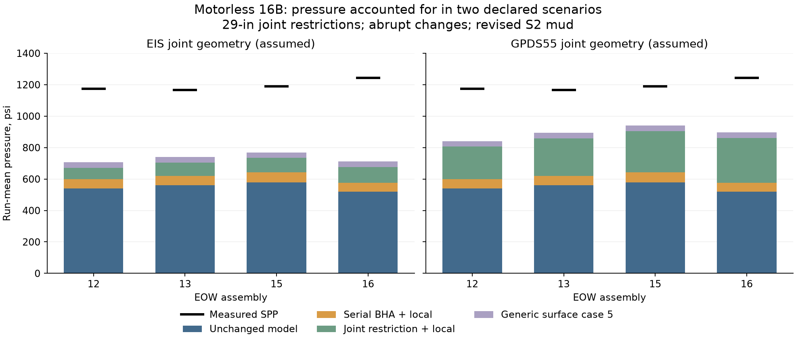

# FORGE whole-well comparison: S3 pre-merge review

S2b and S3 are complete on `forge16b-wholewell`, based on `85f23db51f6661e6ca09bd05c16b9ffb48881d83`. No model function, constant, physical input, saved reference result or tolerance was changed. No coefficient was fitted. Nothing has been committed, merged, pushed, tagged or released.

## Motorless hydraulics result

The modelled pressure has been separated into pipe-body friction, HWDP and lower-BHA friction, bit nozzles, annulus friction and the signed density-column correction. The model has no separate tool-joint or surface-line term. Its lower BHA uses aggregate dimensions and does not represent proprietary steering/MWD operating restrictions.

The [S2b review](../s2b/S2b-review.md) supplies sample-by-sample and per-run tables, including the raw differential on EOW 12, 13, 15 and 16. All 45 frozen samples were replayed under both mud protocols. All 90 replays converged and reproduce their saved S2 temperature endpoints and pressures exactly. External estimates were calculated afterwards and never supplied to a model solve.

| EOW | Samples | Measured mean SPP, psi | Included model, psi | EIS scenario accounted / residual, psi | GPDS55 scenario accounted / residual, psi |
|---|---:|---:|---:|---:|---:|
| 12 | 12 | 1,174.9 | 539.1 | 706.6 / 468.4 | 841.6 / 333.3 |
| 13 | 14 | 1,166.0 | 561.5 | 739.4 / 426.6 | 894.6 / 271.4 |
| 15 | 4 | 1,189.5 | 577.5 | 769.4 / 420.0 | 940.6 / 248.8 |
| 16 | 15 | 1,244.0 | 519.4 | 711.7 / 532.3 | 896.5 / 347.6 |

These two scenarios use the revised mud, assumed 29-in connection restrictions, abrupt geometric transitions and the generic API top-drive surface layout. They are declared alternatives, not selected by agreement or claimed as the as-built string. The archive also retains zero/58-in restrictions, gradual-transition cases, all five historic API layouts and zero surface allowance. The 6,480 sample budgets include both mud versions. Larger allowances can over-account individual samples.

Recorded component dimensions support serial open-passage estimates and local-transition estimates. They do not identify the operating pressure loss of HALO's integrated steering/pulser internals or the float/filter ports. No applicable operating loss curve or port geometry was found. The archive therefore supplies numeric pressure per unit additional loss coefficient at each recorded bore, while leaving the actual tool-specific coefficient and pressure loss unquantified. These terms cannot be assigned an absolute number from the available inputs without an unsupported assumption. The remaining residual is not assigned to a particular tool or to distributed friction.

The source-backed methods, catalogue dimensions and surface-layout assumptions are in the [S2b protocol](../comparison_protocol_s2b.md). Abrupt-transition correlations have a Newtonian turbulent-flow limitation. Revised-mud geometric Reynolds numbers exceed their thresholds, but the Bingham/annular application remains approximate. Original S1 mud has out-of-domain rows which remain explicitly flagged. The pressure-tap location and installed surface schedule are unresolved, so including a complete generic surface layout is conditional.

The raw differential means are +39.65, +15.65, −0.37 and +14.12 psi in EOW 12, 13, 15 and 16, with seven negative sample windows. The channel is neither subtracted nor used to set a loss coefficient in S2b. S2's earlier adjusted-pressure convention remains labelled and preserved.

## Documentation changes

The [validation guide](../../../docs/science/validation.md#forge-16b-whole-well-circulation-comparison) presents the original S1 blind result first, with per-run means, scatter and sensor branches. The earlier trial's fitted-input roles remain explicit. The recovery bound and film sensitivity remain tied to S1 version 1.

The missing-rheology rule is described as a labelled protocol revision, with the original and revised results side by side. The guide then preserves the original 16A blind comparison before presenting its water-rheology sensitivity. It reports that all nine 16A downhole means become too hot, while the mean return discrepancy worsens.

The cross-well section reports the annulus film coefficients and distinct thermal/hydraulic regimes. It preserves the energy-budget pressure convention and distinguishes measured hydraulic power from heat deposited downhole. The ten matched-depth bins and three unmatched bins link to the full input tables. The motorless S2b section gives the included pressure terms, external estimates and unresolved restrictions without assigning a cause to either well's temperature errors.

The [limitations guide](../../../docs/science/limitations.md#circulation-hydraulics-and-heat-input) now states the pressure omissions and the different viscosity treatments used by hydraulics and friction heat. It explains why pump power cannot be added directly as missing downhole heat. The field-comparison range is updated to include the whole-well samples. The [Unreleased changelog](../../../CHANGELOG.md#unreleased) records the evidence and documentation additions without a version change.

## Verification

| Check | Result |
|---|---|
| Fast suite | 616 passed, 104 slow tests skipped, 40.02 s; zero failures/errors |
| New archive-arithmetic checks | 22 passed; saved statistics, every declared branch, sample coverage and pressure sums |
| S2b independent audit | 1,000 serial-component rows and all 6,480 scenario sums verified |
| Original S1/S2 archive preservation | All 66 files in the S2b snapshot unchanged |
| 16A archive preservation | All 48 files unchanged |
| Baseline model/existing input preservation | All 64 files unchanged |
| Published evidence hashes | S1 35, S2 29 and S2b 21 output hashes verified |
| Local/repository links | Passed |
| Strict documentation build | Passed, with no documentation warnings/errors |
| Whitespace / encoding | `git diff --check` passed; no targeted mojibake sequences in tracked UTF-8 text or new archive text |

The fast suite does not rerun the slow physical regressions. These changes add evidence and arithmetic checks; no existing golden or physical regression tolerance was edited. The strict build uses source ref `main` for the unpublished additions and writes outside the repository. It does not deploy the website.

[S3-review.patch](S3-review.patch) shows this stage's reader-documentation changes, the new S2b study/protocol and the new archive-arithmetic tests. Earlier reviewed S0/S1/S2 files remain unchanged and are still uncommitted on this branch. [final-verification.json](final-verification.json) records counts and preservation checks. [commands.md](commands.md) records execution and verification commands. Numerical outputs remain under the external validation archive, outside the installed package data.

Stopped before merge for review.
