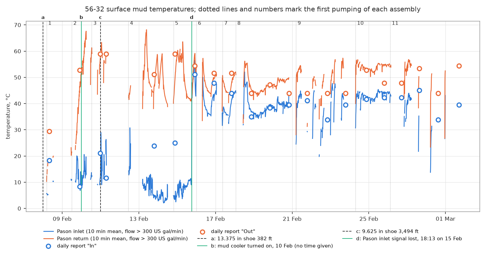
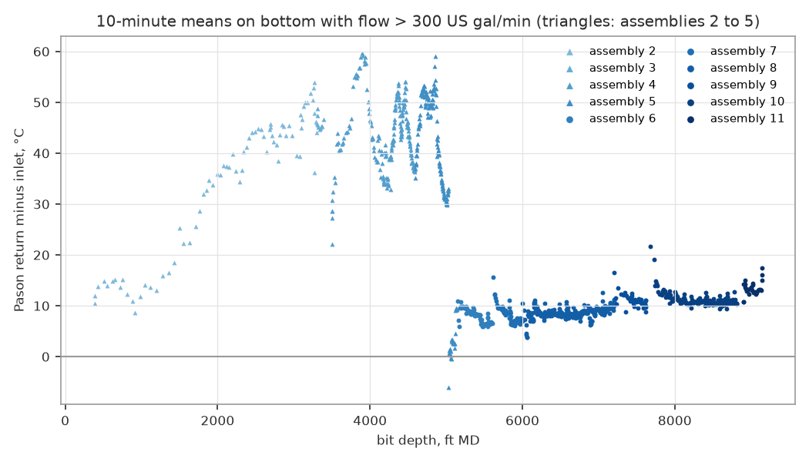
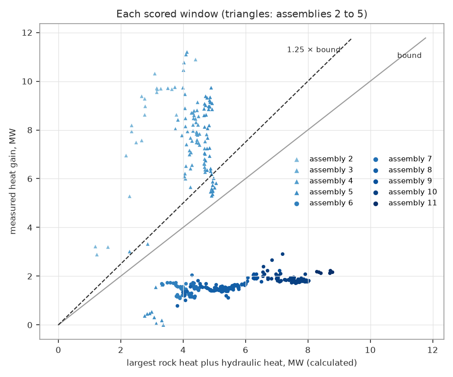
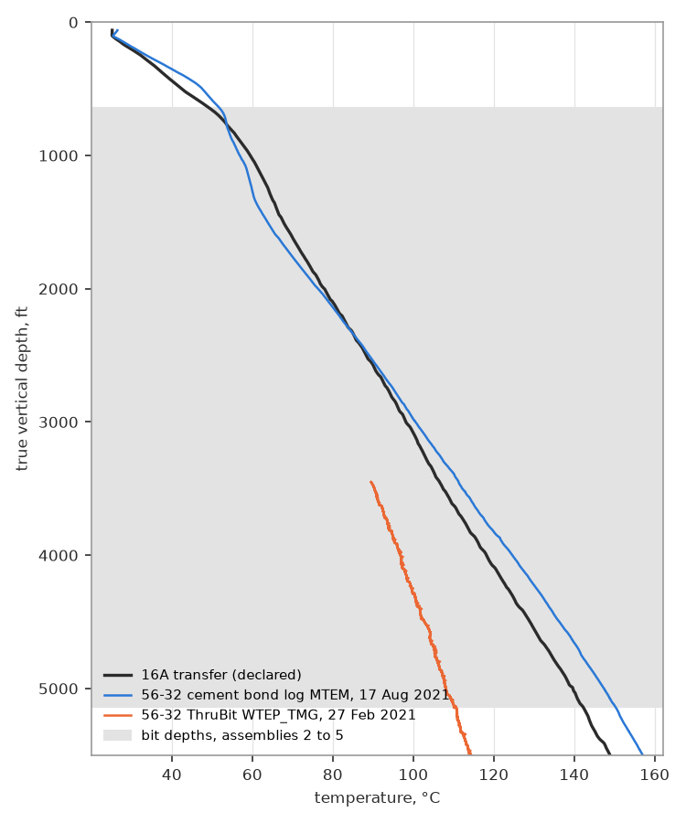
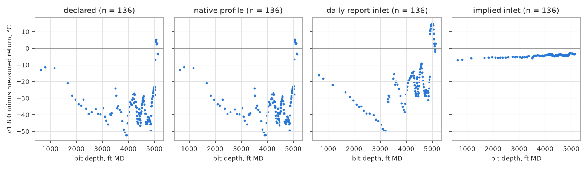

# FORGE 56-32 shallow assemblies: post-hoc diagnosis

This folder examines why the declared v1.8.0 forecast of the 56-32 return temperature misses on assemblies 2 to 5. The work was done after the forecast was scored in `c1b9e27`. The declared score in [`../scores`](../scores/summary.csv) remains the result of the blind test, and no file in `predictions-v1.8.0`, `targets` or `scores` was changed.

Each statement below is labelled *measured* (read from a record), *calculated* (derived from records with a stated method) or *inferred* (a conclusion that the records support without proving).

## Question

On the 136 scored windows of assemblies 2 to 5, drilled from 9 to 15 February 2021, v1.8.0 has a bias of −33.35 °C. On the 265 windows of assemblies 6 to 11 the bias is −0.69 °C. By assembly, the median measured return in the shallow windows is 49.8 to 55.4 °C and the median Pason inlet is 5.2 to 12.1 °C (measured). The question is whether the shallow miss comes from the inputs and measurements, or from physics the model lacks, such as a shallow formation hotter than the 16A profile transferred to 56-32.

## Data

All sources are members of GDR 1295 (`1295.zip`), read in place.

- **Pason records**, one sample a second: `Temp IN` (the inlet), `Temp OUT` (the return), pump output, standpipe pressure, bit and hole depth, and the five mud tank volumes. `MWD Temp` has values only on 23 February. The `_standard` export has temperature columns with no values.
- **Daily drilling reports**: the "In" and "Out" temperatures of the mud table, one sample a day labelled "Mud Pits", and the operations text.
- **Mud logger's morning reports**: "Temp In" and "Temp Out" every 100 ft, and the depth at which the cooling tower was started.
- **End of well report**, searched for the mud system and temperature.
- **Native temperature logs**: `MTEM` in the cement bond log of 17 August 2021, 60 to 9,111 ft MD, and `WTEP_TMG` in the ThruBit log of 27 February 2021, 3,450 to 9,127 ft MD.

## Method

The **measured heat gain** of a window is Q = ṁ c_p (T_return − T_inlet), with Pason means over the window's qualified seconds (calculated). The mass flow ṁ comes from the pump output and the mud density selected for the forecast. The heat capacity c_p is that of BoreTHM's `Mud`: barite and water by mass fraction, water from IAPWS-95 and barite from Robie and Hemingway (1995), averaged between inlet and return temperature.

The inlet here keeps only readings within 0 to 120 °C, the rule the scoring protocol applies to the return. The forecast's inlet input kept every reading other than the null value, so for windows `56b-0172` and `56b-0173` it includes readings from the signal gap described below: 6.6 and 29.3 °C there, against 9.1 and 42.4 °C from in-range seconds. Every other window agrees to within 0.03 °C.

The **hydraulic heat** is the standpipe pressure times the volumetric flow, the whole hydraulic power the pumps deliver (calculated). It bounds the heat that friction adds in the string, the annulus and the bit nozzles.

The **rock bound** is the larger of two calculated upper limits on the heat the rock can give the fluid.

1. `rock_model_W`: the v1.8.0 circulation rerun on the forecast's code, commit `ba56445`, with each setting below moved to the side that raises heat gain. Friction and motor heat are switched off, so the return rise is rock heat alone.
2. `conduction_bound_W`: radial conduction from the same formation profile into a wall held at the inlet temperature, with no film, casing or cement. Each depth's exposure is the smaller of its recorded value and one hour, and at least 1 s. The formation is warmer than the inlet at every depth here, so the fluid in the annulus is never colder than the inlet, and this bounds the rock heat for any annulus temperature profile.

| Setting | Declared forecast | Rock bound | Source |
|---|---|---|---|
| Formation temperature | 16A transfer | the larger of the 16A transfer and `MTEM` at each TVD | [`formation_comparison.csv`](formation_comparison.csv) |
| Casing and cement | steel and cement layers to each shoe | open hole of the drilled diameter; 20 in above the 129 ft conductor shoe | casing records |
| Exposure | recorded circulation clock | one hour at every depth, the model's floor | `T_EXPOSURE_FLOOR` in `model1_coupled.py` |
| Annulus film coefficient | v1.8.0 correlations | multiplied by 100 | see below |
| Rock conductivity | 2.497 W/(m K) | 3.087 W/(m K) | top of `K_ROCK_RANGE`, FORGE granitoid cores (MetaRock 2021, tabulated by Xing et al. 2026) |
| Rock ρc | 2.48 MJ/(m³ K) | 2,680 kg/m³ × 1,091.1 J/(kg K) | highest density and highest heat capacity of the same cores |

Secondary sources give the accuracy of the Dittus-Boelter correlation as about 25 % and of Gnielinski's as about 10 %. The primary statement could not be checked for this work, so the bound removes the film resistance with a multiplier of 100. A run with a multiplier of 1.25 gives a smaller rock bound for assemblies 2 to 5 ([`energy_balance_film1.25_2-3-4-5.csv`](energy_balance_film1.25_2-3-4-5.csv)).

The **formation limit** is the formation temperature at the bit's true vertical depth (TVD) and the highest formation temperature along the open hole below the last casing shoe.

## Classification rule (post-hoc)

This rule was written after the declared score was known and after the energy balance in `energy_balance.csv` had been calculated. It was fixed before any window was classified by it.

For each scored window:

- the measured heat gain is Q = ṁ c_p (T_return − T_inlet), from the Pason means over the window's qualified seconds;
- the rock bound is the larger of `rock_model_W` and `conduction_bound_W`;
- the hydraulic heat is the standpipe pressure times the volumetric flow.

A window is **energy-inconsistent** when its measured heat gain exceeds 1.25 times the sum of the rock bound and the hydraulic heat. Otherwise it is **energy-consistent**.

The 25 % margin is for error in the measured heat gain: 10 % for the flow, which comes from pump strokes, and 15 % for the mud density, its heat capacity and the two temperature readings. The rock bound and the hydraulic heat are upper bounds by construction, so no margin is added to them.

## Results

### Surface record

From 9 to 14 February the daily mean Pason inlet while pumping is 4.2 to 18.0 °C and the daily mean return is 36.1 to 58.4 °C (measured). From 16 to 27 February the inlet is 34.1 to 43.1 °C and the return 45.4 to 54.0 °C. With the pumps off from 13:00 to 18:00 on 14 February the inlet stays at 3.1 to 4.4 °C (measured).

At 18:12:14 on 15 February, with assembly 5 drilling near 5,030 ft at 675 US gal/min, the `Temp IN` channel stops giving valid readings. Until 18:37:19 it records nulls and values from −94.15 to 299.58 °F. The last valid reading before the gap is 48.7 °F (9.3 °C) and the first after it is 106 °F (41.1 °C) (measured). Between 18:12 and 18:30 tanks 1 and 2 gain 14.4 and 10.9 bbl and tanks 3 and 4 lose 27.2 and 15.4 bbl. Pason's tank selection code stays at 31 throughout ([`pvt_tank_selection.csv`](pvt_tank_selection.csv)). The 10-minute mean return is 42.0 °C at 18:00, 42.9 °C at 18:30 and 46.1 °C at 19:00, so the return shows no step of the size of the inlet's (measured). Over the next three hours the inlet and the return rise together, to 56.5 and 58.2 °C at 22:00.

The operating notes ([`report_notes.csv`](report_notes.csv)) give two relevant entries. The 13 February daily report, page 1, says "Mud Cooler were turned on 2-10-2021". The mud logger's reports from 15 February on give "Cooling Tower on @ 3308"; those of 11 to 14 February give 0. The daily report for 15 February records rotary drilling from 12:00 to 23:15 with no entry near 18:12. The mud logger's report divides the same drilling at 5,026 ft, the hole depth at the gap, and gives no reason (measured). No report mentions a heater, steam, a boiler, freezing or a change of surface sensor.

The mud logger's values agree with the Pason channels: before the gap the median difference is 0.0 K for the inlet and +0.2 K for the return over 16 depths (measured). They are probably the same sensors or copies of them (inferred). The daily report "In" is a separate reading. Before the gap it is a median 10.3 K warmer than the Pason inlet (−10.2 to +20.9 K, five days); after the gap the median difference is −0.7 K over ten days ([`source_comparison.csv`](source_comparison.csv)).

### Energy balance

Medians by assembly (calculated, [`energy_by_assembly.csv`](energy_by_assembly.csv)):

| Assembly | Windows | Measured heat gain, MW | Hydraulic heat, MW | Rock bound, MW | Measured / (rock + hydraulic) | Energy-inconsistent |
|---|---:|---:|---:|---:|---:|---:|
| 2 | 21 | 8.6 | 1.05 | 1.68 | 3.03 | 21 |
| 3 | 2 | 9.7 | 1.16 | 2.45 | 2.70 | 2 |
| 4 | 60 | 7.8 | 0.80 | 3.54 | 1.77 | 59 |
| 5 | 53 | 6.7 | 0.84 | 4.00 | 1.43 | 31 |
| 6 | 33 | 1.5 | 0.94 | 2.92 | 0.37 | 0 |
| 7 | 31 | 1.5 | 0.91 | 3.39 | 0.34 | 0 |
| 8 | 110 | 1.5 | 0.91 | 4.34 | 0.28 | 0 |
| 9 | 11 | 1.9 | 1.07 | 5.23 | 0.31 | 0 |
| 10 | 74 | 1.9 | 1.00 | 6.59 | 0.25 | 0 |
| 11 | 6 | 2.2 | 0.99 | 7.54 | 0.25 | 0 |

The conduction bound is the larger of the two rock bounds in every window. The measured return stays below the formation temperature: in assemblies 2 to 5 the median formation temperature at the bit is 88 to 145 °C. The shallow windows therefore do not break the formation limit. They break the limit on the rate at which the rock and the pumps can supply heat.

### Native formation temperatures

`MTEM` lies within −4.5 to +5.0 °C of the 16A transfer from 0 to 2,500 ft TVD and 2.3 to 8.5 °C above it from 3,000 to 5,500 ft (measured, compared with the declared input). `WTEP_TMG` lies 16.6 to 34.4 °C below the transfer; it was logged after the well was circulated to cool it for logging, so it is disturbed (inferred from the 27 February daily report). The forecast rerun with `MTEM` as the formation profile and the declared settings otherwise unchanged moves each shallow assembly's bias by 0.12 °C or less (calculated, [`sensitivity_summary.csv`](sensitivity_summary.csv)).

### Classification and secondary scores

Under the rule, 113 of the 136 windows of assemblies 2 to 5 are energy-inconsistent, and none of the 265 windows of assemblies 6 to 11. The secondary scores below are post-hoc and stand next to the declared score ([`secondary_scores.csv`](secondary_scores.csv)).

| Windows | n | v1.8.0 bias, °C | RMSE, °C |
|---|---:|---:|---:|
| All scored (declared) | 401 | −11.77 | 20.75 |
| Energy-consistent | 288 | −1.73 | 5.54 |
| Energy-consistent, assemblies 6 to 11 | 265 | −0.69 | 1.35 |
| Energy-consistent, assemblies 2 to 5 | 23 | −13.71 | 19.06 |

The 23 shallow windows left by the rule form two groups (calculated, [`classification.csv`](classification.csv)). Thirteen precede the 18:12 gap on 15 February and exceed the bound by factors of 1.08 to 1.21, inside the margin; their bias is −25.05 °C. Ten are centred from 18:30 on; their bias is +1.04 °C and their RMSE 4.02 °C.

### Inlet sensitivities

The shallow windows were rerun with two other inlet temperatures (calculated). These are sensitivities and do not correct the forecast.

| Inlet | Median inlet, °C | v1.8.0 bias, °C | RMSE, °C |
|---|---:|---:|---:|
| Pason (declared) | 8.4 | −33.35 | 35.59 |
| Daily report "In", nearest sample | 23.9 | −17.99 | 24.03 |
| Measured return less 9.13 K | 41.5 | −4.23 | 4.31 |

The 9.13 K is the median measured return minus inlet of assemblies 6 to 11. That case uses the measured return to set its input, so its agreement is partly built in.

## Conclusion

The shallow miss is attributed to the inputs and measurements: the Pason inlet temperature before 18:12 on 15 February does not represent the mud pumped into the well (inferred). The evidence:

- The measured heat gain of 113 of the 136 shallow windows exceeds 1.25 times the largest heat the rock and the pumps could supply, by a median factor of 1.43 to 3.03 by assembly (calculated). In the deep windows the measured gain is at most 0.51 of the bound.
- The native `MTEM` profile is within 5 °C of the 16A transfer over the shallow hole, and using it moves the shallow bias by 0.12 °C or less (measured and calculated). A hotter shallow formation does not account for the miss.
- The inlet channel lost its signal for 25 minutes on 15 February while mud moved between tanks, and returned 32 K higher (measured). The return shows no step of that size (measured). A change in the temperature of the pumped mud would reach the return within about one circulation; a change in the sensor's reading would not (inferred).
- Before the gap the daily mean inlet is 4 to 18 °C, and the reading stays low with the pumps off, while returns with daily means of 36 to 58 °C enter the pits (measured). After it, the inlet follows the return (measured).
- With an inlet near 41 °C, the value after the gap and in the deep runs, the forecast's shallow bias is −4.2 °C (calculated, partly built in).

## Limits

The location of the inlet sensor before and after 15 February, and the line-up of the mud cooler and tanks, are not recorded in the reports read here. A record of either would settle where the sensor was. No downhole temperature exists for the shallow runs, so the temperature of the mud reaching the bit there is not measured. The daily report "In" is warmer than the Pason inlet before the gap; its sampling point is given only as "Mud Pits", and with it as the inlet the shallow windows still carry a bias of −18 °C. The return sensor is taken as representative throughout, on the evidence of the deep runs and the absence of a step at 18:12. The rule's margin and the bounds' settings are choices made for this diagnosis. `MTEM` was logged six months after drilling inside casing and is treated as close to the undisturbed formation.

## Files

| File | Contents |
|---|---|
| [`surface_record.py`](surface_record.py) | Pason pass; writes `surface_record_10min.csv`, `window_surface.csv`, `pvt_tank_selection.csv` |
| [`report_temperatures.py`](report_temperatures.py) | report temperatures and operating notes; writes `report_temperatures.csv`, `report_notes.csv` |
| [`native_temperature.py`](native_temperature.py) | native logs; writes `native_temperature_logs.csv`, `formation_comparison.csv` |
| [`compare_sources.py`](compare_sources.py) | writes `source_comparison.csv` |
| [`model_runs.py`](model_runs.py) | rock bounds and sensitivities on the forecast's code; writes `energy_balance*.csv`, `sensitivity.csv` |
| [`summarise.py`](summarise.py) | the rule and the summaries; writes `classification.csv`, `energy_by_assembly.csv`, `secondary_scores.csv`, `sensitivity_summary.csv` |
| [`figures.py`](figures.py) | the figures in this README |

To reproduce, run the first four scripts with the archive path from the repository root, for example `python -m validation.forge56-32.diagnosis.surface_record 1295.zip validation/forge56-32/diagnosis`. Then run `model_runs.py bound` and `model_runs.py sensitivity` from a checkout of `ba56445` whose package is installed, followed by `summarise` and `figures`.
