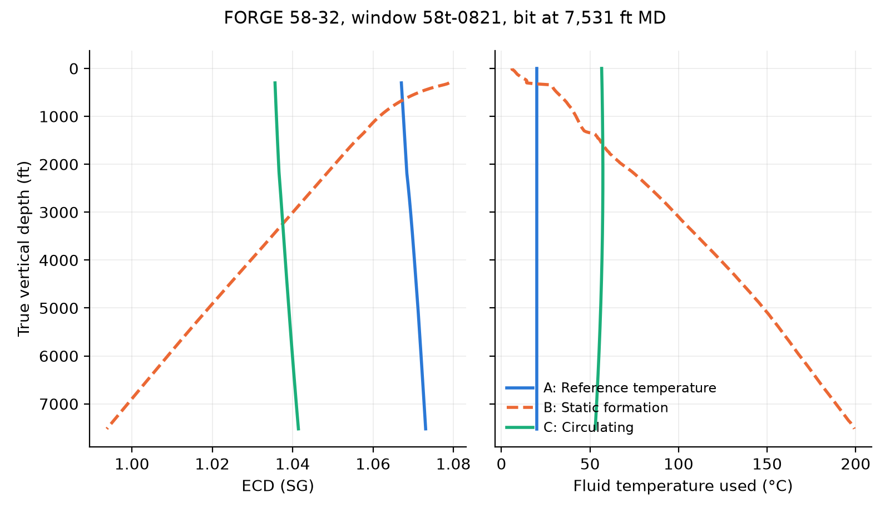

# FORGE 58-32: circulating temperature and ECD at the bit

This calculation asks how much the temperature of the circulating mud changes the equivalent circulating density (ECD) at the bit, and how closely that temperature needs to be known. It is a model calculation. No downhole pressure measurement is used.

## Cases and windows

The bottom-hole pressure while drilling is the static mud column plus the annular friction loss (`pressure.bottomhole_pressure`, state `"drilling"`). It is calculated with the same mud under three temperature treatments:

- A: every depth at the mud's reference temperature, `fluids.T_REF`, 20 °C;
- B: the static formation temperature, the PT118 profile used as the forecast's geotherm;
- C: the circulating temperatures of the BoreTHM 1.9.0 solve.

The windows are drilling windows of the [thermal forecast](../predictions-v1.9.0/README.md) with the primary flow: the deepest of the 760 scored windows, and the scored windows nearest a half and a quarter of its bit depth. The circulation solve was repeated with the committed inputs and gave the committed return temperature exactly in all three.

| Window | Sample | Assembly | Bit, ft MD | Mud, ppg | PV, cP | YP, lbf/100 ft² | Predicted return, °C |
|---|---|---:|---:|---:|---:|---:|---:|
| Shallow | 58t-0074 | 2 | 1,887.74 | 9.1 | 16 | 24 | 53.01 |
| Mid-depth | 58t-0246 | 5 | 3,766.09 | 9.4 | 15 | 20 | 61.33 |
| Deepest | 58t-0821 | 20 | 7,530.58 | 8.6 | 6 | 13 | 56.59 |

The settings are the v1.9.0 defaults: the Herschel-Bulkley annulus with the Erge et al. (2015) transition band, the no-yield power law from PV and YP, and smooth Colebrook pipe friction. Density is the barite and IAPWS-95 water model. PV follows water's viscosity from its 48.9 °C reference, and YP is constant. In cases A and C the annulus is laminar in all three windows.

## Results

ECD at the bit, SG (ppg):

| Window | A | B | C |
|---|---:|---:|---:|
| Shallow | 1.1216 (9.36) | 1.1040 (9.21) | 1.0949 (9.14) |
| Mid-depth | 1.1879 (9.91) | 1.1389 (9.50) | 1.1399 (9.51) |
| Deepest | 1.0731 (8.96) | 0.9937 (8.29) | 1.0414 (8.69) |

| Window | Difference | ECD, SG | ECD, ppg | Total, psi | Column, psi | Friction, psi |
|---|---|---:|---:|---:|---:|---:|
| Shallow | C − A | -0.0266 | -0.22 | -21.8 | -10.3 | -11.6 |
| Shallow | C − B | -0.0091 | -0.08 | -7.5 | -4.3 | -3.2 |
| Mid-depth | C − A | -0.0481 | -0.40 | -78.5 | -28.5 | -50.0 |
| Mid-depth | C − B | +0.0010 | +0.01 | +1.6 | +8.6 | -7.1 |
| Deepest | C − A | -0.0317 | -0.26 | -103.3 | -44.8 | -58.6 |
| Deepest | C − B | +0.0477 | +0.40 | +155.6 | +141.2 | +14.4 |

In every window the hotter column is the lighter one. The annular friction falls as the mud warms, because PV follows water's viscosity. With PV fixed at its 20 °C value in case C, C − A is -10.1, -27.7 and -44.1 psi in the three windows, from density alone. The viscosity gives the rest: -11.7, -50.8 and -59.2 psi.

Case A takes PV at 20 °C, 1.80 times its value at the 48.9 °C reference. With case A's PV at 48.9 °C, C − A is -11.1, -37.5 and -51.5 psi.

## Sensitivity

The whole annulus temperature profile of case C in the deepest window was shifted. The change in ECD at the bit is:

| Shift, °C | ECD, SG | ECD, ppg | Total, psi | Column, psi | Friction, psi |
|---:|---:|---:|---:|---:|---:|
| -10 | +0.0079 | +0.066 | +25.7 | +15.4 | +10.2 |
| -2 | +0.0015 | +0.013 | +5.0 | +3.2 | +1.8 |
| +2 | -0.0015 | -0.013 | -5.0 | -3.3 | -1.7 |
| +10 | -0.0076 | -0.063 | -24.7 | -17.4 | -7.3 |

Density gives about two thirds of the change through the column. PV gives the rest through the annular friction. With PV fixed at its 20 °C value, the friction changes by less than 0.3 psi for any shift.

## Limits

This is a model calculation, and no downhole pressure measurement is used or compared. The mud is a water-based mud, with an annulus temperature at the bit of 53 to 61 °C in these windows; the formation reaches 199 °C at the deepest bit depth. The rheology is the v1.9.0 assumption: PV scaled with water's viscosity, a constant YP, no yield stress at low shear and no measured high-temperature rheology. The calculation does not show the effect in an oil-based mud or at higher circulating temperatures. Cuttings, pipe rotation, eccentricity, surge and swab are not included.

Run `python -m borethm.studies.ecd_temperature` from the repository root to write the CSV files and the figure in this folder.
