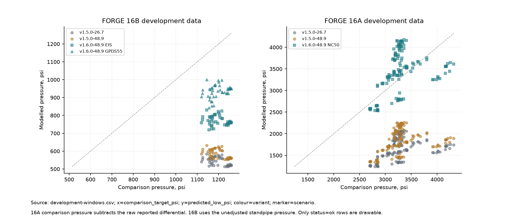
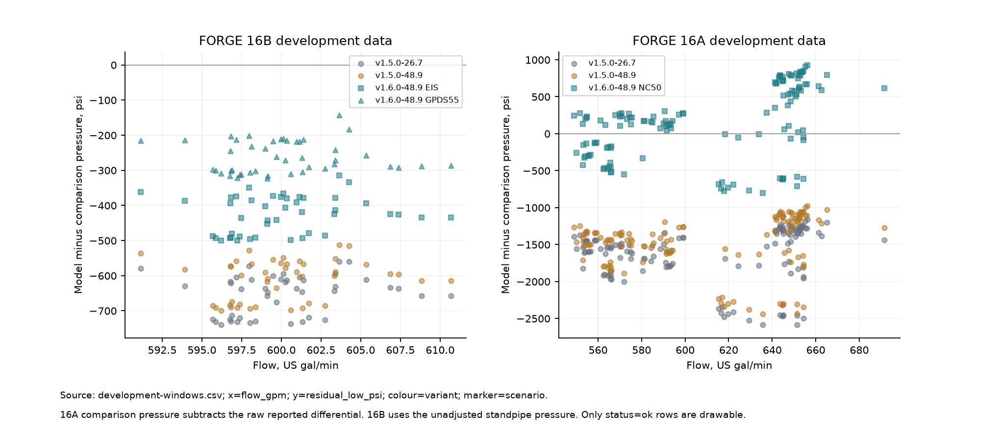
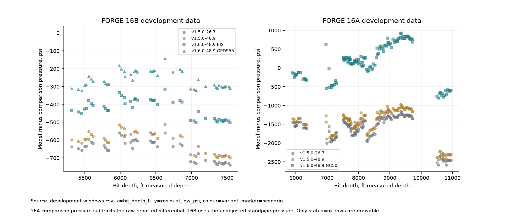
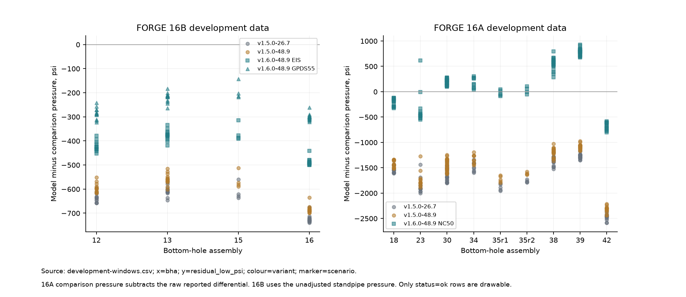

# FORGE development pressure comparisons

These comparisons use the previously examined FORGE 16A and 16B observations as development data. They are not an independent validation of the revised hydraulics. No 56-32 or 58-32 pressure observation is included.

## Results

| File | Contents |
|---|---|
| [development-windows.csv](development-windows.csv) | One row per registered sample, calculation variant and connection scenario, including missing observations and solver flags. |
| [development-events.csv](development-events.csv) | Paired medians for each observation group. |
| [development-bha.csv](development-bha.csv) | Assembly summaries, with equal weight per observation group and separate available/missing counts. |
| [development-differences.csv](development-differences.csv) | All three predictions side by side for each available sample and revised connection scenario, including pressure-budget and temperature differences. |
| [legacy-reproduction.csv](legacy-reproduction.csv) | Original-mode pressure against the archived predictions, with signed differences. |
| [manifest.json](manifest.json) | Calculation identity, runtime versions and input/output checksums. |

The `variant` column separates the original calculation with PV referenced to 26.7 °C, the original calculation with PV referenced to the assumed field convention of 48.9 °C, and the revised calculation with the same 48.9 °C reference. Yield point is unchanged. The `scenario` column identifies the connection geometry. Signed residuals are modelled minus comparison pressure, in psi and percent; a zero comparison pressure has no percentage residual.

In the difference table, `_reference_change` is original-mode 48.9 °C minus original-mode 26.7 °C, `_hydraulics_change` is revised mode minus original mode at 48.9 °C, and `_total_change` is revised mode at 48.9 °C minus original mode at 26.7 °C. These are differences between complete coupled calculations, including their changed temperature profiles.









Vector copies of these plots have the same filenames with an `.svg` extension. Each plot names its source file and columns. Checksums use LF newlines for text files and unchanged bytes for images, so they can be checked across platforms.

## Inputs and calculation

The samples, formation properties, exposure histories and previously fitted thermal parameters come from the [16B rheology and energy comparison plan](../../forge16b/s2/plan.json). The original [16A comparison](../../forge16a/README.md) and [16B comparison](../../forge16b/README.md) describe the observations and their limits. No parameter is fitted in this calculation. The source checksums identify the exact inputs.

The four motorless 16B runs are EOW 12, 13, 15 and 16. Their comparison pressure is the recorded standpipe pressure. The 16A motor runs use recorded standpipe pressure minus the raw reported motor differential, as in the earlier energy comparison. This subtraction does not establish that the channel isolates motor loss. Proprietary operating losses remain unspecified and are flagged in the output.

The original-mode geometry and exposure calculations are retained for the two legacy variants. The revised variant uses the recorded serial components, the declared surface-loss scenario and joint restrictions. On 16B, the EIS and GPDS55 connection scenarios retain the earlier motorless pressure-accounting treatment. On 16A, NC50 denotes the compatible NOV GPDS50 scenario, with a 6.625-in joint OD, 3.25-in bore, 29-in effective restriction length and assumed 31.5-ft pitch. These are catalogue scenarios rather than identified as-built connections. The short bit-body annulus retains the previous aggregate envelope: the bit gauge is not treated as a sealed cylindrical body.

The registered samples here are half-hour observations, not the short off-bottom events defined for the held-out pressure wells. Each sample has its own `event_id`, so the assembly summary gives each available sample equal weight. Repeated observations within one drilling run are not independent experiments. Missing targets remain in the tables and are not solved or included in residual summaries.

## Reproduction

From a repository checkout with the calculation dependencies installed:

```text
python -m borethm.studies.pressure_comparison --output OUTPUT_DIRECTORY
python -m borethm.studies.pressure_comparison --output OUTPUT_DIRECTORY --plot-existing
python validation/hydraulics-v160/build_pressure_archive.py --source OUTPUT_DIRECTORY
```

The entry point saves resumable case records alongside the tables. The archive builder copies the final scientific tables and plots, omits per-case execution durations, calculates the legacy reproduction differences from the earlier archives and writes the checksums. Its optional `--output` selects a separate destination. This comparison does not replace the earlier blind temperature results.

## Sources and licence

The derived observations retain the CC BY 4.0 attribution in the [16A source archive](../../forge16a/README.md#sources-and-attribution) and [16B source archive](../../forge16b/README.md#sources-and-licence): GDR submissions 1283, 1292, 1421 and 1516. Changes here comprise calculation variants, hydraulic geometry scenarios, pressure residuals and aggregation. Original observations and earlier comparison results are unchanged.
