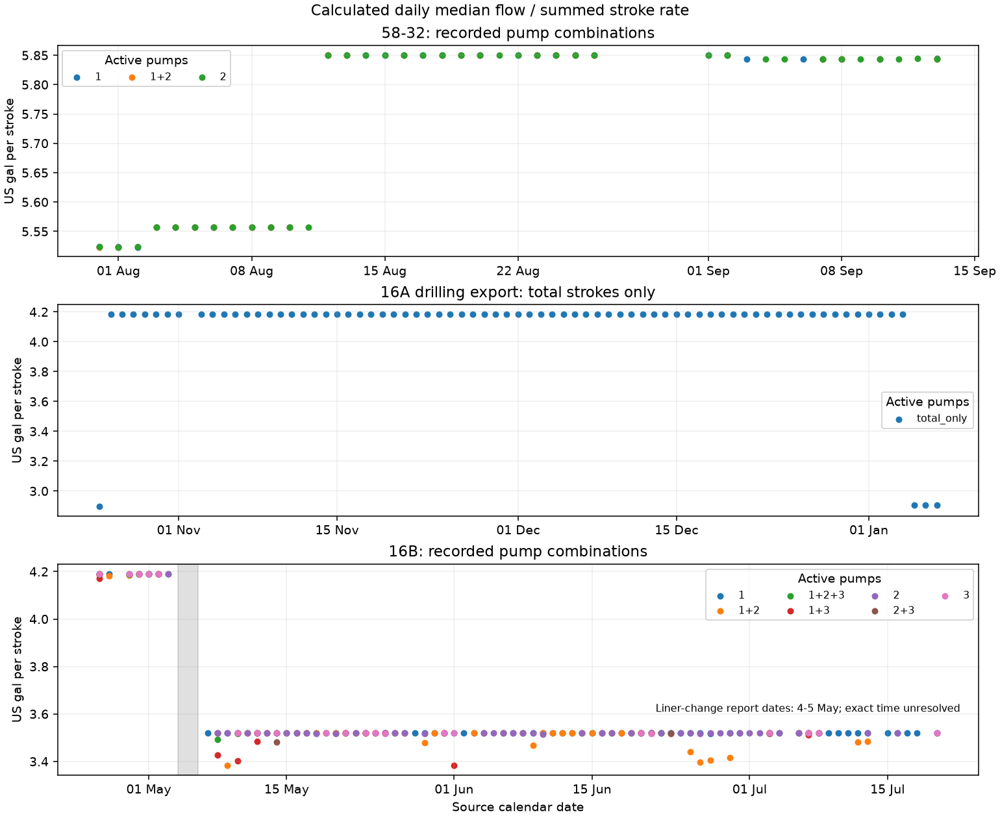

# Pressure-input diagnosis results

**Inferred finding.** The 58-32 flow channel behaves like strokes multiplied by a configured displacement. The available sources do not establish the pump liners, stroke or configuration used in August 2017, so they do not yet supply a corrected flow input. The nozzle records agree with the registered opening area, and the reported density range cannot account for the pressure discrepancy under the declared fixed-factor bound. The pressure-channel comparison with the daily reports leaves its physical measurement location unresolved. No candidate input is adopted.

## A. Pressure channel

**Calculated A1.** [A1-offset-summary.csv](A1-offset-summary.csv), columns `periods`, `native_rows` and `median_pressure_psi`, pools observations after 60 seconds of pump-off settling, requiring at least 60 seconds of retained time. Event scopes extend two hours before and after their registered intervals. [A1-off-periods.csv](A1-off-periods.csv) gives each contributing period and its source row ranges.

| Scope | Qualified periods | Retained native rows | Median pump-off pressure, psi |
| --- | --- | --- | --- |
| 2017-08-03 | 26 | 45875 | 14.61 |
| 2017-08-04 | 37 | 15211 | 26.04 |
| 2017-08-05 | 20 | 14299 | 17.66 |
| 2017-08-06 | 24 | 22935 | 18.42 |
| 58-32-off0081 | 8 | 3431 | 23.76 |
| 58-32-off0084 | 9 | 3557 | 23.76 |
| 58-32-off0092 | 7 | 1334 | 27.95 |
| 58-32-off0096 | 7 | 1441 | 31.38 |
| 58-32-off0162 | 7 | 6153 | 16.89 |
| 58-32-off0163 | 7 | 6573 | 16.89 |
| 58-32-off0192 | 2 | 462 | 24.9 |

**Inferred A1 meaning.** Nonzero pump-off readings are present. They may reflect an offset or retained physical pressure. These values do not identify a dynamic correction or a pressure-tap location. They are small beside the registered model excess, and subtracting a positive offset from the observations would make that excess larger. No offset is applied.

**Measured source records and calculated A2 medians.** [A2-report-comparison.csv](A2-report-comparison.csv) retains all parsed drilling-parameter intervals and their source citations. The report-date calendar rule and depth/on-bottom selection are those declared in the entry method. Of 60 summary reports, 18 explicitly state that they contain no drilling-parameter records. All 42 printed intervals were extracted, and 36 have eligible native observations. The other intervals remain unavailable. Representative report 9–11 values are:

| Report | Report flow, US gpm | Rig median flow, US gpm | Report pressure, psi | Rig median pressure, psi | Native rows |
| --- | --- | --- | --- | --- | --- |
| 10 | 613.0 | 845.09 | 680.0 | 631.09 | 43895 |
| 11 | 613.0 | 840.17 | 675.0 | 677.6 | 46538 |
| 9 | 613.0 | 866.43 | 580.0 | 538.83 | 44612 |

**Inferred A2 meaning.** The rig pressure medians differ from the reports by -41.17, -48.91 and +2.60 psi over these three intervals, while rig flow differs substantially from the repeated report flow. A copied or nominal report-flow entry is possible. This does not establish which flow is correct, or that either reported pressure is the model's standpipe boundary. Calendar and depth matching do not establish exact report-clock alignment. `A2-native-comparisons.csv.gz` (rebuildable externally) preserves every selected row.

**Measured source record.** Report 10 gives pump 1 at 51 strokes/min and 95 psi, then 52 strokes/min and 104 psi. [verified-facts.csv](../sources/verified-facts.csv), `report10_slow_pump1`, cites `1006.zip!58-32_EOWR.zip!58-32_EOWR/DailyDrillingReport.pdf`, PDF p13, line 27.

**Calculated A3.** All qualifying native periods on 5 August are below. [A3-slow-periods.csv](A3-slow-periods.csv) includes source members and row ranges, and differences against both report readings. [A3-slow-by-rate.csv](A3-slow-by-rate.csv) preserves each recorded stroke-rate value.

| Period | Source start, 5 August | Duration, s | Pump 1, strokes/min | Median flow, US gpm | Median pressure, psi |
| --- | --- | --- | --- | --- | --- |
| 1 | 02:21:05 | 53.0 | 51.15 | 284.28 | 96.19 |
| 2 | 02:26:26 | 22.0 | 51.245 | 284.78999999999996 | 100.58 |
| 3 | 04:16:45 | 16.0 | 51.045 | 283.66499999999996 | 102.68 |
| 4 | 09:23:09 | 3.0 | 50.93 | 283.05 | 185.03 |
| 5 | 10:45:59 | 6.0 | 50.91 | 282.95000000000005 | 79.04 |
| 6 | 15:45:35 | 7.0 | 51.0 | 283.46 | 40.91 |
| 7 | 17:10:17 | 17.0 | 51.08 | 283.87 | 94.67 |
| 8 | 17:20:43 | 2.0 | 50.525000000000006 | 280.79999999999995 | 63.78999999999999 |
| 9 | 21:53:46 | 53.0 | 51.15 | 284.28 | 106.49 |
| 10 | 23:53:17 | 7.0 | 50.89 | 282.85 | 104.96 |

**Inferred A3 meaning.** The first three period medians are 96.19, 100.58 and 102.68 psi, against report values of 95 and 104 psi. Other selected periods include 185.03 and 40.91 psi, so those three periods do not establish agreement for the whole selection. None is a sustained one-minute plateau within the narrow stroke-rate range. Their duration and the report's missing exact time prevent a unique assignment of its two readings. The slow-circulation check does not establish an installed displacement or a stable pressure calibration.

## B. Flow derivation and equipment sources

**Calculated presentation.** [Daily flow/stroke medians](daily-ratios.png) plots the archived per-day, per-pump-combination values. Points are not joined across gaps; the shaded 16B dates are report dates, without asserting a clock alignment.



**Calculated B1 coverage.** Each well's `*-flow-manifest.json` supplies these counts and runtimes. Ineligible rows include pumps stopped, missing channels or absent finite flow; they are not discarded using pressure. Exact and rounded records include starts of new source-contiguous segments, so their counts are not counts of equipment changes.

| Well | Native rows | Ineligible ratio rows | Exact ratio records | 0.01-gal/stroke records | Runtime, s |
| --- | --- | --- | --- | --- | --- |
| 58-32 | 3397398 | 1440577 | 1675122 | 8055 | 49.3 |
| 16A | 5827030 | 2610088 | 2293949 | 7687 | 340.5 |
| 16B | 746904 | 471559 | 157824 | 38180 | 24.1 |

**Calculated B1 result.** The [58-32 daily summaries](58-32-ratios-by-day.csv) show median ratios near 5.523 US gal per stroke initially, 5.557 through the registered window dates and 5.850 during later operation. Later September values are near 5.843–5.844. The individual-pump and combined-pump summaries give similar values within each period. `58-32-ratio-changes.csv.gz` (rebuildable externally) preserves every exact ratio change and source row; [58-32-ratio-steps.csv.gz](58-32-ratio-steps.csv.gz) preserves the declared 0.01-resolution changes, including single-row changes. All dates and transient departures remain visible. For the 62 registered windows, the previously calculated 5.5574–5.5576 ratio is reproduced by the source-bin arithmetic in [B4-published-specification-flows.csv](B4-published-specification-flows.csv).

**Inferred B1 meaning.** Repeated ratios across pump combinations and their changes over time support a configured-displacement origin. This is not evidence that the configured value equals actual delivered flow.

**Calculated B2/source gap.** [B2-daily-change-source-comparison.csv](B2-daily-change-source-comparison.csv) gives compact daily/pump-combination associations. The rebuildable `B2-ratio-change-source-comparison.csv` retains every rounded-change record and its source-search outcome. No dated 58-32 pump-liner or displacement-configuration change was identified in the searched reports. That absence also applies to the complete exact-change extract; rounding does not remove it from the archive. The actual equipment changes and their times remain unresolved. The kelly change is a separate recorded surface-equipment event, not evidence of a pump-displacement change.

**Measured B3 source coverage.** [source-documents.csv](../sources/source-documents.csv) and [source-search-pages.csv](../sources/source-search-pages.csv) identify every supplied report page searched, including zero keyword matches. The inventory includes duplicate source copies, which are not independent records. [source-lines.csv](../sources/source-lines.csv) preserves the matching source text and locators. Every supplied relevant 58-32 daily-report page was searched, together with its end-of-well report, bit summary and mud logs. No installed 2017 liner/stroke record was found.

**Measured later specification.** Kenai Drilling's [Rig 10 specification](https://kenaidrilling.com/wp-content/uploads/2024/09/Rig10-Specs.pdf), PDF p1, lists two RS-F-1000 triplex pumps with 6.75-in liners and 10-in strokes. Its PDF creation metadata is dated August 2021. [rig10-public-source.json](../sources/rig10-public-source.json) records its hash and time qualification. No source establishes that those dimensions applied in August 2017. No pump efficiency is supplied by that sheet.

**Calculated B4, qualified arithmetic.** The published dimensions give 4.647364 US gal per stroke at 100% volumetric efficiency. [B4-published-specification-flows.csv](B4-published-specification-flows.csv) gives that arithmetic for every registered window using its recorded summed strokes. These are time-transferred specification values, not corrected 2017 flows. [source-arithmetic.csv](source-arithmetic.csv) also reproduces the triplex formula and illustrative liner/stroke arithmetic; those examples do not identify installed equipment. A hydraulic replay using these later dimensions is not run because the declaration requires a source-established correction for the registered period.

## C. Bit nozzles

**Measured.** The daily bit tables and bit summary identify run 2 as a Smith XR+, 12.25 in, with three 22/32-in jets and printed total flow area (TFA) 1.114 in². The bit summary's dull record does not document an additional open or centre port. [verified-facts.csv](../sources/verified-facts.csv), `bit2_nozzles`, cites `1006.zip!58-32_EOWR.zip!58-32_EOWR/BitSummary.pdf`, PDF p1, lines 6–12. Report 10 also prints bit drop 254 psi and jet velocity 177 ft/s; its full locator is in the same extract.

**Calculated.** Summing three circular nozzle areas gives 1.113670 in², matching the rounded printed area and the registered geometry. **Inferred.** The records provide no numerical area correction. They do not replace an installation sheet or physical inspection concerning a possible extra port.

## D. String and surface equipment

**Measured.** Reports 6–9 give 240 joints of 4-in TSDS ordinary pipe and 15 inventory joints of 4-in HWDP. Reports 8 and 9 give ordinary-pipe nominal weight 14.0 lb/ft, S-135 grade and TSDS40 thread, with HWDP weight 28.0 lb/ft. Report 6 gives G-105 for ordinary pipe with blank weight; its HWDP thread is 3.5FH, followed by 4FH in report 7 and TSDS40 in reports 8 and 9. The source cells and locators are in [verified-facts.csv](../sources/verified-facts.csv), `report6_inventory` through `report9_inventory`.

**Calculated D1/D2 comparison.** The later inventory confirms the primary scenario's nominal 4-in, 14-lb/ft body specification. It does not confirm its 3.340-in body ID, 2.563-in joint ID, 31.5-ft pitch or effective restriction length. The HWDP's 2.500-in bore comes from end-of-well Figure 14, item 17, PDF p29, not from interpreting a thread label. Inventory quantity is distinct from the nine HWDP joints in that BHA. No passage dimension changes.

**Measured D3.** Report 8 records replacing a 4.25-in square kelly with a 5.25-in hex kelly at 360 ft, during 17:30–19:00; attached daily-report PDF p6, line 70. **Inferred.** This supports a kelly-based surface layout. API RP 13D, sixth edition (2009), section 7.3, equation 60 and table 4 distinguishes complete surface cases; the inherited source assessment describes case 5 as a top-drive layout. A kelly's external size does not establish its bore or the other line dimensions, so it cannot select a specific kelly case. The registered case 5 remains unchanged. An as-built layout and pressure-tap location are needed before later adoption.

## E. Mud density

**Measured.** The reports give 8.6, 9.0, 9.1 and 9.2 lb/US gal on 3–6 August respectively; [verified-facts.csv](../sources/verified-facts.csv), `mud_density_*`, gives the report members, pages and line ranges. **Calculated bound.** [E-density-bounds.csv](E-density-bounds.csv) gives each event's pressure-scale factor and density equivalent at fixed velocities and friction factors. The density equivalents span 2.431–3.585 lb/US gal. **Inferred.** The reported range excludes those values, weakening density alone as an explanation under this approximate bound. These are not recomputed fluid properties or adopted inputs.

## F. Other development-well flow records

**Calculated 16A.** [16A-ratios-by-day.csv](16A-ratios-by-day.csv) uses the complete supplied one-second drilling export's `Flow In` and `SPM Total`. Most daily medians are near 4.1832 US gal per stroke; the initial and final recorded days are near 2.898. The raw export lacks per-pump stroke channels, so the declared per-pump comparison is unavailable. The combined total-only reduction is a labelled supplementary substitution. Exact and rounded native changes remain in `16A-ratio-changes.csv.gz` (rebuildable externally) and [16A-ratio-steps.csv.gz](16A-ratio-steps.csv.gz).

**Measured 16A sources.** [16A-pump-records.csv](../sources/tables/16A-pump-records.csv) transcribes six-inch liners and mostly 12-in strokes on BOMCO 1600 pumps. The 29 October report instead prints 11-in strokes; that conflict remains unresolved. The separate downloaded Pason LAS identifies a later well-stimulation job on Frontier 28, not the 2020 drilling record; [16A-pason-job-identity.csv](../sources/16A-pason-job-identity.csv) gives its metadata and source hash. It is not substituted for drilling-period per-pump data. **Inferred.** The drilling export's repeated flow/total-stroke ratio is consistent with a derived flow channel, but does not verify the installed configuration or establish the provenance of every study input channel.

**Calculated 16B.** [16B-ratios-by-day.csv](16B-ratios-by-day.csv) includes every active recorded pump, including the third pump present in the source header. This expands the original two-pump combination labels and is disclosed as a source-driven change after declaration. Common ratios are near 4.1895 before the recorded liner change and 3.5192 afterwards; all other combinations and departures remain visible in the daily and `16B-ratio-changes.csv.gz` (rebuildable externally) and [rounded-change](16B-ratio-steps.csv.gz) extracts.

**Measured 16B source.** Daily reports dated 4 and 5 May describe changing mud-pump liners from 6 in to 5.5 in; [dated-pump-changes.csv](../sources/dated-pump-changes.csv) gives both members and line ranges. The reporting interval and Pason clock do not establish the exact completion time. Stroke length and configuration settings remain source gaps. **Inferred.** The combination of a liner-change record and a changed flow/stroke ratio supports a configured-output origin. No 16A or 16B comparison result, scenario or decision changes.

## Source arithmetic and pressure-scale bounds

**Calculated flow regimes.** [flow-regimes.csv](flow-regimes.csv) groups the existing daily medians by date and pump combination. The approximate regimes are 5.5233 US gal per stroke on 31 July to 2 August, 5.5575 on 3–11 August, 5.8500 on 12 August to 2 September, and 5.843–5.844 from 3 September. Each regime occurs for pump 1 alone, pump 2 alone and both pumps together where recorded. Daily extrema retain transient departures; the regime statements describe daily medians, with small differences between combinations. The table records absent daily combinations through its available-day counts.

**Calculated displacement arithmetic.** [pump-displacement-arithmetic.csv](pump-displacement-arithmetic.csv) gives the source columns and formula inputs. The median of daily pump-combination medians is 5.55750334 in the registered period and 5.84999533 in the later regime, a ratio of 0.95000133. At rounded regime precision, 5.5575 / 5.8500 = 0.9500. **Inferred.** This is consistent with a configured displacement of 5.85 US gal per stroke and a 95% efficiency setting in the registered period, later changed to 100%. The configuration is unverified, and this interpretation supplies no corrected flow.

**Calculated published-pump comparison.** At 100% efficiency, 5.85 US gal per stroke requires `D²L = 573.530753 in³`, about 574 in³. With a 10-in stroke this requires a 7.573181-in liner, about 7.57 in. The later specification lists a 6.75-in liner with that stroke, giving 4.647364 US gal per stroke. **Inferred.** The dimensions differ, but the later sheet cannot establish the 2017 equipment. The backwards-calculated liner is arithmetic for an enquiry, never an equipment input.

**Calculated other-well comparison.** The triplex formula `3 × (π/4) × D² × L / 231` gives 4.406390 US gal per stroke for 6 × 12 in and 3.702591 for 5.5 × 12 in. Using the archived daily summaries:

| Well and period | Representative flow/stroke, US gal/stroke | Theoretical displacement, US gal/stroke | Ratio |
| --- | --- | --- | --- |
| 16A predominant regime | 4.183200 | 4.406390 | 0.949349 |
| 16B before liner change | 4.189541 | 4.406390 | 0.950788 |
| 16B after liner change | 3.519236 | 3.702591 | 0.950479 |

The 16A representative value is the median of all daily total-stroke medians; its initial/final departures remain in the daily table. The 16B representatives are medians of daily pump-combination medians before 4 May and after 5 May, excluding the two reported change dates. The 16B regime ratio is 0.840005, against `(5.5/6)² = 0.840278`. **Inferred.** With a 12-in stroke, the channels are consistent with the recorded liners at about 95% efficiency, and the 16B setting followed the reported liner change. One 16A report's 11-in stroke and the 16B stroke remain unconfirmed. No 16A or 16B result changes.

**Calculated flow-factor bound.** [flow-factor-bounds.csv](flow-factor-bounds.csv) uses [P3 event-budget.csv](../../../forge58-32/pressure-test/results/event-budget.csv), restricted to `scenario=primary`, `cohort=scenario`, `variant=original`. For each event, the diagnostic solves `nozzles × k² + (pipe bore + BHA bore) × k^n + annulus × k + buoyancy = measured median`, for `n=1.75` and `n=1.85`. The original surface term is zero. The terms are event means and the observation is an event median, as in the inherited budget; they are not redefined as matched median components. The equivalent pressure gain is `median_predicted_psi / median_target_psi` from that same row.

| Event | Flow factor, n=1.75 | Flow factor, n=1.85 | Equivalent pressure gain |
| --- | --- | --- | --- |
| 58-32-off0081 | 0.6002 | 0.6101 | 2.5436 |
| 58-32-off0084 | 0.6082 | 0.6178 | 2.5037 |
| 58-32-off0092 | 0.6213 | 0.6309 | 2.3988 |
| 58-32-off0096 | 0.6031 | 0.6131 | 2.5315 |
| 58-32-off0162 | 0.5792 | 0.5915 | 2.6792 |
| 58-32-off0163 | 0.5750 | 0.5874 | 2.7039 |
| 58-32-off0192 | 0.5529 | 0.5661 | 2.8957 |

The factor spans 0.552922–0.630900 across events. This approximate bound uses fixed friction exponents and fixed rheology, with no temperature effect. It is never used as an input and selects no correction. The pressure-gain values are equivalent scale factors, with no calibration inferred.

**Calculated component check.** For off0081, BHA plus annulus is 314.78 psi and nozzle plus annulus is 216.76 psi, each above the measured 205.34 psi. Even including the unchanged -0.052-psi buoyancy term does not reverse either inequality. **Inferred.** Removing either the nozzle or BHA component alone cannot reconcile that event under the recorded remaining terms. The common factor needed across events makes a flow scale the leading candidate; a pressure-channel gain remains possible because independent gauge provenance is unknown. This is an interpretation of development data, without a fitted correction.

## Sweep coincidence and interval depth changes

**Measured sweep record.** [sweep-record.csv](../sources/sweep-record.csv) transcribes `1006.zip!DailyDrillingReports_Well58-32.zip!DailyReportSummaryRpt9-20170804.pdf`, PDF p1, extracted line 64: `23:15 23:45 0.50 1,512 3-5-1 Pumped sweep and circulated for survey.`. **Calculated coincidence.** [sweep-coincidence.csv](sweep-coincidence.csv) places all 12 off0162 windows, 2017-08-04 23:26:40 to 2017-08-04 23:38:40, inside the report's 23:15–23:45 period on 4 August. This is a calendar-clock comparison; independent clock alignment is not established.

**Inferred qualification.** A viscous sweep could increase off0162 pressure and reduce the apparent pressure increment to off0192. The sweep's pressure effect is not quantified. This qualifies the preceding P3 depth-increment argument; its files and interpretation remain unchanged. The on-bottom intervals provide an additional comparison, while also changing flow and operating state.

**Calculated interval differences.** [A2-report-comparison.csv](A2-report-comparison.csv) now includes `median_bit_depth_ft` for every available interval using exactly the original selected rows. [A2-depth-increments.csv](A2-depth-increments.csv) includes all 42 report intervals in date/depth order and differences from the immediately preceding interval. Missing coverage remains unavailable; zero depth differences have no pressure-per-foot value. Selected values are:

| Report | Median bit depth, ft | Median pressure, psi | Median flow, US gpm | Pressure change, psi | Depth change, ft | Pressure change/depth change, psi/ft |
| --- | --- | --- | --- | --- | --- | --- |
| 9 | 1163.07 | 538.83 | 866.43 | 144.88 | 720.61 | 0.2011 |
| 10 | 1735.22 | 631.09 | 845.09 | 92.26 | 572.15 | 0.1613 |
| 11 | 2095.65 | 677.60 | 840.17 | 46.51 | 360.43 | 0.1290 |

The pressure rises from report 9 to 10 and 10 to 11 are 92.26 and 46.51 psi. Their corresponding differences in median depth are 572.15 and 360.43 ft. These ratios describe pooled interval medians. Flow changes and other operating differences prevent treating them as isolated friction gradients.

## Unresolved inputs and later work

**Inferred.** No independently established numerical correction for the registered 2017 period has been found. The inventory provides stronger source support for already used nominal pipe values, and the nozzle area is confirmed, but installed passage dimensions and actual delivered flow remain unverified. No source-derived correction is adopted. [diagnostic-solves.csv](diagnostic-solves.csv) records why the conditional original/working and slow-circulation replays are unavailable; no fitted correction or skill score is calculated.

**Inferred next step.** Obtain the archived 2017 Rig 10 pump/liner and Pason displacement records, together with the pressure-tap location, before proposing a source-based flow correction. [enquiries.csv](enquiries.csv) identifies the relevant custodians and what each record would settle. This entry adds the sweep qualification above while preserving the frozen P3 files and their original interpretation. The installed-pipe work on 16A and 16B can proceed while the 58-32 source enquiries remain unresolved.

## Reproduction and qualifications

**Calculated archive method.** The build scripts rebuild report searches and source transcriptions separately from native rig reductions. `build_checks.py` implements A1–A3 and the density bounds; `build_evidence.py` records the public specification's date qualification and its arithmetic. `finalise.py` assembles source-change associations and the manifest. `manifest.json` at the entry root identifies code, inherited inputs and archive hashes. Raw downloads, inspection pages and execution logs are external.

**Calculated implementation correction.** An initial diagnostic-script version treated reader timestamps as nanoseconds; the source reader used microseconds. Before interpretation was completed, elapsed seconds were made explicit and the checks were rerun. Period-selection tests cover the time conversion, full settling duration and gaps. This is a study-script correction with no package change. All archived pressure-period results use the corrected conversion. The input selection rules are unchanged.

**Calculated storage and rebuild.** Six bulky derived files are rebuildable and are not committed. The entry-root [manifest](../manifest.json), `rebuildable_files`, records each SHA-256, byte size and rebuild command. This includes the three native exact-ratio extracts, `58-32-pressure-inputs.csv.gz`, `A2-native-comparisons.csv.gz` and the full B2 association. The compact daily B2 table and all rounded-change extracts remain committed. The rebuild command requires the original archive filenames and the recorded extraction runtime, and writes outside the repository:

```text
python validation/model-development/entry-11/rebuild_bulk.py --raw58 1006.zip --raw16a 1283.zip --raw16b 1516.zip --output ../entry-11-bulk
```

The wrapper runs the committed reducers and verifies every bulk hash. `build_source_bounds.py --raw58 1006.zip` reproduces the added arithmetic and sweep extract after the interval summary is rebuilt. `finalise.py --bulk-output ../entry-11-bulk` assembles the compact archive, moves bulk outputs outside the checkout and regenerates manifests. Raw archives and derived bulk files remain external.
