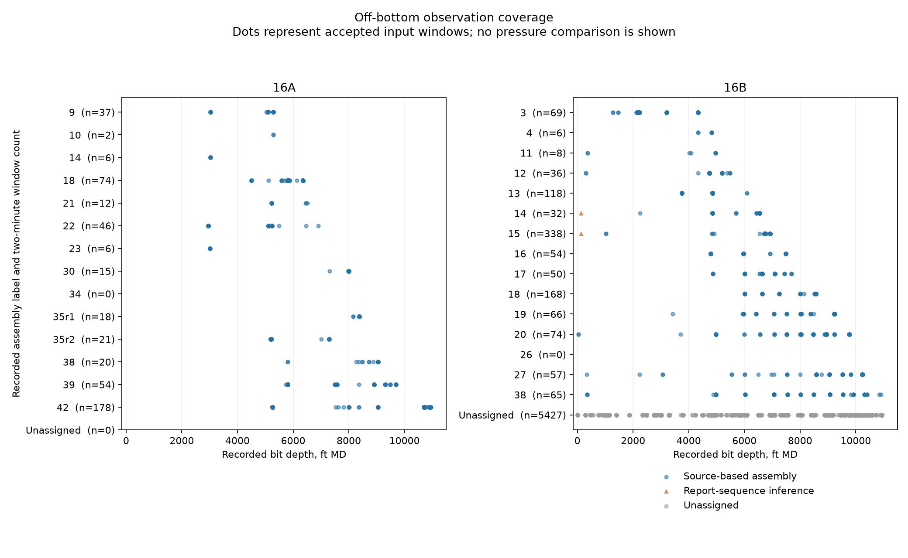

# Pressure diagnosis inputs

Standpipe pressure is the pressure recorded in the surface supply to the drill string. This archive prepares observations for separating losses associated with equipment from losses that increase with pipe length. It contains no new modelled well pressures and no pressure-error score.

The calculation baseline is `a0819322610b772a259a2c48a8050495e6e43fd6`. The [development declaration](../../../docs/science/model-development.md#31-october-2026-entry-9-pressure-diagnosis-declaration) describes the questions and the preliminary observations seen before this archive was prepared.

## Contents

| File | Purpose |
|---|---|
| `references.json` | Source locators, applicability and remaining source gaps |
| `tool-source-inventory.csv` | Every component in the frozen assembly audit, with additional reported 16A components and explicit missing assembly mappings |
| `candidate-scales.csv` | Illustrative circular-pipe friction-factor calculations; no measured well pressure enters them |
| `16b-assembly-intervals.csv` | Reported operation intervals, with PDF locators and separate inferred assignments |
| `inputs/16a-channel-coverage.csv` | Non-null channel counts in both standardised 16A rig exports |
| `inputs/16a-source-coverage.csv` | Bit-depth coverage of each Sanvean recording period |
| `inputs/16a-observations.csv.gz` | Sanvean depths and flow, joined to rig pressure and pump strokes by minute |
| `inputs/16b-observations.csv.gz` | Selected original 10-second Pason channels across the downloaded campaign |
| `inputs/16b-excursions.csv` | Depth-based excursion labels and all ambiguous assembly candidates |
| `inputs/16a-steady-windows.csv`, `inputs/16b-steady-windows.csv` | Observation-only two-minute reductions |
| `inputs/coverage.csv` | Counts and depth coverage by assembly, including zero-count and unassigned groups |
| `inputs/16a-pump-displacement.csv`, `inputs/16b-pump-displacement.csv` | Daily flow-to-stroke ratios, with two explicitly assumed triplex reference displacements |
| `inputs/manifest.json` | Archive hashes, input hashes, output hashes and exclusion counts |

The labels identify the recorded bottom-hole assembly (BHA). Dots show window-mean bit positions, with gaps left visible. `plot_inputs.py` rebuilds this figure from the CSV extracts and requires Matplotlib.

## Sources and rebuilding

The source data are University of Utah FORGE datasets [GDR 1283](https://gdr.openei.org/submissions/1283) and [GDR 1516](https://doi.org/10.15121/1998591), CC BY 4.0. The original downloads remain unchanged. The existing Sanvean extracts originate in GDR 1292 and retain their [source description](../../forge16a/README.md). Manufacturer documents are cited in `references.json`; their PDFs are not redistributed here.

Run `build_extracts.py` with `--raw` naming the directory containing `1283.zip` and `1516.zip`, and `--scratch` naming a directory outside the repository. `--output` selects a separate destination for a rebuild. A reusable `16B_Pason.zip` is verified against the original source manifest before it is used. Large CSV members are streamed. Gzip metadata and CSV newlines are fixed for reproducibility.

`build_inventory.py` rebuilds the component-source inventory and the four illustrative friction cases from committed inputs. These scripts import no well model. They do not replace an archived blind result.

## Selection and assignment

A candidate window is a clock-aligned, non-overlapping two-minute bin with twelve 10-second observations. Every observation must have flow above 100 and at most 2,000 gpm. The flow range within the bin must be at most 5% of its mean. The bit must remain within a 5-ft range and at least 10 ft above the recorded hole bottom.

The first 30 seconds after a pump start, a time gap above 15 seconds, or a flow step greater than the larger of 20 gpm and 5% are excluded. This is an input-based delay; it does not establish that gel breaking has ended. No pressure-stability test or temperature threshold selects a window. Missing pressure or temperature is retained and counted separately.

For 16B, an excursion is separated by an observed visit to 1,000 ft or shallower. This shallow-visit marker leaves the actual surface arrival unresolved. Reported incoming-assembly starts also separate excursions, using the definite operation intervals in `16b-assembly-intervals.csv`. Mixed-operation inferences do not create these boundaries. A drilling-depth anchor requires bit depth within 5 ft of hole depth, circulation, and an advance beyond the deepest earlier drilling observation. Its hole depth must lie more than 5 ft inside a reported run interval. A candidate cannot precede its reported incoming-equipment start. This prevents a rounded-depth boundary crossing from naming equipment before its documented arrival. An excursion takes an assembly only when it has exactly one such candidate. Otherwise its assignment remains unresolved.

An excursion label alone does not identify an assembly at 1,000 ft or shallower. `16b-assembly-intervals.csv` supplies independent report intervals where incoming equipment is identified. A row must lie within the half-open reported time interval and within 20 ft of the report's rounded hole depth. No extra clock shift or extension of a time interval is applied. These labels are attached to the individual observations before reduction.

Two reports combine outgoing-equipment removal and incoming-equipment makeup in one block. Their new-assembly labels are marked `report sequence inferred`; the exact exchange time remains unknown. They are secondary observations and are excluded from the primary pressure comparison. Other shallow observations remain unassigned, with a blank assembly and an explicit status. No label is inferred from pressure. The recorded motor-use channel is retained separately from the reported assembly motor flag.

The 16A assembly labels are the documented Sanvean recording periods. `source_row` is the row of that committed Sanvean CSV. Rig pressure and pump strokes are means of the original rig rows with the same minute timestamp; `rig_source_row_first` and `rig_source_row_last` locate those rows. Repeated 10-second pressure values within a minute are not independent pressure measurements. No additional clock shift is fitted.

## Coverage limits

Both the 608,676-row 10-second standard export and the 5,827,030-row 1-second standard export have zero populated `Bit Depth` and `Measured while Drilling Tool Depth` values. The raw non-standard export has no bit-depth field. Its hole-depth field cannot supply a trip's bit position. The Sanvean recordings supply some off-bottom observations, but no near-surface trip coverage. Their actual depth limits are in `16a-source-coverage.csv`.

The 16A rig `MUD TEMP` channel is carried in `temp_out_F` as a return proxy. The original [rig-channel comparison](../../forge16a/rig_mud_channel_matches.csv) supports that interpretation, but it is not an independently labelled return sensor. There is no time-resolved inlet channel in these rig exports. `temp_in_F` remains blank. The depth-indexed mud log is not substituted as a contemporaneous trip inlet. The near-surface 16A comparison remains unavailable. For the per-length and flow-step diagnostics, the development declaration specifies an isothermal bracket from the measured Sanvean top-sub and bit-box temperatures and this return proxy. The existing Sanvean source rows supply the downhole temperatures without adding channels to these observation extracts.

No eligible window was found for 16A BHA 34 under the declared rule. Some 16B assemblies and excursions remain unassigned. Later non-drilling operations are retained in the observation archive and cannot be scored as a named drilling assembly without an independent assignment.

## Equipment information and its limits

The 16B reports dated 4 and 5 May record the change from 6-inch to 5.5-inch pump liners. A 12-inch stroke and 95% efficiency on 16B have not been established by an equipment record. The corresponding 16A arrangement is recorded in the 18 December pump table. A conversion inferred from flow and pump-stroke channels is not an independent measurement of delivered flow.

The displacement tables use raw 16A total pump strokes and the sum of the three individual 16B pump-stroke rates. They require flow above 100 and at most 2,000 gpm, and a positive stroke rate at most 500 per minute. Daily quartiles retain variation. The reference volume is three piston swept volumes per triplex revolution, multiplied by the declared efficiency and converted using 231 cubic inches per US gallon. Both reference liner sizes are shown on every date; neither is assigned from pressure agreement.

The HALO manufacturer sheet identifies an integrated pulser and steering tool but supplies no operating loss curve. Adding a second generic pulser could count the same equipment twice. Other installed tool curves and valve open areas remain unidentified. A generic manufacturer's example is not a bound on every installed tool.

The NC50 and EIS/GPDS dimensions are catalogue scenarios. No inspected tally identifies the installed connection machining. The EPA roughness value describes new steel water pipe; it is an illustrative scenario, with no claim that the drill pipe has that roughness. Surface high-pressure line dimensions and the exact pressure-tap location remain unresolved.
